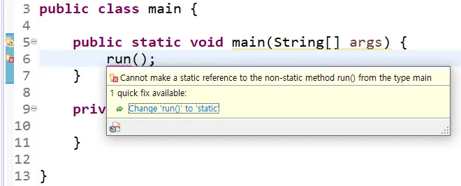
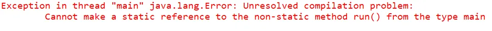

> 이 글은 2020-12-08에 티스토리 블로그(leirbag.tistory.com/17)에 처음 작성한 글을 옮겨온 것입니다.

자바를 처음 시작하시는 분들이 자주 범하는 오류입니다.

```java
public class main {

	public static void main(String[] args) {
		run();
	}

	private void run() {
		System.out.println("Leirbag");
	}

}
```

이 코드에서 실행을 하게되면 다음과 같은 오류가 발생합니다.



<table><tbody><tr><td>Cannot&nbsp;make&nbsp;a&nbsp;static&nbsp;reference&nbsp;to&nbsp;the&nbsp;non-static&nbsp;method&nbsp;run()&nbsp;from&nbsp;the&nbsp;type&nbsp;main</td></tr></tbody></table>



이렇게 run()을 호출할 수 없다는 경고문이 뜨게 됩니다.

이유가 무엇일까요?

main메소드는 static 메소드로써, 클래스 객체 외부에 존재하는 메소드이기 때문입니다.

자바 프로그램이 처음 시작할 부분을 정해야 하는데 그것은 클래스 밖에 존재 해야 해당 클래스를 실행할 수 있습니다.

왜냐하면 아직 이 main클래스가 호출되지 않았기 때문입니다.

즉, static이 붙지 않은 run이라는 객체 메소드는 main 클래스가 호출된 이후에 존재할 수 있는 메소드이므로

아직 존재하지 않는 것이나 마찬가지입니다.

반면에 main메소드는 static이 붙었기 때문에 이 클래스가 불린적이 없더라도 존재할 수 있는 것입니다.

그렇다면 어떻게 해야할까요?

```java
public class main {

	public static void main(String[] args) {
		main my = new main();
		my.run();
	}

	private void run() {
		System.out.println("Leirbag");
	}

}
```

이렇게 수정해주면 오류가 발생하지 않고 메소드를 정상적으로 불러올 수 있게 됩니다.

static인 main메소드에서 main이라는 클래스를 my라는 이름으로 호출하고

그 my에 들어있는 run() 메소드를 호출하겠다는 의미입니다.

따라서 run()메소드가 정상적으로 작동하여 run 안에 들어있는 값을 출력할 수 있게 되는 것입니다.
