> 이 글은 2021-01-12에 티스토리 블로그(leirbag.tistory.com/23)에 처음 작성한 글을 옮겨온 것입니다.

안드로이드 스마트폰의 고질적인 문제 중 하나인 소프트웨어 지원기간이 짧음을 해결할 수 있는 방법이 있습니다.

안드로이드는 아이폰과 다르게 OS 태생 자체가 커스텀하기 쉽게 되어있습니다.

안드로이드의 장점을 활용하여 단점을 커버할 수 있는 것이죠.

갤럭시 A7 2016의 소프트웨어 지원기간은 안드로이드 7.0에서 끝이 난지 오래입니다.

하지만 xda-developers에 이 기기에 안드로이드10을 설치할 수 있는 방법이 올라와 있어 소개드립니다.

다음과 같은 순서로 따라오시면 아무 문제 없이 설치하실 수 있습니다.

<table><tbody><tr><td>주의! 갤럭시 계열 스마트폰의 경우 메인보드의 녹스 워런티가 깨집니다. KNOX 워런티는 메인보드의 eFUSE라는 퓨즈의 연결 여부를 기반으로 판단하며, 순정 갤럭시 소프트웨어가 강제로 수정되는 경우 메인보드에 있는 일부 퓨즈를 끊어버려 하드웨어의 특정 값이 다르게 나타나게 하여 루팅 여부를 판별하는 장치입니다. 녹스 워런티가 깨지는 경우, 스마트폰에서 보안을 요구하는 앱(은행, 보안폴더, 증권, 등등)을 사용할 수 없게 됩니다. 또한, 커스텀롬에서 순정롬으로 복구한다고 하더라도 메인보드의 일부가 이미 변형된 상태이므로 워런티를 복구할 수 없습니다! 설치하기 전 반드시 고민하세요!</td></tr></tbody></table>

## 1\. Odin (오딘) 다운

[odindownload.com](https://odindownload.com/)

> [**Download Odin 3.13.1 - Samsung Odin download with ROM Flashing Tool**](https://odindownload.com/)  
> Samsung Odin is the ROM Flashing tool for SAMSUNG Android Smartphone and tablets devices. Including Samsung Galaxy Note, Samsung Galaxy S8 etc. You can get Latest Odin from our Odin Download dedicated page. Download Odin and flash / Install Custom RO

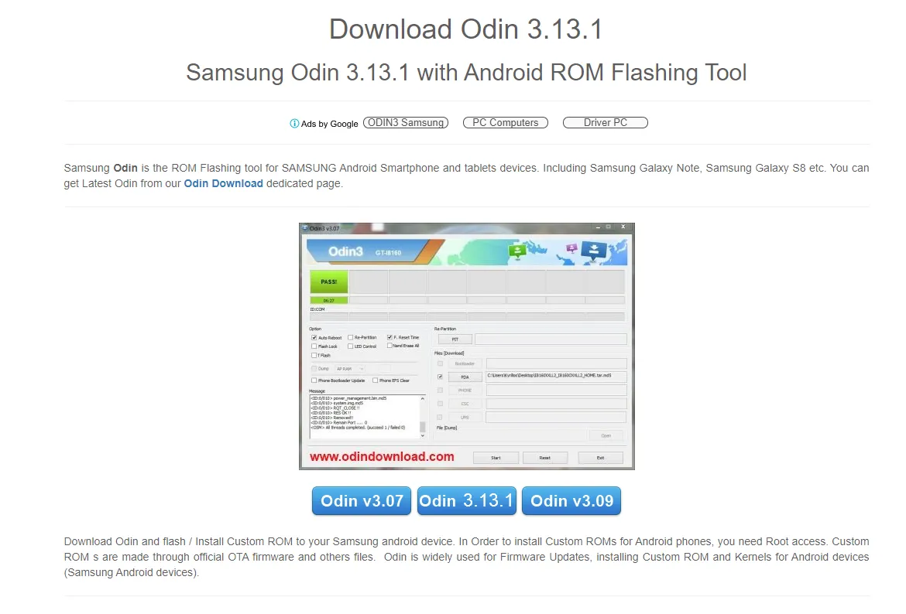

저는 여기에서 Odin 3.13.1을 선택했습니다.

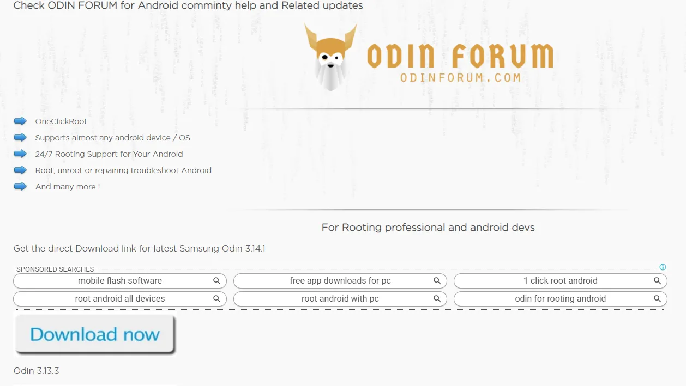

Download now버튼을 누르면 Odin3\_v3.14.1.zip이 설치됩니다.

(분명 3.13이라고 해놓고 3.14가 받아지는 이유는 모르겠음)

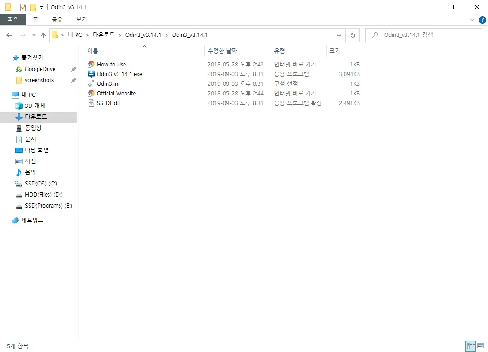

압축을 푸시면 Odin3 v3.14.1.exe가 있습니다.

실행시켜주세요

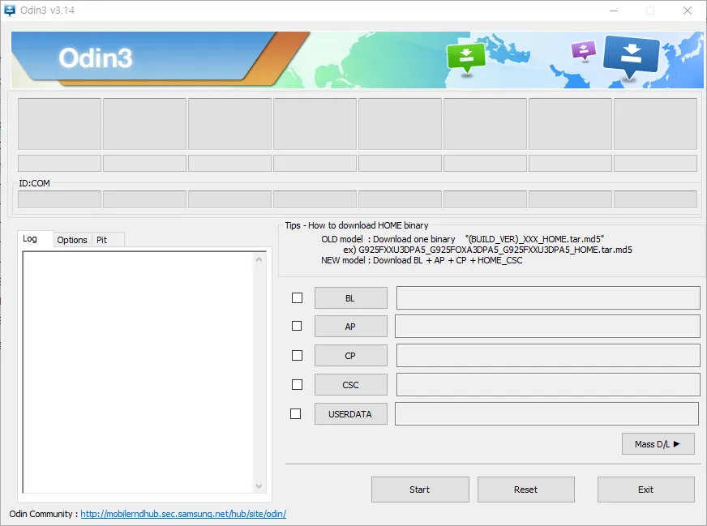

실행시키면 이런 화면이 나옵니다. 일단 이대로 둡니다.

## 2\. TWRP 다운

[dl.twrp.me/a7xelte/](https://dl.twrp.me/a7xelte/)

> [**Download TWRP for a7xelte**](https://dl.twrp.me/a7xelte/)  
> Team Win strives to provide a quality product. However, it is your decision to install our software on your device. Team Win takes no responsibility for any damage that may occur from installing or using TWRP. We recommend downloading the latest version of

링크 타고 들어오셔서

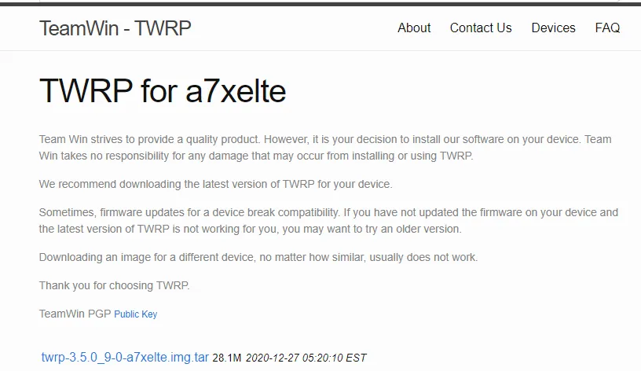

tar파일을 받습니다.

## 3\. Odin으로 TWRP를 스마트폰에 주입

TWRP 프로그램을 오딘을 이용해서 스마트폰에 주입시켜야 하는데

저는 이미 순정 갤럭시를 날려버려서 이미지가 없습니다 ㅠ

일단 스마트폰을 키시고

설정 -> 휴대전화정보 -> 소프트웨어 정보

이렇게 진입을 합니다.

그다음, 빌드번호를 약 10회 정도 연타해주면 개발자옵션이 활성화됩니다.

다시 설정 메뉴에 가 보시면 하단에 개발자옵션이라는 메뉴가 활성화됩니다.

해당 메뉴에 진입하신 후

1\. OEM 잠금 해제를 활성화

2\. USB 디버깅 활성화

여기까지 해주시고 휴대전화를 종료합니다.

(사진이 없어서 이해가 잘 안 되시는 분은 다른 분 블로그인 [palpit.tistory.com/entry/%EA%B0%A4%EB%9F%AD%EC%8B%9C-S8-%EB%A3%A8%ED%8C%85%ED%95%98%EA%B8%B0-TWRP-%EC%84%A4%EC%B9%98%EA%B9%8C%EC%A7%80](https://palpit.tistory.com/entry/%EA%B0%A4%EB%9F%AD%EC%8B%9C-S8-%EB%A3%A8%ED%8C%85%ED%95%98%EA%B8%B0-TWRP-%EC%84%A4%EC%B9%98%EA%B9%8C%EC%A7%80)

이곳을 참고해주시기 바랍니다.)

위 세팅이 끝나고

휴대전화가 종료됐다면 **볼륨 하 + 홈버튼 + 전원 키를** 동시에 꾹 누릅니다. (누름 상태를 약 5초간 지속)

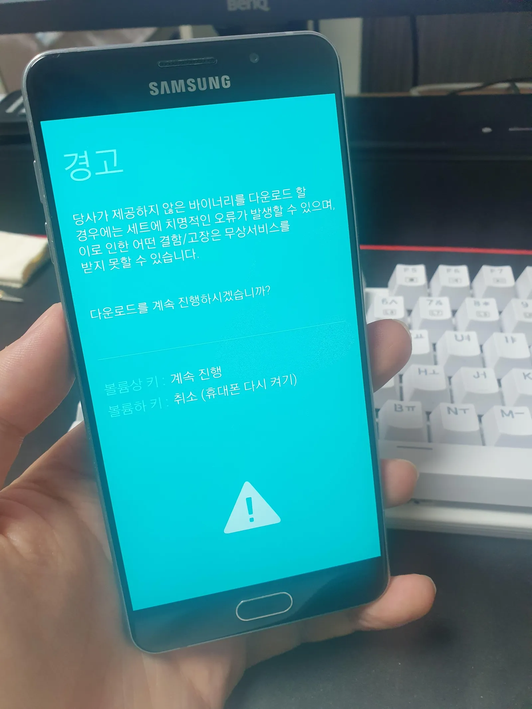

볼륨 상 키를 누르셔서 계속 진행합니다.

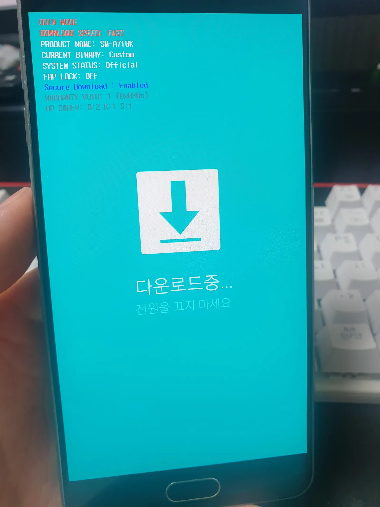

이 화면이 나왔다면 스마트폰과 PC를 USB 케이블로 연결해줍니다.

연결하면 연결됐다고 Odin Log에 기록이 뜹니다.

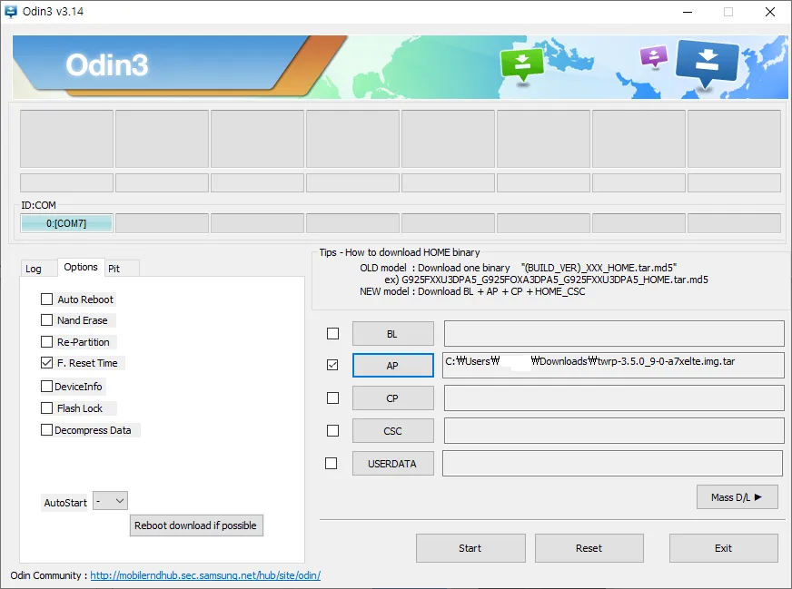

Options에 들어가서 Auto Reboot를 **반드시 해제**합니다.

AP를 체크하시고, 아까 다운로드하였던 tar파일을 넣어줍니다.

그다음 Start를 누르시면

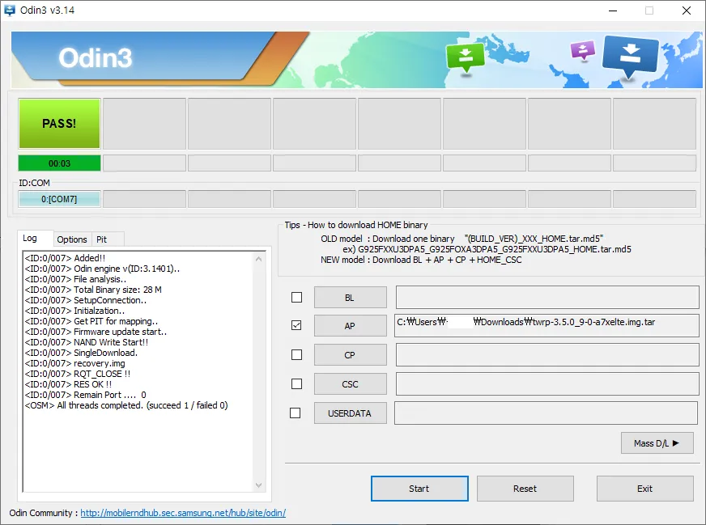

이 화면이 나와야 정상입니다. (이제 오딘을 종료하셔도 좋습니다.)

그 상태로 **볼륨 하 + 홈버튼 + 전원 키를** 꾹 눌러주면 다운로드 모드에 있던 스마트폰이 종료됩니다.

이번에는 **볼륨상 + 홈버튼 + 전원 키를** 약 10초간 눌러줍니다. (이번에는 볼륨 상입니다!)

그러면 다음과 같은 화면이 나옵니다.

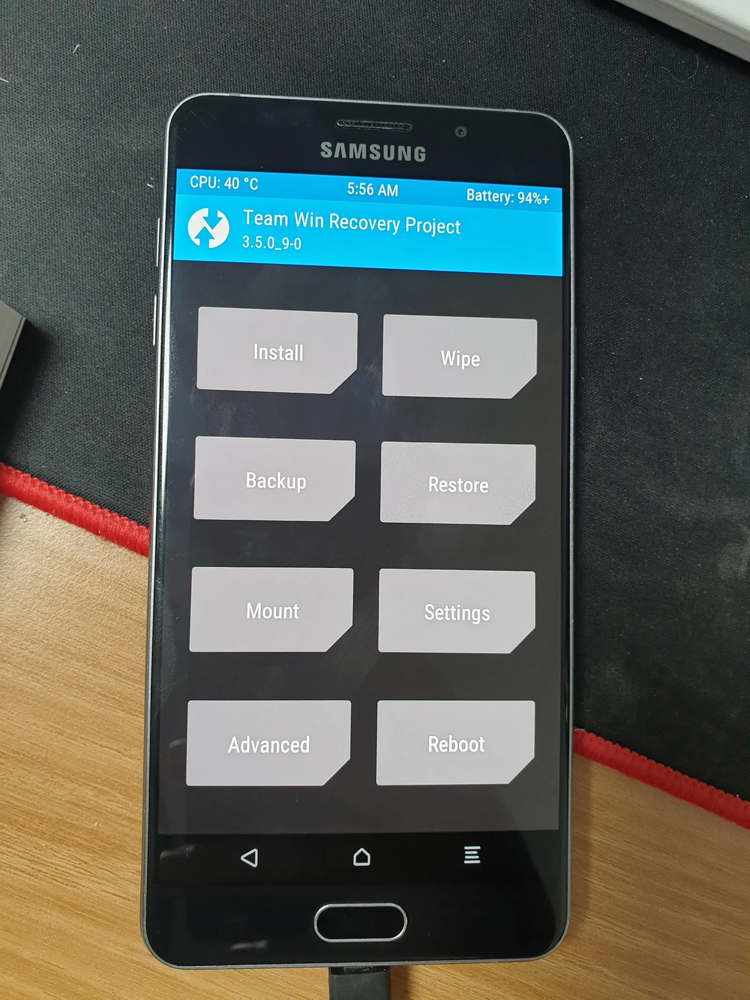

Wipe 누르시고 Format Data 누르시고, yes라고 직접 치신 다음 확인 버튼을 누르면 스마트폰이 초기화됩니다.

여기까지 한 것들을 정리하자면

안드로이드(갤럭시)에 들어있는 기본 리커버리를 사용하지 않고

TWRP라는 프로그램을 사용할 수 있게 작업한 것입니다.

그 작업은 오딘이라는 프로그램으로 한 것입니다.

저는 삼성 AS 직원이 아니라 자세히는 모르겠지만, 오딘은 삼성 수리점에서 쓰는 프로그램과 거의 일치한다고 합니다.

따라서 메인보드에 접근도 쉽게 가능한 것으로 보입니다.

다음으로 할 것은 커스텀롬(Lineage OS)을 설치하고 구글 기본 앱을 설치하는 것입니다.

## 4\. LineageOS와 opengapps 다운로드하기

[download.lineageos.org/a7xelte](https://download.lineageos.org/a7xelte)

> [**LineageOS Downloads**](https://download.lineageos.org/a7xelte)  
> Galaxy S4 (GT-I9505/G,SGH-I337M,SGH-M919) jfltexx

최신 버전 다운로드하여줍니다.

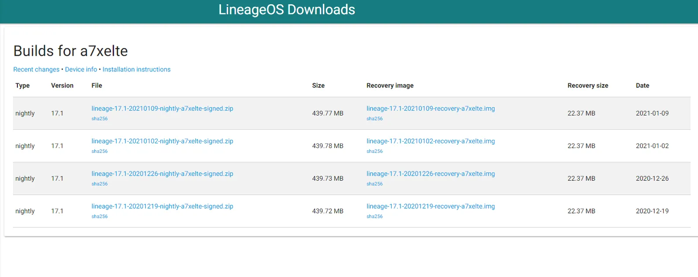

*lineage-17.1-20210109-nightly-a7xelte-signed.zip*

zip으로 된 것을 받아주세요

다운이 완료됐다면

[opengapps.org/](https://opengapps.org/)

> [**The Open GApps Project**](https://opengapps.org/)

여기로 들어오셔서

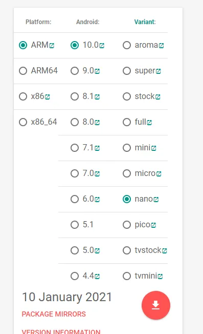

*open_gapps-arm-10.0-nano-20210108.zip*

이것처럼 ARM 10.0 nano로 설정해주시고 다운 버튼을 눌러주세요

그러면 zip 파일이 저장될 것입니다.

이렇게 저장된 두 파일을 스마트폰에 넣어줄 것입니다.

아마 지금 PC의 파일 시스템을 보시면 Galaxy A7(2016)이라는 장치가 나오실 것입니다.

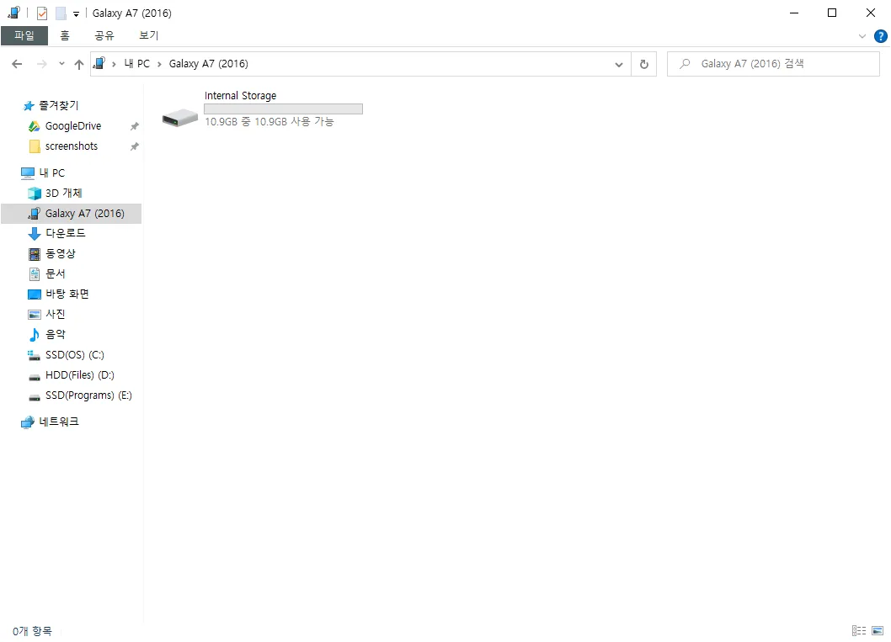

이렇게 나오면 Internal Storage에 들어가셔서 방금 다운로드한 두 zip을 넣어줍니다.

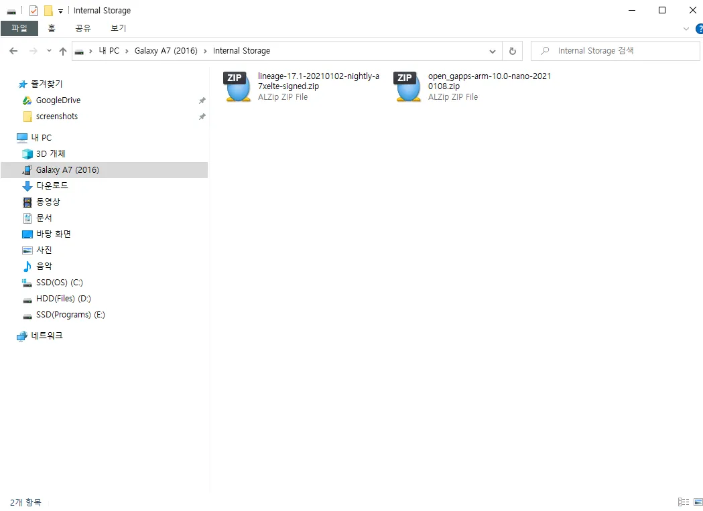

## 5\. LineageOS 설치

다시 스마트폰을 보시고

홈에 있는 Install 메뉴에 들어가 보면 파일 두 개가 들어온 것을 확인할 수 있습니다.

(아까 Wipe 화면에서 멈춰있다면 뒤로 가기 키를 누르면서 메인 화면으로 돌아오시면 됩니다.)

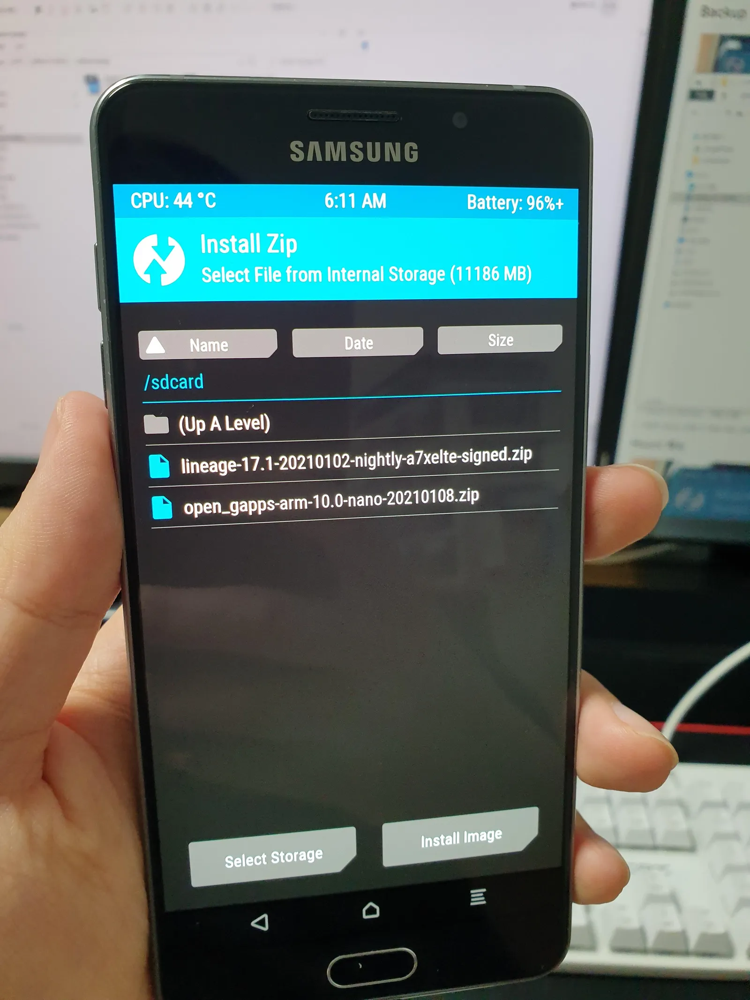

lineage-lineage-17.1-20210102-nightly-a7xelte-signed.zip를 눌러주시고

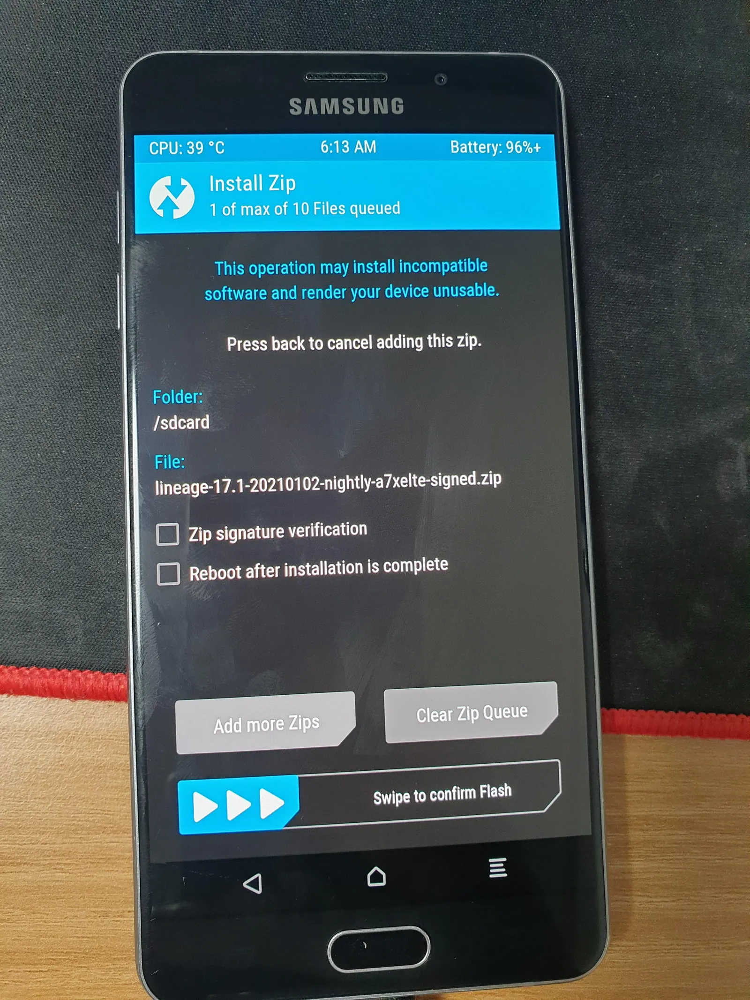

Swipe to confirm Flash를 우측으로 밀어줍니다.

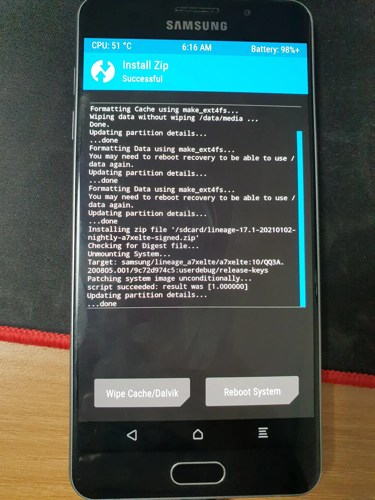

설치가 끝나면 Reboot System을 누릅니다.

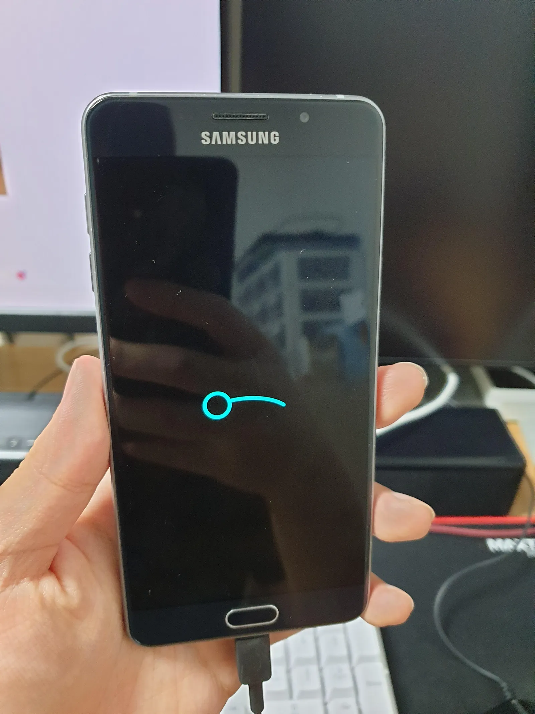

이런 화면이 나오고 부팅에 성공하면 리니지 OS가 실행됩니다.

하지만 이 OS에는 구글 플레이스토어가 없기 때문에 추가로 작업을 해주셔야 합니다.

## 6\. opengapps 설치

다시 스마트폰을 종료해줍니다. (개인적인 안드로이드 세팅이 끝나고 하셔도 됩니다.)

**볼륨상 + 홈버튼 + 전원 키를** 10초간 눌러 아까처럼 TWRP로 진입해줍니다.

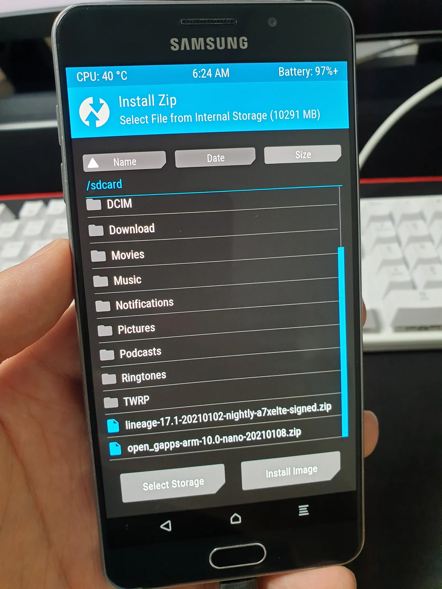

이번에는 open\_gapps-arm-10.0-nano-20210108.zip를 눌러주시고

앞선 방법과 동일하게 Swipe 해줍니다.

다 설치가 됐다면 Reboot 해주시면 구글 플레이스토어가 깔립니다.

## 7\. 주의사항

기본 키보드에서 한글이 지원되지 않습니다.

저는 구글 키보드를 플레이스토어에서 설치해서 사용하고 있습니다.

앞서 언급드렸지만 금융 관련 어플 일절 불가능합니다.

삼성 페이도 안됩니다.

지문은 잘 작동합니다.

실사용 하기에 전혀 무리가 없습니다.

안드로이드 순정 롬을 거의 가져다 쓴 것이다 보니 삼성 앱이 없어 용량 확보에 도움이 되실 것 같습니다.

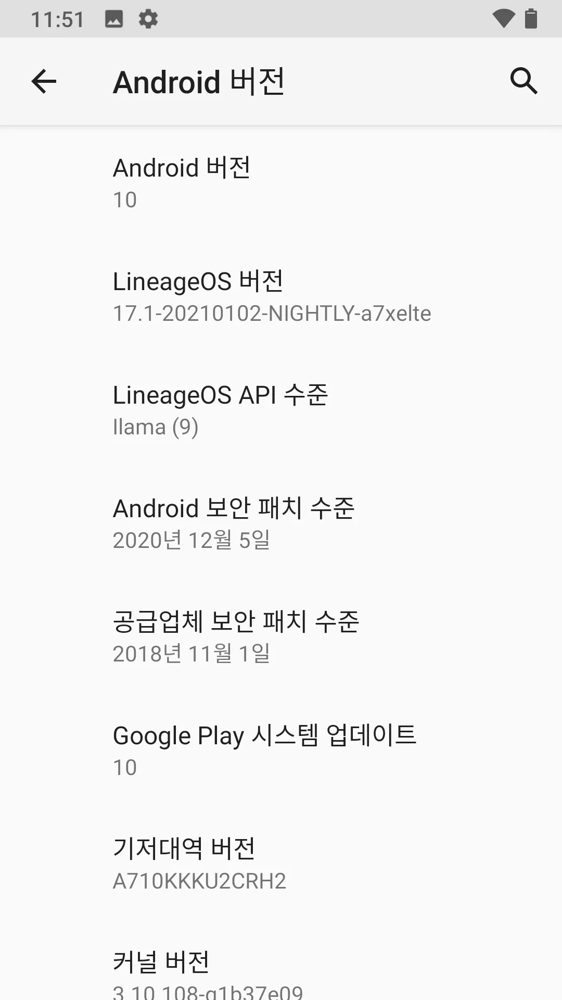

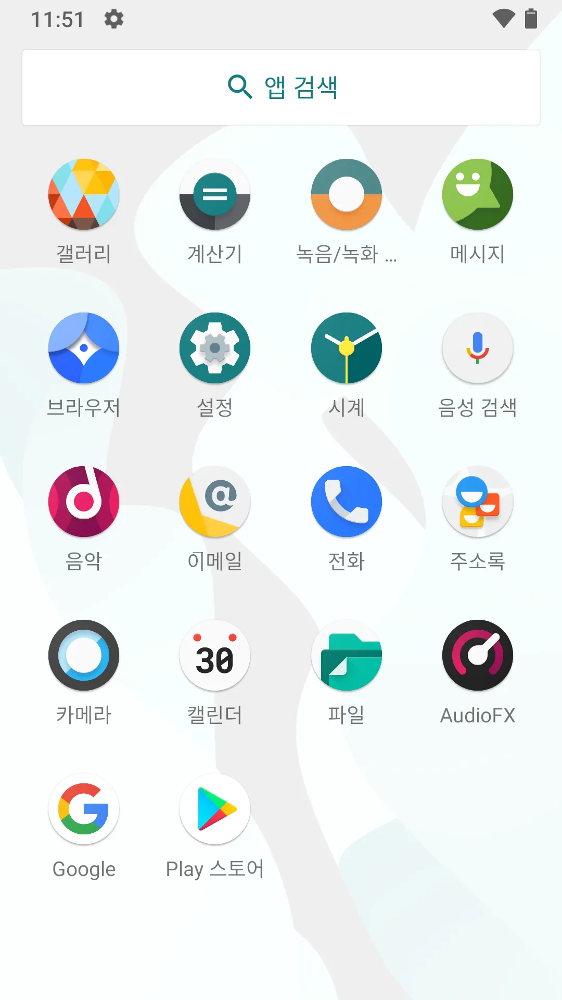
