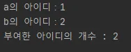

> 이 글은 2021-02-23에 티스토리 블로그(leirbag.tistory.com/31)에 처음 작성한 글을 옮겨온 것입니다.

자바의 메소드는 두 가지 종류를 가지고 있습니다.

<table><tbody><tr><td>1. 인스턴스 메소드 (비정적 메소드)<br>2. 클래스 메소드 (정적 메소드)</td></tr></tbody></table>

인스턴스 메소드는 비정적 메소드이므로 non-static 메소드로 선언된 메소드이고

클래스메소드는 정적 메소드이므로 static을 붙여서 선언된 메소드입니다.

변수나 메소드 앞에 static이 붙는다면 이 메소드는 어디서든 부를 수 있게 됩니다.

그리고 해당 인스턴스와 상관없이 독자적으로 클래스 외부에서 활동하고 있습니다.

자바의 시작 지점에서 public static void main...으로 시작하는 것도 이와 같은 이유입니다.

최소한 자바에서 정적으로 시작점을 가지고 있어야 하기 때문에 static으로 설정이 되어있는 것입니다.

즉, 메인 메소드는 클래스와 상관없는 외부 메소드 입니다.

static 사용의 예를 보여드리겠습니다.

다음과 같은 아이디 생성 프로그램이 있습니다.

```java
class Id {
    private static int counter = 0;		// 아이디를 몇 개 부여했는지 저장
    private int id;						// 아이디

    // 생성자
    public Id() { id = ++counter; }

    // 아이디를 반환하는 인스턴트 메서드
    public int getId() { return id; }

    // counter를 반환하는 클래스 메서드
    public static int getCounter() { return counter; }
}

public class IdTester {
    public static void main(String[] args) {
        Id a = new Id();		// 아이디 1
        Id b = new Id();		// 아이디 2

        System.out.println("a의 아이디：" + a.getId());
        System.out.println("b의 아이디：" + b.getId());

        System.out.println("부여한 아이디의 개수 : " + Id.getCounter());
    }
}
```



*실행결과*

main 메소드를 보시면 a라는 Id 객체를 생성하고, b라는 Id 객체를 생성합니다.

이들의 아이디를 부여하는 방식은 counter의 값을 그대로 부여하는 것입니다.

a객체와 b 객체는 분명히 달리 선언이 되었는데

어떻게 counter 변수를 이어서 사용할 수 있었을까요?

counter 변수가 static(정적)인 상태이기 때문입니다.

앞서 언급했지만 static이 붙은 변수는 클래스와 상관없이 외부에서 돌고 있습니다.

따라서 객체 a가 실행되었을 때 counter변수의 값이 0에서 1로 증가하게 되는 것이고

객체 b가 실행되었을 때 counter 변수가 1에서 2로 증가하게 되는 것입니다.

인스턴스가 계속 새로 만들어져도 counter는 static이기 때문에 외부에 기록된 counter 변수를 가져다 쓰는 것이지요.

부여한 아이디의 개수를 가져올 때도 static메소드를 활용하여 가져오고 있습니다.

이것은 인스턴스의 값과 상관없이 static(정적)이기 때문에 Id.getCounter()로 counter값을 가져올 수 있기도 한 부분입니다.

static에 관한 추가 팁은 다음 게시글에서 참고하실 수 있습니다.

> [**\[Java\] main메소드에서 "Cannot make a static reference to the non-static method run() from the type main" 오류 해결법**](../2020-12-08-tistory-17/)  
> 자바를 처음 시작하시는 분들이 자주 범하는 오류입니다. public class main { public static void main(String\[\] args) { run(); } private void run() { System.out.println("Leirbag"); } } 이 코드에서 실행을..
