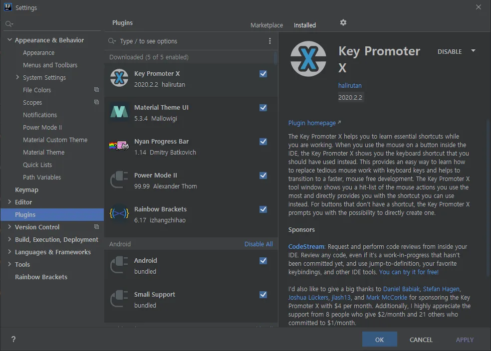
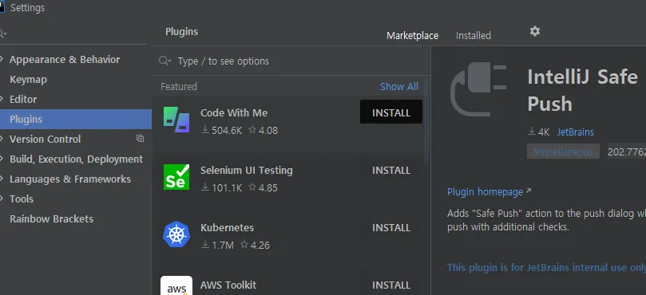
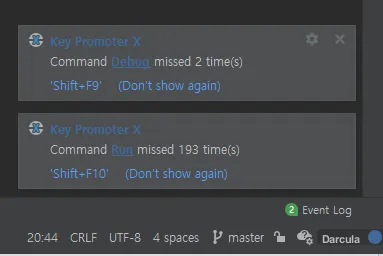
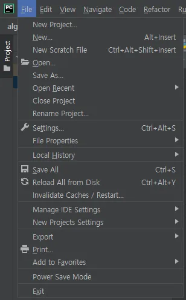
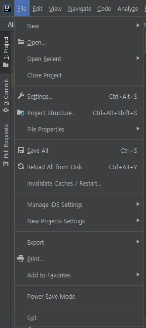
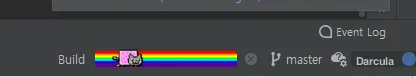
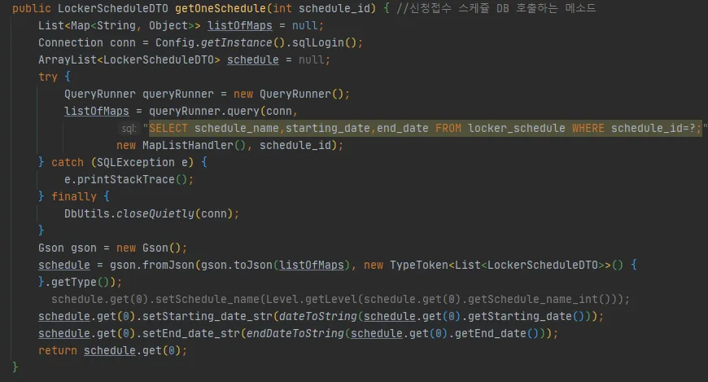

> 이 글은 2021-03-18에 티스토리 블로그(leirbag.tistory.com/36)에 처음 작성한 글을 옮겨온 것입니다.

인텔리제이를 실행하고 File-Settings-Plugins에 들어오면 여러가지 플러그인을 설치할 수 있습니다.

플러그인은 인텔리제이 내부에 설치하는 프로그램으로

다른 개발자들이 만들어 놓은 플러그인으로 커스터마이징 하거나 여러가지 기능을 추가할 수 있는 기능입니다.

*인텔리제이는 여러가지 써드파티 플러그인을 지원합니다.*

적용 방법은 진짜 쉽습니다

Marketplace 페이지에서 원하는 플러그인을 찾아서

INSTALL버튼만 눌러주면 됩니다!

다음은 제가 사용하고 있는 몇가지 플러그인 입니다.

## Key Promoter X

이 플러그인은 단축키를 항상 알림으로 알려줍니다.

만약에 제가 어떤 버튼을 눌렀을 때 그 버튼에 해당하는 단축키가 있다면 단축키를 사용해보라고 권유합니다.

이런식으로 제가 누른 행동에 대해 더 쉬운 실행 방법이 있다고 알려줍니다.

알려주는대로 쓰다보면 단축키가 손에 익는다는 장점이 있고,

자주쓰는 기능의 단축키를 일일이 검색하지 않아도 알기 쉽다는 장점이 있습니다.

## Material Theme UI

이 플러그인은 인텔리제이 테마 입니다.

개인적인 취향이지만 인텔리제이를 더 예쁘게 꾸며줍니다.

*테마 적용 전*

*테마 적용 후*

모든 기능의 출력은 테마 전이나 후나 똑같은데

그냥 테마만 바뀝니다!

인텔리제이에서 가장 인기 있는 테마 중 하나입니다.

저는 이 테마를 사용했을 때 각 버튼 사이의 줄간격이 넓어져서 선호합니다.

## Nyan Progress Bar

한때 유튜브를 강타했던 귀여운 고양이 Nyan Cat을 인텔리제이에서도 보실 수 있습니다!

<iframe src="https://www.youtube.com/embed/QH2-TGUlwu4" allowfullscreen="" style="width:100%;aspect-ratio:16/9;border:0"></iframe>

인텔리제이에 존재하는 모든 Progress Bar를 Nyan Cat으로 보여주게 적용합니다!

그냥 귀여워서 추천

## Power Mode 2

코드 입력하는게 지루하신가요?

타격감을 느낄 수 있는 모드입니다.

여러가지 효과를 줄 수 있어서 코드 입력을 꾸며줍니다.

이 플러그인은 환경설정에서 여러가지 효과를 키고 끌 수 있습니다.

## Rainbow Brackets

코드를 입력하다보 소괄호, 중괄호, 대괄호를 중복해서 사용하는 경우가 아주 많습니다.

괄호를 열고, 열고, 열고, 또 열고 ...

괄호를 더블클릭 하면 어디서 출발된 괄호인지 쉽게 확인이 가능합니다만 그것이 한 눈에 보이지는 않습니다.

이 플러그인을 설치하면 괄호별로 색깔을 입혀 쉽고 빠르게 구분이 가능합니다.

이런식으로 괄호에 색을 입혀 어디서 열린 괄호인지 추적이 가능하게 합니다.
