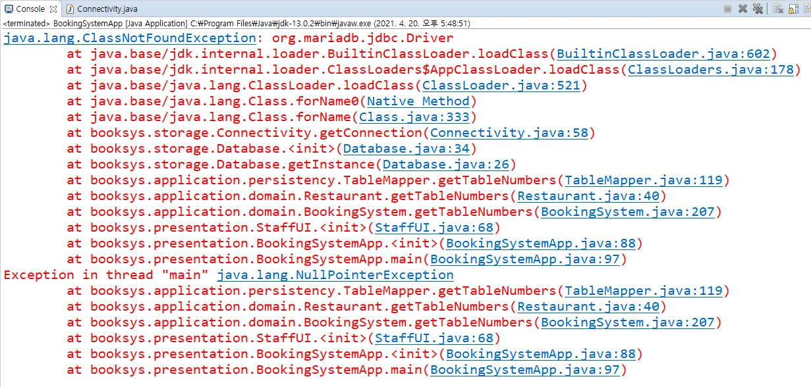
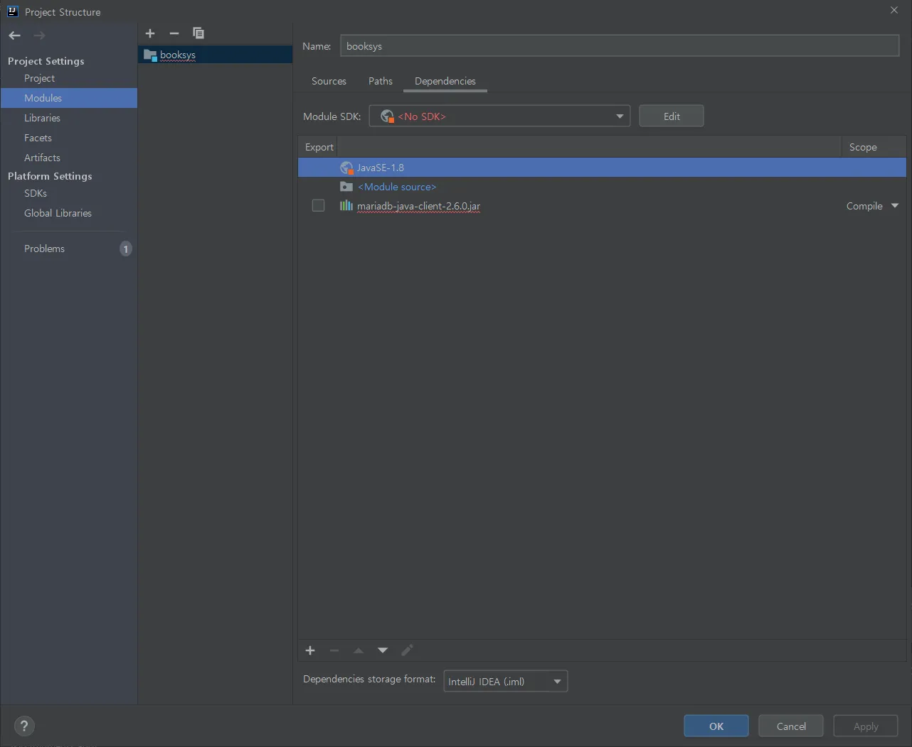
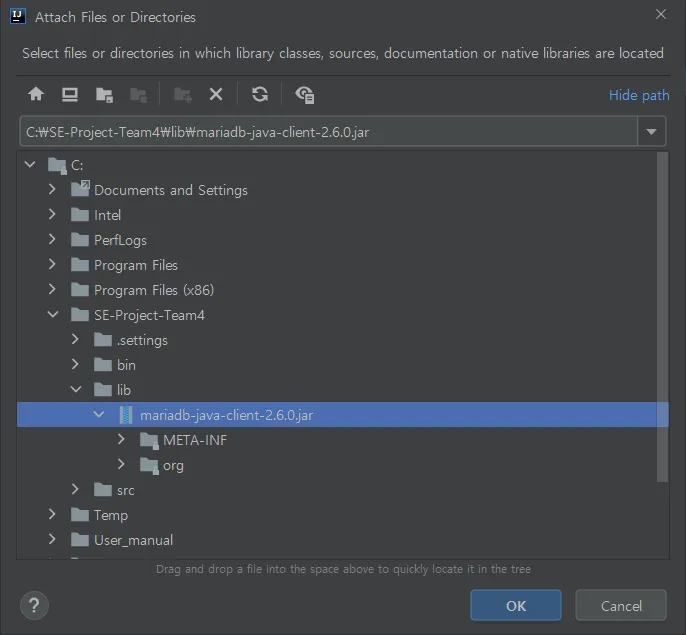
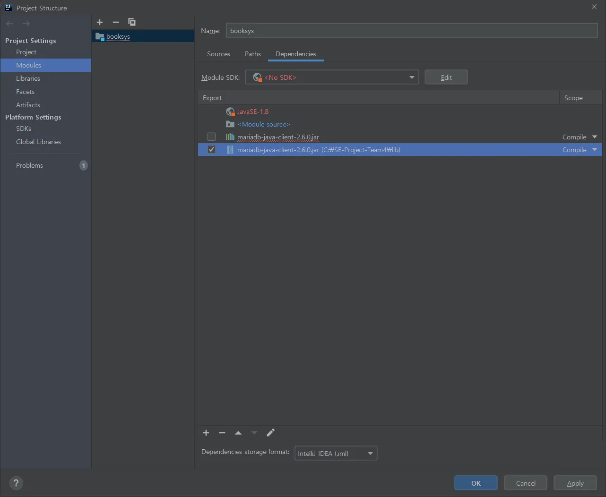
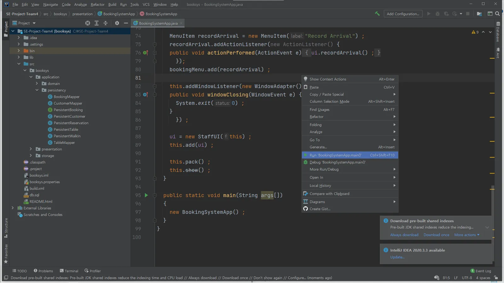
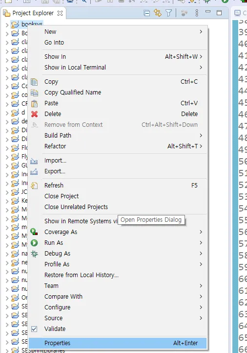
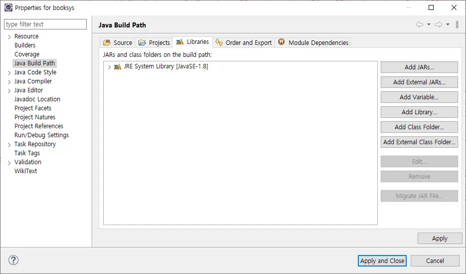
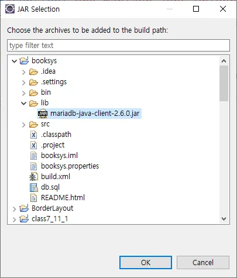
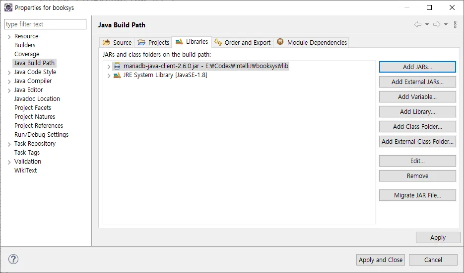

> 이 글은 2021-04-20에 티스토리 블로그(leirbag.tistory.com/48)에 처음 작성한 글을 옮겨온 것입니다.

org.mariadb.jdbc.Driver 오류가 발생할때 라이브러리를 적용하면 쉽게 해결할 수 있습니다.

## **인텔리제이(IntelliJ) 해결법**

1\. Settings - ProjectStructure - ProjectSettings - Modules - Dependencies에 들어갑니다.

1\. Settings - ProjectStructure - ProjectSettings - Modules - Dependencies에 들어갑니다.

하단에 있는 +를 눌러

mariadb jar를 선택하고 OK합니다.

Apply 하고 OK 눌러서 나옵니다.

Main 메소드가 있는 곳에서 우클릭하고 Run하면 작동합니다.

## 이클립스(Eclipse) 해결법

1\. 프로젝트에 우클릭 후 Properties에 들어갑니다.

Java Build Path - Libraries에 들어와서 Add JARs...를 누릅니다.

프로젝트 내에 있는 lib 폴더에서 mariadb jar 파일을 선택합니다.

OK

Apply and Close를 누르면 실행됩니다.

끝
