> 이 글은 2021-06-21에 티스토리 블로그(leirbag.tistory.com/68)에 처음 작성한 글을 옮겨온 것입니다.

컴퓨터가 특정 사이트에 들어가지 못하도록 차단하는 방법이 있습니다.

자녀가 어떤 홈페이지에 접근하지 않으시길 원하실 때 유용한 방법입니다.

## 1\. 특정 사이트의 ip를 확인합니다.

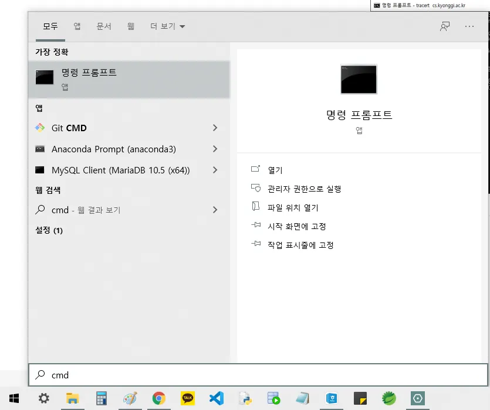

윈도우 - cmd를 검색 후 명령 프롬프트를 실행합니다.

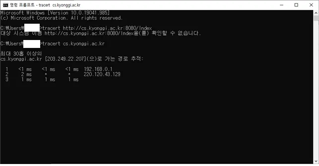

명령 프롬프트에 tracert 주소

를 치시면 해당 사이트의 IP 확인이 가능합니다.

## 2\. 방화벽 차단

윈도우 설정에서 업데이트 및 보안에 들어옵니다.

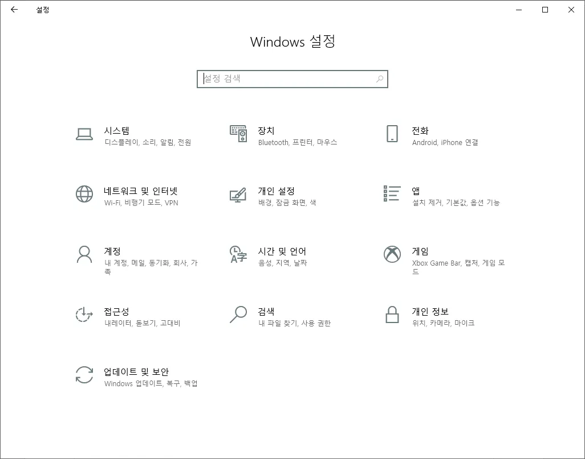

Windows 보안을 누릅니다.

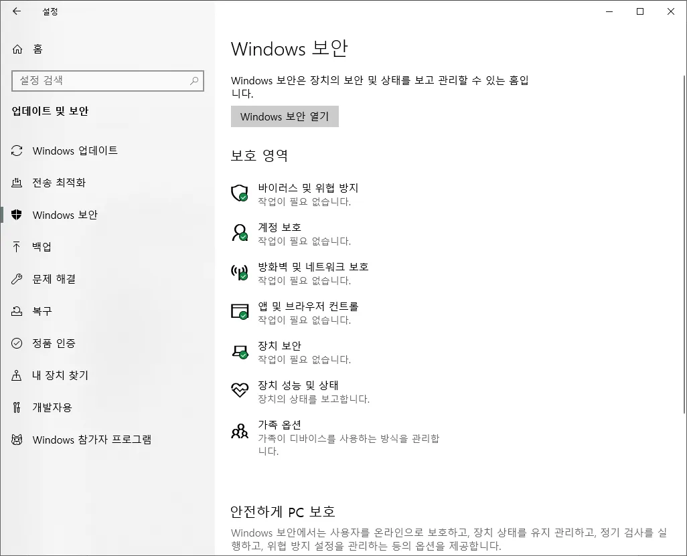

방화벽 및 네트워크 보호를 누릅니다.

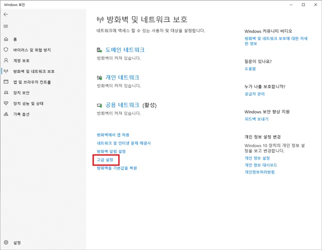

고급설정에 들어옵니다.

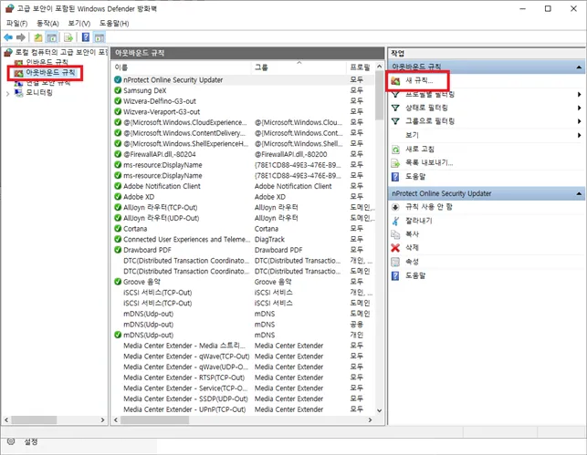

아웃바운드 규칙에서 새 규칙을 누릅니다.

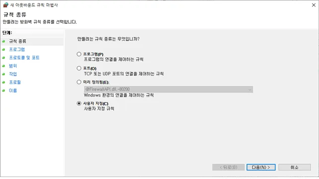

사용자 지정 - 다음

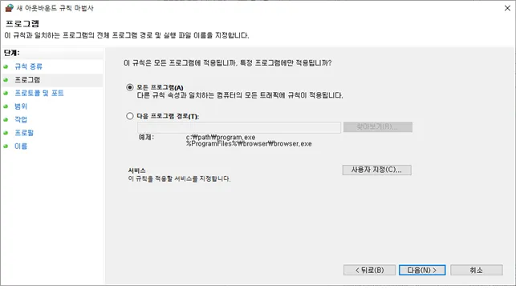

모든 프로그램 - 다음

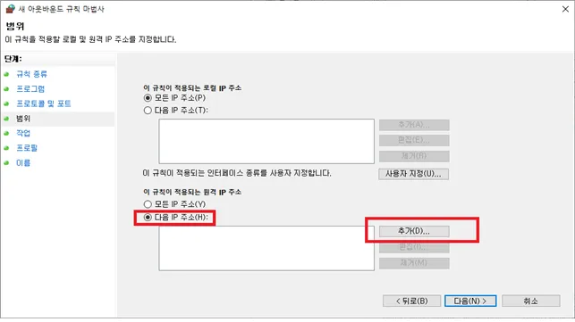

이 규칙이 적용되는 원격 IP 주소에서 다음 IP주소를 누르고 추가버튼 클릭

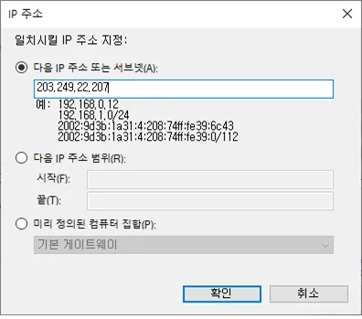

앞서 cmd에서 알아낸 IP주소를 입력합니다.

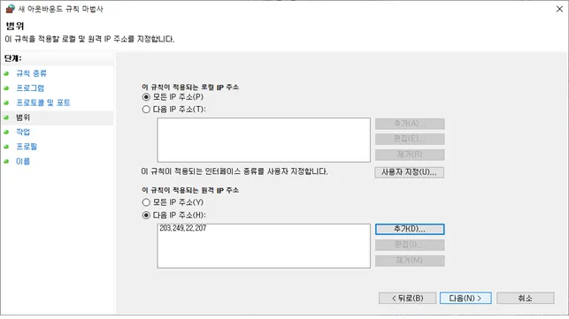

추가되었으면 다음을 누릅니다.

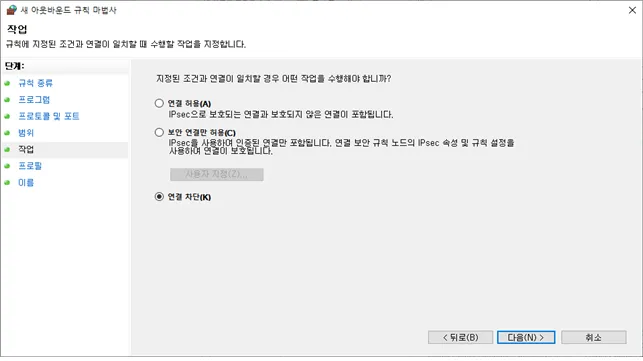

연결 차단 체크 후 다음

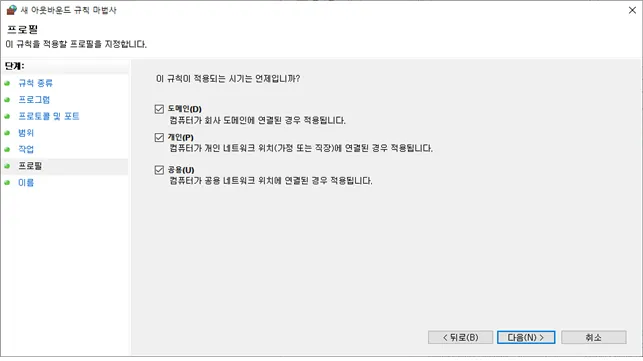

전부 체크 후 다음

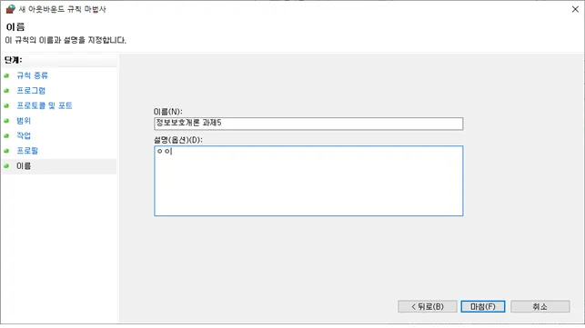

이 규칙의 이름과 설명을 적습니다. 그리고 마침버튼 클릭

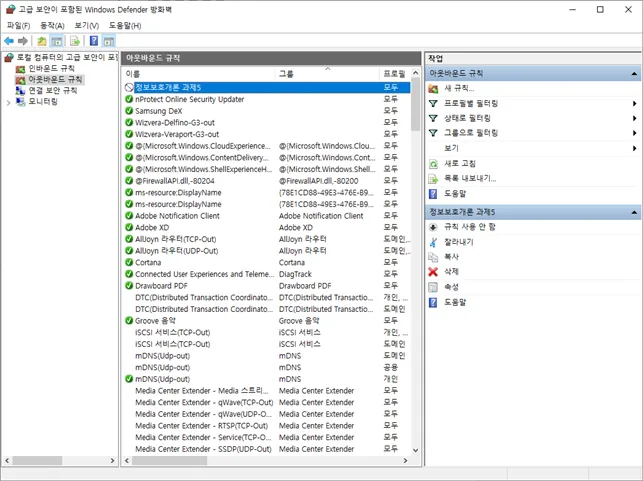

이렇게 추가된 규칙이 뜨게됩니다.

## 3\. 차단 확인

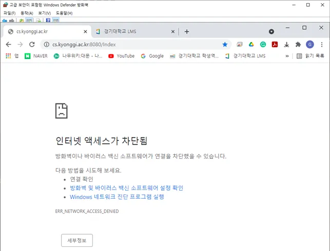

이렇게 자체적으로 접속을 차단할 수 있습니다.

군 복무할 때 근무지에 새 컴퓨터 받거나 새로운 프로그램 보급받았을 때 이걸로 여러가지 설정을 했던 기억이 나네요.

이걸로 개인 PC의 주요 사이트 접속 차단이 가능합니다.
