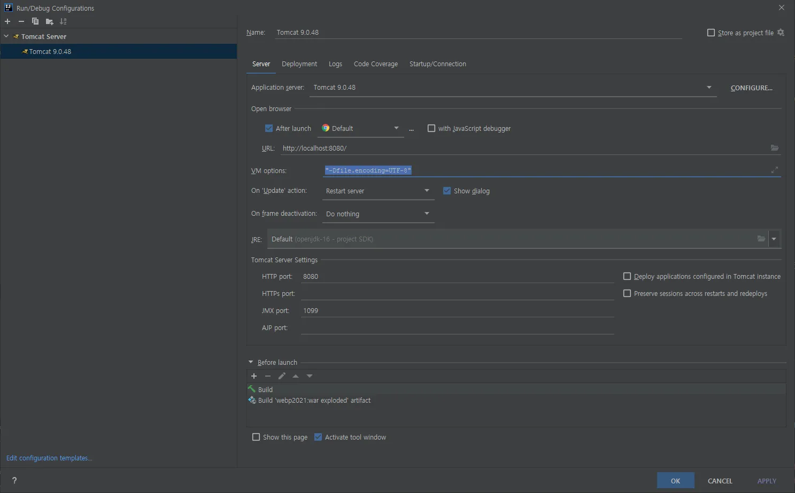

> 이 글은 2021-06-30에 티스토리 블로그(leirbag.tistory.com/85)에 처음 작성한 글을 옮겨온 것입니다.

Edit Configure를 누르고 사진처럼 VM Options에 다음 명령어를 넣습니다.

<table><tbody><tr><td>"-Dfile.encoding=UTF-8"</td></tr></tbody></table>
