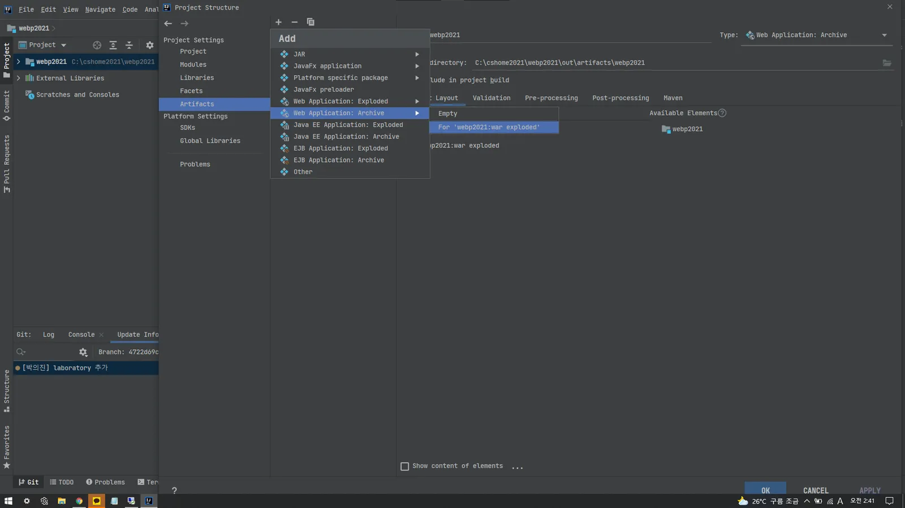
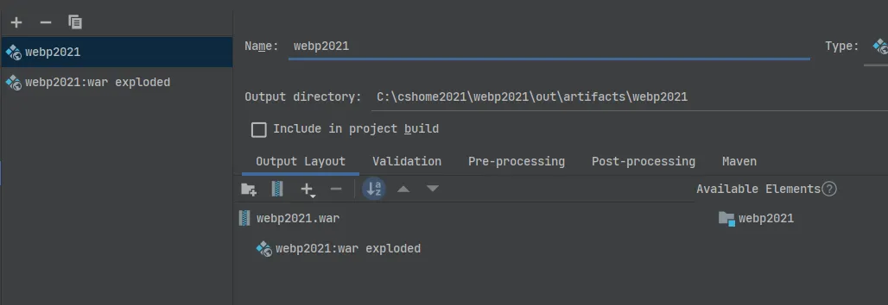
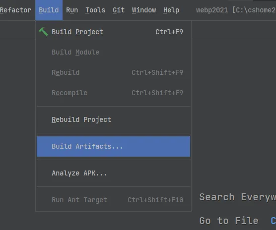
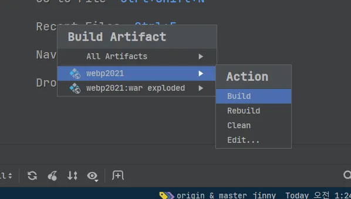
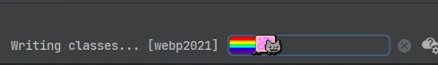
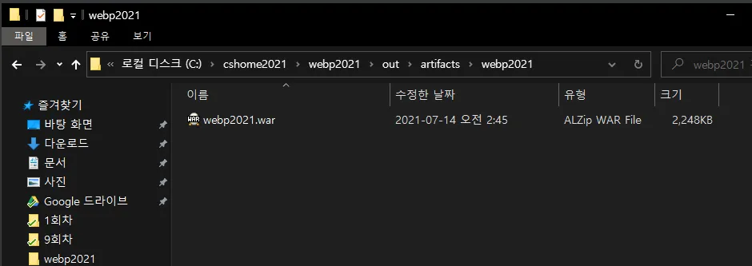

> 이 글은 2021-07-14에 티스토리 블로그(leirbag.tistory.com/87)에 처음 작성한 글을 옮겨온 것입니다.

## 1\. 환경설정

Project Structure- Artifacts - Web Application : Archieve - For \*\*\* war exploded를 누릅니다.

## 2\. 이름 뒤에 붙어있는 :war를 지웁니다.

톰캣 설정의 이름과 맞춰주기 위함입니다.

(tomcat의 xml설정에서 지정한 프로젝트 명과 동일하게 해야합니다.)

## 3\. WAR 파일 추출

Build - Build Artifacts를 누릅니다.

방금 만들어준 Artifacts에 마우스를 올려주고, Build를 누릅니다.

하단에 뭔가 돌아가는게 보입니다.

## 4\. WAR 파일 확인

프로젝트의 out - artifacts - 아까 설정해줬던 이름의 폴더에 들어가보면

이런식으로 WAR 파일이 생긴 것을 확인하실 수 있습니다.

이제 이 파일을 톰캣한테 주고 실행시키면 됩니다.
