> 이 글은 2021-07-14에 티스토리 블로그(leirbag.tistory.com/88)에 처음 작성한 글을 옮겨온 것입니다.

[\[Ubuntu/RaspberryPi4\] 윈도우에서 라즈베리파이용 우분투에 GUI로 원격 접속하기(Ubuntu MATE)](../2021-07-12-tistory-86/)

> [**\[Ubuntu/RaspberryPi4\] 윈도우에서 라즈베리파이용 우분투에 GUI로 원격 접속하기(Ubuntu MATE)**](../2021-07-12-tistory-86/)  
> 이 게시글은 라즈베리파이용 우분투의 쉬운 원격 접속을 위한 글입니다. x86이나 AMD64버전의 우분투는 그냥 anydesk 사용하시면 됩니다. 라즈비안 OS도 우분투도 같은 데비안계열이고 ARM기반으로

위의 원격 접속을 기준으로 작성합니다.

우분투 마테로 예시가 들어와있으나, 우분투 그놈으로 하셔도 무방합니다. (필요 없는 부분은 건너뛰어도 괜찮음)

## 1\. WAR파일을 준비합니다.

[\[IntelliJ\] WAR파일 만드는 방법](../2021-07-14-tistory-87/)

> [**\[IntelliJ\] WAR파일 만드는 방법**](../2021-07-14-tistory-87/)  
> 1\. 환경설정 Project Structure- Artifacts - Web Application : Archieve - For \*\*\* war exploded를 누릅니다. 2. 이름 뒤에 붙어있는 :war를 지웁니다. 톰캣 설정의 이름과 맞춰주기 위함입니다. (tomcat의 xm..

위 문서 참고바랍니다. 이클립스는 어케하는지 모름.

WAR파일을 구글드라이브나 애니데스크 또는 USB로 옮기면 되는데

라즈베리파이 우분투는 애니데스크가 안되고, 기계를 저멀리 어딘가에 뒀기 때문에

구글드라이브로 작업 하는 것을 기준으로 작성하겠습니다.

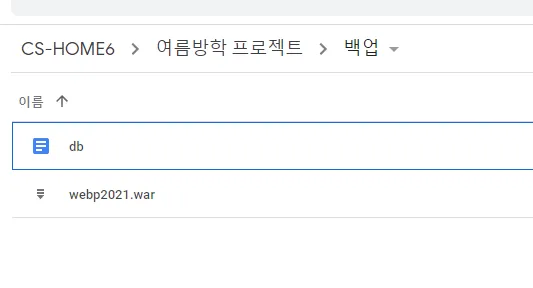

WAR파일이랑 DB를 업로드 합니다.

**(실시간 서비스중인 경우에는 DB를 절대로 업로드 하지 않습니다.)**

## 2\. 원격 접속해서 WAR 파일을 다운 후 톰캣 폴더에 넣기

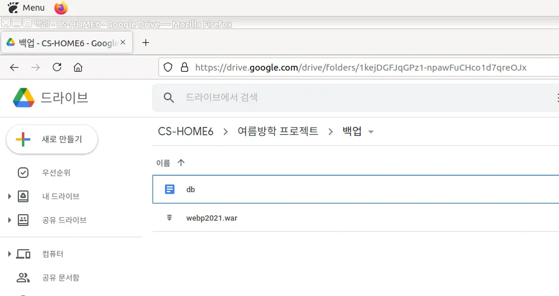

구글드라이브에서 WAR 파일만 저장해줍니다.

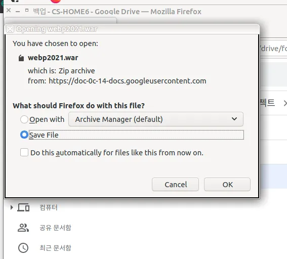

save file 후 ok

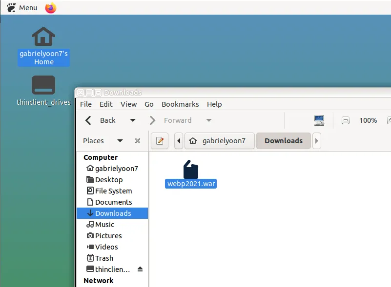

war 파일이 다운로드 폴더에 있는 것을 확인할 수 있습니다.

이 파일에 우클릭 후 cut을 해주고

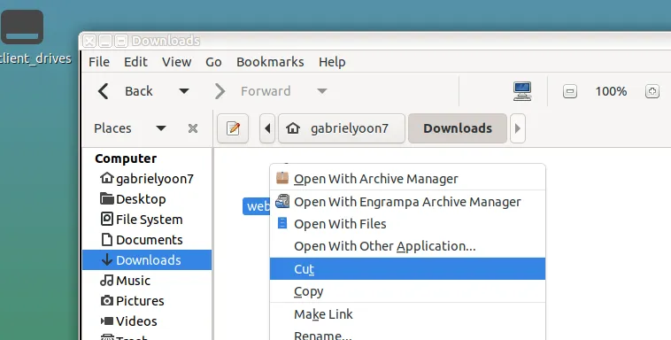

다음과 같이 톰캣의 webapps 폴더에 들어갑니다.

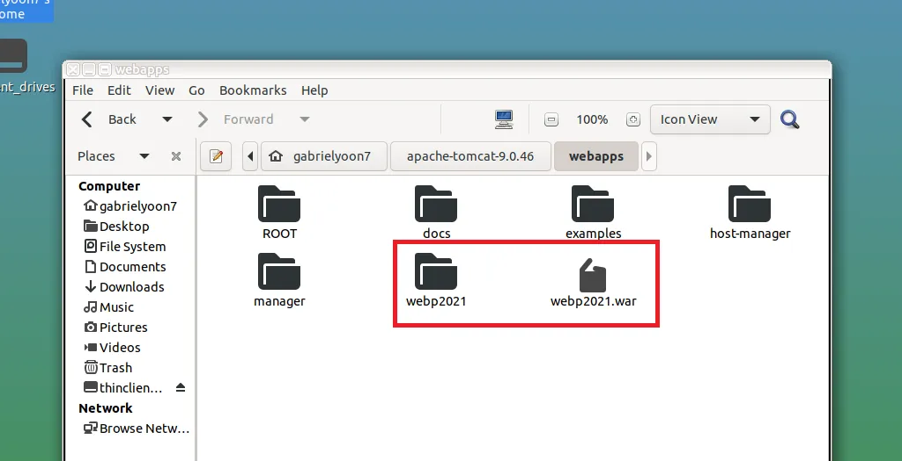

그리고 기존의 war 파일과, 폴더를 지웁니다.

그리고 앞서 cut 했던 WAR 파일을 저기에 붙여넣기 합니다. (우클릭 후 paste)

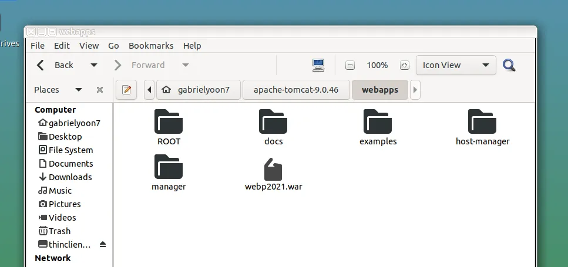

## 3.  DB 설정 (실시간 서비스중인 경우에는 이 항목을 건너뜁니다.)

**혹시나해서 언급하지만.. 실시간 서비스중인 프로그램에 이 항목대로 따라하면 DB가 전부 날라갑니다.**

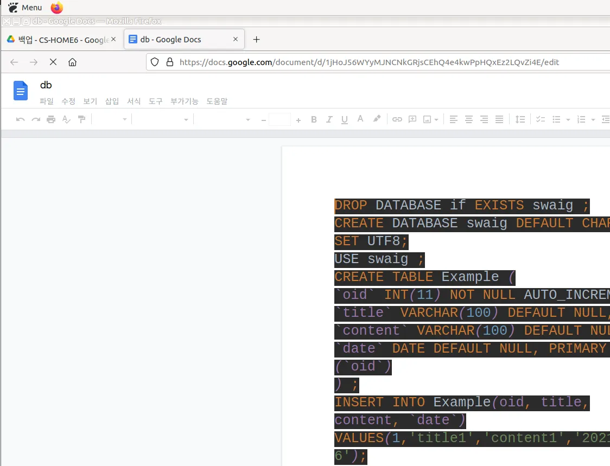

구글 드라이브를 통해 같이 넘겨줬던 db 쿼리문을 전체 복사 합니다.

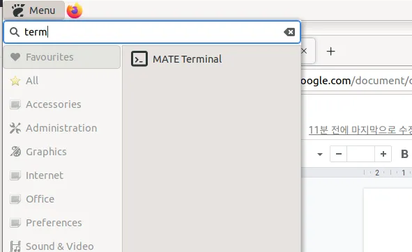

메뉴를 누르고 terminal를 검색하여 MATE terminal을 실행합니다.

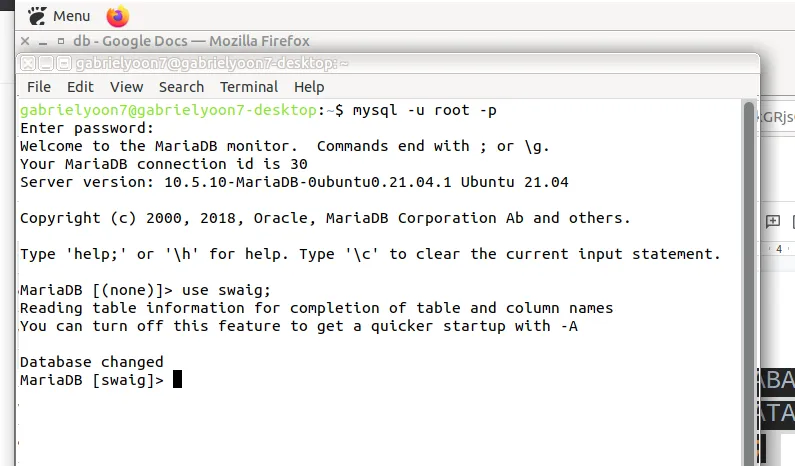

mysql -u root -p를 입력하고 엔터, 비밀번호를 입력한 후 엔터

그리고 use 데이터베이스명; 을 입력하여 maria DB를 실행시킵니다.

그리고 앞서 복사했던 문장을 붙여넣기 합니다. (반드시 우클릭 후 paste를 누릅니다.)

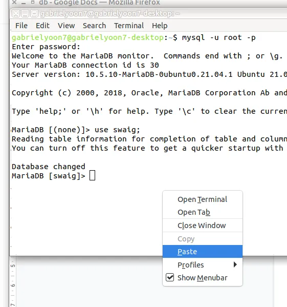

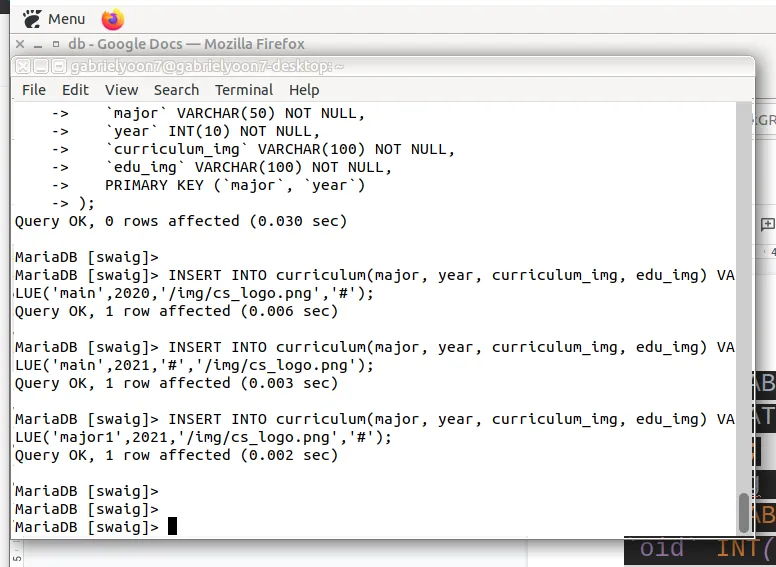

이제 db가 잘 들어갔는지 확인하기 위해 다음과 같은 명령어를 치면서 점검합니다.

(가끔 제대로 안들어가고 오류를 뿜어내는 경우가 있음)

show tables; 로 테이블이 모두 잘 들어왔는지 점검.

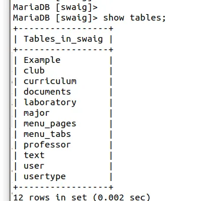

select 문으로 특정 db가 잘 들어왔는지 점검.

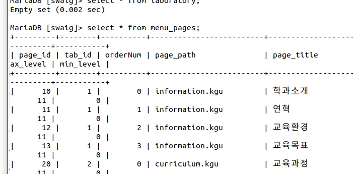

## 4.  Tomcat 실행

톰캣 설정이 다 되어있다고 가정하에 적습니다.

터미널을 새로 실행하여 다음과 같이 입력하여 톰캣의 bin 폴더에 접근합니다.

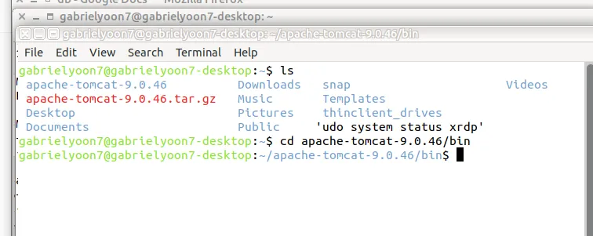

ls를 입력하면 현재 위치의 모든 폴더/파일을 출력해주며

cd 경로를 입력하면 해당 경로로 이동하게 됩니다.

저의 경우에는 cd apache-tomcat-9.0.46/bin 으로 접근했습니다.

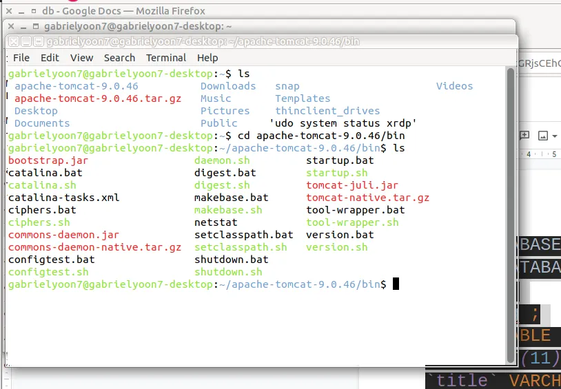

이렇게 ls를 입력하여 확인하면 잘 들어와있는지 알 수 있습니다.

잘 접속했다면 다음과 같이 입력하여 톰캣을 실행합니다.

./startup.sh

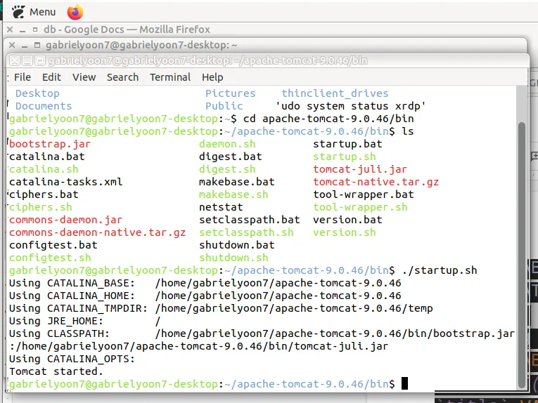

맨 아래 Tomcat started.가 실행되었다면 톰캣이 실행중인 것 입니다.

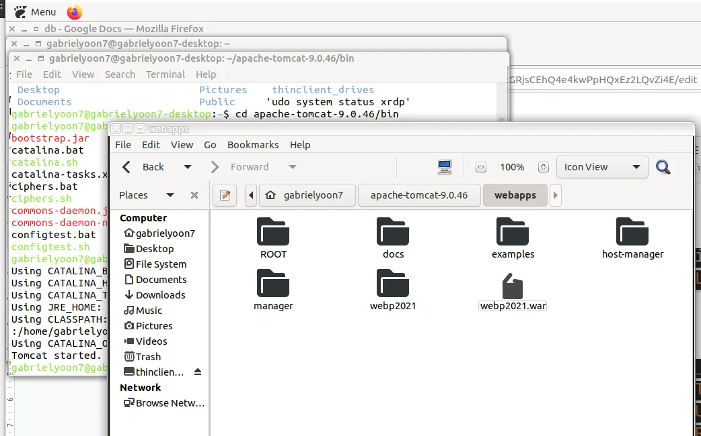

아까 webapps에서 넣어놨던 war 파일이 압축 해제되면 같은 이름의 폴더가 생깁니다.

약간의 시간이 소요될 수 있으며, 톰캣이 제대로 실행된 경우 서버 PC에서 localhost로 접속하면 홈페이지가 잘 나와야 합니다. (이 경우, 외부에서도 접속이 가능하다는 의미기도 합니다.)

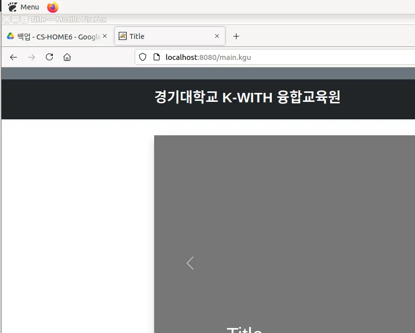

끝
