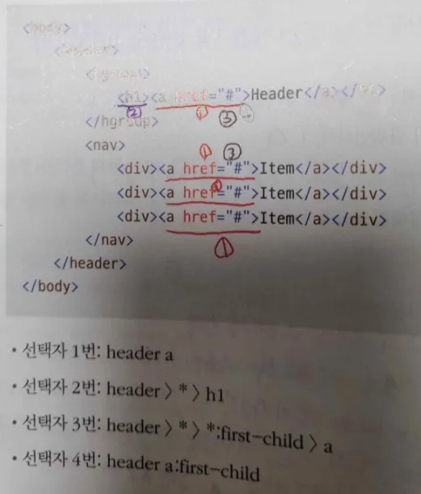

> 이 글은 2021-10-21에 티스토리 블로그(leirbag.tistory.com/96)에 처음 작성한 글을 옮겨온 것입니다.

## 01 관련 있는 것끼리 연결하시오.

(1) C

(2) D

(3) B

(4)A

## 02 다음 질문에 OX를 표시하시오.

(1) X

(2) X

(3) X

(4) O

(5) X

(6) O

## 03 다음 코드에서 선택자가 어떤 태그를 선택하는지 설명하시오

(1) header태그의 후손인 a 태그를 선택

(2) header 태그의 자손태그의 자손인 h1태그를 선택

(3) header 태그의 자손인 div 태그들 중 첫번 째 div의 자손인 a 태그를 선택

(4) header 태그의 후손인 a태그들 중에서 첫번 째 a 태그를 선택

(5) div 태그의 자손인 h1태그 선택, 일반 h2태그 선택

(6) title클래스와 card클래스 모두 가지고 있는 태그 선택

## 04 다음 HTML 구조에서 음영으로 표시된 태그를 선택할 수 있는 선택자를...

```html
<style>
    .head-item{}
    .head .head-item{}
    tr .head-item{}
</style>
```

## 05 다음 코드에서 선택자가 어떤 태그를 선택하는지 적으시오



## 06 다음 HTML 구조에서 음영으로 표시된 태그를 선택할 수 있는 선택자를...

```html
<style>
    #first{}
    .active{}
    li:first-child{}
</style>
```

## 07 다음 코드의 실행 결과를 예측하시오.

리스트가 전부 red로 출력됩니다. (css 설정이 li의 자손 중 첫번째 a 태그를 선택하므로)

## 08 **다음 중에서 CSS에서 사용할 수 없는 크기 단위는?**

2

## 09 **다음 스타일이 적용되는 태그 너비를 구하시오.**

110px
