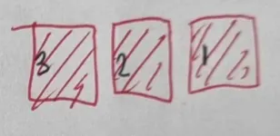

> 이 글은 2021-10-21에 티스토리 블로그(leirbag.tistory.com/97)에 처음 작성한 글을 옮겨온 것입니다.

## 01 다음 빈칸에 알맞은 단어를 넣으시오.

(1) 박스속성

(2) border-width, border-style, border-color

(3) border-radius

(4) display

(5) image

(6) size

(7) repeat

(8) attachment

(9) position

(10) size

(11) family

(12) serif

(13) sans-serif

(14) style

(15) weight

(16) text-align

(17) text-height

(18) position

(19) overflow

(20) box-shadow

(21) text-shadow

## 02 다음 질문에 OX를 표시하시오.

(1) O

(2) O

(3) O

(4) X

(5) X

(6) O

(7) O

(8) O

(9) X

(10) O

(11) O

## 03 다음 중 CSS에서 사용할 수 없는 크기 단위는?

2

## 04 다음 속성 중 글자 색상을 지정하는 속성은?

3

## 05 다음 속성 중 박스와 관련한 속성이 아닌 것은?

4

## 06 다음 중 배경임지로 backgound.png를 올바르게 지정한 것은?

1

## 07 다음 중 position 속성을 absolute로 지정한 절대 좌표계에서 위치를 ...

2

## 08 **다음 스타일이 적용되는 태그 너비를 구하시오.**

150px

## 09 **다음 코드와 같은 background-image 속성을 적용했을 때, 이미지...**

A

## 10 다음 코드의 실행 결과를 그리시오.



## 11 다음과 같이 HTML을 구성하고 스타일을 적용하시오.

```html
<!DOCTYPE html>
<html lang="en">
<head>
    <meta charset="UTF-8">
    <meta http-equiv="X-UA-Compatible" content="IE=edge">
    <meta name="viewport" content="width=device-width, initial-scale=1.0">
    <title>Document</title>
    <style>
        body {background-color: gray;}
        .submit, input {
            background-color: white;
                border-radius: 20px;
                width: 200px;
                text-align: center;
                font-weight: bold;
                }
      </style>
  
</head>
<body>
    <h1>간단한 입력 양식</h1>
    <br>
    <form>
        <table>
            <tr>
                <td>아이디</td>
                <td><input type="text"></td>
            </tr>
            <tr>
                <td>비밀번호</td>
                <td><input type="password"></td>
            </tr>
            <tr>
                <td></td>
                <td><div class="submit">제출</div></td>
            </tr>
        </table>
    </form>
</body>
</html>
```

## 12 다음과 같이 HTML을 구성하고 스타일을 적용하시오.

```html
<!DOCTYPE html>
<html lang="en">
<head>
    <meta charset="UTF-8">
    <meta http-equiv="X-UA-Compatible" content="IE=edge">
    <meta name="viewport" content="width=device-width, initial-scale=1.0">
    <title>Document</title>
    <style>
        img {
            border-radius: 50%;
            float: left;
            margin: 5px;
        }
    </style>
</head>
<body>
    <div>
        
        <p>텍스트텍스트텍스트텍스트텍스트텍스트텍스트텍스트텍스트텍스트텍스트텍스트텍스트텍스트텍스트텍스트텍스트텍스트텍스트텍스트텍스트텍스트텍스트텍스트텍스트텍스트텍스트텍스트텍스트텍스트텍스트텍스트텍스트텍스트텍스트텍스트텍스트텍스트텍스트텍스트텍스트텍스트텍스트텍스트텍스트텍스트텍스트텍스트텍스트텍스트텍스트텍스트텍스트텍스트텍스트텍스트텍스트텍스트텍스트텍스트텍스트텍스트텍스트텍스트텍스트텍스트텍스트텍스트텍스트텍스트텍스트텍스트텍스트텍스트텍스트</p>
    </div>
    <div>
        
        <p>텍스트텍스트텍스트텍스트텍스트텍스트텍스트텍스트텍스트텍스트텍스트텍스트텍스트텍스트텍스트텍스트텍스트텍스트텍스트텍스트텍스트텍스트텍스트텍스트텍스트텍스트텍스트텍스트텍스트텍스트텍스트텍스트텍스트텍스트텍스트텍스트텍스트텍스트텍스트텍스트텍스트텍스트텍스트텍스트텍스트텍스트텍스트텍스트텍스트텍스트텍스트텍스트텍스트텍스트텍스트텍스트텍스트텍스트텍스트텍스트텍스트텍스트텍스트텍스트텍스트텍스트텍스트텍스트텍스트텍스트텍스트텍스트텍스트텍스트텍스트텍스트텍스트텍스트텍스트텍스트텍스트텍스트텍스트텍스트텍스트텍스트텍스트텍스트텍스트텍스트텍스트텍스트텍스트텍스트텍스트텍스트텍스트텍스트텍스트텍스트텍스트텍스트텍스트텍스트텍스트텍스트텍스트텍스트텍스트텍스트텍스트텍스트텍스트텍스트텍스트텍스트텍스트텍스트텍스트텍스트텍스트텍스트텍스트텍스트텍스트텍스트텍스트텍스트텍스트텍스트텍스트텍스트텍스트텍스트텍스트텍스트텍스트텍스트텍스트텍스트텍스트텍스트텍스트텍스트텍스트텍스트텍스트텍스트텍스트텍스트텍스트텍스트텍스트텍스트텍스트텍스트텍스트텍스트텍스트텍스트텍스트텍스트텍스트텍스트텍스트텍스트텍스트텍스트텍스트텍스트텍스트텍스트텍스트텍스트텍스트텍스트텍스트텍스트텍스트텍스트텍스트텍스트텍스트</p>
    </div>
</body>
</html>
```

## 13 다음과 같이 HTML을 구성하고 스타일을 적용하시오.

```html
<!DOCTYPE html>
<html lang="en">
<head>
    <meta charset="UTF-8">
    <meta http-equiv="X-UA-Compatible" content="IE=edge">
    <meta name="viewport" content="width=device-width, initial-scale=1.0">
    <title>Document</title>
    <style>
            div {
                width: 180px;
                height: 300px;
                box-shadow: 1px 1px 10px gray;
                text-align: center;
                padding: 10px;
                border-radius: 10px;
            }
    </style>
</head>
<body>
    <div>
        <h2>Card</h2>
        
        <p>11텍스트텍스트텍스트텍스트텍스트텍스11트텍스트텍스트텍스트텍스트텍11스트텍스트텍스트텍스트</p>
    </div>

</body>
</html>
```
