> 이 글은 2021-12-04에 티스토리 블로그(leirbag.tistory.com/102)에 처음 작성한 글을 옮겨온 것입니다.

Google Workspace (구. G-Suite) 조직원들 간에 간단하게 사용할 수 있는 구글 로그인 서비스입니다. 구글 로그인 버튼을 통해 구글 계정 정보를 받아올 수 있는 기능입니다.

외부 서비스는 어떻게 하는지 알고는 있지만 심사를 거쳐본 적이 없어서 내부 서비스 기준으로 설명하겠습니다.

[https://console.cloud.google.com/home](https://console.cloud.google.com/home)

> [**Google Cloud Platform**](https://accounts.google.com/ServiceLogin?service=cloudconsole&passive=1209600&osid=1&continue=https://console.cloud.google.com/home&followup=https://console.cloud.google.com/home)  
> 하나의 계정으로 모든 Google 서비스를 Google Cloud Platform을 사용하려면 로그인하세요.

위 주소로 접속합니다.

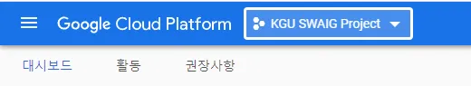

상단에 있는 이 버튼을 누릅니다.

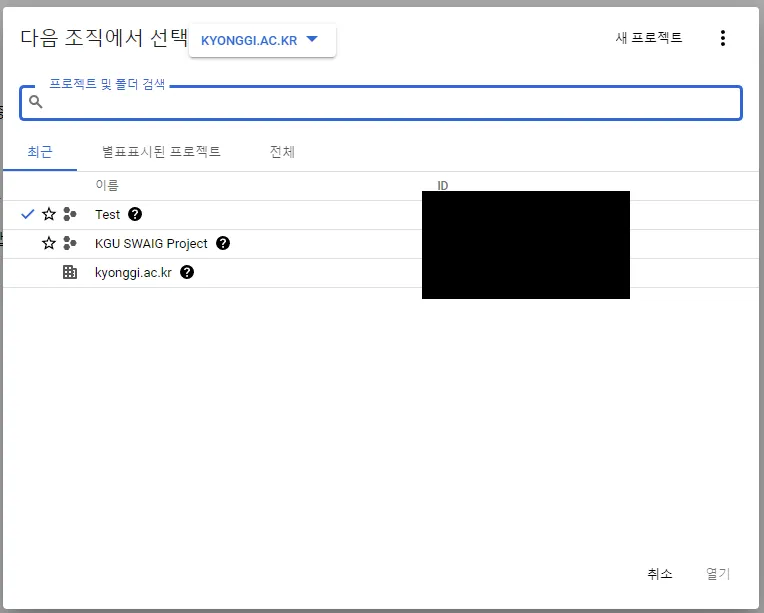

우측 상단의 새 프로젝트를 누릅니다.

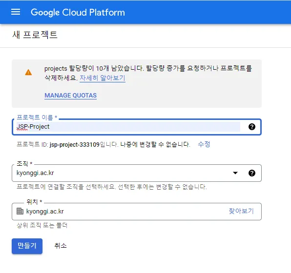

프로젝트 이름을 정해줍니다.

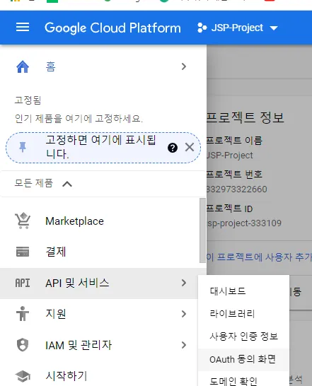

OAuth 동의 화면에 들어갑니다.

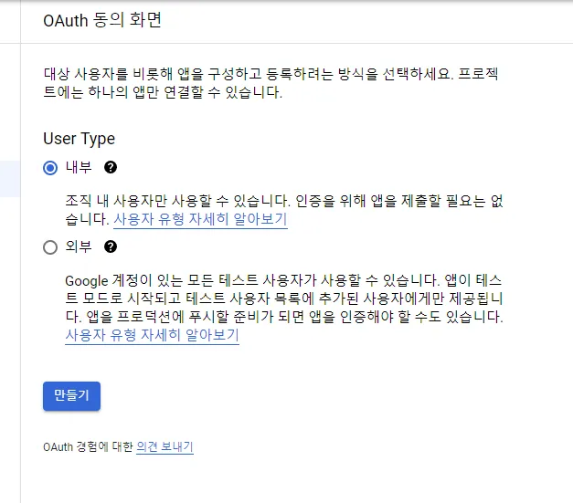

내부를 선택하고 만들기

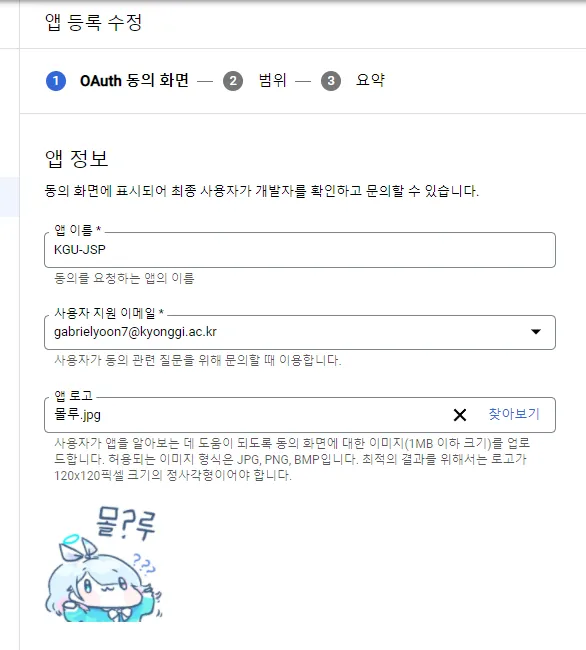

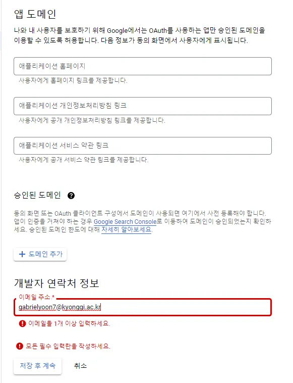

필요한 내용을 추가합니다.

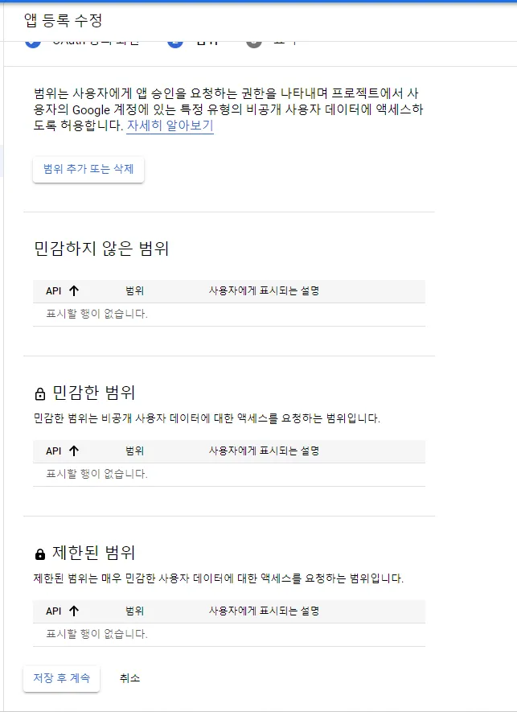

저장 후 계속을 누르면 다음과 같은 화면이 나옵니다.

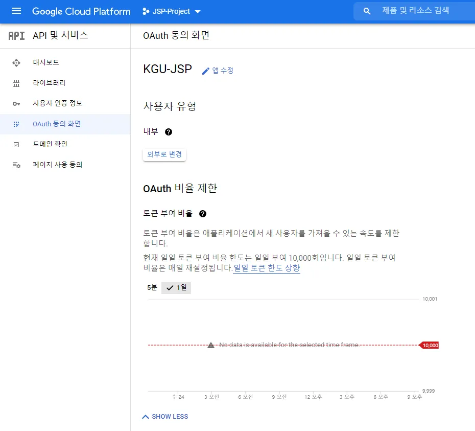

이제 사용자 인증 정보 페이지 - 사용자 인증 정보 만들기 - OAuth 클라이언트ID를 눌러줍니다.

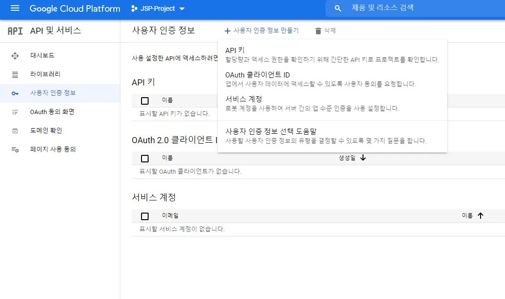

웹 애플리케이션을 누르고

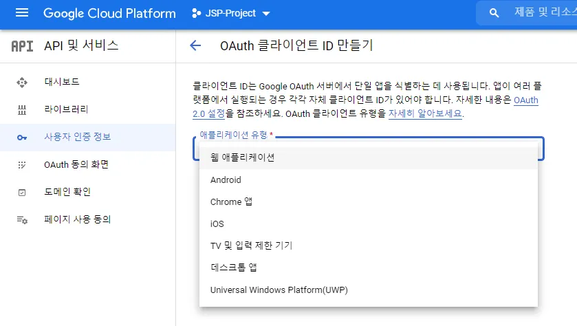

테스트 환경이나, 서비스 중인 도메인을 적어줍니다.

저는 로컬에서 허용할 것이므로 localhost:8080을 등록했습니다.

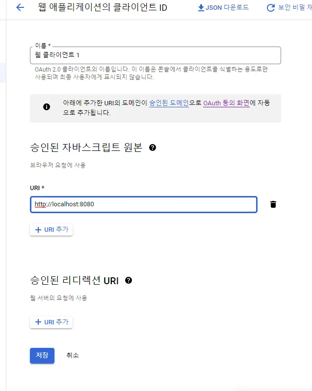

이렇게 클라이언트 ID까지 발급받으면 됩니다.

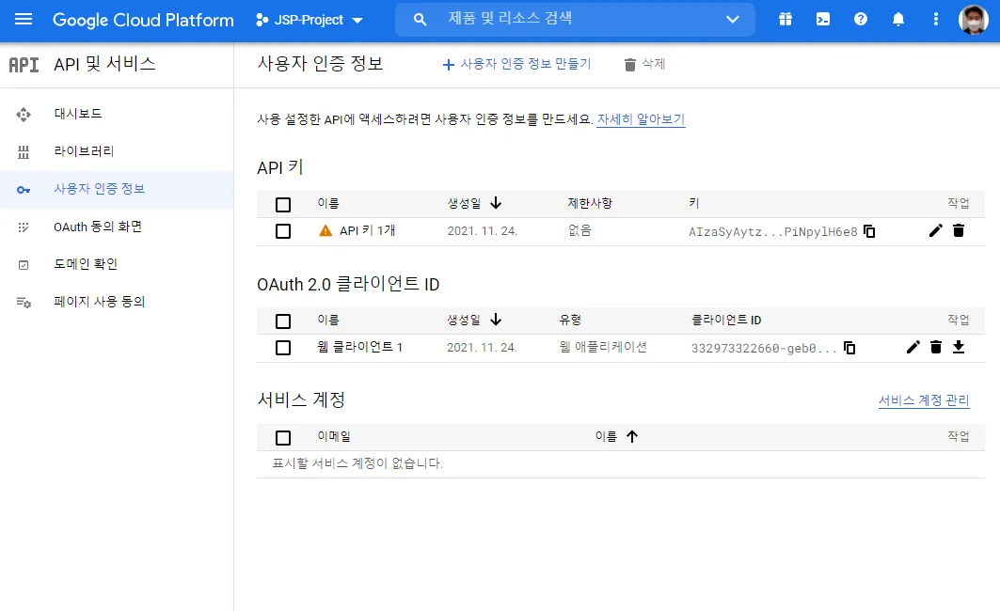

위 클라이언트ID 값을 복사한 후, 로그인 버튼을 활성화 할 HTML 헤더에 다음과 같이 넣습니다.

```html
<!-- content에 자신의 OAuth2.0 클라이언트ID를 넣습니다. -->
<meta name="google-signin-client_id"
      content="클라이언트ID에서 복사한 값">
<script src="https://apis.google.com/js/platform.js" async defer></script>
```

그리고 body 태그 안에 버튼이 등장할 위치에 다음과 같이 등록합니다.

```html
<%--        구글 로그인 버튼 --%>
<div class="g-signin2 d-flex justify-content-center" data-onsuccess="onSignIn"></div>
<%--구글 로그인 버튼 끝--%>
```
