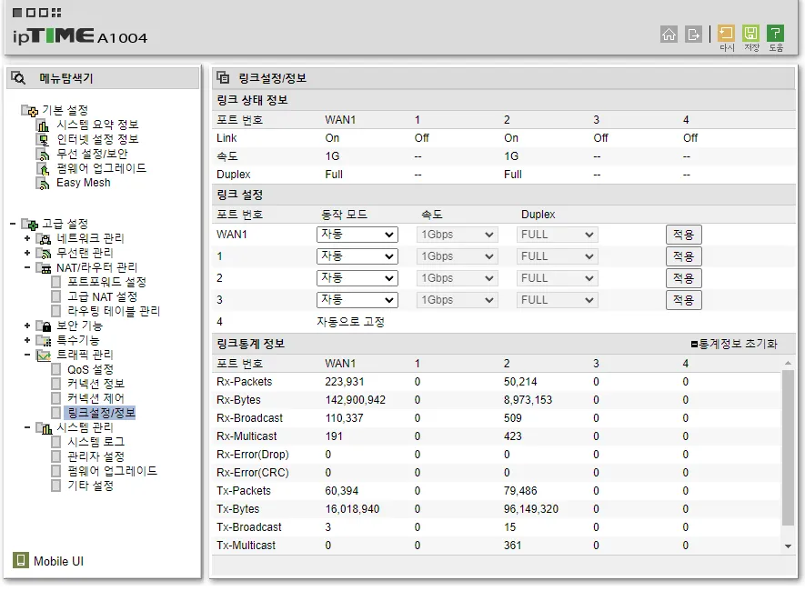
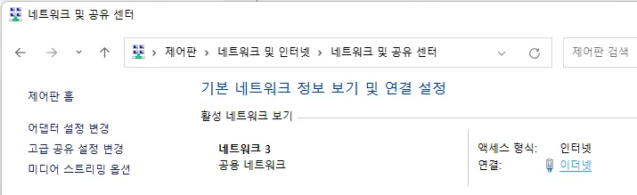
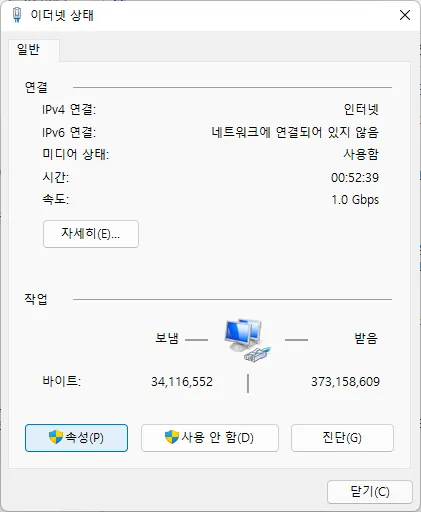
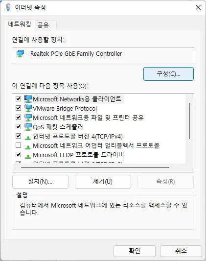
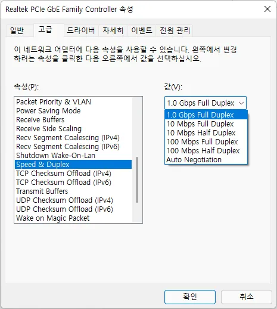

> 이 글은 2022-02-09에 티스토리 블로그(leirbag.tistory.com/111)에 처음 작성한 글을 옮겨온 것입니다.

기가인터넷을 신청한다고 해서 기가 인터넷 속도가 나오지는 않습니다.

많은 사람들이 이를 모르고 그냥 쓰고 있다가

대용량의 파일을 다운받다가 속도가 나지 않는 다는 것을 발견하는 경우가 많습니다.

몇 가지 점검을 통해 기가인터넷이 비활성화 되어있지 않는지 확인할 필요가 있습니다.

## 0\. 인터넷이 설치된 건물이 너무 오래되지 않았는가?

건물 자체가 너무 오래된 경우 기가 인터넷을 지원하지 않을 수도 있다고 합니다.

## 1\. 랜선 버전 (카테고리) 확인

*빨간 색으로 되어있는 부분이 랜선이다*

랜선에서 기가인터넷을 지원해줘야 합니다.

일반적으로 CAT5e부터 기가인터넷을 지원한다고 알려져있으며

랜선의 카테고리를 확인하는 방법은 랜선의 고무 부분을 직접 확인해보시면 반드시 써있습니다.

안정적인 기가인터넷 사용을 목표로 한다면 CAT6이상을 사용할 것을 권장합니다.

특이사항으로는.. 벽에서 공유기 까지, 공유기에서 PC 까지의 2개의 선 모두

CAT5e이상인 고성능의 랜선이 연결되어 있어야 합니다.

## 2\. 두꺼비집 확인

건물(집)의 두꺼비 집에 있는 인터넷을 확인해봐야 한다고 하는데

저는 잘 모르겠어서 패스합니다.

(애초에 인터넷이 연결 되던 방이라면 문제가 없을 가능성이 큽니다.)

## 3\. 공유기 설정 확인

iptime 기준으로 192.168.0.1을 웹 브라우저에 입력하시면 공유기 설정 페이지가 나옵니다.

고급 설정 - 트래픽 관리 - 링크 설정/정보에 들어오셔서 속도가 1Gbps인지 확인합니다.

## 4\. 윈도우 설정

제어판 - 네트워크 및 인터넷 - 네트워크 및 공유 센터에 들어가서 이더넷을 누릅니다.

속성을 누르고

구성을 누릅니다.

고급 - Speed & Duplex에서 1.0Gpbs Full Duplex를 누릅니다.

(Auto Negotiation으로 잡혀있는 경우 자동으로 100메가 제한을 걸고 있을 가능성이 있습니다.)

끝
