> 이 글은 2022-05-06에 티스토리 블로그(leirbag.tistory.com/113)에 처음 작성한 글을 옮겨온 것입니다.

React Native를 개발할 때 본인 컴퓨터가 Windows면서 iOS를 사용하는 사용하는 경우에는 불가피하게 Expo를 사용하게 되는 경우가 있습니다. (본인이 아니더라도 팀원이 해당 환경을 사용하는 경우도 있습니다.)

아무튼 간에 Expo로 앱 개발을 하게 되면 일반적으로 각자의 스마트폰에 Expo Go를 설치하여 테스트를 하게 됩니다.

하지만 이는 너무나도 귀찮은 작업입니다.

스마트폰을 거치해야 하며, 테스트도 손으로 일일이 해야 해서 여러모로 귀찮습니다.

스마트폰을 개발 내내 켜놔야 하는 문제도 있습니다.

Expo 없이 React Native로 앱 개발을 할 때에는 Android Studio의 에뮬레이터에 물려서 사용했었는데

Expo에서도 가능합니다.

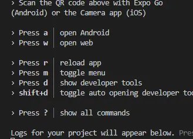

*실제로 expo를 구동시켜보면 open Android 메뉴가 있다*

글 시작에 앞서 현재 제 개발 환경을 공유하고, 어떤 사람들이 사용하면 좋을지를 추천하겠습니다.

## 1\. 개발 환경

#### PC 환경

<table><tbody><tr><td>분류</td><td>OS</td><td>CPU</td><td>RAM</td></tr><tr><td>데스크톱</td><td rowspan="2">Windows 11</td><td>i5 8세대</td><td>16GB</td></tr><tr><td>노트북</td><td>i5 8세대(저전력)</td><td>8GB</td></tr></tbody></table>

#### IDE 환경

*Visual Studio Code*

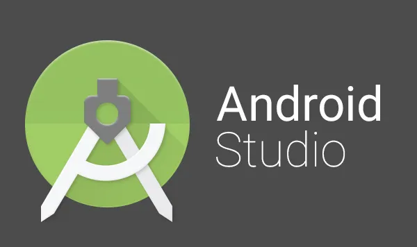

*Android Studio*

위 두 프로그램은 필수로 설치되어 있어야 합니다.

## 2\. Android Studio Emulator 준비

#### Emulator 설치

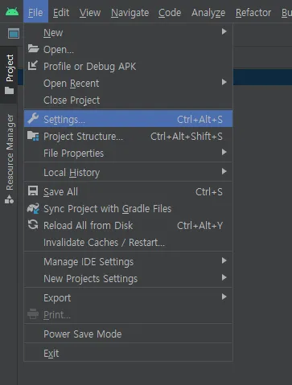

프로젝트 화면 좌측 상단의 File - Settings를 클릭합니다.

Appearance & Behavior - System Settings - Android SDK - SDK Tools 탭에 들어가서

Android SDK Build-Tools가 설치되어 있는지 확인합니다.

(Installed, Update Available 등 표현이 있으면 설치되어 있는 것입니다.)

설치되어있지 않다면 설치해줍니다.

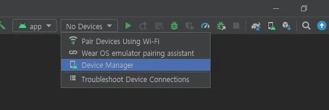

우측 상단의 Device Manager (과거 AVD Manager)를 켜줍니다.

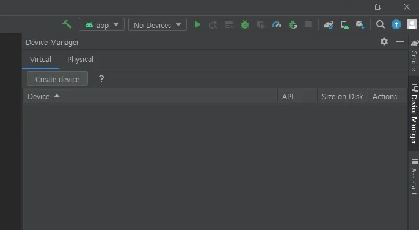

Virtual 탭에서 Create Device를 클릭

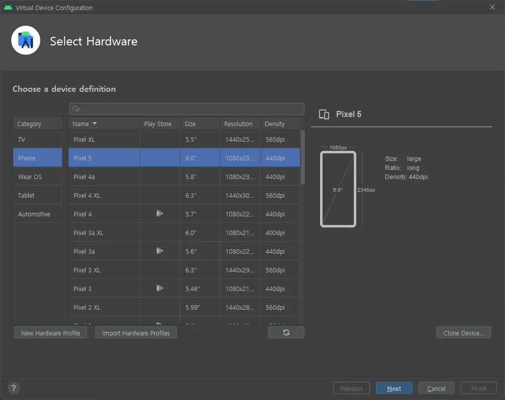

원하는 디바이스를 선택하여 Next를 누릅니다.

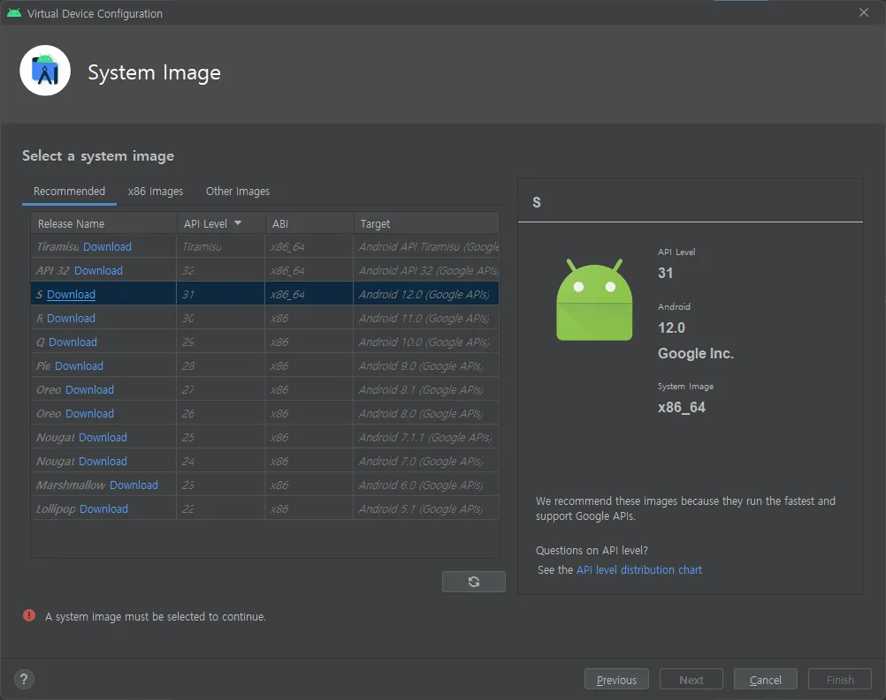

원하는 운영체제를 Download 후 선택하고 Next

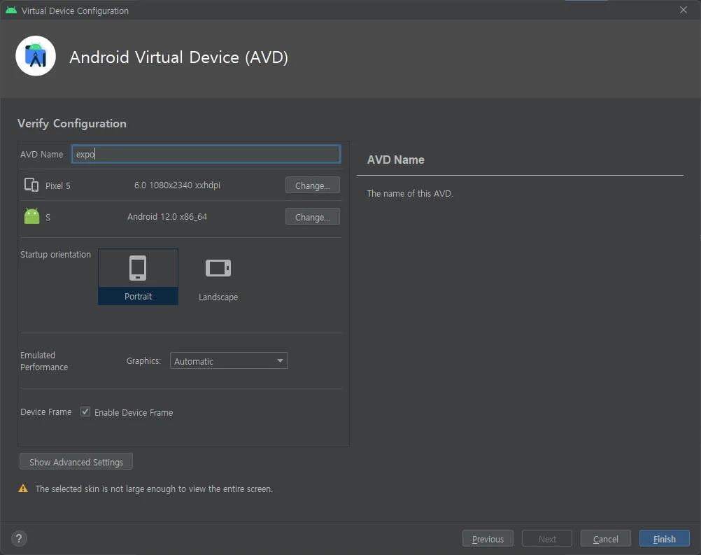

AVD Name은 한 단어로 짧게 써주세요 (뒤이어 설명할 추가 설정과 관련이 있음)

그리고 Finnish를 누릅니다

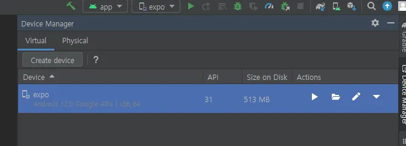

재생을 누르면

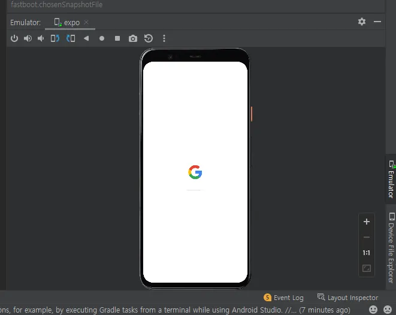

하단에 요런 식으로 에뮬레이터가 준비됩니다.

초기 세팅은 시간이 오래 걸리므로 에뮬레이터의 홈 화면이 나올 때까지 대기합니다.

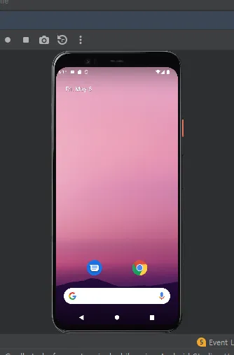

이렇게 에뮬레이터가 실행되면 끝입니다.

~~이다음 설정은 필수는 아니고 선택이므로 관심 없는 사람은 3번 항으로 넘어가세요~~

Android Studio를 종료합니다.

#### Android Studio 없이 Emulator 실행하기

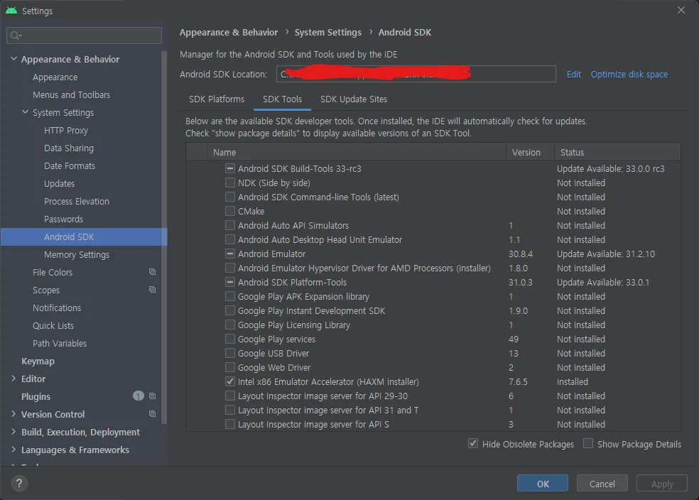

앞서 했던 세팅 중에 이런 화면이 있었습니다.

위에 빨간 줄로 가려놓은 주소(Android SDK Location)를 복사합니다.

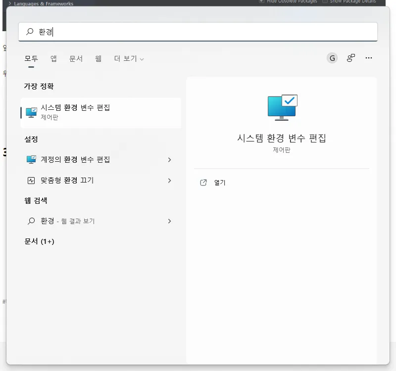

윈도우 키 누르고 시스템 환경 변수 편집을 검색하여 실행합니다.

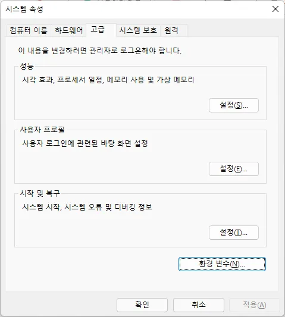

환경 변수를 누르고

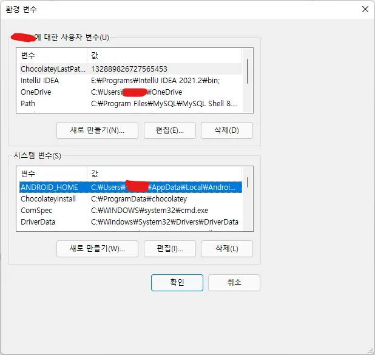

만약에 위와 같이 시스템 변수에 ANDROID\_HOME 변수가 없다면 시스템 변수에 새로 만들기를 눌러

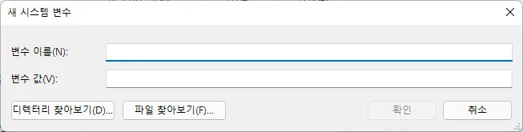

<table><tbody><tr><td>변수 이름에 <b>ANDROID_HOME</b> 변수 값에 위에서 복사한 <b>sdk 주소(Android SDK Location)</b>를 적습니다.</td></tr></tbody></table>

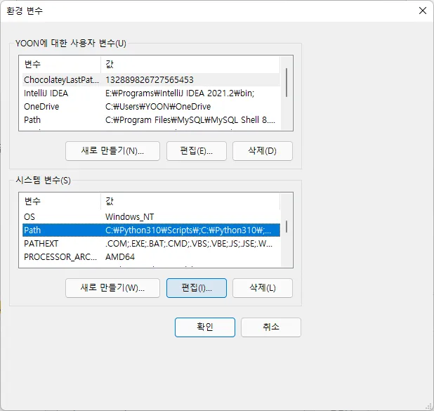

시스템 변수의 Path를 누르고 편집을 누릅니다

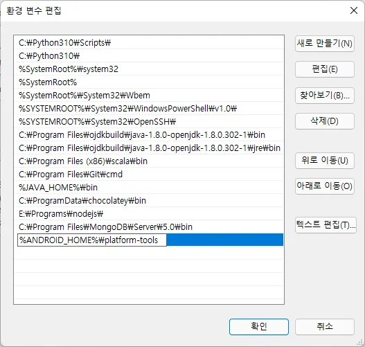

<table><tbody><tr><td><b>%ANDROID_HOME%\platform-tools</b><b>&nbsp; &nbsp;를 추가하고 저장합니다.</b></td></tr></tbody></table>

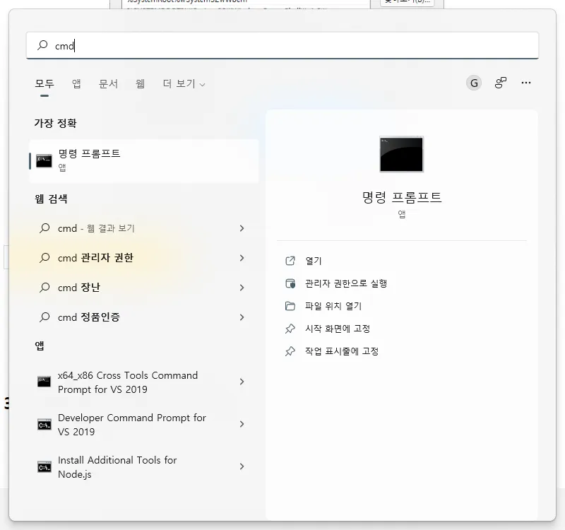

명령 프롬프트 cmd를 실행합니다.

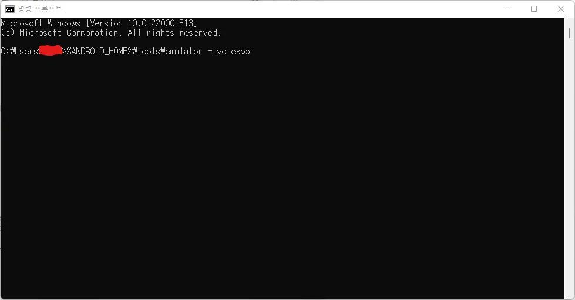

<table><tbody><tr><td><b>%ANDROID_HOME%\tools\emulator -avd [앞서 정해줬던 AVD name]</b></td></tr></tbody></table>

을 입력하고 엔터를 누릅니다.

## "PANIC: Missing emulator engine program for 'x86' CPUS."

(위 경고문이 뜨는 경우 tools 대신 emulator로 바꿔서 입력합니다)

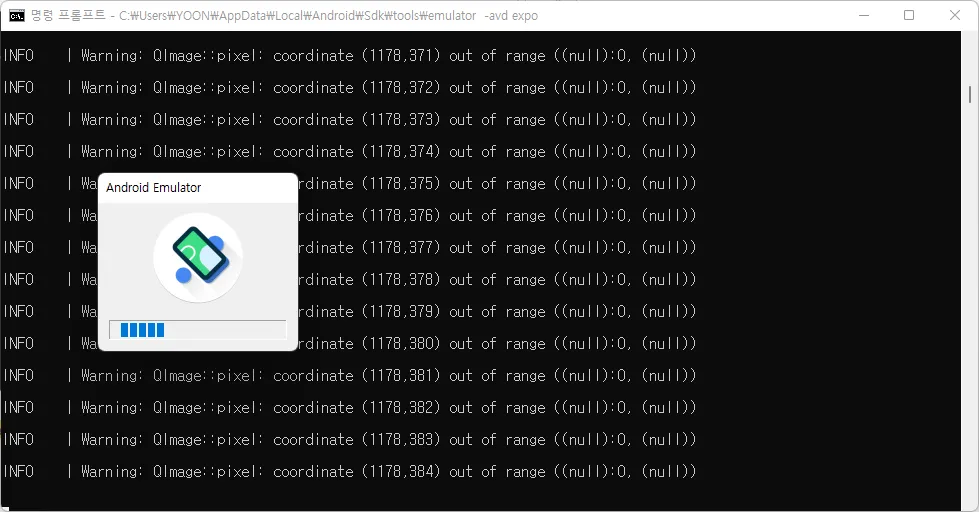

좀 기다리면

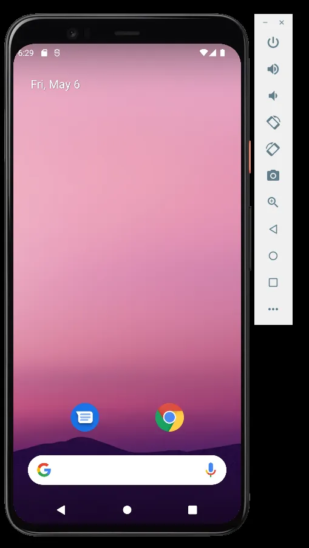

이렇게 Android Studio 실행 없이도 에뮬레이터를 돌릴 수 있습니다.

## 3\. Visual Studio에서 Expo 실행

에뮬레이터가 켜져 있는 상태로 Visual Studio에서 React Native Expo를 실행시킵니다.

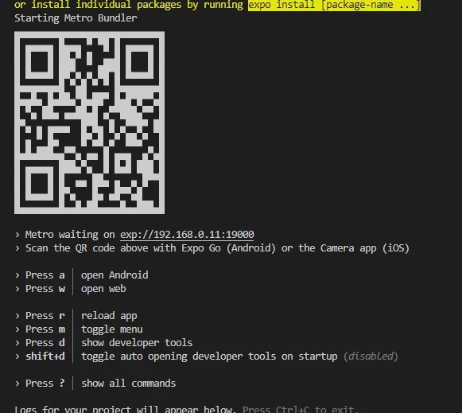

해당 터미널에 마우스 클릭 한번 찍은 후, 키보드에서 a를 **한 번만** 누릅니다

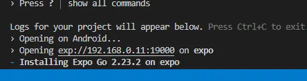

감지된 에뮬레이터에 Expo 앱을 자동으로 설치하고 실행해줍니다.

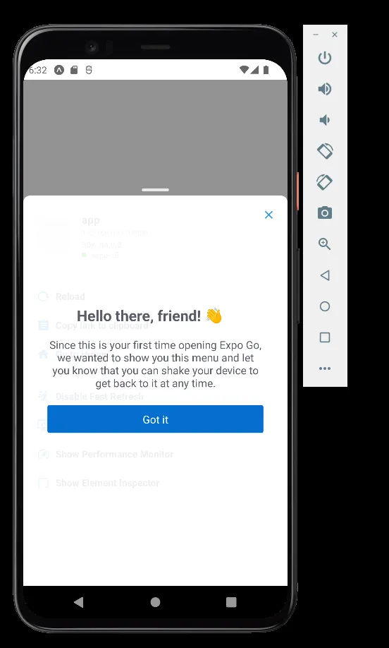

끝
