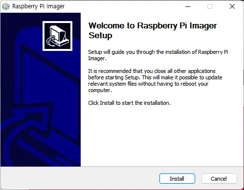
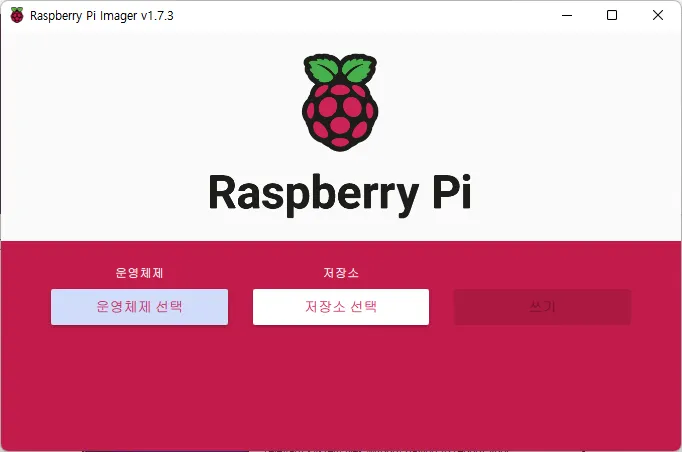
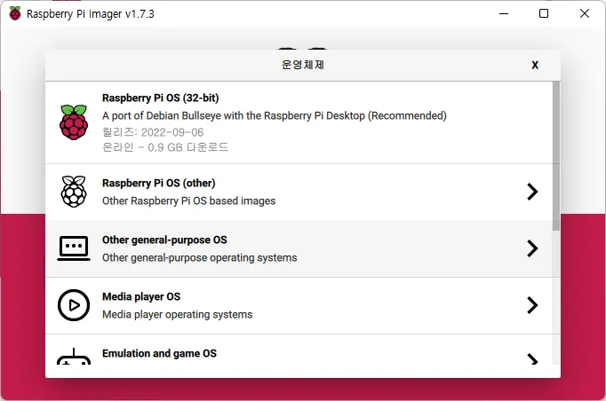
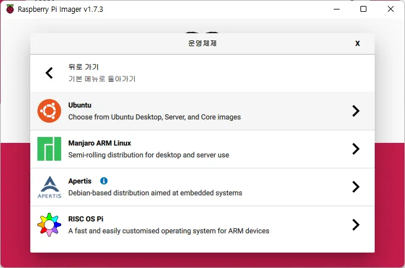
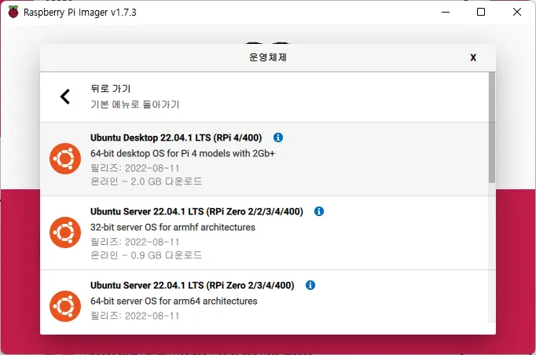
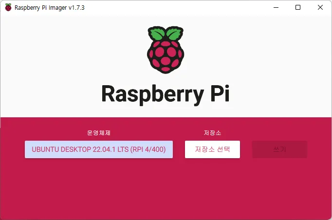
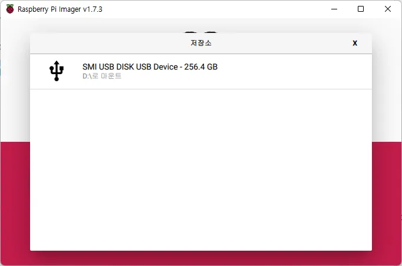
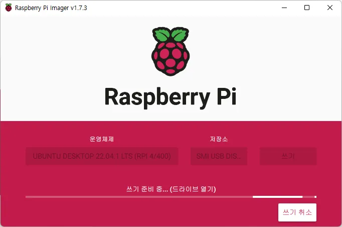

> 이 글은 2022-09-18에 티스토리 블로그(leirbag.tistory.com/121)에 처음 작성한 글을 옮겨온 것입니다.

## 준비물

라즈베리파이, Micro SD 카드

## 참고한 글

[https://ubuntu.com/tutorials/how-to-install-ubuntu-desktop-on-raspberry-pi-4#1-overview](https://ubuntu.com/tutorials/how-to-install-ubuntu-desktop-on-raspberry-pi-4#1-overview)

> [**How to install Ubuntu Desktop on Raspberry Pi 4 | Ubuntu**](https://ubuntu.com/tutorials/how-to-install-ubuntu-desktop-on-raspberry-pi-4)  
> Ubuntu is an open source software operating system that runs from the desktop, to the cloud, to all your internet connected things.

## 다운로드 파일

**아래 링크를 눌러 설치해줍니다.**

-   [Raspberry Pi Imager for Windows](https://downloads.raspberrypi.org/imager/imager_latest.exe)

Next

운영체제 선택 후

Other general purpose OS 클릭

우분투 클릭

Desktop을 선택하셔야 GUI와 함께 사용할 수 있습니다.

삽입 한 Micro SD카드를 선택합니다.

끝난 후, 라즈베리파이에 넣고 전원을 키시면 부팅이 됩니다.
