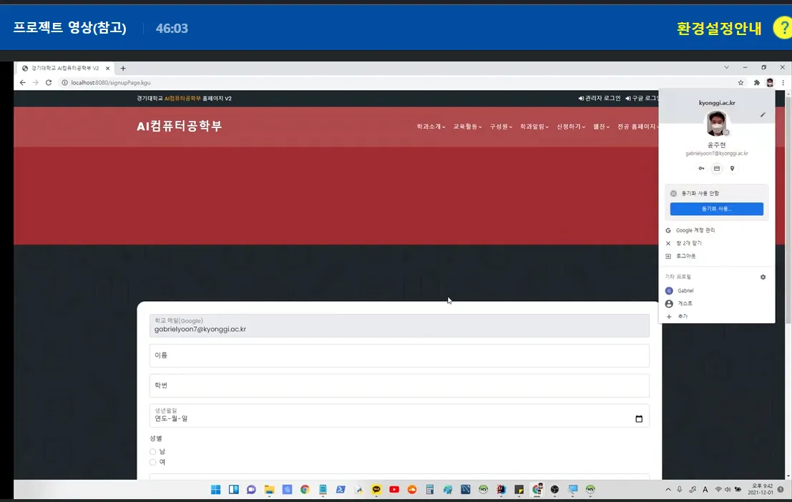

> 이 글은 2022-11-18에 티스토리 블로그(leirbag.tistory.com/123)에 처음 작성한 글을 옮겨온 것입니다.

작년 2학기 수업시간에 과제로 제출했던 JSP 과제가

올해 참고 영상으로 등장했다고 합니다.

(자랑임)

기본적인 홈페이지 내용을 구현했던 기능으로는

url에 따른 테마 제어

관리자 모드에서 전공별 테마 색상 설정

관리자 모드에서 학부 내 전공 홈페이지 추가

Google Workspace 계정 간 구글 로그인 기능

등이 있었던 프로젝트입니다.
