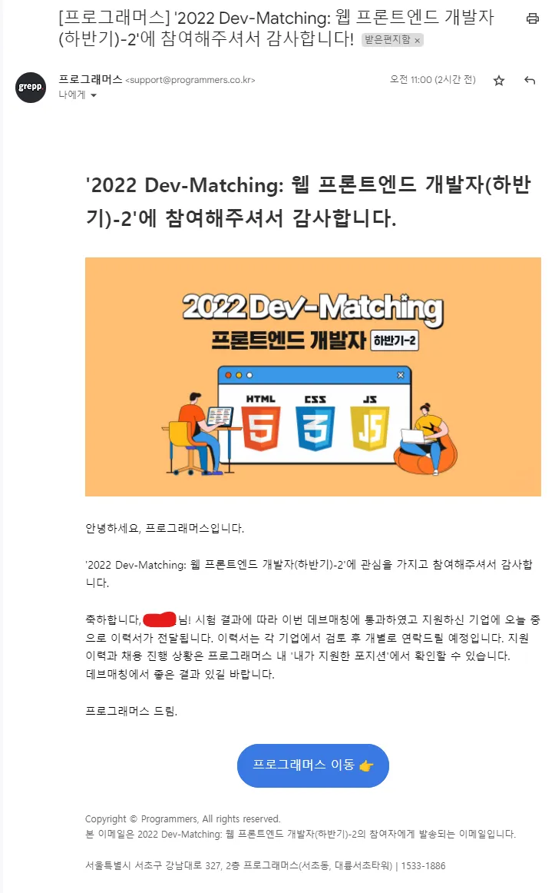

> 이 글은 2022-11-22에 티스토리 블로그(leirbag.tistory.com/124)에 처음 작성한 글을 옮겨온 것입니다.

[https://career.programmers.co.kr/competitions/2990](https://career.programmers.co.kr/competitions/2990)

> [**2022 Dev-Matching: 웹 프론트엔드 개발자(하반기)-2**](https://career.programmers.co.kr/competitions/2990/2022-web-fe-third)

10월 말 쯤 인스타그램 스토리를 넘기다가 프로그래머스에서 데브매칭을 진행한다는 광고를 접했습니다.

연말에 해야할게 많아서 지원할까말까 고민했는데

아무리 바빠도 겨우 4시간을 투자하지 못한다는건 핑계에 불과하다는 생각이 들어 지원하게 됐습니다.

문제는 캡쳐하면 안된다고 해서 따로 캡쳐하지는 않았습니다.

기억나는대로 적어보면

페이징 기법이 적용된 동적 테이블을 JavaScript로 만드는 것이었습니다.

> 1\. 주어진 JSON 리스트를 수신해서  
> 2\. 테이블로 구현하기  
> 3\. 한번에 5개/15개씩 보기를 선택할 수 있어야 함  
> 4\. 하단에 페이지 번호 있어서 테이블 내용이 페이지 수에 맞게 유동적으로 바뀌기  
> 5\. 페이지 끝에서 끝으로 이동

전형적인 동적 테이블을 구현하는 것입니다.

중요한 것은 라이브러리는 사용이 금지였는데,

부트스트랩을 못써서 어떡하나 싶어서 걱정했지만 별 일 없었습니다.

지금은 React와 그에 딸린 여러 기술 위주로 사용하느라 바닐라 JS를 사용하는 것이 정말 오랜만이었지만

학과 홈페이지 관리할 때 jQuery로 머리 싸매던 경험이 많은 도움이 됐습니다.

당시에 (제가 jQuery를 잘 몰라서) 오로지 document 조작 함수만 jQuery에 의지하였고, 사실상 바닐라로 개발을 했다 보니 과제가 어렵게 느껴지지는 않았네요.

## 결과는 통과

*두둥탁*

오늘부터 내 이력서를 각 기업에 보낸다네요...

하지만 제 프로그래머스의 이력서는 ***진짜로 빈칸*** 입니다 (...)

당연히 취업을 하고 싶지만, 마음 한편으로는 공부를 좀 더 깊게 하고 싶다는 생각이 들어서 프로필 작성에 적극적이지 않았던 것 같기도 하네요.

이럴줄 알았으면 조금 더 신경써서 작성할걸 생각이 들기도 하고

그냥 실력 점검 했고 통과 메일 받은것에 만족하기도 하고...

이런 생각 하는 **나는 아직 취업에 간절하지 않은걸까?** 생각이 드는 후기
