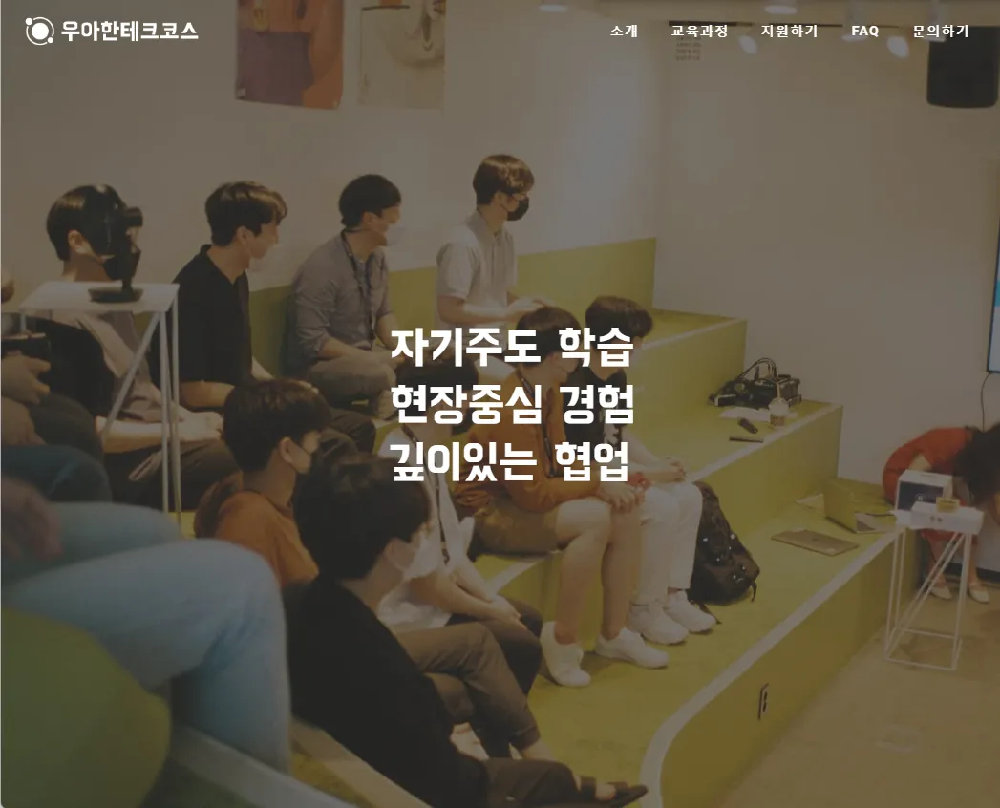
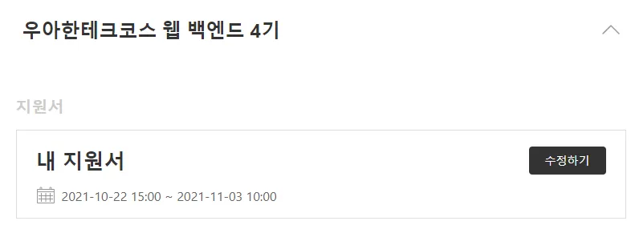
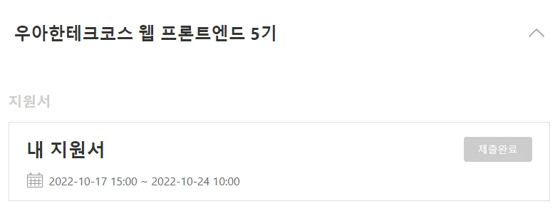
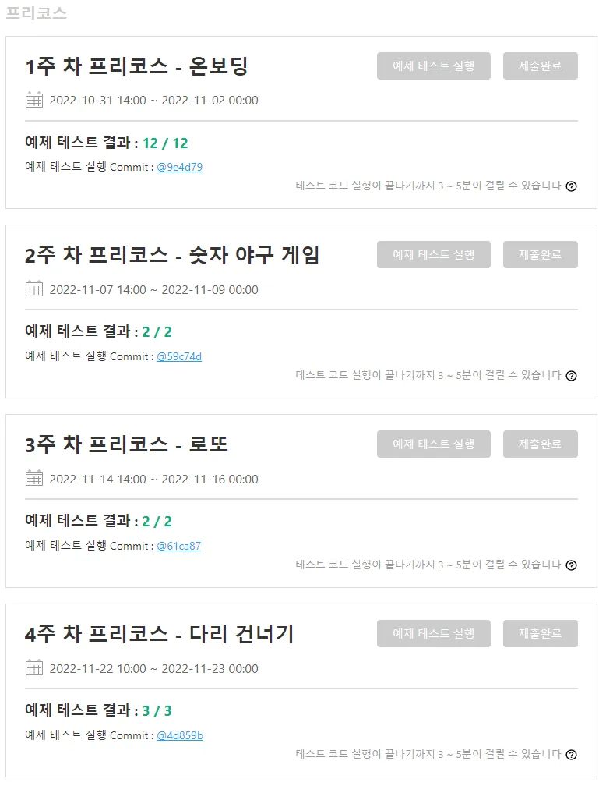

> 이 글은 2022-11-29에 티스토리 블로그(leirbag.tistory.com/125)에 처음 작성한 글을 옮겨온 것입니다.

## 개요

지난 4주(10월 31일 ~ 11월 23일)간 우아한테크코스 5기 프리코스의 웹 프론트엔드에 참여했습니다.

작년만 하더라도 제 진로에 대한 고민이 깊어 백엔드로 갈지, 프론트엔드로 갈지 명확하게 정하지 못했지만

4학년이 들면서 프론트엔드로 확실하게 정했고, JavaScript만이 나의 길이라고 생각하고 올 한해를 바쳤습니다.

저는 작년에 우테코 백엔드에 지원을 하려고 했습니다만...

*텅*

3학년인 입장에서, Java에 대한 자신감이 많이 부족했고

솔직하게 말하면 ***용기가 없어서*** 작성하던 모든 글을 지우고 지원 당일 날 제출하지 않았습니다.

*올해는 지원했다.*

올해는 달랐습니다.

그간 학과 홈페이지를 유지보수하고 개발해오면서 FE/BE/DB 가리지 않고, 학습한 것들을 되돌아 봤을때

제 적성에 맞는 길은 프론트엔드였습니다.

사용자에게 직접 마주할 수 있는 개발이 제일 재밌었습니다.

결정적으로는...

저는 한번 제대로 흥미를 느끼는 것에 푹 빠지는 성격인데

앞으로 이걸로 평생 먹고 살아도 될 것 같다는 생각이 계속 들어왔고, 이제는 확신이 들었습니다.

작년 말, 이런 확신이 든 직후에는 정말 JavaScript를 열심히 준비해왔습니다.

물론 학교에서는 JS를 ~~공기~~ 취급하기에 학교에서 받을 수 있는 도움은 솔직히 말하면 없었습니다.

그럼에도 불구하고 나홀로 책 사가며, 구글에 돌아다니는 문서 찾아가며 깊게 공부하려고 노력했습니다.

이런 노력 끝에 이제는 코딩테스트도 JS로 준비하고,

몇몇 시험(ICT, 프로그래머스)에선 이 언어로 코테를 통과까지 할 정도로 JS가 편해졌다고 생각합니다.

하지만 항상 제 스스로 이 길이 맞는지, 이렇게 공부하는지 맞는지에 대한 의구심이 심하게 들었고

웹 프론트엔드 관련 기술을 제대로 배웠으면 좋겠다는 갈증이 있어

올해 만큼은 용기를 내어 우테코 5기 프론트엔드에 지원했습니다.

## 지원하다

솔직히 말하면 지원서 문구를 어디에 백업해 둔 것이 아니라 잘 기억이 나지 않지만

그동안 어떻게 학습 해왔는지, 어떤 열정을 보였는지 등에 대한 내용을 질문했던 것 같습니다.

500~1000자 사이의 칸이었던 것 같은데, 하고 싶은 말이 정말 많았지만 꾹꾹 눌러담아 썼다고 생각합니다.

제 기억에, 이 날 제출 마감 직전까지 문장을 고치면서 제출을 했습니다.

이번 우테코는 별도의 선발과정 없이, 프리코스를 모두에게 오픈하여 4주 간 먼저 진행한다음

선발된 인원에 한해서 코딩테스트를 진행한다고 합니다.

## 프리코스를 진행하다.

50명을 뽑는데 1주차 과제를 포크해 간 사람이 800명이 넘는 것을 보고 기겁했습니다.

이렇게 경쟁자가 많다니!

물론 국내 최고의 부트캠프로 손꼽히고 있고, 특히나 싸피는 JS 코스가 없기에 이렇게 사람이 몰리는 것은 당연했습니다.

프리코스를 진행하기 위해 Slack 채널에도 초대 받고, 매주 미션 메일을 수신받고, 피드백이 담긴 유튜브 라이브도 시청했습니다.

<iframe src="https://www.youtube.com/embed/RiL-kPRmMKE" title="video" style="width:100%;aspect-ratio:16/9;border:0" loading="lazy" allowfullscreen=""></iframe>

미션은 매주 조금씩 규칙이 추가되어 신경써야 할 부분이 많아지도록 설계 되었습니다.

프리코스에서 중점적으로  받은 피드백은 다음과 같습니다.

*아래 부분은 문제가 되면 삭제하겠습니다.*

> 1주차  
> 요구사항을 정확히 준수한다  
> 커밋 메시지를 의미 있게 작성한다  
> git을 통해 관리할 자원에 대해서도 고려한다  
> Pull Request를 보내기 전 브랜치를 확인한다  
> PR을 한 번 작성했다면 닫지 말고 추가 커밋을 한다  
> 이름을 통해 의도를 드러낸다  
> 축약하지 않는다  
> 공백도 코딩 컨벤션이다  
> 공백 라인을 의미 있게 사용한다  
> space와 tab을 혼용하지 않는다  
> 의미 없는 주석을 달지 않는다  
> linter와 Code Formatter의 기능을 활용한다  
> EOL(End Of Line)  
> 불필요한 console.log를 남기지 않는다  
> JavaScript에서 제공하는 API를 적극 활용한다  
>  
> 2주차  
> README.md를 상세히 작성한다  
> 기능 목록을 재검토한다  
> 기능 목록을 업데이트한다  
> 값을 하드 코딩하지 않는다  
> 구현 순서도 코딩 컨벤션이다  
> 한 함수가 한 가지 기능만 담당하게 한다  
> 함수가 한 가지 기능을 하는지 확인하는 기준을 세운다  
> JavaScript에서 객체를 만드는 다양한 방법을 이해하고 사용한다.  
> 테스트를 작성하는 이유에 대해 본인의 경험을 토대로 정리해본다  
> 처음부터 큰 단위의 테스트를 만들지 않는다  
>  
> 3주차  
> 함수(메서드) 라인에 대한 기준  
> 발생할 수 있는 예외 상황에 대해 고민한다  
> 비즈니스 로직과 UI 로직을 분리한다  
> 객체의 상태 접근을 제한한다  
> 객체는 객체스럽게 사용한다  
> 필드의 수를 줄이기 위해 노력한다  
> 성공하는 케이스 뿐만 아니라 예외에 대한 케이스도 테스트한다  
> 테스트 코드도 코드다  
> 테스트를 위한 코드는 구현 코드에서 분리되어야 한다  
> 단위 테스트하기 어려운 코드를 단위 테스트하기

미션 자체는 코딩을 좀만 경험해본 사람이라면 누구나 풀 수 있는 수준으로 출제되었으나,

그에 따르는 세부 규칙이 정말 다양했습니다.

~~(비록 Java에 관한 설명이었지만)~~ 학교에서 귀에 못이 박히도록 들은 코드를 어떻게 하면 더 안정적으로 작성하는지, 남이 보기 좋은 코드가 무엇인지, 테스트는 어떻게 하는지 등 주요한 내용들이

이번 프리코스에서 굉장히 중심적으로 다뤄졌습니다.

AngularJS의 Git Commit Convention

Airbnb의 JS Style Guide

Jest로 테스트 하는 방법

eslint를 활용한 코드 규칙 설정

등 굉장히 빡빡한 규칙들이 있어 코드를 어떻게 하면 더 깔끔하게 작성할 수 있을지에 대한 고민으로 가득 찬 4주였습니다.

JavaScript의 본연에 집중하는 것도 굉장히 어려운 일이지만, 이런 세부 규칙을 지키면서 코드를 작성한다는 것이 얼마나 어렵고, 프로의 길은 얼마나 멀리 있는지를 새삼 느끼게 됐습니다.

규정 상 질문도 할 수 없습니다. 알아서 스스로 해결해야 합니다.

물론 저는 원래 질문을 하기 보다 스스로 찾아 해결해내는 것을 좋아하는 성향이라 크게 불편하지 않았지만, 슬랙 내부에서 올라오는 글 마다 계속 질문을 자제하라는 이모지?가 달린 것을 보니 이런 것이 불편한 사람들도 많았을 것으로 예상합니다.

스스로 생각할 수 있는 시간을 깊게 가질 수 있어서 참 좋았던 것 같습니다.

하지만 시간이 지나면서 점점 포기하는 사람이 많았는지, 매주 과제를 포크해간 사람이 조금씩 줄었습니다.

어떤 이유인지는 정확하게 파악이 어렵지만, 마지막 과제를 포크해간 사람은 528명이고 제출한 사람은 478명인 것으로 보았을 때, 생각보다 포기를 한 사람이 많았습니다.

저는 졸업도 늦고 이번 기회가 아니면 다시 기회가 주어지지 않을 것 같다는 생각이 들어 절대로 중도에 포기할 수 없었지만, 최근에 바쁜 일이 너무 몰려서 정말 내외적으로 힘든 시간을 가졌음에도 불구하고 우테코를 무조건 우선 일정으로 정해두고 눈물을 머금으며 미션을 수행했습니다.  

## 되돌아 볼 점

*모든 미션을 제출했다*

과제 제출한걸 보니 정말 잘하는 지원자가 많았습니다.

어떻게 이런 생각을 했는지 싶은 사람들도 있었고, 코드가 참 깔끔하다고 느낀 사람도 있었습니다.

피드백을 해달라는 요청도 많이 올라와서 다 읽어볼 수 없을 정도로 글이 많았습니다.

커뮤니티 활동을 활발히 하는 사람들의 글을 보니 기죽을때도 많았고, 어떻게 글을 저렇게 잘 쓰는지 감탄할 때도 많았습니다. 물론 프리코스를 담당하시는 코치님들은 커뮤니티 활동이 선발에 영향을 주지 않을 것이라고 하셨지만, 타인에게 자신의 생각을 잘 전달하는 것도 하나의 능력이니 참 배우고 싶다는 생각이 들었고, 블로그에 꾸준히 글 쓰면서 연습해야 하나 고민이 깊어졌습니다.

사실 이 글도 원래는 ~~용기가 없어~~ 작성할 생각이 없었으나, 다른 사람들이 생각을 기록으로 남기는 것을 보고 자극 받아 남깁니다.

지난 과제를 천천히 읽어보면서 내린 제 스스로에 대한 평가는

> \- 테스트 케이스를 너무 빈약하게 짰다.  
> \- 미션 제출 소감문에 어떻게 학습했는지에 대한 내용이 잘 묻어나지 않게 쓴 것 같다.  
>     - 소감문을 얼마나 길게 써야할 지 모르겠고, 읽으시는 분이 지루해하실까봐 글이 루즈해지지 않도록 작성했는데 이게 독이 될 수도 있다는 생각이 든다.  
> \- JS의 클래스 문법을 다시 공부해야 할 것 같다.  
>     - 클래스 문법을 좀 더 잘 알았다면 테스트 케이스를 더 잘 작성했을 수 있을 것 같다는 아쉬움이 든다.  
> \- 콜백에 대해 다시 알아보자

## 이 글을 마치며...

이런 좋은 미션을 모두에게 공개해주셔서 감사합니다.

그간 JavaScript를 누군가로부터 학습받는 것이 처음이라 정말 색다른 경험이었고,

테스트 코드의 중요성, 작업 순서에 대한 고민, git에 대한 이해도 등

스스로 많은 성장을 할 수 있는 시간이였고, 꼭 합격해서 더 많은 것을 배우고 싶다는 생각이 드는 4주였습니다.

배민 화이팅!

[https://github.com/gabrielyoon7/javascript-onboarding](https://github.com/gabrielyoon7/javascript-onboarding)

> [**GitHub - gabrielyoon7/javascript-onboarding: 온보딩 미션을 진행하는 저장소**](https://github.com/gabrielyoon7/javascript-onboarding)  
> 온보딩 미션을 진행하는 저장소. Contribute to gabrielyoon7/javascript-onboarding development by creating an account on GitHub.

[https://github.com/gabrielyoon7/javascript-baseball](https://github.com/gabrielyoon7/javascript-baseball)

> [**GitHub - gabrielyoon7/javascript-baseball: 숫자 야구 게임 미션을 진행하는 저장소**](https://github.com/gabrielyoon7/javascript-baseball)  
> 숫자 야구 게임 미션을 진행하는 저장소. Contribute to gabrielyoon7/javascript-baseball development by creating an account on GitHub.

[https://github.com/gabrielyoon7/javascript-lotto](https://github.com/gabrielyoon7/javascript-lotto)

> [**GitHub - gabrielyoon7/javascript-lotto: 로또 미션을 진행하는 저장소**](https://github.com/gabrielyoon7/javascript-lotto)  
> 로또 미션을 진행하는 저장소. Contribute to gabrielyoon7/javascript-lotto development by creating an account on GitHub.

[https://github.com/gabrielyoon7/javascript-bridge](https://github.com/gabrielyoon7/javascript-bridge)

> [**GitHub - gabrielyoon7/javascript-bridge**](https://github.com/gabrielyoon7/javascript-bridge)  
> Contribute to gabrielyoon7/javascript-bridge development by creating an account on GitHub.
