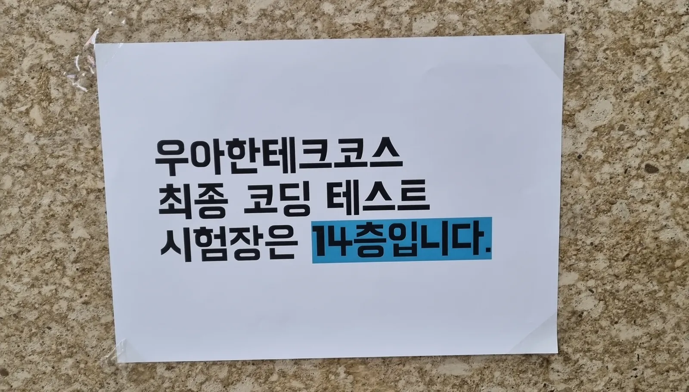
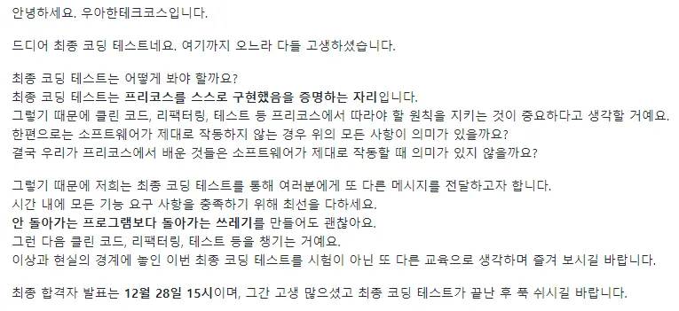
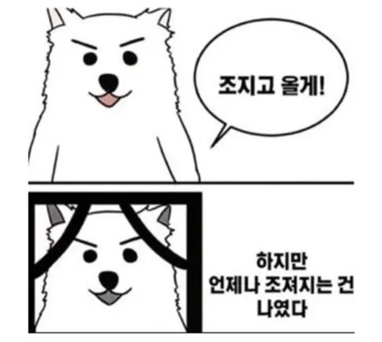

> 이 글은 2022-12-21에 티스토리 블로그(leirbag.tistory.com/127)에 처음 작성한 글을 옮겨온 것입니다.

#### 이전 글

> [**\[회고\] 우아한테크코스 5기 프리코스 (FE)**](../2022-11-29-tistory-125/)  
> 개요 지난 4주(10월 31일 ~ 11월 23일)간 우아한테크코스 5기 프리코스의 웹 프론트엔드에 참여했습니다. 작년만 하더라도 제 진로에 대한 고민이 깊어 백엔드로 갈지, 프론트엔드로 갈지 명확하게

## 프리코스 종료 이후

프리코스가 끝나고 그 동안 밀린 할 일을 처리하기 시작했습니다.

몇 달 동안 준비했던 대학생논문경진대회에도 나가고, 기말고사도 보고, 학교에 제출해야 하는 각종 서류들을 하나씩 처리해가면서 다시 일상으로 돌아와서 해야할 일을 하기 시작한 것이었습니다.

그동안 바빠서 읽지 못했던 JavaScript Deep Dive도 다시 펴고, 학교에서 새롭게 제의 받은 토이 프로젝트에도 참여하는 등 다시 하고 싶은 일들을 하기 시작했습니다.

앞서 언급했던 논문경진대회에서 [상](https://ki-it.or.kr/%EA%B3%B5%EC%A7%80%EC%82%AC%ED%95%AD/11591766)도 받고, 참가를 위해 진행했던 프로젝트를 개인프로젝트로 전환하여 추가로 진행하는 등, 심적 여유를 가지면서 이런 저런 일들을 할 수 있는 시간을 가졌던 것 같습니다.

그동안 제출했던 프리코스 과제에서 배웠던 내용들도 다시 읽어보고 복습하고, 어떤 것이 부족했는지를 알아가는 시간이었습니다.

지난 회고에서 언급했던 것 처럼 실제로 *Jest 사용법*이나, *클래스 문법*, *바인딩*, *콜백* 등 프리코스 기간 내내 이해하기 힘들었거나 사용이 불편했던 부분을 시간적 여유를 가지고 파고 들기도 했습니다. 이렇게 풀면 어땠을까? 저렇게 풀면 어땠을까? 하면서 더 읽기 쉬운 코드란 무엇인지 여러 레퍼런스를 찾아다니기도 했고, 자바스크립트와 훨씬 더 친해질 수 있도록 노력하는 시간을 가졌습니다.

한편으로는 ***우테코에 떨어지면 어떡하지?***라는 불편한 마음이 있었지만 그냥 평소처럼 학교 다니면서, 하고 싶었던 활동이나 공부 하면서 아무렇지 않은 척 했습니다. 슬랙이나 디스커션 글을 보니, 삼삼오오 모여서 공부를 하는 사람들도 있어서 괜한 불안감이 생기기도 했지만요.

## 프리코스 1차 합격 이후

발표 날, 3시에 메일이 온다고 해서 1시부터 네이버 시계를 켜놓고 있었습니다. 세상에서 가장 긴 2시간이더군요.

솔직히 떨어질 줄 알았습니다. 저보다 잘한 사람들이 많았다고 생각했습니다.

심지어 소감문은 읽는 코치님들이 지루해할 것 같다는 생각이 들어 길게 작성하지도 않았습니다. 물론 대충 작성했다는 의미는 아닙니다. 미션 진행하면서 느낀 감정들이나 느낀점에 대해서는 굉장히 상세하게 적었습니다.

*제 진심이 전달된 걸까요?*

아무튼 갑자기 합격해버려서, 시험 날 까지의 모든 일정을 비우고 새로운 학습 보다는 그 간 받았던 피드백 메일을 더 꼼꼼히 검토하는 등, 들뜬 마음을 가라앉히고 마음을 편하게 가지려고 노력했습니다.

## 시험보러 가는 길

시험 당일 날, 정전에 단수가 된 사람이 저 말고 또 있을까요?

새벽 4시부터 정전됐다고 관리사무소 방송이 나오는데, 그 시간에 누가 정전이 궁금하다고 음악 틀면서 방송을 해야하는지 모르겠지만, 괜히 싱숭생숭해져서 잠에서 깨버렸습니다.

몇 시에 잠들었는지는 몰라도, 해가 뜨고 다시 잠들었는데...

오전 10시 쯤 다시 방송이 나와서 잠에서 깼습니다. 이번엔 단수랍니다.

사실 11시에 일어나서 씻고, 11시 30분 쯤 출발해서 12시 쯤 잠실에 도착하는게 계획이었는데 물이 안나온다니!!

어머니가 당근마켓 앱에서 검색해보시니 정전이란 단수 난 지역이 벌써 공유된다고 귀뜸을 해주셨는데

그 얘기를 듣자마자 재빨리 집근처 사우나로 달려갔습니다.

*안내 방송 때문에 잠을 설쳤는데, 안내 방송 덕분에 일찍 일어나서 씻고 시험보러 갈 수 있었습니다.??*

잠실에는 12시 10분 쯤 도착했는데, 가는 길에 안내 메일을 받았습니다.

*최종 미션 메일*

갑자기 실감이 나기 시작했고, 긴장이 되기 시작했습니다.

원래 긴장을 잘 안하는 성격인데, 요 몇달 새 우테코를 하면서 성격이 바뀌었나 봅니다.

그런데, 평소와는 다른 문장들이 보였습니다.

코드 작성 원칙 지키느라 구현을 다 못하지 말고, 돌아가는 쓰레기라도 만들라니! ~~중요한 것은 꺾이지 않는 작동~~

아 그냥 오늘은 시간 제한 있으니깐 이런 메시지를 전달하셨나보다 생각했습니다.

커피 한잔 사들고 시험장으로 이동했는데.. 스트리밍에서만 보던 우테코 잠실 캠퍼스(?)를 보니 너무 신기했습니다.

혹시 보안에 문제가 될까 사진을 찍지는 않았는데, 약간 카페에 온 느낌이 들었네요.

제가 회사를 안다녀 봐서, 대면 면접을 한 군데 밖에 안봐서 잘 모르는 것일 수도 있지만

딱딱한 인테리어는 절대 아닌 곳이었습니다.

기념품으로 펜과 노트를 받고 안내해주시는 자리에 앉아서 시험을 봤습니다.

## 시험

*한짤요약*

결론부터 말씀드리자면 망했습니다.

***안 돌아가는 프로그램보다 돌아가는 쓰레기를 작성하라는 말***이 이런 말이었구나 싶었습니다.

문제 난이도 자체는 평이했는데, 시간 분배를 잘못해도 너무 잘못했습니다.

평소처럼 했으면 절대 안됐습니다. 괜히 심적 여유를 가진답시고 리팩토링 해가면서 코드를 짰습니다.

이 글에서 코드에 대한 직접적인 언급을 할 생각은 없습니다만 가장 문제였던 부분은 데이터를 연속적으로 입력받는 부분이었습니다.

코치의 수 만큼 readline을 호출해야하는 문제였는데, 그냥 단순히 콜백으로 처리했으면 될 일이었습니다.

처음부터 알았습니다. 그냥 이거 콜백으로 쓰면 된다고.

근데 그냥 코드가 지저분해지는게 싫었습니다. 머리는 이해했지만, 마음은 아니었습니다.

괜히 비동기 처리 기능을 쓰겠다고 고집 피우다가 1시간 40분이나 날렸습니다.

집에서 혼자 프리코스 이후에, 이 부분을 Promise로 해결한 적이 있었거든요.

물론 문제에서 async/await을 사용하지 말라는 문장이 있었지만, Promise를 사용하지 말란 말은 없었으니깐요.

***돌아가는 쓰레기***를 명심했어야 했습니다.

생각처럼 프로그램이 돌아가지 않자 굉장히 당황했고, reduce로 실행하는 법, Promise.all 등 여러 시도 끝에 그냥 깔끔하게 포기하기로 했습니다.

이 부분에 대해서 많은 대비를 해 간 상태여서 더 결정이 어려웠던 것 같고, 뼈아픈 실책으로 이어졌습니다.

마지막 커밋이 2시 42분이었고, 이 [문제를 결국 콜백으로 해결했을 때](https://github.com/gabrielyoon7/javascript-menu/commit/c6dad7130717862a3fb1079553f2cfa79cae09f0)의 시간이 4시 20분이니

얼마나 바보같은 짓을 했는지 감이 오시나요?

후회하기에는 1분 1초가 아쉬워진 저는, 남은 시간이 얼마 되지 않아서 급하게 남은 기능을 구현하기 시작했습니다.

요일별로 카테고리도 잘 추천해줬고, 해당 카테고리에 맞춰서 코치의 메뉴를 정하는 것도 됐습니다.

***5시 40분 이후에 다 구현했다고 생각했는데, 이번엔 테스트 코드가 문제였습니다.***

사실 테스트 코드를 분석 할 시간이 너무 부족했습니다.

시간이 조금만 더 여유로웠으면 jest 코드를 분석 할 시간이 있었을 텐데... 뭔가 셔플 쪽에서 문제가 있는 것 같았습니다.

사실 테스트 코드를 돌리기 전 까지는, 시간을 많이 쏟았을 뿐 심적 부담이 있지는 않았습니다.

그런데 갑자기 테스트 코드가 돌아가지 않는 것을 보고 멘붕이 오기 시작했습니다.

*남은 시간은 20분인데 어떡하지?*

갑자기 코드가 눈에 들어오지도 않고 좌절감에 휩싸였습니다.

이때부터는 당황함이 저를 압도하여 더이상 뭘 할 수 있는 상태가 아니였습니다.

결국 엉망진창 코드는 포기하고, 55분부터 제출과 소감문을 급히 작성하고 시험을 마쳤습니다.

## 에필로그

집에 돌아 가는 길 내내 왜 그런짓을 했는지 후회했습니다.

집에 가서는 저녁도 대충 먹고 어디가 문제였는지 복기하기도 했습니다.

싫어하는 메뉴 제거도 잘못 됐고, 누가봐도 리팩토링이 시급한 코드였습니다.

셔플도 테스트코드를 제대로 읽었으면 됐던 문제였습니다.

중간에 쓸데 없는 집착만 안했어도 시간 가지고 해결할 수 있는 문제였는데..

시간 관리를 좀 더 타이트 하게 할걸,,,

몇날 며칠 제 머릿속에 이런 생각이 떠나지 않았습니다.

하지만 내가 왜 그렇게 바보같은 짓을 했는지 후회해봐야 늦었다는 사실은 변하지 않습니다.

저는 테스트 코드를 통과하지 못한 것이 당락에 큰 영향을 줄거라고 생각합니다.

어찌됐든 짧은 시간 내에 이걸 다 해결한 사람들은 좋은 평가를 받을 수 밖에 없으니깐요.

다른 지원자들의 프로필을 보니, 부트캠프에서 이미 훈련된 사람들도 종종 보였고 다양한 학습 활동을 했다는 사실도 너무 부러웠습니다.

컴퓨터공학을 전공했어도 학교에서는 자바스크립트 같은거 왜 하냐는 분위기와 커리큘럼 탓에 혼자 준비해야하는 어려움도 있었습니다.

진짜 한 걸음만 더 나아가면 된다고 생각했는데 아니었나봅니다.

재수 삼수하면서 수능 볼때도 이정도로 열심히 했었나 생각이 들 정도로

이번 프리코스를 통해 무언가에 진정으로 몰입할 수 있다는걸 알게됐고, 성장할 수 있는 계기가 된 것 같습니다.

다른 지원자들 보면서 자극도 많이 됐고, 함께 성장하는 것이 무엇인지를 알게되는 기간이었습니다.

이런 소중한 기회를 만들어주신 우테코 코치님들께 감사를 드리고, 다른 지원자들에게도 행운을 빕니다.

이제 나이 때문에 우테코를 다시 지원하는게 쉽지 않을거라는 생각이 드네요

그래도 이 기간을 고통이 아닌 즐거운 시간으로 보낼 수 있었습니다.

꼭 합격했으면 좋겠네요 ㅠㅠ

긴 글 읽어주셔서 감사합니다.
