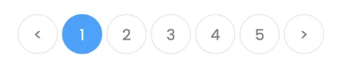
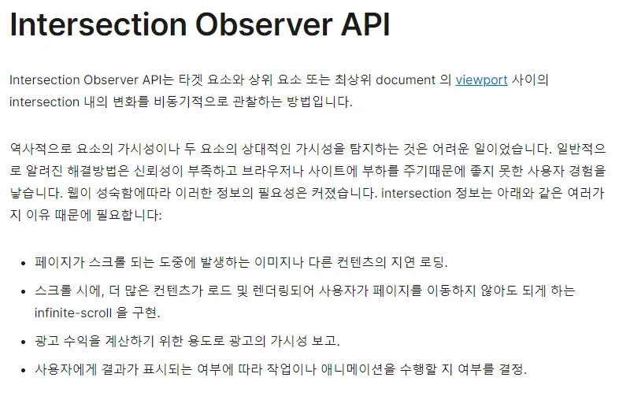
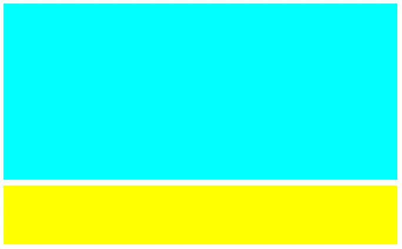
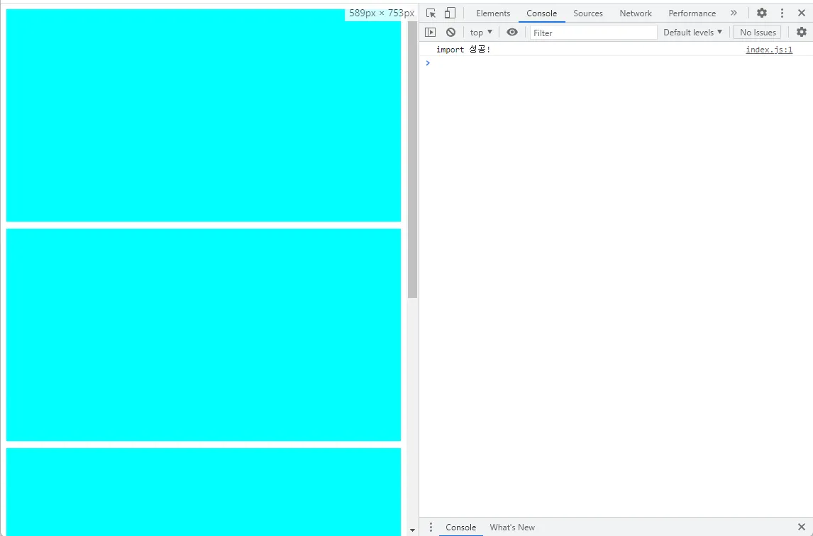
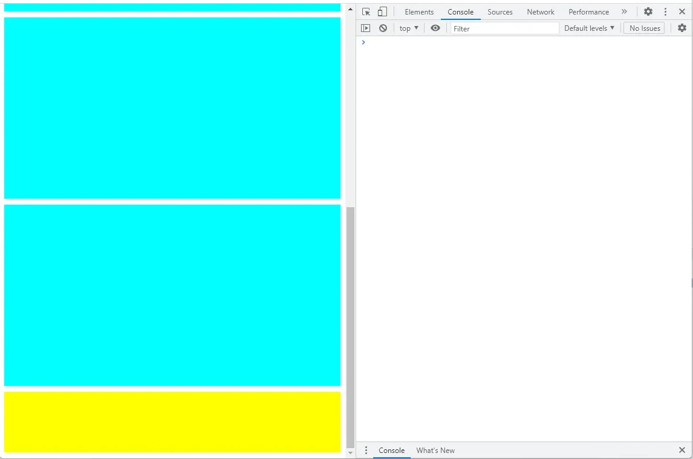
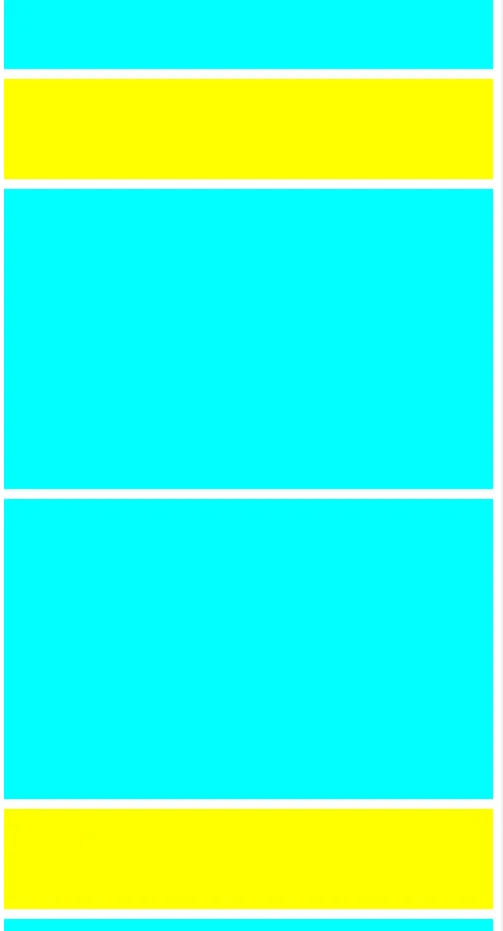

> 이 글은 2023-04-08에 티스토리 블로그(leirbag.tistory.com/137)에 처음 작성한 글을 옮겨온 것입니다.

과거에는 데이터를 Pagination으로 데이터를 소분해서 보여주던 시절이 있었습니다.



*Pagination은 지금도 잘 쓰이는 구현 방식 중 하나이다.*

하지만 점점 데이터가 무한정하게 늘어나면서 기존 방식으로는 데이터를 효율적으로 보여줄 수 없게 됐습니다.

따라서 무한스크롤(infinite scroll)이라는 개념이 등장하기 시작했고, 모던 웹과 앱에서 모두 필수적인 기능으로 자리 잡았습니다.


*무한스크롤은 이제 어디서나 접할 수 있다.*

어떤 데이터를 보여줄지만 서버에서 잘 추천해 준다면 무한스크롤은 더 동적인 웹으로 만드는데 일조하게 됩니다.

웹에서 무한스크롤을 구현하려면 어떤 방법이 있을까요?

단순하게 구현 아이디어를 생각해 봤을 때, 데이터를 페이지 단위로 서버에 요청하는 것은 Pagination과 동일할 것입니다. 다만 무한 스크롤은 기존 결과를 날리지 않고, 비동기적으로 수신받은 추가 데이터를 이어 붙여주면 된다는 차이가 있겠죠?

그렇다면 스크롤이 바닥에 닿았을 때를 감지해야 하지 않을까요?


*바닥면을 터치 하는 순간을 잡아라?*

실제로 resize를 이벤트로 걸어두고 현재의 스크롤 위치가 변화할 때마다, 지정해 둔 엘리먼트의 높이 혹은 위치와 윈도우의 높이를 비교하는 등 여러 ~~복잡한 방법으로~~ 바닥에 닿았는지를 계산하여 다음 페이지를 요청하곤 했습니다.

이 방법의 가장 큰 문제는 매번 스크롤 위치를 검사해줘야 해서 성능 이슈가 발생할 수 있고, 무엇보다 계산하는 공식이 복잡했습니다. 엘리먼트의 오프셋이 얼마인지, 스크롤 위치가 어디인지, 높이가 얼마인지 등등 개발 외적으로 고려해야 할 사항이 많았습니다.

이 방법을 획기적으로 개선해 줄 [Intersection Observer API](https://developer.mozilla.org/en-US/docs/Web/API/Intersection_Observer_API)에 대해서 소개.. 하기보다는 빠르게 빠르게 사용법을 안내하겠습니다.

일단 문서의 제목부터 수상합니다. Intersection은 교차점이 아닌가? Observer는 감시자가 아닌가?



*공식 문서에 있는 설명을 가져오자면...*

Intersection은 교차의 의미를 가진 단어죠.

사실 네이티브가 아닌 사람의 입장에서는 이게 무슨 소리인가 싶겠지만, 공식문서에 힌트가 잘 나와있습니다. 최상위 Document의 Viewport 사이의 Intersection 즉, 화면과 DOM이 교차하는 지점, 브라우저의 화면 영역에 해당 엘리먼트가 노출 중인지를 말하는 것입니다.


*특정 엘리먼트의 등장/퇴장의 변화를 관찰한디*

즉, 화면에 노출 중이라는 의미를 intersection이라고 표현한 것이고, 이를 observing 하겠다는 의미이기도 합니다.

좀 더 쉽게 말하면 특정 엘리먼트가 화면에 나왔는지 안 나왔는지 감시하는 기능으로 생각하시면 됩니다.

사실 자세한 내용은 공식문서를 보면 됩니다!

다만 해당 문서가 다소 불친절하기 때문에 이 글을 보고 공식문서를 보러 가신다면 도움이 될 것으로 생각합니다.

#### 예제를 선보이기 전에...

이 글에서는 이해를 돕기 위해 다음과 같은 CSS 클래스 2개를 정의할 것입니다.



*하늘색은 .card / 노란색은 .target 이다*

```css
.card{
  background-color: aqua;
  height: 300px;
  margin-bottom: 10px;
}

.target{
  background-color: yellow;
  height: 100px;
  margin-bottom: 10px;
}
```

.card는 그냥 공간을 무의미하게 차지하기 위해 만들었고, 실제 코드에서는 실제로 보여줄 어떤 엘리먼트라고 생각하면 됩니다.

.target은 후술하겠지만 화면에 등장했는지 검사하기 위해 만든 엘리먼트입니다.

> .target은 실제로는 눈에 안 보이게 처리를 해도 괜찮지만 이 글에서 예제를 위해 과도하게 크기를 키웠다. 즉, 이 엘리먼트는 어떠한 CSS 스타일을 주지 않아도 되고, 비어있어도 된다. 다만, 추후에 엘리먼트를 선택하기 위한 id나 class와 같은 선택자 정도는 하나 남겨두면 된다!

#### target 엘리먼트가 화면에 등장했는지 어떻게 알지?

일단 target 엘리먼트는 화면에서 보이지 않게 card 엘리먼트를 많이 생성할 것입니다.

```html
<body>
  <div class="card"></div>
  <div class="card"></div>
  <div class="card"></div>
  <div class="card"></div>
  <div class="target"></div>
</body>
```



마지막 바닥에 target 엘리먼트가 있으니, 대부분의 디바이스의 환경에서는 card를 보여주다가 화면 바깥에 존재하게 될 것입니다.

자 그럼 이 상황에서 스크롤을 바닥에 내린다면 무슨 일이 일어날까요?



*아무 일도 일어나지 않았다고 한다 ...*

당연하지만 아무 일도 일어나지 않습니다.

그러면 저 노란 영역인 target 엘리먼트가 화면에 등장했는지를 감시해 보겠습니다.

```javascript
const target = document.querySelector('.target');

const observer = new IntersectionObserver((entries) => {
  entries.forEach(entry => {
    console.log(entry.isIntersecting);
  });
});
observer.observe(target);
```

target 엘리먼트를 observer 객체의 observe 함수에 등록할 것인데, observer 객체는 IntersectionObserver 객체로써, 어떤 현재 가지고 있는 entries의 intersecting 여부를 출력하는 것입니다.

다시 정리하면, observer 객체에 등록된 엘리먼트들의 intersecting 여부를 출력합니다.


*갑자기 감이 오시는 분들은 이제 이 문서를 떠나셔도 좋습니다.*

자. 이제 특정 엘리먼트가 화면에 등장(intersecting)했는지 여부를 boolean으로 출력해 준다는 사실을 알게 됐습니다.

이 엘리먼트가 ①등장하는 시점, ②사라지는 시점에 각각 동작합니다.

이제 뭘 해야 할까요? 코드를 좀 더 다듬어볼까요?

#### target 엘리먼트가 화면에 등장했을 때만 출력되게 해 보자 + 모듈화를 해보자

이번에는 코드를 살짝 고쳐서 모듈화의 가능성을 보여드리겠습니다.

```javascript
const observeIntersection = (target, callback) => {
  const observer = new IntersectionObserver((entries) => {
    entries.forEach(entry => {
      if (entry.isIntersecting) {
        callback();
      }
    });
  });
  observer.observe(target);
}

const el = document.querySelector('.target');
const sayHello = () => console.log('Hello');
observeIntersection(el, sayHello);
```


아까보다 코드가 좀 더 보기 편해지지 않았나요?

특정 엘리먼트가 화면에 등장했을 때에만 Hello를 출력하는 함수가 동작하게 됩니다.

물론 이 과정을 별도의 함수인 observeIntersation에서 담당하도록 모듈화를 시도해 봤습니다.

근데 귀찮게 왜 모듈화를 했냐구요? 다음 예제와 연관이 있답니다.

#### target 엘리먼트가 화면에 등장했을 때 다음 페이지 출력을 요청해 보자

사실 지금 소개해드릴 예제에서는 이 블로그에서 소개한 적이 없는 클로저의 예제가 등장합니다.

따라서 다소 무책임하게 [공식 문서](https://developer.mozilla.org/en-US/docs/Web/JavaScript/Closures) 하나만 드리는 점은 양해 바랍니다.

참고로 다음 예제는 앞서 작성했던 예제에서 sayHello 함수만 callNextPage 함수로 변경을 한 것입니다.

(물론 클로저 사용을 위해 observeIntersection의 호출부에서도 함수 자체를 넘겨주는 것이 아닌 callNextPage()를 넘깁니다.)

```javascript
const observeIntersection = (target, callback) => {
  const observer = new IntersectionObserver((entries) => {
    entries.forEach(entry => {
      if (entry.isIntersecting) {
        callback();
      }
    });
  });
  observer.observe(target);
}

const el = document.querySelector('.target');
const callNextPage = () => {
  let page = 0;
  return () => {
    console.log(page++);
  }
}
observeIntersection(el, callNextPage());
```


callNextPage함수는 클로저로, 호출할 때마다 page 변수를 1씩 증가시키게 됩니다.

사실 이렇게 안 해도 observeIntersection 함수에 증가된 페이지 변수와 함께 넘겨줄 수 있지만,

함수 하나만 던져서 우아하게 요청하는 방법도 있다는 것을 보여드리기 위해 클로저로 작성해 봤습니다.

위 예제를 잘 응용해 보면 어떤 시점에 데이터를 외부로 요청할지 감이 오시나요?

다음 예제는 무한 스크롤과 관련이 없지만, 중간 광고와 같은 환경에서 응용할 수 있는 예제입니다.

#### target 엘리먼트를 여러 개 감지하기

```html
<body>
  <div class="card"></div>
  <div class="card"></div>
  <div class="target"></div>
  <div class="card"></div>
  <div class="card"></div>
  <div class="target"></div>
  <div class="card"></div>
  <div class="card"></div>
  <div class="target"></div>
</body>
```

이번에는 html 코드를 위와 같이 고쳐줍니다.



중간중간에 등장하는 광고들은 어떻게 등장 여부를 감지할까요?

코드가 화면에 등장해야 광고 정산에 포함이 될 텐데 말이죠 ???

```javascript
const observeIntersection = (targets, callback) => {
  const observer = new IntersectionObserver((entries) => {
    entries.forEach(entry => {
      if (entry.isIntersecting) {
        callback();
      }
    });
  });
  targets.forEach(target => observer.observe(target));
}

const targets = document.querySelectorAll('.target');
const sayHello = () => console.log('Hello');
observeIntersection(targets, sayHello);
```

이번에는 여러 타겟을 observer에 등록하는 예제입니다.

이렇게 되면 화면 중간중간에 등장하는 element~~광고~~들이 등장했는지 여부를 감지할 수 있게 될 것입니다.


