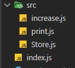

> 이 글은 2023-04-11에 티스토리 블로그(leirbag.tistory.com/139)에 처음 작성한 글을 옮겨온 것입니다.

MVC패턴은 기존의 응용 프로그램 개발을 위해 사용되던 디자인 패턴으로, 서버나 애플리케이션 구축에 사용되던 오래된 방법 중 하나입니다. 하지만 프론트엔드에서도 MVC패턴이 필수일까요?

프론트엔드 개발에서 MVC 패턴을 사용한다면 가장 큰 이유로는 객체나 변수의 공유일 것입니다.

특히 컨트롤러가 중앙에서 데이터의 흐름을 통제하는 일을 하고 있을 가능성이 큽니다. ~~(웹 개발에서 중앙 통제라...)~~

컨트롤러 없이 데이터를 어떻게 공유할 수 있을까요?

전역 키워드인 [globalThis](https://developer.mozilla.org/en-US/docs/Web/JavaScript/Reference/Global_Objects/globalThis)를 비롯한 여러 방법이 존재하겠지만, 사용이 권장되지는 않습니다.

객체를 공유하기 위해 다음과 같은 방법들이 존재합니다.

### 모듈시스템 이용하기

JavaScript의 모듈 시스템은 코드의 재사용성을 증가시키고 유지 보수를 쉽게 할 수 있도록 도와주는 중요한 기능입니다. 모듈 시스템을 사용하면 코드를 여러 파일로 나누어 작성할 수 있으며, 이 파일들은 서로 독립적으로 존재하며 필요할 때 로드됩니다.


*폴더 구조*

**increase.js**

```javascript
import Store from "./Store.js";

const increase = () => {
  Store.setValue(Store.getValue() + 1);
}
export default increase;
```

**print.js**

```javascript
import Store from "./Store.js";

const print = () => {
  console.log(Store.getValue());
}
export default print;
```

**Store.js**

```javascript
const Store = {
  value: 0,
  getValue() {
    return this.value;
  },
  setValue(newValue) {
    this.value = newValue;
  }
}
export default Store;
```

**index.js**

```javascript
import print from "./src/print.js";
import increase from "./src/increase.js";

print(); // 0
increase();
print(); // 1
increase();
increase();
increase();
print(); // 4
```

  
위 코드에서는 ES6의 모듈 시스템을 사용하고 있습니다. 총 4개의 모듈로 이루어져 있습니다.  
  
index.js는 애플리케이션의 진입점이며, print.js와 increase.js를 로드하여 함수를 호출합니다. 이 파일에서는 Store 모듈을 직접 로드하지 않았지만, 다른 모듈에서 import하여 사용하고 있습니다. 즉, index.js는 단순하게 print 함수와 increase 함수를 호출하면서 실제로 Store 객체를 공유하고 있는지를 확인하고 있습니다.  
  
increase.js는 Store 객체를 사용하여 값을 증가시키는 함수를 정의하고 있습니다. 이 함수는 Store 객체의 값(value)을 가져와 1을 더한 뒤 다시 Store 객체에 저장합니다.  
  
print.js 는 Store 객체를 사용하여 현재 값(value)을 콘솔에 출력하는 함수를 정의하고 있습니다.  
  
increase.js와 print.js 에서는 Store 객체를 import하여 사용하고 있습니다. 이 모듈은 애플리케이션 전반에서 사용될 값을 저장하고 있는데, getValue() 함수를 사용하여 현재 값을 반환하고, setValue() 함수를 사용하여 값을 변경할 수 있습니다.

다시 정리하면 increase.js와 print.js는 import를 통해 동일한 Store 객체를 공유하고 있습니다.

### 싱글턴 패턴 이용하기

JavaScript는 Classes 문법을 지원합니다. 다음 예제 코드는 자바스크립트에서 사용되는 싱글턴 패턴을 보여주는 좋은 예시입니다. 이 패턴은 ***단 하나의 인스턴스만 생성***하고, 그 인스턴스를 전역에서 사용할 수 있도록 하는 디자인 패턴입니다. 이를 통해 전역 변수의 오용이나 중복 인스턴스 생성의 문제를 방지하고, 코드의 일관성을 유지할 수 있습니다.



*폴더 구조*

**increase.js**

```javascript
import Store from "./Store.js";

const increase = () => {
  const store = Store.getInstance();
  const value = store.getValue();
  store.setValue(value + 1);
}
export default increase;
```

**print.js**

```javascript
import Store from "./Store.js";

const print = () => {
  const store = Store.getInstance();
  console.log(store.getValue());
}
export default print;
```

**Store.js**

```javascript
export default class Store {

  static #instance;
  #value = 0;

  static getInstance() {
    if (!Store.instance) {
      Store.instance = new Store();
    }

    return Store.instance;
  }

  getValue() {
    return this.#value;
  }

  setValue(newValue) {
    this.#value = newValue;
  }
}
```

**index.js**

```javascript
import print from "./src/print.js";
import increase from "./src/increase.js";

print(); // 0
increase();
print(); // 1
increase();
increase();
increase();
print(); // 4
```

  
위 예제에서는 Store 클래스를 싱글턴 패턴으로 구현하였습니다. (자바에서 많이 보던 그 구조와 거의 동일합니다..!)

Store 클래스는 생성자 함수를 외부에서 호출할 수 없도록 생성자 함수를 private으로 만들어서, 외부에서 생성자 함수를 호출하지 못하도록 합니다.  
  
그리고 getInstance() 메소드를 통해 클래스 인스턴스를 생성하거나, 이미 생성된 인스턴스를 반환하도록 합니다. 만약 인스턴스가 이미 생성된 경우, 그 인스턴스를 반환하고, 그렇지 않으면 새로운 인스턴스를 생성합니다.  
  
즉, getInstance() 메소드는 클래스를 통해 ***단 하나의 인스턴스만 생성하고, 해당 인스턴스를 반환하는 역할을 수행***합니다. 그래서 위 예제에서 Store 클래스를 이용하여 increase.js 와 print.js에서 모두 같은 인스턴스를 공유하여 사용할 수 있습니다.  
  
이렇게 클래스의 인스턴스를 하나만 유지하면서, 여러 곳에서 공유해서 사용할 수 있는 싱글턴 패턴은 코드의 재사용성과 유지보수성을 높여주는 디자인 패턴 중 하나입니다.
