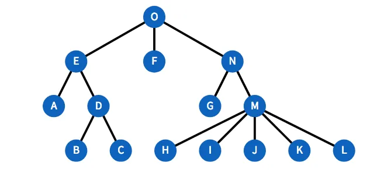
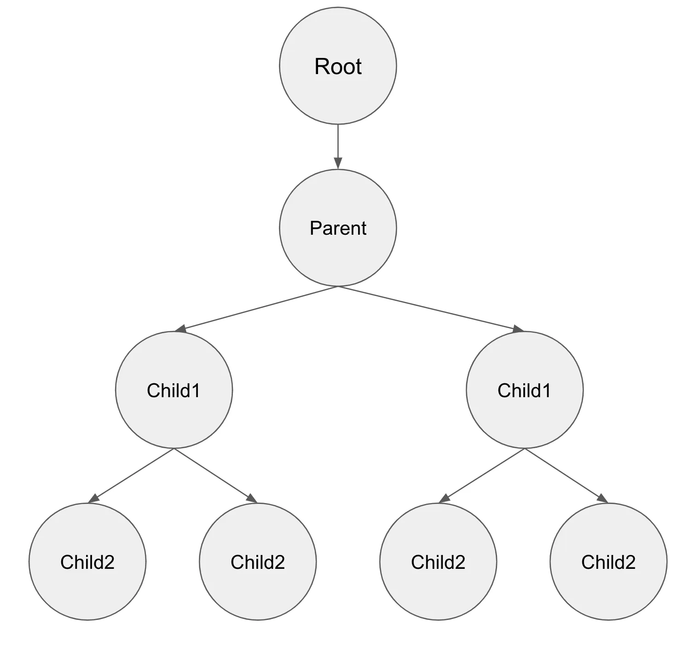
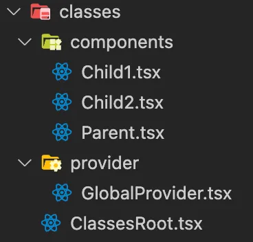
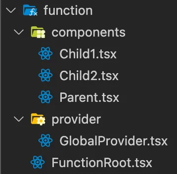
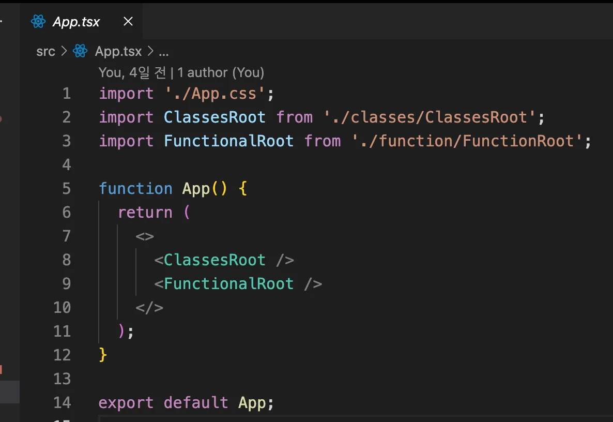
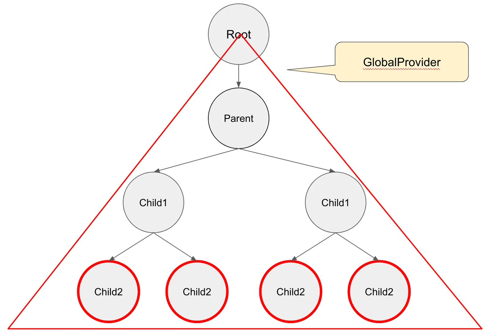

> 이 글은 2023-04-17에 티스토리 블로그(leirbag.tistory.com/142)에 처음 작성한 글을 옮겨온 것입니다.

React에서 프로젝트를 진행하다보면 [컴포넌트 간에 상태를 공유하기 위해서 그 상태를 부모에게 끌어올리는 일](https://react.dev/learn/sharing-state-between-components)은 자연스러운 현상입니다.  
이 과정을 다시 생각해보면, 상태를 부모가 관리하게 하여 prop으로 자식들에게 전달하는 방식으로 쉽게 구현할 수 있겠죠.  
하지만 React 애플리케이션이 점점 커지고 복잡해질 수록 상태 관리를 하는 것은 어려운 작업이 될 것입니다.  
특히 여러 구성 요소(ex.컴포넌트)간에 상태를 공유해야한다면 상태 값을 공유(동기화)하는 것은 주요 문제 중 하나입니다.  
이런 문제를 해결하기 위해 Redux, MobX, Recoil 등 상태 관리 라이브러리를 사용하는 것이 굉장히 일반적이지만, 라이브러리 없이 context api로 구현하는 방법에 대해서 알아보려고 합니다.  
특히 타입스크립트에서 Context API를 관리하는 방법에 대해서 쉽게 설명하는 글이 없어서 작성하게 됐습니다.  
  
React의 context 기능을 소개 하기 전에 컴포넌트 트리에 대한 이해가 필요합니다.



*html의 DOM트리와 비슷하지만, react의 DOM은 prop을 넘겨줄 수 있다는 특징이 있다.*

context를 이용하면 단계마다 일일이 props를 넘겨주지 않고도 컴포넌트 트리 전체에 데이터를 제공할 수 있습니다.  
위 사진에서 컴포넌트 O이 가진 어떤 상태를 컴포넌트 J에게 전달하려면 컴포넌트 N과 컴포넌트 M을 거쳐야 합니다.  
  
하지만 만약에  DOM tree의 depth가 너무 깊다면 어떻게 할까요?  
테마와 같이 모든 컴포넌트들이 현재의 테마 상태를 알아야 한다면 어떻게 하죠?  
예상하신대로 부모가 모든 자식들에게 테마 상태를 넘겨줘야 합니다.  
이런 문제를 해결하기 위해 나온 개념이 Context API 입니다.  
  
이번 예제를 설명하기 앞서 구조를 미리 소개하겠습니다.



*굉장히 단순한 구조의 프로젝트 입니다.*

클래스형 문법과 함수형 문법 각각의 예제를 보여드리겠습니다.  

## 클래스형의 Context API



*폴더 구조*

#### ClassesRoot.tsx

```javascript
import React from "react";
import GlobalProvider from "./provider/GlobalProvider";
import Parent from "./components/Parent";

class ClassesRoot extends React.Component {
  render() {
    return (
      <GlobalProvider>
        <h2>Classes Context API</h2>
        <Parent />
      </GlobalProvider>
    );
  }
}
export default ClassesRoot;
```

#### GlobalProvider.tsx

```javascript
import React from "react";

export interface GlobalState {
  value1: boolean;
  value2: string;
  setValue1: (value: boolean) => void;
  setValue2: (value: string) => void;
}

export const GlobalContext = React.createContext<GlobalState>({
  value1: false,
  value2: '',
  setValue1: () => { },
  setValue2: () => { }
});

interface GlobalProviderProps {
  children: React.ReactNode;
}

class GlobalProvider extends React.Component<GlobalProviderProps, GlobalState> {
  state: GlobalState = {
    value1: false,
    setValue1: (newValue) => this.setState({ value1: newValue }),
    value2: '하이',
    setValue2: (newValue) => this.setState({ value2: newValue }),
  };

  render() {
    return (
      <GlobalContext.Provider value={this.state}>
        {this.props.children}
      </GlobalContext.Provider>
    );
  }
}

export default GlobalProvider;
```

GlobalProvider는 단순히 컴포넌트를 감싸는 Wrapper Component 입니다. GlobalContext는 Provider를 통해 자식들에게 포함된 컴포넌트 중 context를 구독하는 컴포넌트에게 변화를 알리는 역할을 합니다.  
createContext는 Context 객체를 만드는 역할을 합니다. Context 객체는 상태 값과 이를 업데이트하는 함수를 가지고 있을 수 있습니다. 인자로 전달하는 defaultValue는 트리 안에서 적절한 Provider를 **찾지 못했을 때만** 쓰이는 값입니다. (테스트 등에 사용된다고 합니다.)  

#### Parent.tsx

```javascript
import React from "react";
import Child1 from "./Child1";

class Parent extends React.Component {
  render() {
    return (
      <>
        부모(뎁스0)
        <Child1 />
        <Child1 />
      </>
    );
  }
}
export default Parent;
```

#### Child1.tsx

```javascript
import React from "react";
import Child2 from "./Child2";

class Child1 extends React.Component {
  render() {
    return (
      <div>
        -- 자식(뎁스1)
        <Child2 />
        <Child2 />
      </div>
    );
  }
}
export default Child1;
```

#### Child2.tsx

```javascript
import React from "react";
import { GlobalContext, GlobalState } from "../provider/GlobalProvider";

class Child2 extends React.Component {
  static contextType = GlobalContext;

  render() {
    const globalState = this.context as GlobalState;
    return (
      <div>
        ------- 자식(뎁스2)
        <div>
          <div>
            -------------- value1 : {JSON.stringify(globalState.value1)}
            <button onClick={() => globalState.setValue1(!globalState.value1)}>불리안 업데이트</button>
          </div>
          <div>
            -------------- value2:{globalState.value2}
            <button onClick={() => globalState.setValue2('바이')}>문자열 업데이트</button>
          </div>
        </div>
      </div>
    );
  }
}
export default Child2;
```

this.context로 컨텍스트를 호출할 수 있지만, 클래스형 컴포넌트에서는 ***반드시 contextType을 지정해줘야*** 합니다.  
해당 값은 static하며, 사용 방법은 위와 같습니다.  

## 함수형의 Context API



*폴더 구조*

#### FunctionalRoot.tsx

```javascript
import React from "react";
import GlobalProvider from "./provider/GlobalProvider";
import Parent from "./components/Parent";

const FunctionalRoot: React.FC = () => {
  return (
    <GlobalProvider>
      <h2>Functional Context API</h2>
      <Parent />
    </GlobalProvider>
  );
};

export default FunctionalRoot;
```

#### GlobalProvider.tsx

```javascript
import React, { useState } from "react";

export interface GlobalState {
  value1: boolean;
  value2: string;
  setValue1: (value: boolean) => void;
  setValue2: (value: string) => void;
}

export const GlobalContext = React.createContext<GlobalState>({
  value1: false,
  value2: "",
  setValue1: () => { },
  setValue2: () => { },
});

interface GlobalProviderProps {
  children: React.ReactNode;
}

const GlobalProvider: React.FC<GlobalProviderProps> = ({ children }) => {
  const [value1, setValue1] = useState<boolean>(false);
  const [value2, setValue2] = useState<string>("하이");

  const state: GlobalState = {
    value1, setValue1,
    value2, setValue2,
  };

  return (
    <GlobalContext.Provider value={state}>
      {children}
    </GlobalContext.Provider>
  );
};

export default GlobalProvider;
```

앞서 언급한 클래스형 컴포넌트와 그 구조가 거의 비슷하지만, useState hook을 대신하여 사용하는 것을 확인할 수 있습니다.  

#### Parent.tsx

```javascript
import React from "react";
import Child1 from "./Child1";

const Parent: React.FC = () => {
  return (
    <>
      부모(뎁스0)
      <Child1 />
      <Child1 />
    </>
  );
};

export default Parent;
```

#### Child1.tsx

```javascript
import React from "react";
import Child2 from "./Child2";

const Child1: React.FC = () => {
  return (
    <div>
      -- 자식(뎁스1)
      <Child2 />
      <Child2 />
    </div>
  );
};

export default Child1;
```

#### Child2.tsx

```javascript
import React, { useContext } from "react";
import { GlobalContext } from "../provider/GlobalProvider";

const Child2: React.FC = () => {
  const globalState = useContext(GlobalContext);
  return (
    <div>
      ------- 자식(뎁스2)
      <div>
        <div>
          -------------- value1 : {JSON.stringify(globalState.value1)}
          <button onClick={() => globalState.setValue1(!globalState.value1)}>불리안 업데이트</button>
        </div>
        <div>
          -------------- value2:{globalState.value2}
          <button onClick={() => globalState.setValue2('바이')}>문자열 업데이트</button>
        </div>
      </div>
    </div>
  );
};

export default Child2;
```

클래스형 예제와 달리 useContext hook을 사용하여 컨텍스트에 접근하게 됩니다.  

## 실행 결과

두 예제를 실행할 때, 각각의 컨텍스트가 동작할 수 있도록 다음과 같이 구성을 해보겠습니다.



*둘 다 해보세용*

보시다시피 각각의 루트가 각각의 컨텍스트를 가지고 있을 수 있게 되는데, 이는 각 컨텍스트가 독립적으로 동작함을 보장합니다.


*두 예제 모두 결과가 동일하지만 각각 동작합니다.*

하나의 컨텍스트 내에 있는 모든 컴포넌트들은 해당 컨텍스트의 상태를 동시에 접근하거나 수정할 수 있습니다.  
따라서 모든 컴포넌트들이 자식들에게 일일이 prop을 넘기지 않아도 자식 중 누군가가 해당 컨텍스트 내에만 있다면 접근할 수 있게 됩니다.  



즉, 이 예제 코드에서는 Parent, Child1은 어떠한 상태나 prop을 가지고 있지 않지만, Child2 컴포넌트들이 GlobalProvider 컨텍스트 내부에 있기에 해당 컨텍스트에 있는 상태에 접근할 수 있게 됩니다. 마치 전역에 상태가 존재하는 것 같은 효과를 가져올 수 있습니다.  
  
그렇다면 이를 언제 사용할 수 있을까요?  
[공식 문서](https://ko.reactjs.org/docs/context.html)에 따르면 테마, 언어와 같이 모든 컴포넌트들이 동적으로 동시에 관리되어야 할 상황에서 사용하는 것을 권장하고 있습니다.  
다만 주의할 점으로 특점 컨텍스트의 상태에 접근하여 업데이트 할 때마다 불필요한 렌더링이 발생할 수 있습니다.  
예를 들어 Provider의 value가 바뀔 때마다 매번 새로운 객체가 생성되므로 Provider가 렌더링 될 때마다 그 하위에서 구독하고 있는 컴포넌트 모두가 다시 렌더링 될 것입니다.  
  
상황에 맞게 잘 사용하는 것이 중요한 기술이라고 생각됩니다.  
  
참고로 useContext는 커스텀 훅 내부에서도 사용이 가능하므로 이를 응용하면 독특한 설계도 가능하게 됩니다.

```javascript
import { useContext } from "react";
import { GlobalContext } from "../containers/GlobalProvider";

interface UseModal {
  modalOpen: boolean;
  openModal: () => void;
  closeModal: () => void;
}
export const useModal = (): UseModal => {
  const globalState = useContext(GlobalContext);
  const { modalOpen, setModalOpen } = globalState;

  const openModal = () => {
    setModalOpen(true);
  };

  const closeModal = () => {
    setModalOpen(false);
  };

  return { modalOpen, openModal, closeModal };
};
```

이 코드는 전역 상태로 관리하는 모달을 커스텀 훅으로 열고 닫는데 활용한 예제인데요,

```javascript
  const { modalOpen, openModal, closeModal } = useModal();
```

위 예제와 같이 커스텀 훅으로 접근하게 되면 **전역에서 관리되는 모달**도 손쉽게 관리할 수 있게 됩니다.
