> 이 글은 2023-05-12에 티스토리 블로그(leirbag.tistory.com/146)에 처음 작성한 글을 옮겨온 것입니다.

Create React App에서 리액트 프로젝트와 Storybook 배포를 자동화 하는 것은 자료가 많고 매우 쉽습니다.

하지만 Vite라면 어떨까요? 아직까지 Vite는 다소 귀찮은 작업들이 존재하는데요, 자료가 거의 없어서 직접 소개하려고 합니다.

많은 배포 방법이 존재하겠지만 리액트 프로젝트는 GitHub Pages에 배포할 것이고, 스토리북은 Chromatic에 배포할 것입니다.

### Vite로 React 프로젝트 설치 (with TypeScript)

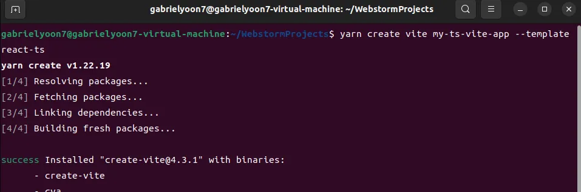

```bash
yarn create vite 프로젝트명 --template react-ts
```

타입스크립트 템플릿으로 설치할 생각이 없다면 [다른 템플릿도 존재](https://vitejs.dev/guide/)합니다.

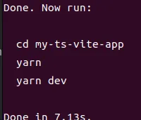

설치가 끝나면 yarn 으로 패키지를 설치해주고, yarn dev로 실행합니다.

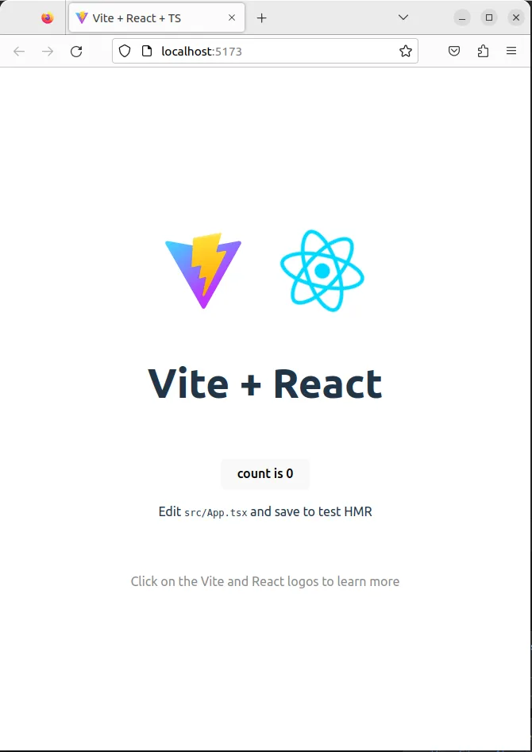

프로젝트가 잘 실행됐나요?

이제 github repository를 생성하여 올려줍니다.

### Vite 프로젝트를 GitHub Pages에 배포하기

#### **tsconfig.json 수정**

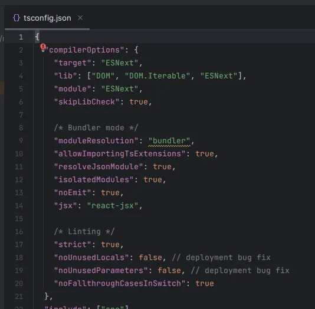

기본으로 설치 된 tsconfig.json을 일부 수정해야하는데요,  
다음 두 줄만 수정해주면 됩니다.

    "noUnusedLocals": false, // deployment bug fix  
    "noUnusedParameters": false, // deployment bug fix

수정된 코드는 다음과 같습니다.

```bash
{
  "compilerOptions": {
    "target": "ESNext",
    "lib": ["DOM", "DOM.Iterable", "ESNext"],
    "module": "ESNext",
    "skipLibCheck": true,

    /* Bundler mode */
    "moduleResolution": "bundler",
    "allowImportingTsExtensions": true,
    "resolveJsonModule": true,
    "isolatedModules": true,
    "noEmit": true,
    "jsx": "react-jsx",

    /* Linting */
    "strict": true,
    "noUnusedLocals": false, // deployment bug fix
    "noUnusedParameters": false, // deployment bug fix
    "noFallthroughCasesInSwitch": true
  },
  "include": ["src"],
  "references": [{ "path": "./tsconfig.node.json" }]
}
```

#### vite.config.ts 수정

일단 프로젝트 내부에 있는 vite.config.ts 파일을 엽니다.

그리고 base 프로퍼티를 추가해야하는데요, 기본 값이 생략되어있다면 https://&lt;USERNAME>.github.io/와 같은 형태로 배포됩니다.

하지만 대부분의 사람들은 https://&lt;USERNAME>.github.io/&lt;REPO>/와 같은 형태로 배포를 하게 될 것인데요,

이때 base 설정 값을 '/&lt;REPO>/'로 지정해주시면 됩니다.

즉, 프로젝트 이름과 동일하게 해주시면 됩니다.

```bash
// vite.config.ts

import { defineConfig } from 'vite'
import react from '@vitejs/plugin-react'

// https://vitejs.dev/config/
export default defineConfig({
  plugins: [react()],
  base:'/my-ts-vite-app/' // 이 부분을 수정
})
```

이렇게 수정을 하신 후 yarn dev로 프로젝트를 다시 실행해보면

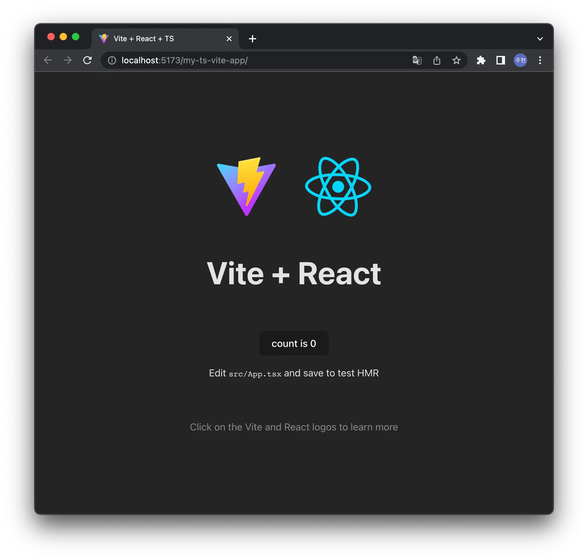

기존의 주소와 달리 프로젝트 명이 주소 뒤에 붙는 것을 확인할 수 있습니다.  
(마치 apache tomcat의 context path를 설정하는 듯이 주소 뒤에 항상 따라다닙니다.)

#### GitHub 설정

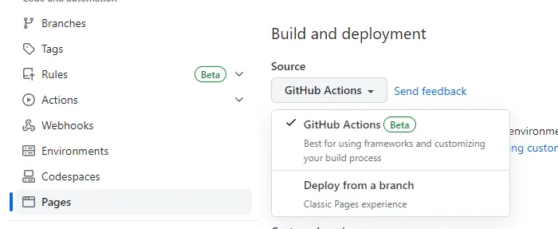

생성된 레포의 Settings에 들어가서 Pages에 진입합니다.

그리고 Build and deployment의 Source를 GitHub Actions를 눌러주면 됩니다.  
(현재는 Beta이지만 이 기능으로 설정해주시면 됩니다.)

만약에 본인이 ***사용중인 브랜치가 main이 아니라면*** 반드시 추가 설정이 필요한데요,  
main 브랜치를 사용중이라면 이 부분은 넘어가셔도 좋습니다.

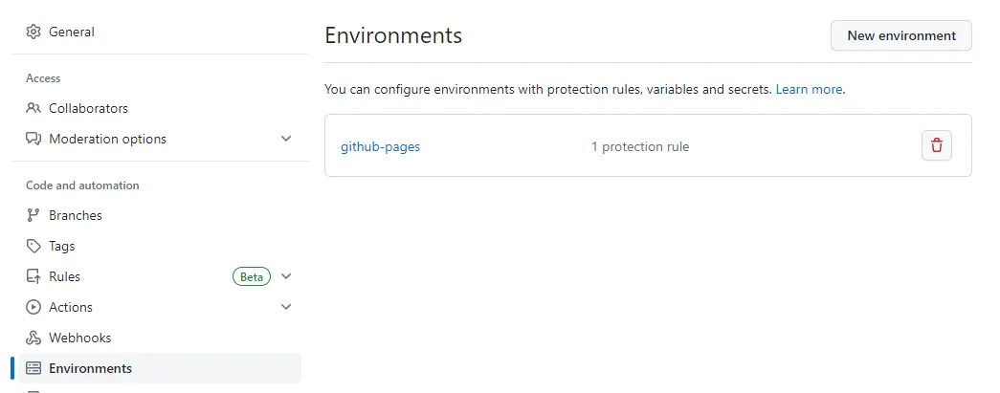

Settings의 Environments에 진입한 후, github-pages를 눌러 들어갑니다.

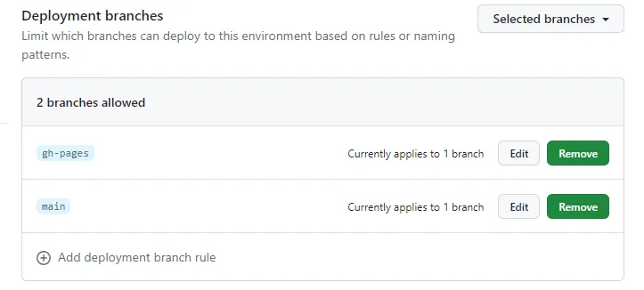

Add deployment branch rule를 누른 후, 배포하려는 브랜치를 추가해주시면 됩니다.  
(그렇지 않은 경우, 이후 배포할 때 rule issue가 발생합니다.)

#### deploy.yml 추가

다음으로는 루트 폴더에 .github/workflows/deploy.yml 을 생성해주세요.

deploy.yml에 들어갈 코드는 다음과 같습니다.

```bash
name: Deploy static content to Pages

on:
  # 원하는 브랜치 명으로 바꿔주시면 됩니다.
  push:
    branches: ['main']

  workflow_dispatch:

permissions:
  contents: read
  pages: write
  id-token: write

concurrency:
  group: 'pages'
  cancel-in-progress: true

jobs:
  deploy:
    environment:
      name: github-pages
      url: ${{ steps.deployment.outputs.page_url }}
    runs-on: ubuntu-latest
    steps:
      - name: Checkout
        uses: actions/checkout@v3
      - name: Set up Node
        uses: actions/setup-node@v3
        with:
          node-version: 18
          cache: 'npm'
      - name: Install dependencies
        run: npm install
      - name: Build
        run: npm run build
      - name: Setup Pages
        uses: actions/configure-pages@v3
      - name: Upload artifact
        uses: actions/upload-pages-artifact@v1
        with:
          path: './dist'
      - name: Deploy to GitHub Pages
        id: deployment
        uses: actions/deploy-pages@v1
```

그리고 커밋 후 푸쉬를 해주세요.

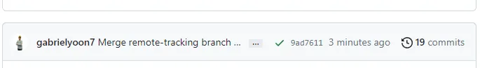

잠시 기다리면 레포에 안보이던 체크 표시가 보일 것입니다.

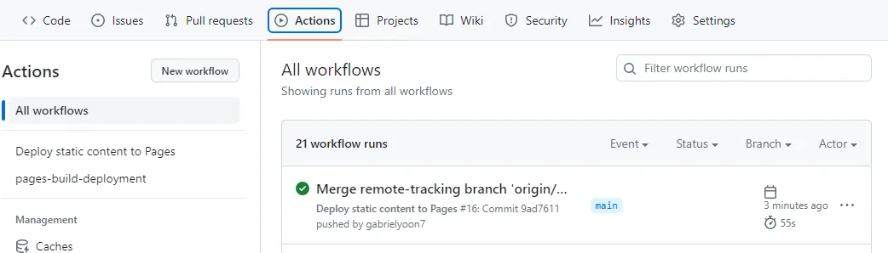

Actions 탭에 들어오면 workflow가 동작한 것을 확인할 수 있으며

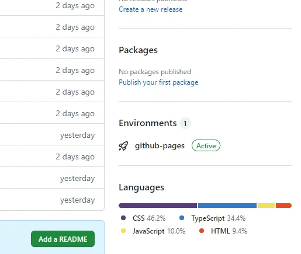

레포 우측 하단에도 Environments가 활성화 된 것을 확인할 수 있습니다.

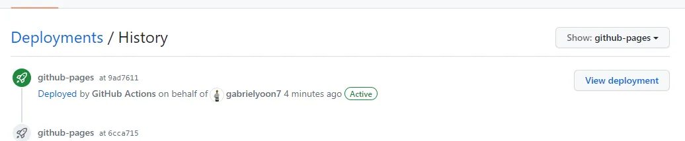

View Deployment에 들어가면 배포된 것을 확인할 수 있습니다.

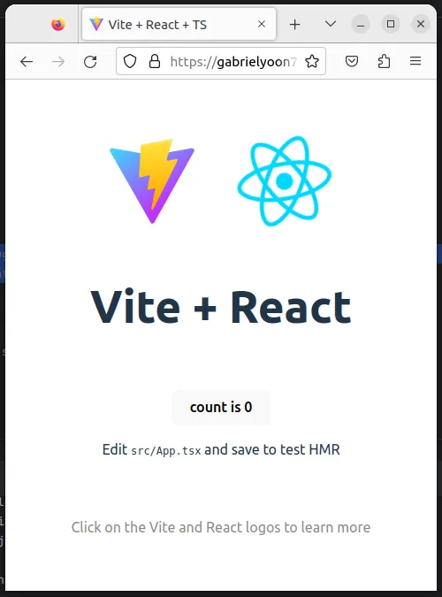

*배포된 페이지*

### Vite 프로젝트의 StoryBook을 Chromatic에 배포하기

#### StoryBook 설치

터미널을 열고 다음과 같이 입력합니다.

```bash
npx storybook@latest init
```

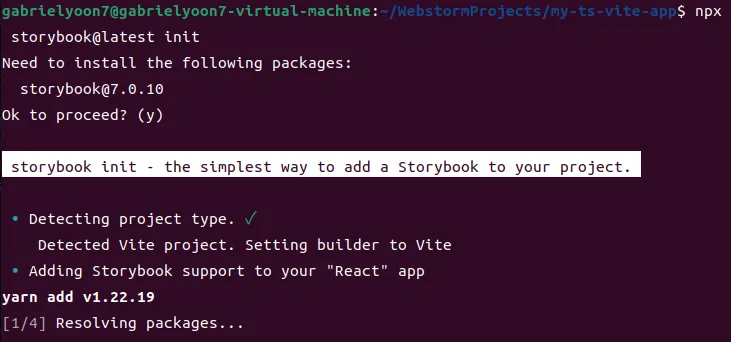

약간의 시간이 소요됩니다.

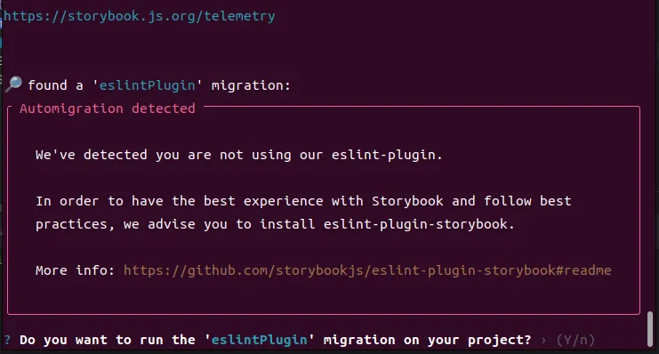

예쓰

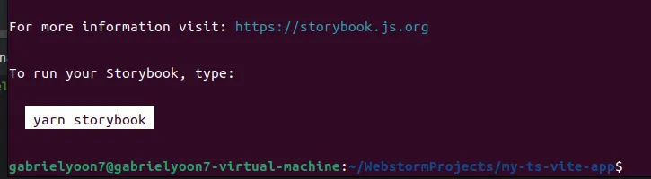

설치가 끝나면 yarn storybook으로 실행합니다.

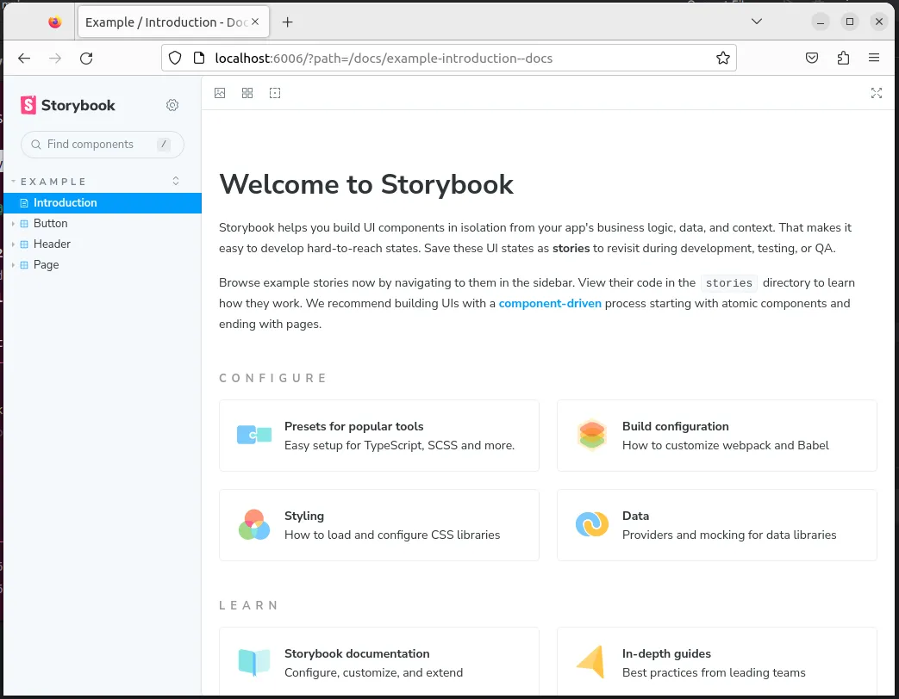

잘 실행되면 커밋 & 푸쉬 한번씩 날려줍니다.

#### 크로매틱(Chromatic) 설치 및 최초 배포

터미널을 열고 chromatic을 설치해줍니다.

```bash
yarn add -D chromatic
```

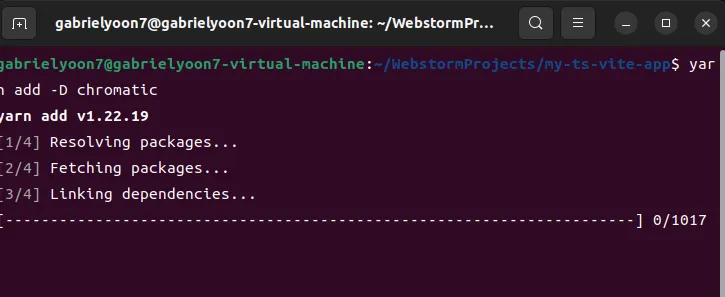

설치가 끝나면 [크로매틱에 접속해서 로그인](https://www.chromatic.com/start/?utm_source=storybook_website&utm_medium=link&utm_campaign=storybook) 합니다. Github 계정으로 가입하면 됩니다.

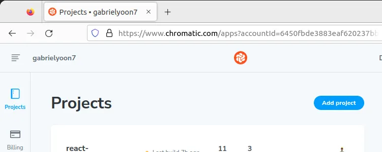

Add Project를 누릅니다.

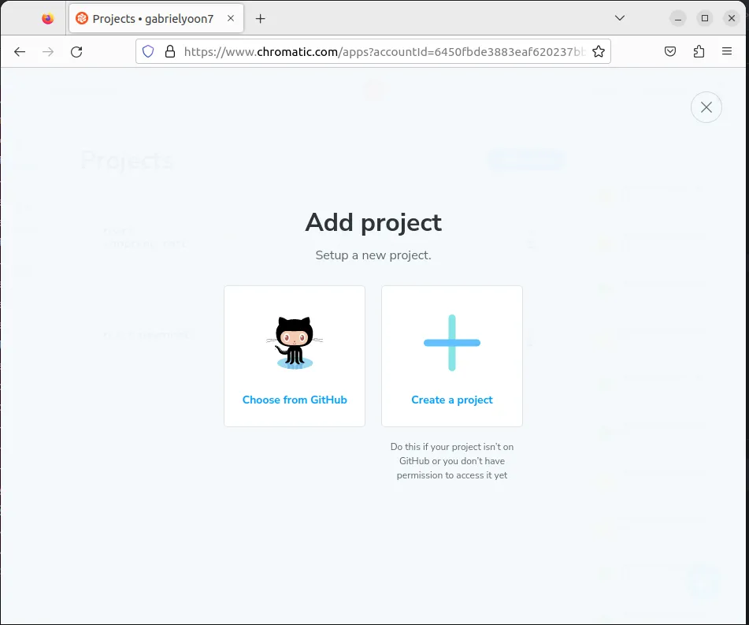

Choose from Github를 누릅니다.


원하는 프로젝트를 선택합니다.

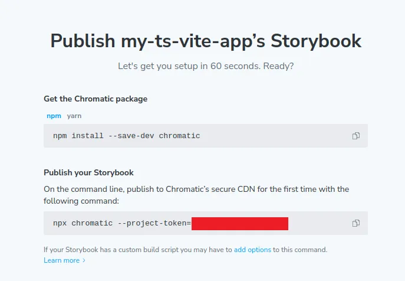

발급된 토큰 값은 뒤에서 쓰이므로 따로 메모장 같은 곳에 저장해둡니다.

```bash
yarn chromatic --project-token=<project-token>
```

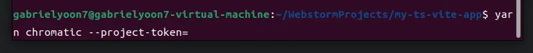

토큰 값을 채워서 실행합니다.  
약간의 시간이 걸린 후, 터미널에 storybook이 배포됐다고 뜹니다.

※ 2023-09-17 추가  
[빌드 오류 발생 시 참고 링크(yarn 관련 버그가 있을 수 있음)](https://github.com/storybookjs/storybook/issues/22431)

```bash
yarn cache clean --all

npm install -g npm@latest
npm install -g yarn@latest

rm node_modules/ yarn.lock package-lock.json

yarn
```

참고로 아주 많은 시간이 걸린 후에 배포됩니다.

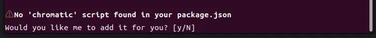

**반드시 N을 누릅니다. 토큰 값이 외부로 노출되므로 추가할 필요가 없습니다.**

참고로 배포된 크로매틱 주소는 다음과 같습니다.

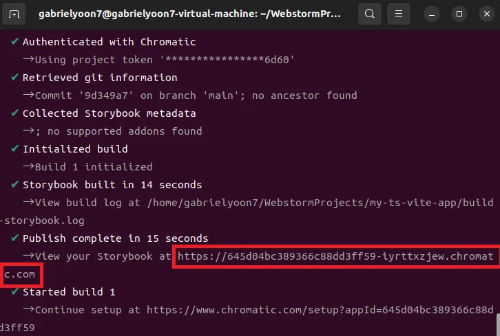

#### 크로매틱(Chromatic) 자동 배포

앞서 발급 받은 토큰을 시크릿 키로 관리해야합니다.

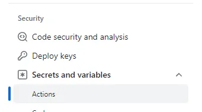

레포의 Settings에서 Security / Secrets and variables를 누른 후, Actions로 진입해주세요.

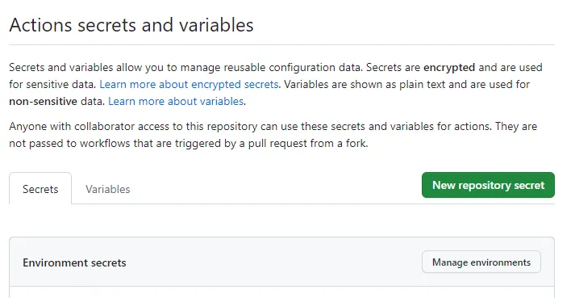

New Repository Secret을 누릅니다.


Name은 CHROMATIC\_PROJECT\_TOKEN

Secret은 아까 발급 받은 토큰 키를 그대로 복붙합니다.

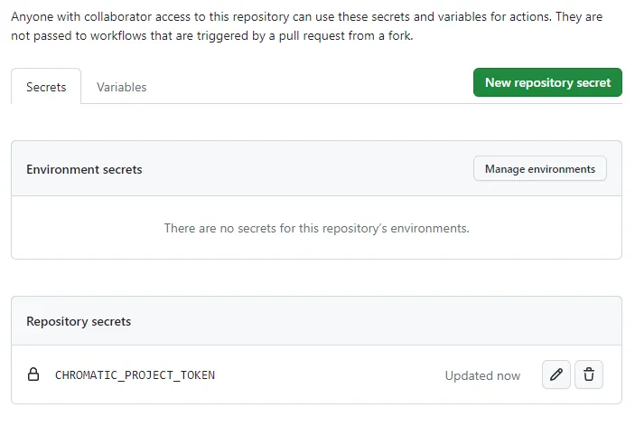

이렇게 등록시킵니다.

이제 자동 배포 스크립트를 추가해야하는데요,

.github/workflows/chromatic.yml 파일을 생성합니다.

```bash
name: 'Chromatic Deployment'

on:
  # 원하는 브랜치 명으로 바꿔주시면 됩니다.
  push:
    branches: ['main']

jobs:
  test:
    runs-on: ubuntu-latest
    steps:
      - uses: actions/checkout@v1
      - run: yarn
      - uses: chromaui/action@v1
        with:
          projectToken: ${{ secrets.CHROMATIC_PROJECT_TOKEN }}
          token: ${{ secrets.GITHUB_TOKEN }}
```

새로 생긴 파일을 커밋 후 푸시를 합니다.

이후 레포의 Actions 탭에 들어가면 아까와는 다르게 2개의 배포 작업이 동시에 진행됩니다.

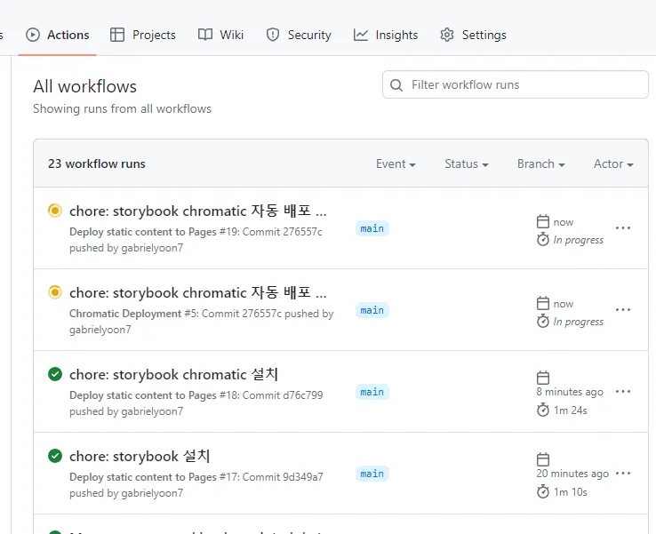

하나는 GitHub Pages를 배포하는 것이고, 하나는 Chromatic에 스토리 북을 배포하는 것입니다.

배포가 끝난 후 앞서 생성한 크로매틱 배포링크와 깃헙페이지 배포 링크로 들어가보면 스토리북이 항상 레포의 최신 상태와 일치할 것입니다.

* * *
