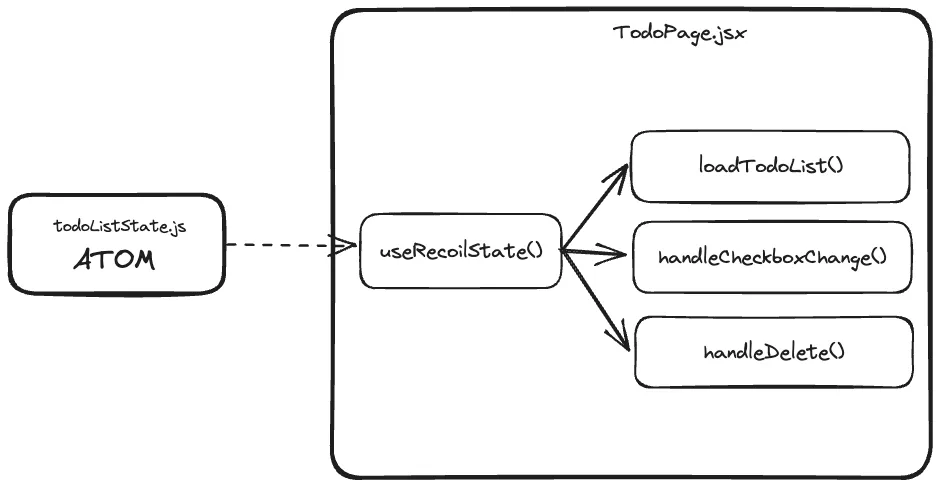
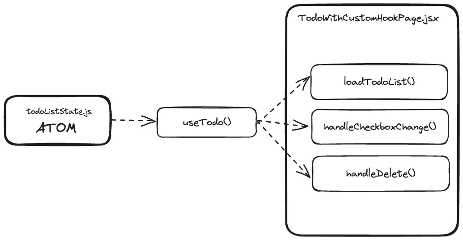
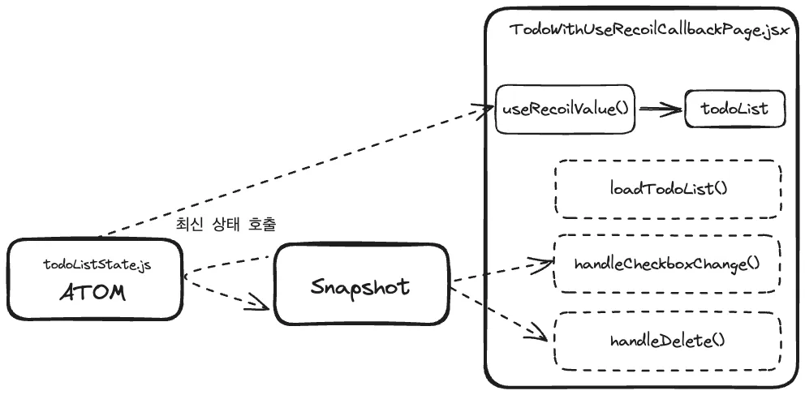
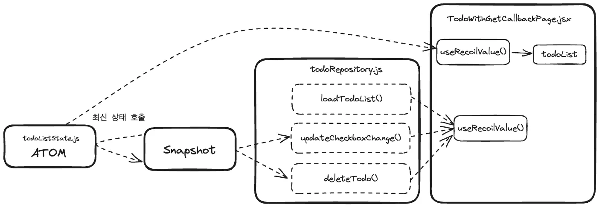

> 이 글은 2023-06-03에 티스토리 블로그(leirbag.tistory.com/148)에 처음 작성한 글을 옮겨온 것입니다.

[Recoil](https://recoiljs.org/)은 React 애플리케이션의 상태 관리를 위한 라이브러리입니다.

공식문서의 [Basic Tutorial](https://recoiljs.org/docs/basic-tutorial/intro)를 참고해 보면 atom과 selector를 활용한 상태 관리가 그렇게 어려워 보이지 않습니다.

일단 useRecoilState으로 대부분의 로직을 리액트의 영역으로 끌고 온 다음 가공한 다음 다시 recoil로 돌려줘서 상태를 업데이트하곤 합니다.

하지만 이게 과연 괜찮은 걸까요? 그렇다면 recoil은 하는 일이 뭘까요?

지금부터 예제 몇 가지를 비교하면서 소개 할 것입니다.

이 글의 초반 부에는 너무나도 당연하고 쉬운 예제들로 가득 찰 것이지만, 뒤로 가면 갈수록 *어? 이게 뭐지?* 스러운 장면들이 나올 것입니다.

또, 이 글을 다 읽을 때 쯤에는 recoil을 recoil 답게 쓸 수 있을 것 같다는 생각이 들 것입니다.

앞 쪽의 **1\. react스러운 recoil 상태 관리**는 다 아는 내용일 것이므로, 대충 훑어보고 후반부의 **2\. recoil다운 recoil 상태 관리**로 건너 뛰어도 좋습니다.

#### todoListState.js

먼저 일단 앞으로 사용될 todoListState atom을 선언해 보겠습니다.

```javascript
import {atom} from "recoil";

export const todoListState = atom({
  key: 'TodoList',
  default: []
});
```

todoListState는 보시다시피 단순한 배열을 가지는 atom입니다.  
앞으로 설명할 예제에서 계속 등장하는 상태 관리 저장소가 될 것입니다.

모든 예제는 다음 영상과 같은 동일한 기능을 나타냅니다.


## 1\. react 스러운 recoil 상태 관리

#### 1-1. React에서 recoil 상태를 관리하기

일단 공식문서의 [Basic Tutorial](https://recoiljs.org/docs/basic-tutorial/intro) 에서는 다음과 같이 상태를 관리하도록 소개하곤 합니다.

1\. useRecoilState로 react에서 \[사용할 상태, 상태 업데이트 함수\]를 끌어온다.

2\. 마치 useState와 같은 방법으로 상태를 구독하거나 업데이트해준다.

**TodoPage.jsx**

```javascript
import {useRecoilState} from "recoil";
import {todoListState} from "../atoms/todo.jsx";

function TodoPage() {
  const [todoList, setTodoList] = useRecoilState(todoListState);

  const loadTodoList = async () => {
    const response = await fetch('https://jsonplaceholder.typicode.com/todos')
    const data = await response.json();
    setTodoList(data);
  }

  const handleCheckboxChange = (todoId) => {
    const newTodoList = todoList.map((todo) => todo.id === todoId ? {...todo, completed: !todo.completed} : todo);
    setTodoList(newTodoList);
  };

  const handleDelete = (todoId) => {
    const newTodoList = todoList.filter((todo) => todo.id !== todoId);
    setTodoList(newTodoList);
  }

  return (
    <>
      <button onClick={loadTodoList}>할 일 불러오기</button>
      {
        todoList.map((todo) => (
          <div key={todo.id} style={{display: 'flex'}}>
            <input
              type="checkbox"
              checked={todo.completed}
              onChange={() => handleCheckboxChange(todo.id)}
            />
            <div>{todo.title}</div>
            <button onClick={() => handleDelete(todo.id)}>삭제</button>
          </div>
        ))
      }
    </>
  )
}

export default TodoPage;
```



보시다시피 todoList와 setTodoList로 useRecoilState에게 접근이 가능토록 합니다.

이 예제는 recoil이 무엇인지 모르는 사람도 해석할 수 있을 만큼 react 스러운 코드입니다.

atom상태를 react로 끌고 와서 작업을 해주는 코드이기 때문이죠!

하지만 로직을 바깥으로 분리해주고 싶다면 어떻게 할 수 있을까요?

useRecoilState도 hook이니깐 커스텀 훅으로 관리할 수 있지 않을까요?

#### 1-2. custom hook에서 recoil 상태를 관리하기

이번에는 recoil 훅을 커스텀 훅에 넣어서 관리해 보겠습니다.

커스텀 훅은 함수형 컴포넌트의 킬러 기능으로, 상태와 관한 대부분의 로직을 외부로 분리하여 모듈화를 할 수 있고 재사용을 유도할 수 있습니다.

**useTodo.js**

```javascript
import {useRecoilState} from "recoil";
import {todoListState} from "../../atoms/todo.jsx";

export const useTodo = () => {

  const [todoList, setTodoList] = useRecoilState(todoListState);

  const loadTodoList = async () => {
    const response = await fetch('https://jsonplaceholder.typicode.com/todos')
    const data = await response.json();
    setTodoList(data);
  }

  const changeCheckbox = (todoId) => {
    const newTodoList = todoList.map((todo) => todo.id === todoId ? {...todo, completed: !todo.completed} : todo)
    setTodoList(newTodoList);
  };

  const deleteTodo = (todoId) => {
    const newTodoList = todoList.filter((todo) => todo.id !== todoId);
    setTodoList(newTodoList);
  }

  return {
    todoList,
    loadTodoList,
    changeCheckbox,
    deleteTodo
  }
}
```

**TodoWithCustomHookPage.jsx**

```javascript
import {useTodo} from "./useTodo.js";

function TodoWithCustomHookPage() {
  const {
    todoList, loadTodoList, changeCheckbox, deleteTodo
  } = useTodo();

  return (
    <>
      <button onClick={loadTodoList}>할 일 불러오기</button>
      {
        todoList.map((todo) => (
          <div key={todo.id} style={{display: 'flex'}}>
            <input
              type="checkbox"
              checked={todo.completed}
              onChange={() => changeCheckbox(todo.id)}
            />
            <div>{todo.title}</div>
            <button onClick={() => deleteTodo(todo.id)}>삭제</button>
          </div>
        ))
      }
    </>
  )
}

export default TodoWithCustomHookPage;
```



1-1 예제와 달리 대부분의 상태 관리 로직이 커스텀 훅으로 분리되었네요.

하지만 여전히 recoil이 할 수 있는 역할은 무엇일까요? 그저 상태를 전역으로만 관리하는 것이 다일까요?

1-1과 1-2 예제에서는 recoil 상태를 하나만 구독하고 있지만, 만약 여러 상태가 구독되는 경우에는 어떨까요?

예상하셨겠지만 커스텀 훅에서 여러 상태 값을 호출하고 활용하는 순간 ***수많은 컴포넌트에 영향***을 끼칠 수밖에 없습니다.

recoil상태는 전역으로 관리되고 있기 때문이죠.

그렇다면 recoil의 상태를 다른 방법으로 관리해 보는 것은 어떨까요?

## 2\. recoil 다운 recoil 상태 관리

#### 2-1. useRecoilCallback()과 snapshot 객체를 활용하기

공식문서에는 [useRecoilCallback()](https://recoiljs.org/docs/api-reference/core/useRecoilCallback/)이라는 기능이 소개되고 있습니다.

이 기능은 무엇을 하는 것일까요?

이 훅은 useCallback()과 사용하는 방법이 비슷하지만, 추가로 Recoil 상태에서 작동할 수 있는 API도 제공하고 있습니다.

여기에서 정말 중요한 것은 Recoil 상태에서 작동할 수 있는 API도 제공한다는 것인데요, React 내에서 Recoil 기능을 쓸 수 있다는 것은 React로 어떤 기능을 끌고 오지 않고도 Recoil 내부 기능만으로도 콜백을 동작시킬 수 있다는 것입니다.

공식 문서에서 볼 수 있듯이 useRecoilCallback()에 의존성 배열이 존재하는 이유는 useCallback()처럼 사용할 수도 있기 때문입니다. 하지만 이 글에서는 해당 목적으로 사용하려는 것이 아닌, recoil 기능을 직접 사용하려는 목적에 있습니다.

즉, 앞선 1-1, 1-2 예제와 달리 recoil 내부의 동작만으로도 상태를 업데이트할 수 있습니다.

앞선 1-1 코드를 useRecoilCallback() 버전으로 개선해 본 예제입니다.

**TodoWithUseRecoilCallbackPage.jsx**

```javascript
import {useRecoilCallback, useRecoilValue} from "recoil";
import {todoListState} from "../../atoms/todo.jsx";

function TodoWithUseRecoilCallbackPage() {
  const todoList = useRecoilValue(todoListState);

  const loadTodoList = useRecoilCallback(({set}) => async () => {
    const response = await fetch('https://jsonplaceholder.typicode.com/todos')
    const data = await response.json();
    set(todoListState, data);
  }, []);

  const handleCheckboxChange = useRecoilCallback(({set, snapshot}) => async (todoId) => {
    const todos = await snapshot.getPromise(todoListState);
    set(todoListState, todos.map((todo) => todo.id === todoId ? {...todo, completed: !todo.completed} : todo));
  }, []);

  const handleDelete = useRecoilCallback(({set, snapshot}) => async (todoId) => {
    const todos = await snapshot.getPromise(todoListState);
    set(todoListState, todos.filter((todo) => todo.id !== todoId))
  }, []);

  return (
    <>
      <button onClick={loadTodoList}>할 일 불러오기</button>
      {
        todoList.map((todo) => (
          <div key={todo.id} style={{display: 'flex'}}>
            <input
              type="checkbox"
              checked={todo.completed}
              onChange={() => handleCheckboxChange(todo.id)}
            />
            <div>{todo.title}</div>
            <button onClick={() => handleDelete(todo.id)}>삭제</button>
          </div>
        ))
      }
    </>
  )
}

export default TodoWithUseRecoilCallbackPage;
```



보시다시피 기존의 예제와는 달리 useRecoilState()의 사용이 필요하지 않습니다.  
useRecoilCallback() 내부에서 recoil의 상태로 직접 접근이 가능한 setter함수가 사용이 가능하기 때문입니다.  
즉, 정리하면 useRecoilCallback() 내부의 코드는 react가 아닌 recoil의 영역입니다.

하지만 처음 보는 snapshot이 등장하기도 합니다.

이를 설명해보려고 합니다.

1\. useRecoilCallback()은 비동기 작업이나 외부 API 호출과 같은 부작용을 관리하는 데 사용됩니다.

2\. Snapshot은 Recoil 상태를 안정적으로 읽고 쓰는 데 도움을 줍니다.

useRecoilCallback()을 사용하여 비동기 작업을 처리하고, 필요한 경우 Snapshot을 사용하여 상태의 일관성을 유지하면서 작업을 수행할 수 있습니다.

await snapshot.getPromise(todoListState);은 useRecoilCallback()의 평가 시점과 관계없이 최신 상태의 recoil 상태(atom 혹은 selector)를 읽을 수 있도록 합니다.

만일 평범하게 getter를 사용하여 접근한다면, recoil 상태를 읽는 것은 가능하지만 해당 상태가 다른 컴포넌트에 의해 변화하는 경우 과거의 상태 값을 읽어 낼 가능성이 있습니다. (useRecoilCallback()에 의존성 배열을 부여하면 snapshot 없이도 getter 사용이 가능하기는 하지만, 추천되지 않습니다.)

즉, 상태를 안정적으로 호출하기 위해서는 Snapshot의 사용이 반드시 필요합니다.

이러한 조합을 통해 복잡한 상태 관리 로직을 깔끔하게 구성하고 Recoil의 장점을 안정적으로 최대한 활용할 수 있습니다.

#### 2-2. getCallback()을 활용한 repository selector 만들기

이 구현 방법을 소개하기 위해 여기까지 긴 호흡으로 달려왔습니다.

앞선 useRecoilCallback()은 결국 hook이기에 컴포넌트에 의존하여 호출될 수밖에 없고, 외부로 분리하기 위해서는 결국 커스텀 훅이 사용될 수 밖에 없는데요, 다시 말하면 재사용성이 오히려 떨어집니다. (useRecoilCallback 내부에 쓰인 함수만 바깥으로 빼는 방법이 있겠지만 유지보수에 방해가 될 수 있습니다.)

만약에 useRecoilCallback() 훅을 리액트 바깥에서도 쓸 수 있다면 얼마나 좋을까요?

물론 훅을 바깥에서 쓰는 것은 아니지만, 콜백을 사용하는 기능인 getCallback()을 selector 내부에서 지원하고 있습니다.

커스텀 훅 버전의 1-2와 useRecoilCallback 버전의 2-1 예제를 적절하게 섞은 듯한 모습의 예제를 소개합니다.

**todoRepository.js**

```javascript
import {selector} from "recoil";
import {todoListState} from "../../atoms/todo.jsx";

export const todoRepository = selector({
  key: 'todoRepository',
  get: ({getCallback}) => {

    const loadTodoList = getCallback(({set}) => async () => {
      const response = await fetch('https://jsonplaceholder.typicode.com/todos')
      const data = await response.json();
      set(todoListState, data);
    });

    const updateCheckboxChange = getCallback(({set, snapshot}) => async (todoId) => {
      const todos = await snapshot.getPromise(todoListState);
      set(todoListState, todos.map((todo) => todo.id === todoId ? {...todo, completed: !todo.completed} : todo));
    });

    const deleteTodo = getCallback(({set, snapshot}) => async (todoId) => {
      const todos = await snapshot.getPromise(todoListState);
      set(todoListState, todos.filter((todo) => todo.id !== todoId))
    });

    return {
      loadTodoList,
      updateCheckboxChange,
      deleteTodo
    }
  }
})
```

**TodoWithGetCallbackPage.jsx**

```javascript
import {useRecoilValue} from "recoil";
import {todoListState} from "../../atoms/todo.jsx";
import {todoRepository} from "./todoRepository.js";

function TodoWithGetCallbackPage() {
  const todoList = useRecoilValue(todoListState);
  const {
    loadTodoList, updateCheckboxChange, deleteTodo
  } = useRecoilValue(todoRepository);

  return (
    <>
      <button onClick={loadTodoList}>할 일 불러오기</button>
      {
        todoList.map((todo) => (
          <div key={todo.id} style={{display: 'flex'}}>
            <input
              type="checkbox"
              checked={todo.completed}
              onChange={() => updateCheckboxChange(todo.id)}
            />
            <div>{todo.title}</div>
            <button onClick={() => deleteTodo(todo.id)}>삭제</button>
          </div>
        ))
      }
    </>
  )
}

export default TodoWithGetCallbackPage;
```



보시다시피 사실상 모든 상태관리를 recoil (정확히 말하면 selector) 스스로 할 수 있게 됐습니다.

이 예제에서는 단순히 하나의 recoil 상태만을 snapshot으로부터 읽고 있기에 그 효과가 다소 체감되지 않을 수 있습니다.

하지만 여러 recoil 상태를 읽어내야 할 때 위 방법의 장점이 극대화될 것입니다.

상태를 snapshot으로부터만 알아내고, 상태 그 자체를 구독하여 읽는 행위를 근본적으로 하지 않고 있으므로 최적화 이슈에서도 자유롭습니다.

***또, 이 repository는 어떠한 상태도 구독하고 있지 않기에 불필요한 재 렌더링을 유도하지 않으면서 수 많은 컴포넌트에서 사용될 수 있습니다.***

(사실 위 예제처럼 snapshot을 읽는 것이 아닌 setter함수 내부의 콜백으로 이전 상태를 호출하는 것이 더 나았을 수도 있습니다.)

유의할 사항으로는 어떤 상태를 구독하는 메서드는 따로 제작하지 않고 컴포넌트에서 곧바로 useRecoilValue()를 활용하는 것이 더 낫습니다.

위 아이디어와는 별개로 [useRecoilCallback()을 특정 컴포넌트에 넣어두고 dispatcher처럼 사용하는 예제도 존재](https://github.com/GeoffCox/recoil-examples/blob/master/dispatcher-tutorial/src/dispatcher.ts)하나, 결국 어떤 컴포넌트에 의존하는 방식보다는 2-2에서 소개한 아이디어를 활용하는 것이 성능 상으로나 코드 유지보수로나 굉장히 간결하고 편리한 방법이 될 것으로 생각됩니다.

결론은 뭘까요?

[recoil callback](https://recoiljs.org/docs/api-reference/core/useRecoilCallback#callback-interface)을 올바르게 사용하면 ① recoil의 로직을 한 군데 모으면서, ② recoil 본연의 기능을 활용하면서, ③ 여러 상태를 참조하더라도, ④ 잠재적인 성능 이슈까지 고려할 수 있게 됩니다.
