> 이 글은 2023-06-25에 티스토리 블로그(leirbag.tistory.com/150)에 처음 작성한 글을 옮겨온 것입니다.

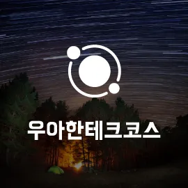

미루고 미루다 작성하는 우아한테크코스 레벨2 회고글입니다.

사실 방학하자마자 바로 회고 글을 작성할까 했지만 여행을 다니느라 글을 쓸 시간이 없었습니다.

방학식을 한 날 이후로 단 하루도 빼놓지 않고 ~~노는~~일정을 빽빽하게 잡았습니다. 가평, 수원, 양양, 강릉, 횡성, 을왕리를 돌다 보니 화면을 볼 시간이 부족했고, 덕분에 작성하려고 준비한 기술 관련 글들도 미뤄져서 레벨3 기간에 작성할 것 같습니다. ???

[레벨 1에서는 JavaScript/TypeScript를 이용한 바닐라 웹을 학습](../2023-04-15-tistory-141/)했다면, 레벨 2에서는 본격적으로 React를 학습하게 됐습니다.

진행한 미션과 회고를 정리해보겠습니다.

## 미션

**미션 1 - 다시, 점심 뭐 먹지**

<table><tbody><tr><td>&nbsp;</td><td>Repository</td><td>Feedback</td></tr><tr><td>Step1</td><td><a href="https://github.com/gabrielyoon7/react-lunch/tree/step1">바로가기</a></td><td><a href="https://github.com/woowacourse/react-lunch/pull/1">바로가기</a></td></tr><tr><td>Step2</td><td><a href="https://github.com/gabrielyoon7/react-lunch/tree/step2">바로가기</a></td><td><a href="https://github.com/woowacourse/react-lunch/pull/59">바로가기</a></td></tr></tbody></table>

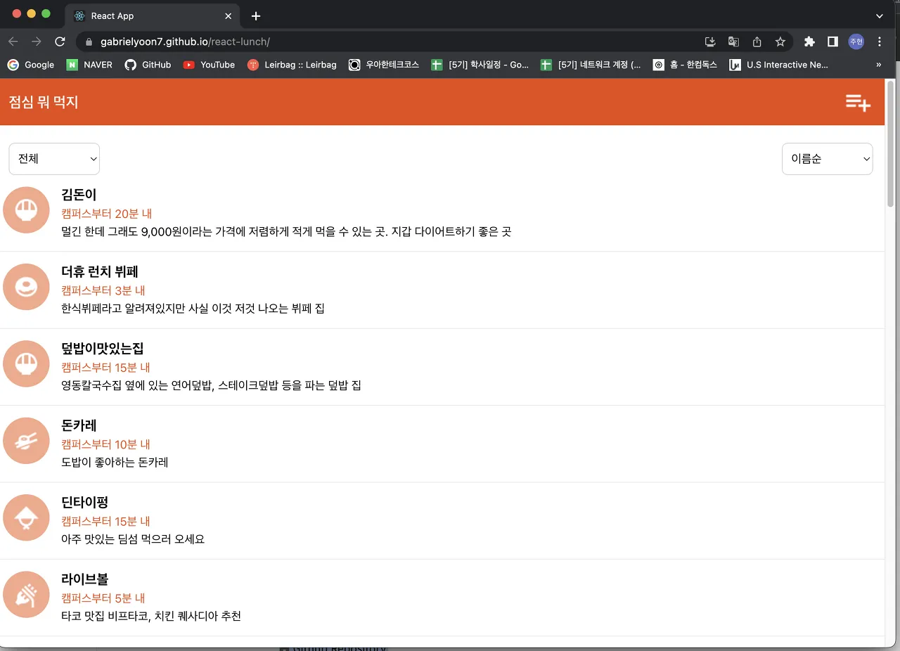

[배포 페이지](https://gabrielyoon7.github.io/react-lunch/)

레벨 1에서 진행했던 [점심 뭐 먹지 미션](https://gabrielyoon7.github.io/javascript-lunch/)이 다시 한번 나왔습니다.

단, 지난 미션 때에는 바닐라 자바스크립트로 작성했다면 이번 미션에서는 리액트로 작성해야 했습니다.

아무래도 개강 주에 나온 온보딩 미션이다 보니 굉장히 짧게 지나갔습니다.

리액트를 처음 접하는 크루들은 리액트를 맛보는 과정으로, 이미 접해본 크루들은 오랜만에 준비 운동(?)하듯이 프로젝트를 진행하는 분위기였습니다.

이 미션에서는 한 가지 재미있는 제약사항이 있었는데요, *반드시 클래스형 컴포넌트로 작성 후 함수형 컴포넌트로 이식을 하는 과정을 경험*해야 했습니다.

저는 리액트를 처음 접할 당시(2021년도) 공식문서에 나온 예제를 달달 외워서 작성하곤 했는데, 구 공식문서의 튜토리얼에서는 리액트를 클래스형으로 소개한 다음 '*훅이란 것도 있단다~'* 와 같은 느낌으로 설명이 되어있어서 첫 몇 달간은 당연히 클래스형이 기준인 줄 알았습니다.

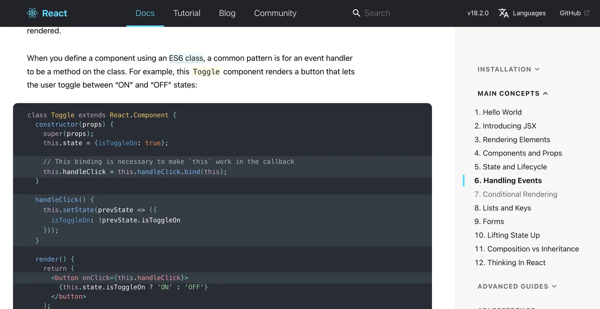

*레거시 문서를 보면 죄다 클래스형으로 설명되어있다.*

물론 얼마 가지 않아 훅의 개념을 알게 되어 클래스형 문법이 deprecated 상태라는 사실을 알게되어 뒤늦게 훅으로 넘어간 경험이 있었습니다 ???

당연하지만 당시의 ~~삽질~~경험이 *다시 점심 뭐 먹지 미션*에서 많은 도움이 됐습니다.

그동안은 대부분의 상태를 서드파티 상태관리 라이브러리에 맡겨서 쓸 일이 많지 않던 context api를 학습 삼아 사용해보기도 하고, styled-components를 사용하기도 하면서 최대한 순수한 React에 적응하려는 기간이었습니다.

또, @testing-library/react를 써보면서 리액트의 테스트 기법에 대해 알게 됐습니다.

소프트웨어 테스트의 중요성에 대해서는 학부 시절부터 수도 없이 듣고 해 봤기 때문에 충분히 공감하고 있었지만, 프론트엔드에서도 테스팅이 중요하다는 사실을 다시 한번 깨닫게 되는 시간이었습니다.

확실히 라이브러리 사용에 제약이 걸리니 더 많은 고민을 하게 됐던 것 같습니다.

**미션 2 - 페이먼츠**

<table><tbody><tr><td>&nbsp;</td><td>Repository</td><td>Feedback</td></tr><tr><td>Step1</td><td><a href="https://github.com/gabrielyoon7/react-payments/tree/step1">바로가기</a></td><td><a href="https://github.com/woowacourse/react-payments/pull/187">바로가기</a></td></tr><tr><td>Step2</td><td><a href="https://github.com/gabrielyoon7/react-payments/tree/step2">바로가기</a></td><td><a href="https://github.com/woowacourse/react-payments/pull/254">바로가기</a></td></tr><tr><td>Step3</td><td><a href="https://github.com/gabrielyoon7/react-payments/tree/step3">바로가기</a></td><td><a href="https://github.com/woowacourse/react-payments/pull/291">바로가기</a></td></tr></tbody></table>

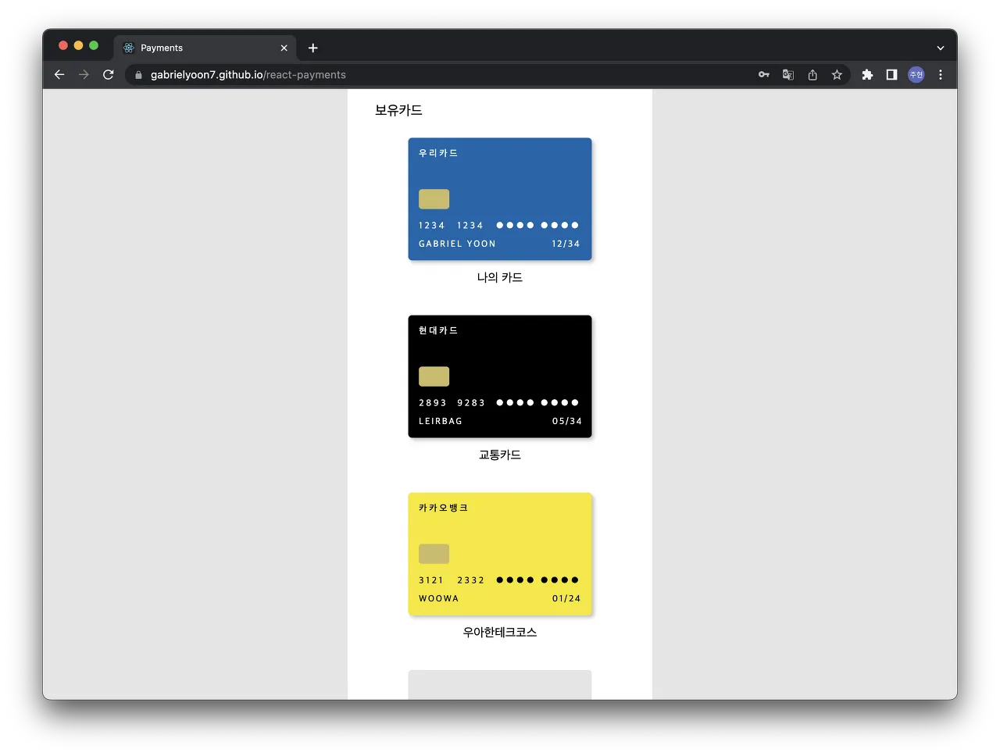

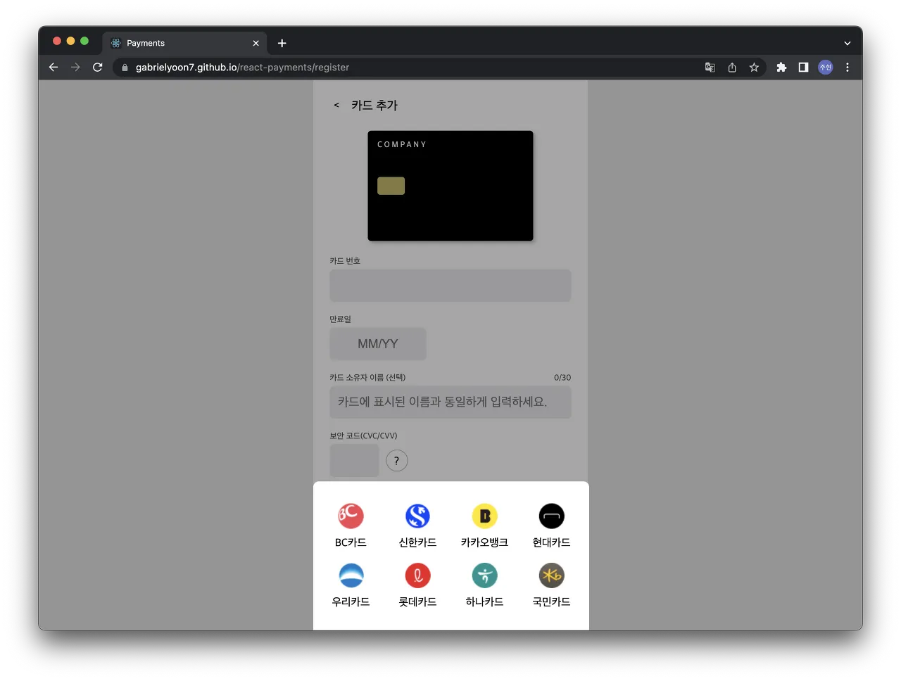

[배포 페이지](https://gabrielyoon7.github.io/react-payments/)

페이먼츠 미션은 신용 카드를 등록하고 조회하는 미션이었습니다.

무려 3주 동안 진행한 미션이었는데요, 많은 고민과 노력을 기울이기에 적당한 시간이기도 했습니다.

페이먼츠 미션에서는 form을 다루는 기법(유효성 검사, 제어/비제어 컴포넌트 방법론 등)과 스토리북을 이용한 CDD, context api, npm 배포에 대해 학습을 하게 됐습니다.

저는 이 미션을 진행하는 기간 내내 리액트란 무엇인지에 대해 다시 생각해 보게 됐습니다.

사실 아무런 제약 없이 페이먼츠 미션을 구현해보라고 한다면 대충 알고 있는 라이브러리를 총 동원하면 금방 해결할 수 있었겠지만, 미션 제약사항과 요구사항에 있는 테스팅도 그렇고 라이브러리를 쓸 수 없는 환경도 그렇고 고민할 것이 많았습니다.

리액트에서 form을 관리하는 것은 빈번하지만 높은 정확도를 요구합니다.

관련 라이브러리들이 많이 출시되어 있지만 이를 직접 구현하는 과정에서 유효성 검사를 어떻게 해야 하는지, 컴포넌트를 항상 제어 상태로 둬야 하는지 등 여러 고민을 하게 됐습니다.

스토리북은 그동안 미뤘던 기술부채였지만 이 미션을 통해 갚게 되었습니다.

리액트는 컴포넌트 기반의 라이브러리임에도 불구하고 항상 탑 다운 방식으로만 개발을 했었던 저에게 많은 생각과 고민을 안겨줬습니다.

(사실 프로젝트가 적당히 자리 잡으면 개발 도중에 바텀업 방식으로 전환해 왔지만 이렇게 완전히 밑바닥부터 올라가는 작업은 처음이었습니다.)

결정적으로 스토리북을 잘 써야 테스트에 대한 고민이 많이 줄어들 것이고, 비개발자와의 소통에 많은 도움이 될 것이라고 생각합니다.

전역 상태 관리를 라이브러리에서 할 수 없다 보니 context api에 의존하거나 스토리지에 의존할 수밖에 없었습니다.

저는 이 두 가지 방법이 맘에 들지 않아 어떻게 하면 좋을지 전전긍긍하고 있었는데, 점심을 같이 먹던 크루가 한 가지 재미있는 인사이트를 줬는데요, 새로 나온 훅을 사용하면 [전역으로 상태 관리를 할 수도 있다는 컨퍼런스를 본 적](https://youtu.be/KEDUqA9JeIo)이 있다는 것이었습니다.

어떤 방식으로 돌아가는지는 잘 모르겠지만 useSyncExternalStore 훅을 확인하면 좋을 것 같다고 말해줬고, 공식문서를 보니 설명과 예제가 잘 나와있었습니다.

이 과정에서 리액트18에는 새로 나온 훅이 많고, 변경점도 많다는 사실을 알게 되어 *"내가 아는 리액트의 세상이 다가 아니구나"* 라고 다시 한번 깨닫게 됐습니다.

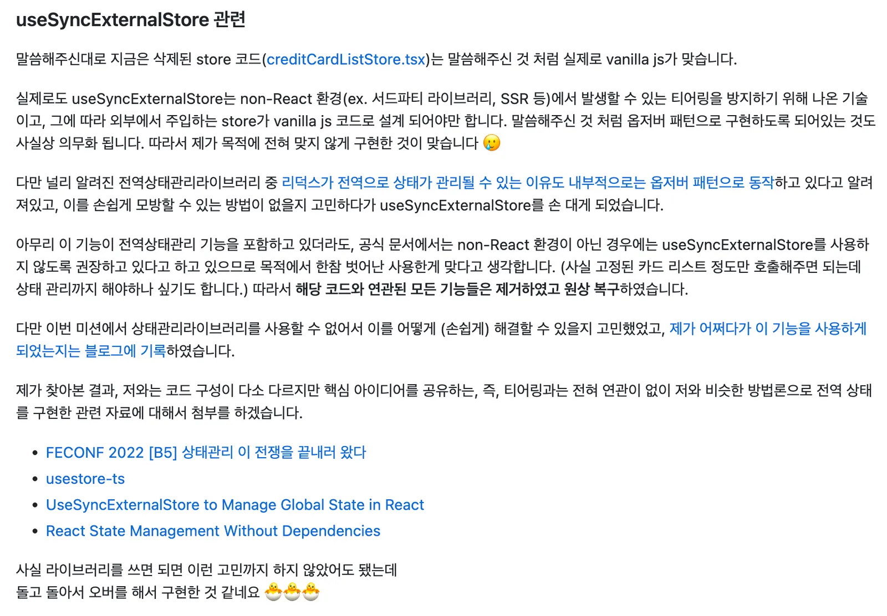

*사실 미션에서 이 기능을 썼다가 그냥 스토리지 쓰는게 낫지 않겠냐는 피드백을 받아서 해명 글도 작성했다*

사실 미션에서 이 기능을 썼다가 다른 방법으로 구현하라는 피드백을 받아 다시 뺐습니다....ㅎㅎ

하지만 useSyncExternalStore를 한 번 써보니 서드파티 상태 관리 라이브러리가 진짜로 필요하긴 한 건지에 대한 의문이 생길 정도로 편하다는 느낌을 받았습니다.

[제가 당시에 했던 고민들이 잘 담겨있는 글](../2023-05-02-tistory-144/)이 있으니 한 번 읽어보셔도 좋은 것 같아요.

> [\- 이 미션 이후에도 이 기능에 대한 잠재력에 대해 고민하다가 작성했던 예제](https://github.com/gabrielyoon7/my-typescript-react/tree/main/src/pages/react/useExternalState)  
> [\- 예제 실행해 보기](https://gabrielyoon7.github.io/my-typescript-react/react/use-external-store)

위 예제에서 작성한 샘플 코드는 [공식 문서](https://react.dev/reference/react/useSyncExternalStore#subscribing-to-an-external-store)보다 훨씬 추상화된 형태의 외부 Store를 제공할 것이라고 생각합니다.

기존 예제와 달리 클래스형으로 싹 바꿔서 커스텀훅으로 내보냈기 때문이죠...!

테코톡에서 클래스와 객체를 주제로 발표했던 것이 많은 도움이 됐었네요

개인적으로는 이 예제가 굉장히 간결하면서도 상태 관리 라이브러리에 대한 좋은 대안이 될 것이라고 믿고 있기 때문에 이 주제에 대해서는 조만간 블로그 글로 정리해서 다시 올라올 예정입니다.

당시에는 잘 몰랐지만 zustand도 이 훅으로 작성되어 있다는 사실을 알게 되어 제 생각이 마냥 틀리지는 않았구나 라는 생각이 들기도 하네요.

> 참고해 보면 좋은 문서  
> [\- 실제 zustand의 store에서 핵심 코드로 사용 중인 useSyncExternalStore 훅](https://github.com/pmndrs/zustand/blob/main/src/react.ts)  
> [\- \[React\] Zustand 동작 원리와 ExternalStore](https://ingg.dev/zustand-work/)

이 사건을 계기로 저는 리액트18의 최신 기능에 대해 깊은 관심을 가지게 됐습니다.

자료 조사를 하면서 컨퍼런스 영상을 많이 접하게 된 것도 좋은 경험이었습니다.

미션의 내용과는 별개로 요 시기부터 [WebStorm](https://www.jetbrains.com/webstorm/)으로 이주했습니다.

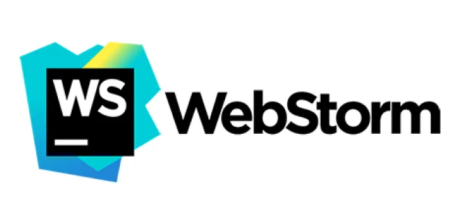

*웹스톰 쓰세요. 두 번 쓰세요. 꼭 쓰세요*

사실 웹스톰 소개에 앞서... 학교 다니던 시절 intelliJ의 광팬이었던 저는, 그 누구보다 이 IDE를 홍보하고 다녔습니다.

당시에는 수업 시간에 이클립스가 보편적으로 사용되고 있어서

*그런거 왜 쓰냐? 이클립스도 잘 되는데 굳이 그걸 쓰는 이유가 뭐냐?* 와 같은 반응이 많았습니다.

불평불만을 가지는 팀원들을 설득하러 다녀왔었습니다.

인텔리제이는 돈 내고 써도 하나 안 아까운 툴이니깐 무조건 학생 인증받아서 경험해 보라고 설득했습니다.

~~(참고로 저는 돈 아까워서 유튜브 프리미엄, 넷플릭스도 안 보는 사람입니다.)~~

제 블로그에 있는 인텔리제이 관련 글은 당시에 제 주변 팀원들이나 학생들을 설득하기 위한 가이드였습니다.

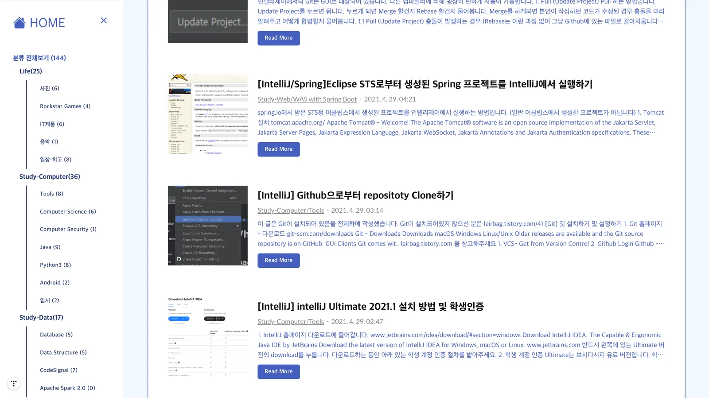

*이 블로그의 과거에는 유독 intelliJ 관련 글이 많다*

누군가 저에게 혹시 JetBrain의 명예직원이냐고 놀려도 그 사람이 곧 intelliJ의 광팬이 되어버릴 정도로 편한 툴입니다.

그때 불편해하던 사람들이 다른 수업에 가서 이 IDE를 전파하고 다니기도 했던 기억이 있습니다.

그래놓고 저는 웹 프런트엔드로 이주를 하여 vscode를 써왔지만 말이죠.

사실 웹 프론트엔드 IDE 시장은 개발자들이 typescript를 잘 지원하는 IDE가 vscode라는 소문과 함께 atom에서 vscode로 대거 이주했다고 알고 있는데 웹스톰은 그다지 유명하지 않아서 사용할 기회가 없었습니다.

(실제로 저는 vscode가 지금처럼 대중화되기 이전에는 atom도 써봤습니다.)

어떤 크루가 미션 할 때 웹스톰을 쓴다고 하길래 옆에서 기웃기웃거려보니 어디선가 많이 본 익숙한 UI여서 이거 혹시 젯브레인에서 만든 거 아니냐고 물어보니 맞다고 하더군요

아직 학생 인증 기한이 1년 남아있던 저는 그 말을 듣자마자 그 자리에서 즉시 웹스톰으로 넘어갔답니다.

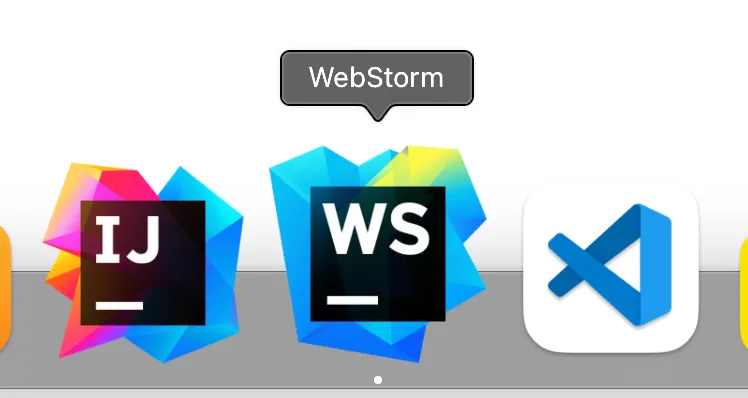

*다시는 떠나지 않을게요*

vscode 단축키나 설정 보다 인텔리제이와 파이참의 단축키가 더 익숙했던 저에게는 정말 꿈만 같은 소식이었습니다.

젯브레인 계열의 IDE가 리팩터링을 얼마나 정확하게 잡아주는지는 경험해 본 사람만이 아는 것 같습니다.

**미션 3 - 장바구니**

<table><tbody><tr><td>&nbsp;</td><td>Repository</td><td>Feedback</td></tr><tr><td>Step1</td><td><a href="https://github.com/gabrielyoon7/react-shopping-cart/tree/step1">바로가기</a></td><td><a href="https://github.com/woowacourse/react-shopping-cart/pull/161">바로가기</a></td></tr><tr><td>Step2</td><td><a href="https://github.com/gabrielyoon7/react-shopping-cart/tree/step2">바로가기</a></td><td><a href="https://github.com/woowacourse/react-shopping-cart/pull/231">바로가기</a></td></tr></tbody></table>

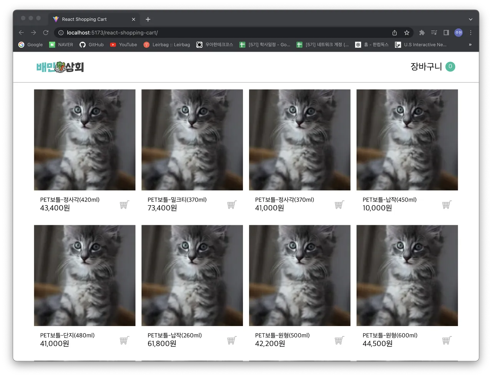

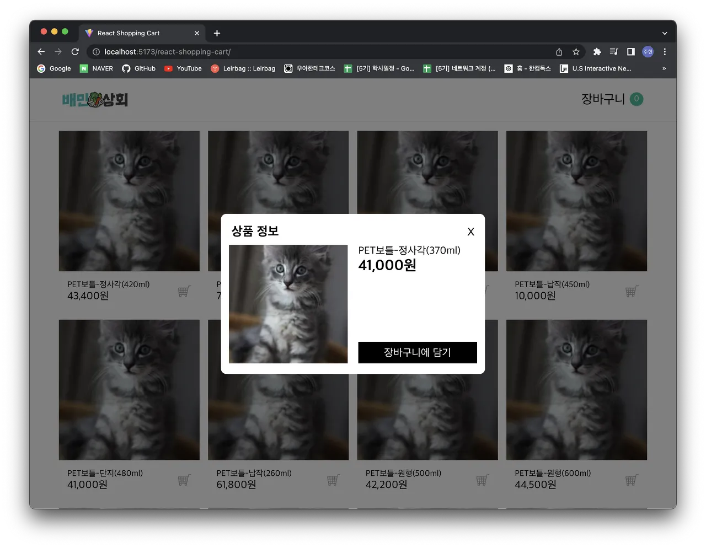

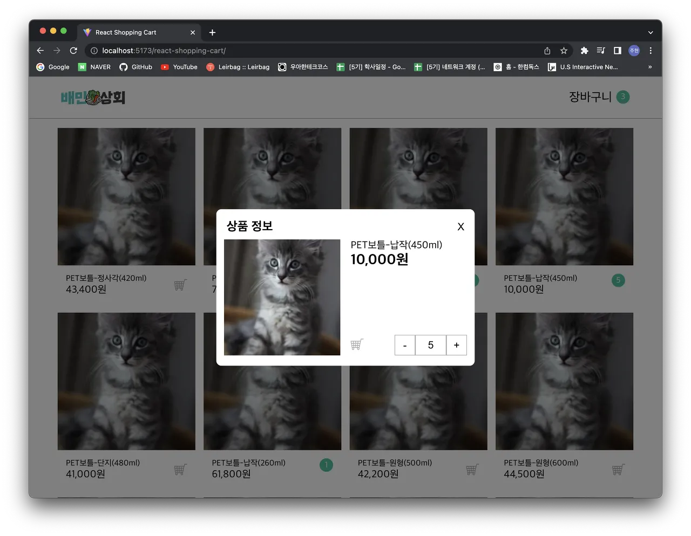

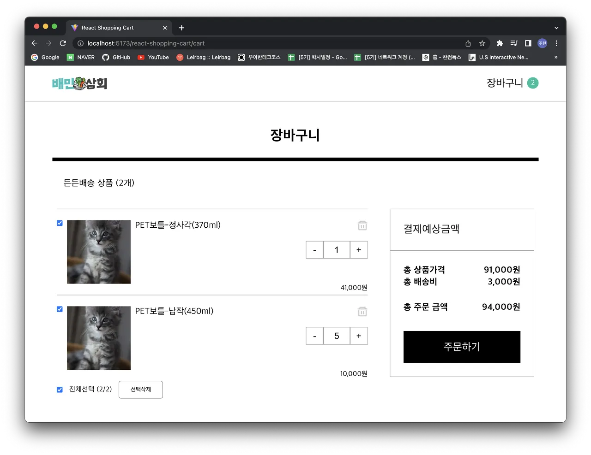

[배포 페이지](https://gabrielyoon7.github.io/react-shopping-cart/)

장바구니가 있는 쇼핑몰을 만들어야 했던 장바구니 미션은 규모가 대폭 커졌습니다.

상품을 장바구니에 담고, 수량을 조절하고, 가격도 계산해줘야 했습니다.

결정적으로 이 미션에서는 상태관리라이브러리를 사용할 수 있었는데요, recoil을 쓸 수 있었습니다.

레벨1이 끝난 방학에 우연한 계기로 recoil을 잠깐 경험해 봤는데, 레벨2에서 메인으로 쓰게 된다니 좀 놀랐습니다.

기존에는 redux만 사용해 봤었는데 말이죠...!

첫 PR에서 이런 피드백을 받았습니다.

제가 커스텀 훅에 recoil 상태를 물려서 사용하는 상황이었는데요

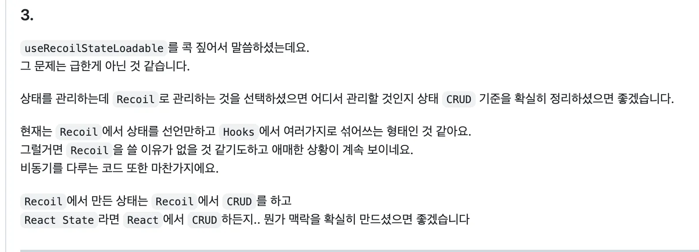

*이 피드백에서 많은 고민이 생겼다.*

이 피드백을 어떻게 해결할 수 있을지 고민이 깊어졌습니다.

recoil 라이브러리를 어떻게 써야 하는지 명확한 기준이 없다 보니 기술에 대한 아쉬움이 너무 컸습니다.

recoil이 상태의 원자성을 강조하다 보니 한 곳에 모아주는 reducer 같은 기능이 ~~(아무리 찾아도)~~ 없는 것 같고, 상태를 리코일 바깥으로 끌고 와서 업데이트하는 과정이 다소 이상한 것 같았습니다.

어찌어찌 selector의 setter를 쥐어짜면서 사용해 가면서 CRUD를 recoil에서 할 수 있도록 개선하여 피드백 내용을 반영하긴 했습니다.

결국 recoil에 대한 아쉬움을 표했는데요

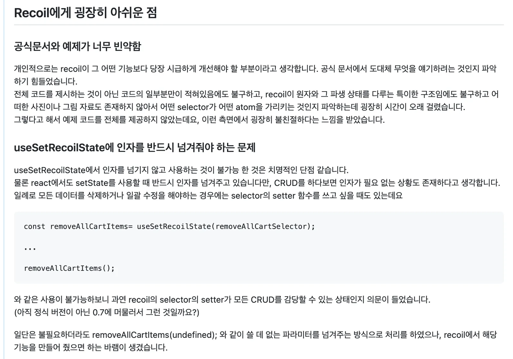

*중대장은 recoil에게 실망했다 같은 느낌*

리뷰어 입장에선 다소 당황할법한 상황이었습니다.

개인적으로는 recoil을 사용하면서 커스텀 훅이 아닌 곳에서 비즈니스 로직을 어떻게 하면 한 군데에 효율적으로 묶을 수 있을지 고민이 굉장히 컸던 것 같습니다.

사실 어떤 기술을 써도 크게 신경 쓰지 않고 담담하게 구현하던 저에게 이처럼 많은 고민을 안겨줬던 것은 라이브러리의 공식문서가 너무 빈약하고 부실한 것도 한몫했습니다.

예제가 없는데 어떻게 쓰란 말인지, 튜토리얼만 보면 useRecoilState, useSetRecoilState, useRecoilValue만 강조하는 것 같은데 이 훅들로 만 할 수 있는 것은 한계가 너무 명확했습니다.

그렇다고 해서 제가 한국어로 번역된 공식문서를 본 것도 아니었습니다.

공식문서는 무조건 원서로 읽어야 한다는 원칙을 가지고 학습을 해왔던 제 스스로에게 혹시 내가 영어가 모국어가 아니라서 이런 설움을 겪고 있는 건지 의심하기도 했습니다.

redux에서 이미 좋은 기능을 선보였는데 왜 recoil은 이런 게 없을까요? 그리고 있다면 공식문서 어디에 숨어있는 걸까요?라는 취지의 글이었지만 ***저 질문이 캡처되어 그대로 수업시간에 등장했습니다***. ???

*공개 처형을 당한 나*

아차 싶었습니다.

제가 쓴 글을 저격하려고 수업 자료로 쓰신 것은 아니겠지만.. 현업에서 내가 라이브러리를 선택할 수 있는 것도 아닌데 괜한 질문을 남겼나 싶기도 했습니다.

결론은.. 레벨 3에서도 recoil 쓰는 것이 강제되는 것도 아니고 그냥 전역 상태 관리 개념을 알고 넘어가자는 취지에서의 학습이라는 것이었습니다.

전역상태관리의 필요성을 느끼려는 관점에서 생각해 봤을 때, 그리고 redux의 엄청난 러닝 커브와 방대한 보일러플레이트를 고려했을 때 recoil은 충분히 좋은 툴이었다는 것은 맞으니깐 말이죠

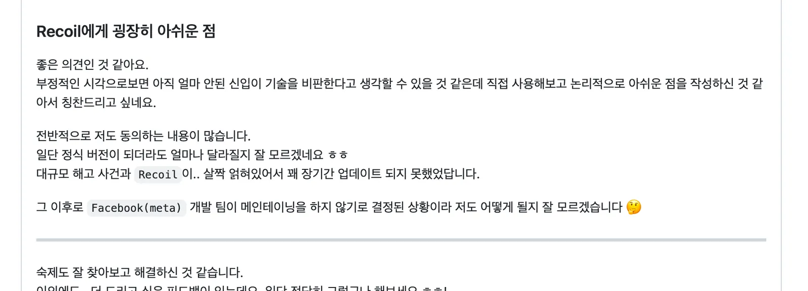

*이후에 이런 피드백이 왔다.*

사실 이 사건이 있고 나서 recoil 공식 문서를 더 파보기로 했고,  useRecoilCallback훅과 Snapshot 객체를 통해서 최적화와 관심사 분리가 가능하다는 사실을 알게 됐습니다. (사실 공식 문서는 여전히 불친절해서 큰 도움이 안 됐고 깃헙에 돌아다니는 이슈가 더 큰 도움이 됐습니다. 저와 같은 고민을 하는 사람들이 더 있더라구요)

이 기능들을 잘 조합해 보니 recoil의 장점들이 보이기 시작했습니다.

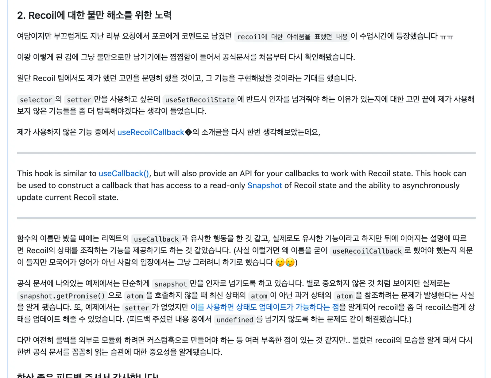

*뒤늦은 깨달음을 얻은 나*

이후에도 이러한 내용을 스터디에 들고 가서 좀 더 고도화할 방법이 없을지 고민했고, 너무 감사하게도 스터디원들이 큰 도움을 줬습니다.

스터디원들에게 이 기능을 소개하면서 고도화시킬 아이디어가 있는지 토의를 했는데, useCallback과 getCallback이 유사한 것 같다는 의견이 나와 이것저것 테스트하다 보니 [엄청나게 효율적인 코드가 탄생](../2023-06-03-tistory-148/)했습니다.

recoil의 로직을 한 군데 모으면서, recoil 본연의 기능을 활용하면서, 여러 상태를 참조하더라도, 잠재적인 성능 이슈까지 해결한 이 예제는 다른 라이브러리인 zustand에 이미 훌륭하게 구현이 되어있다고 생각하여 약간의 아쉬움이 남지만 recoil을 recoil 답게 최선을 다해 쓸 수 있도록 도울 수 있었다고 생각합니다.

사실 recoil을 튜토리얼에 나온 수준으로 간단하게 써도 됐던 일이었지만.. 리뷰어님이 recoil을 쓰는 맥락에 대해 언급하셨 던 것을 계기로 끊임없는 의심과 좌절감 그리고 탐구가 저를 한 단계 더 성장시킨 것 같습니다.

recoil 팀에서 훅 이름을 왜 useCallback과 유사하게 지어서 혼란스럽게 했는지는 여전히 의문이지만.. 스터디원들의 도움이 없었다면 숨은 핵심 기능들을 모르고 지나갔을 것 같았습니다.

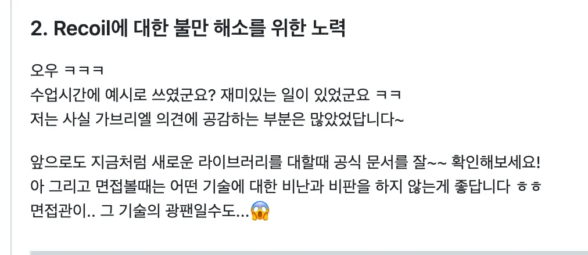

*이런 추가 피드백이 왔는데, 역시 말을 조심해야 할 것 같다는 생각이 들었다.*

여담이지만 이 미션부터 CRA를 쓰지 않고 vite를 쓰고 있는데, 일부 환경 설정이 기존의 CRA와 다르긴 하지만 굉장히 편한 것 같습니다.

일단 빠르고, 배포나 프록시 설정도 쉽습니다.

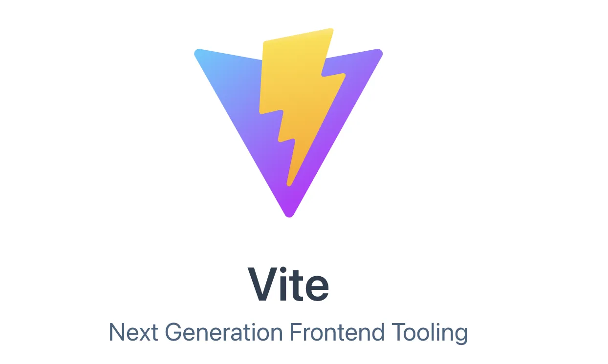

*요즘 거의 모든 공식문서의 예제가 vite로 마이그레이션 되고있다*

[혹시 vite로 프로젝트를 시작하는 것에 관심이 있으시다면 이 글을 확인해 주세요](../2023-05-12-tistory-146/)

**미션 4 - 장바구니(협업)**

<table><tbody><tr><td>&nbsp;</td><td>Repository</td><td>Feedback</td></tr><tr><td>Step1</td><td><a href="https://github.com/gabrielyoon7/react-shopping-cart-prod/tree/step1">바로가기</a></td><td><a href="https://github.com/woowacourse/react-shopping-cart-prod/pull/78">바로가기</a></td></tr><tr><td>Step2</td><td><a href="https://github.com/gabrielyoon7/react-shopping-cart-prod/tree/step2">바로가기</a></td><td><a href="https://github.com/woowacourse/react-shopping-cart-prod/pull/148">바로가기</a></td></tr></tbody></table>

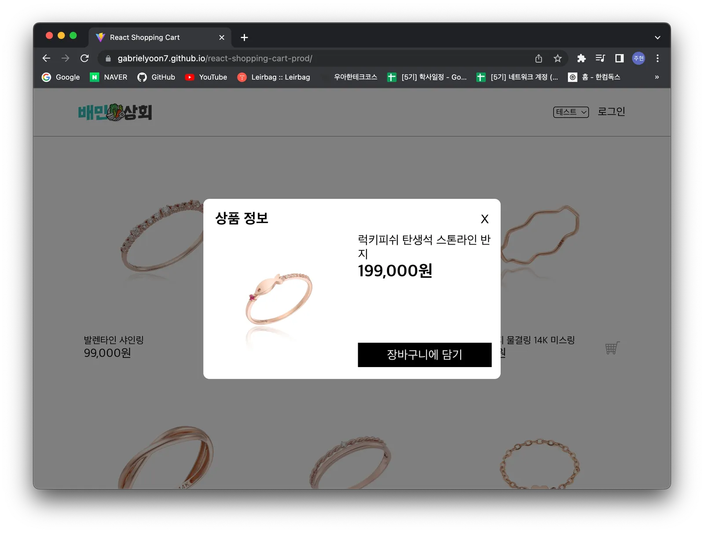

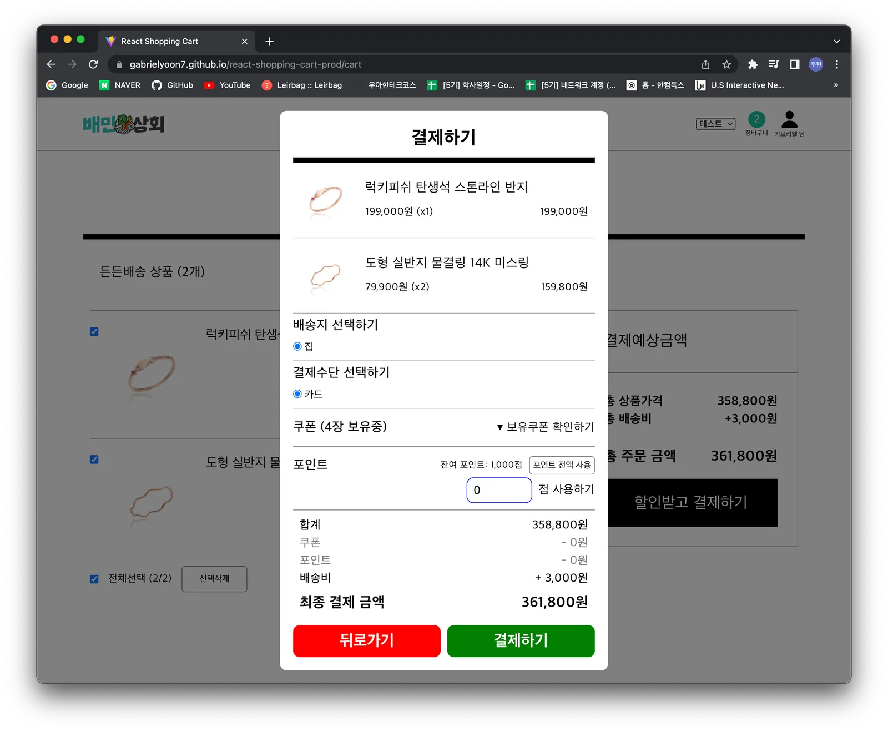

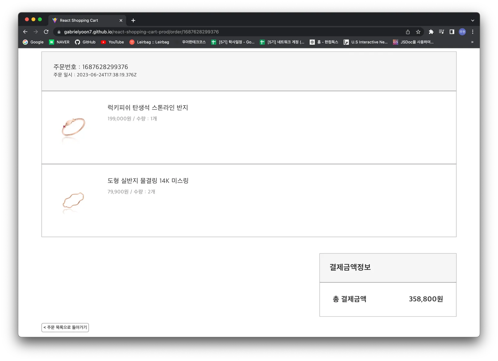

[배포 페이지](https://gabrielyoon7.github.io/react-shopping-cart-prod/)

이 미션은 앞선 장바구니 미션을 백엔드 크루들의 미션과 연결하는 것이었습니다.

이 과정에서 백엔드 크루들의 코드를 테스트 코드와 분리할 필요가 있었고 msw를 사용하여 모의 상황 테스트도 가능했습니다.

서버로 나가는 함수를 모킹 해서 백엔드와 통신이 된 것처럼 처리하는 이 툴은 백엔드 협업에서 테스트하기 좋은 기능이라고 생각합니다.

특히 msw와 스토리지의 결합은 모의테스트를 훨씬 안전하게 해 줍니다.

이후에는 실제로 주문하는 기능을 구현하고 할인하는 기능도 구현했습니다.

기술적으로 새로 학습하기보다는 그동안 배운 내용들을 총 집합하여 서로 통합하는 과정을 학습하게 됐습니다.

낙천적 업데이트가 무엇인지, 업데이트 과정에서 유효성 검사는 어떻게 해야 하는지 등 여러 고민을 하게 됐고

데이터 처리 관점에 대해서 다시 생각해 보게 됐습니다.

서버와 동기화가 필요한 상태는 무엇이고, 클라이언트에서만 필요한 상태는 무엇인지에 대해 고민하게 됐습니다.

이런 상황들을 겪어보니 이래서 react-query가 필요하구나 싶은 상황도 있었습니다.

프론트엔드와 백엔드가 독립적으로 행동하는 현대의 웹 개발 환경에서 많은 고민을 하게 했던 미션이었습니다...!

## 레벨 3과 팀 프로젝트

레벨 3부터는 팀 프로젝트를 시작합니다.

백엔드/프론트엔드/안드로이드 크루들 170여 명이 프로젝트 제안서를 제출했고 1차 선발로 47명이 통과했습니다.

47명의 크루들이 2분 스피치를 진행하여 투표를 진행하여 최종 24팀이 선발되었는데요

운이 좋게도 1차에 선발되어 발표했던 포스터입니다.

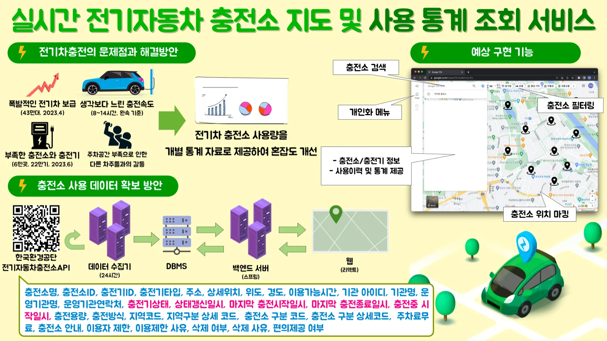

*공간이 너무 부족했다*

저는 전기자동차 충전소 관련 프로젝트를 우테코에 들어오기 전에 이미 [연구실에서 한 번 진행](https://github.com/KGU-DCS-LAB/myPlug)했었지만, 당시에 사실상 혼자서 전체 시스템을 구축하느라 여러 문제들이 있었습니다.

학부 연구생들이 각자 프로젝트를 제안하고 진행하되, 교수님과 팀원들이 이를 검수해주는 프로세스로 진행되다 보니 개발 인력이 너무 부족했습니다.

당장 앱을 개발하는 것도 문제였고, 서버와 대규모의 데이터 수집도 신경을 써야해서 완성도가 다소 부족하다고 생각했습니다.

어찌 저찌 돌아가는 시스템을 만들었지만 이를 장기적으로 유지보수 할 고민이 부족했습니다.

미완성인 채로 졸업을 해버리니 아쉬움이 너무 남았습니다.

주제는 명확했습니다.

지금 이 순간 전기자동차 차주들이 겪는 문제이기 때문입니다.

일례로 최근 아버지가 PHEV 차량을 구매했을 때, 가솔린으로 주행할 수 있음에도 불구하고 충전에 대한 스트레스가 있으셨습니다.

충전소가 부족한 것은 둘째 치고, 충전 단자 호환 문제와 충전 카드 할인 혜택 등 여러 이유로 차주들이 불편을 겪었습니다.

고속 충전은 배터리 수명을 갉아먹는 행위였고, 결정적으로 PHEV는 고속충전이 불법입니다.

따라서 산술적인 충전소/충전기 갯수는 실제 전기차 보급 대수에 완벽하게 대응하지 않다는 것입니다.  
(심지어 전기차의 범위도 BEV 뿐만이 아니라 PHEV도 고려해야 하지만 실제 통계나 정책은 그렇지 않다는 점도 문제입니다.)

아파트 커뮤니티도 항상 전기차 관련하여 싸움이 나곤 했습니다.

전기차 충전소를 더 늘리자니 내연기관 차주들의 반발도 무시할 수 없었습니다.

수도권은 주차 공간이 만성적으로 부족한데 말이죠.

저는 이런 모습을 보고 전기차 충전소의 혼잡도를 차주들에게 제공하여 분산을 유도하고자 하였고, 지금도 이 주제에 애착을 가지고 있습니다.

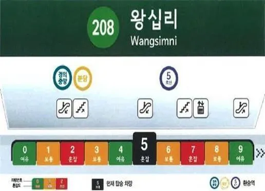

*혼잡도 정보의 제공은 사용자들에게 편의를 준다.*

하지만 이런 문제들은 경험하기 전에는 공감하기 어렵습니다.

연구실에서도, 제 주변에서도, 같은 아파트 입주민들도 공감을 얻어내기 어려웠습니다.

심지어 전기차 차주들끼리도 차량 간의 특성을 이해하지 못해서 싸움이 일어나기 일수였으니깐요.

따라서 저는 발표에서 문제 제기보다는 이 주제가 가지는 명백한 기술적 장점이 무엇일지를 집중공략하기로 했습니다.

<table><tbody><tr><td></td><td>장점</td></tr><tr><td>백엔드</td><td>1. 실존하는 API를 이용해 24시간 수집하면 대규모의 데이터를 다뤄볼 수 있다. 2. 데이터를 누적하는 과정에서 최적화를 고민해볼 수 있다. (벌크 업데이트, 효율적인 데이터 저장 방식 등) 3. 실시간 데이터 제공을 위한 지연 시간 감축에 대해 고민할 수 있다.</td></tr><tr><td>프론트엔드</td><td>1. 지도와 GPS 개념을 다뤄볼 수 있다. 2. 다른 프로젝트와 달리 클라이언트 단에서 많은 연산이 발생하여 최적화를 고민하게 된다.</td></tr></tbody></table>

문제는 발표에서 의도했던 장점 부각과는 다르게 이 팀에 뽑히면 전기차를 사주냐는 질문이 도배되어 "저 할래요"라는 실시간 댓글이 엄청나게 달렸습니다.

다들 댓글을 장난으로 달은 줄 알았는데 실제로도 많은 투표를 해주셔서 결국 뽑히게 됐네요.

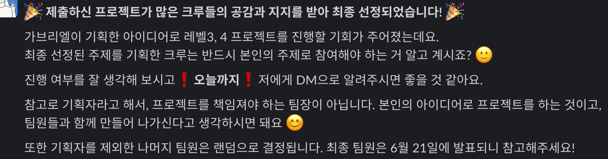

*오예*

## 레벨 3에 들어가는 나의 다짐

#### 글쓰기

일단 밀린 기술 글이 많아서 틈틈이 작성하려고 합니다.

레벨 2 기간 동안 알게된 새로운 훅이나 리액트의 개발 방법론 중에 최적화와 관련된 중요한 부분이 많았습니다.

어쩌면 레벨 2에서 배워야 할 내용 외적인 부분에 시간을 굉장히 많이 들였던 것 같기도 해요.

물론 일반적인 프로젝트에서는 사용할 일이 전혀 없겠지만 저사양 기기를 위한다거나 고사양의 애플리케이션을 개발하게 될 일이 생겼을 때 굉장히 유용한 훅들이 너무 많았습니다.

새로운 공식 문서도 충분히 좋은 예제를 가지고 있지만, 다소 미흡한 부분도 보였기에 작성할만한 글이 정말 많다고 생각합니다.

블로그 포스팅 스터디가 있어서 주기적으로 글을 올려왔는데, 앞으로도 계속 꾸준히 글을 작성할 계획입니다.

#### 스터디

레벨2 기간에서 정말로 열심히 했던 활동 중 하나가 스터디였습니다.

심심하다 싶으면 긴급스터디를 열어서 기술적인 토의를 정말 많이 했습니다.

특히 마지막 주에는 거의 매일 호출했는데 응해주신 크루들에게 너무 감사할 뿐입니다.

다만 이제부터는 캠퍼스가 나뉘어서 예전 처럼 스터디를 잘 못할것 같다는 생각이 들기도 합니다.

계속 이어갈 방법을 찾아보려고 합니다.

#### 프로젝트

앞서 언급했던 것 처럼 전기자동차는 아직도 사람들에게 생소한 개념입니다. 어려운 것은 전혀 없지만 말이죠.

새로운 팀원들에게 핵심 아이디어와 문제 공유를 먼저 하는 것이 우선이라고 생각됩니다.

주제에 대한 설득을 하기 위한 과정을 우선하여 프로젝트를 준비하고 있습니다.

아무 문제 없이 기한 내에 프로젝트를 마무리 할 수 있기를 바랄 뿐입니다.

## 취업할 수 있을까?

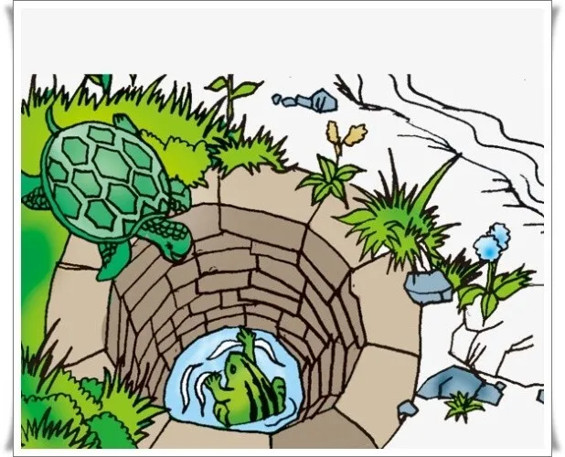

*우물 안 개구리가 되지 말자*

시간이 너무 부족합니다. 깊게 배워야할 것이 많은데 알아야 할 것도 너무 많습니다.

시야를 넓게 가지고, 편견 없이 알아가는 것은 굉장히 어렵습니다.

익숙한 것에 적응되지 않고 기민하게 움직이는 사람이 되는 것은 참 어려운 것 같습니다.

이쯤 되면 다 안거 아닌가? 싶으면 새로운게 발견됩니다.

스스로에게 묻습니다. 이것도 몰랐나?

[어쩌면 모르는게 당연할 지도 모릅니다.](https://overreacted.io/things-i-dont-know-as-of-2018/)

모르는게 나와도 좌절하지 않고 재빠르게 학습하는 수 밖에 없다고 생각합니다.

[마라톤 하듯이 아무 생각 없이 꾸준히 달리는 것 외에는 좋은 방법이 있을까요?](https://okky.kr/articles/1261756)

현업 개발자의 궤도에 들어가려면 죽어라 하는 수 밖에 없습니다.

들어가서도 이탈하지 않으려면 또 죽어라 달리는 수 밖에 없을 것입니다.

끝까지 완주할 수 있는 나를 기대하며 레벨3를 기다립니다.

레벨2 회고 끝.
