> 이 글은 2023-10-24에 티스토리 블로그(leirbag.tistory.com/158)에 처음 작성한 글을 옮겨온 것입니다.


React에서 Google Maps API를 사용하기 위해 사용하는 [@react-google-maps/api](https://github.com/JustFly1984/react-google-maps-api)나 [react-google-maps](https://github.com/tomchentw/react-google-maps) 같은 라이브러리들을 사용하는 방법이 있을 것입니다. 이 라이브러리들을 사용하면 Google Maps API에 있는 주요 기능들을 React 컴포넌트처럼 사용할 수 있지만, 여러 가지 문제가 있습니다.

#### 실제 Google Maps API에서 제공하는 환경과 달라 제대로 된 기능을 활용하기 어렵습니다.

구글 지도에서 제공하는 기능들을 직접 접근하여 개발하는 것이 아닌, 라이브러리에서 제공하는 컴포넌트에 의존하여 개발을 하다보면 트러블 슈팅을 할 때 문제가 발생합니다.

과거 React Native에 Google Maps API를 사용하기 위해 라이브러리([react-native-maps](https://github.com/react-native-maps/react-native-maps))를 사용하였는데, Vanilla JS 수준에서 조작하기 어려운 상황이 많았습니다.

최근 vis.gl에서도 [react-map-gl](https://github.com/visgl/react-map-gl)를 출시하여 Google Maps Platform과 협업을 하고 있는 것으로 보이지만, Google Maps API의 모든 기능을 사용하는 것은 어려워 지금 당장 추천하기는 어렵습니다.

#### 라이브러리의 유지보수가 중단될 수 있습니다.

Google Maps API는 다른 지도 API에 비해 변화가 많은 라이브러리입니다. 주기적으로 업데이트 되고, 신기능이 출시되는 과정에서 특정 라이브러리에 의존하여 개발을 하다보면 대응하기 어려울 수 있습니다. 예를들어 react-google-maps의 경우에는 개발자가 유지보수를 중단한 전례가 있습니다. React의 버전이 더이상 맞지 않는 것은 물론이고, Google Maps API의 버전도 맞지 않았습니다. 다른 라이브러리들도 마찬가지로 개발자가 대응하지 않으면 사용하지 못하는 기능들이 있습니다. 물론 라이브러리 개발자들이 잘 대응해주겠지만, 최근에 추가된 AdvancedMarker 객체의 경우에도, 컴포넌트가 미리 구현되어 있지 않다면 적용하기 어려워 구버전의 Marker를 계속 사용해야 할 것입니다.

## @googlemaps/react-wrapper

Google Maps Platform 팀에서는 공식 라이브러리를 몇 가지 제공해줍니다.

[@googlemaps/js-api-loader](https://www.npmjs.com/package/@googlemaps/js-api-loader) 를 사용하는 것이 가장 저수준의 개발을 할 수 있을 것입니다.

이 라이브러리는 Google Maps API를 React 환경으로 끌어오는 역할을 하게 됩니다.

기존의 npm 설치와 달리, 지도 라이브러리를 동적으로 받아옵니다.

라이브러리를 동적으로 호출하려면 비동기적인 처리가 필요한데, 이를 Wrapper 컴포넌트 형태로 제공하는 라이브러리도 제공합니다.

[https://github.com/googlemaps/react-wrapper](https://github.com/googlemaps/react-wrapper)

> [**GitHub - googlemaps/react-wrapper: Wrap React components with this libary to load the Google Maps JavaScript API.**](https://github.com/googlemaps/react-wrapper)  
> Wrap React components with this libary to load the Google Maps JavaScript API. - GitHub - googlemaps/react-wrapper: Wrap React components with this libary to load the Google Maps JavaScript API.

@googlemaps/react-wrapper는 js-api-loader를 활용하여 지도를 호출하고, 로딩/에러/성공 처리를 분기처리 해주는 Wrapper 컴포넌트를 제공해주는 라이브러리입니다. 이 역시 Google Maps Platform 팀에서 제공하는 공식 라이브러리 입니다.

저는 이 라이브러리를 기준으로 기본 세팅을 하는 방법을 안내하겠습니다.

#### Google Maps API Key 발급 받기

[https://console.cloud.google.com](https://console.cloud.google.com)

> [**Google 클라우드 플랫폼**](https://accounts.google.com/v3/signin/identifier?continue=https%3A%2F%2Fconsole.cloud.google.com%2F&followup=https%3A%2F%2Fconsole.cloud.google.com%2F&ifkv=AVQVeyxCJkan3lFZF9e5Hgrp8qYqqGBukdjsROb-xeTXPcom6l1tBfR7E72Ra9scPHDO704isj-ZCQ&osid=1&passive=1209600&service=cloudconsole&flowName=WebLiteSignIn&flowEntry=ServiceLogin&dsh=S117506186%3A1699333235865164)  
> 로그인 Google 클라우드 플랫폼으로 이동

키를 발급 받습니다.

자세한 과정은 구글에 검색하면 잘 정리되어 있습니다.

#### @googlemaps/react-wrapper 설치 하기

```bash
yarn add @googlemaps/react-wrapper
```

```bash
yarn add -D @types/google.maps
```

npm으로 설치해도 괜찮습니다.

#### Wrapper를 활용하여 Google Maps API 호출

**App.tsx**

App 환경을 다음과 같이 수정합니다.

```typescript
import {Status, Wrapper} from "@googlemaps/react-wrapper";

const render = (status: Status) => {
  switch (status) {
    case Status.LOADING:
      return <>로딩중...</>;
    case Status.FAILURE:
      return <>에러 발생</>;
    case Status.SUCCESS:
      return <>로드 성공</>;
  }
};

function App() {

  return (
    <Wrapper apiKey="구글에서 받은 api key" render={render}/>
  )
}

export default App
```

apiKey에는 키를 직접 주입하는 방식도 있지만, 만일 github에 그대로 push하는 경우 보안 경고 메시지가 올 수 있습니다.

배포 시에는 google cloud 플랫폼에서 api key를 제한 걸 수 있어서 접속한 url에 따라 자동으로 차단되거나 로드가 허용 될 것입니다.

하지만 키 제한을 걸지 않았다면 누구나 사용할 수 있게 되므로 ***다음과 같이 적용하는 것을 권장합니다.***

1\. url 보호

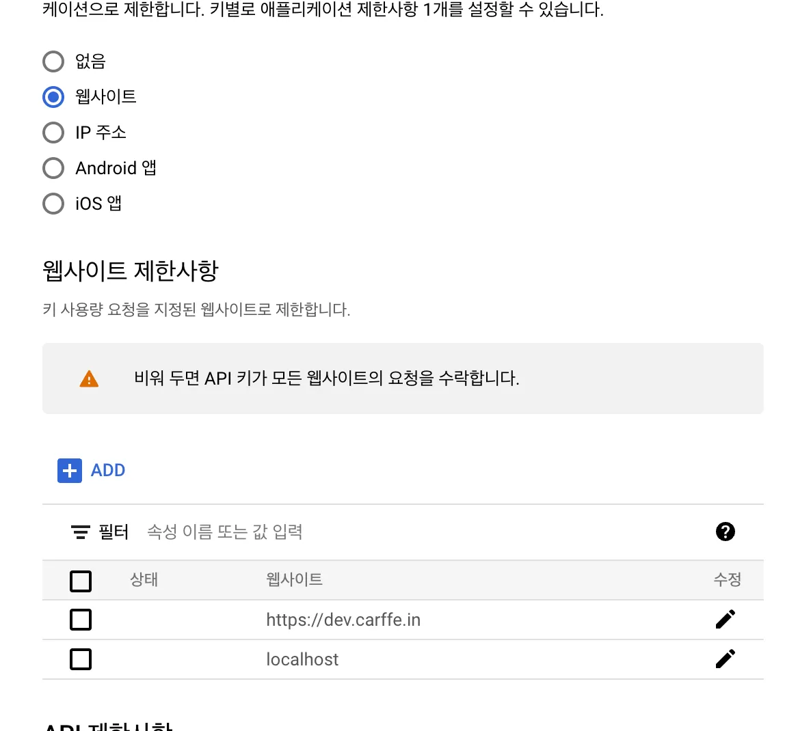

접속을 허용하는 url을 걸어두게 되면, 허용하는 주소에서만 접속이 가능합니다.

2\. .env를 활용한 키 보호

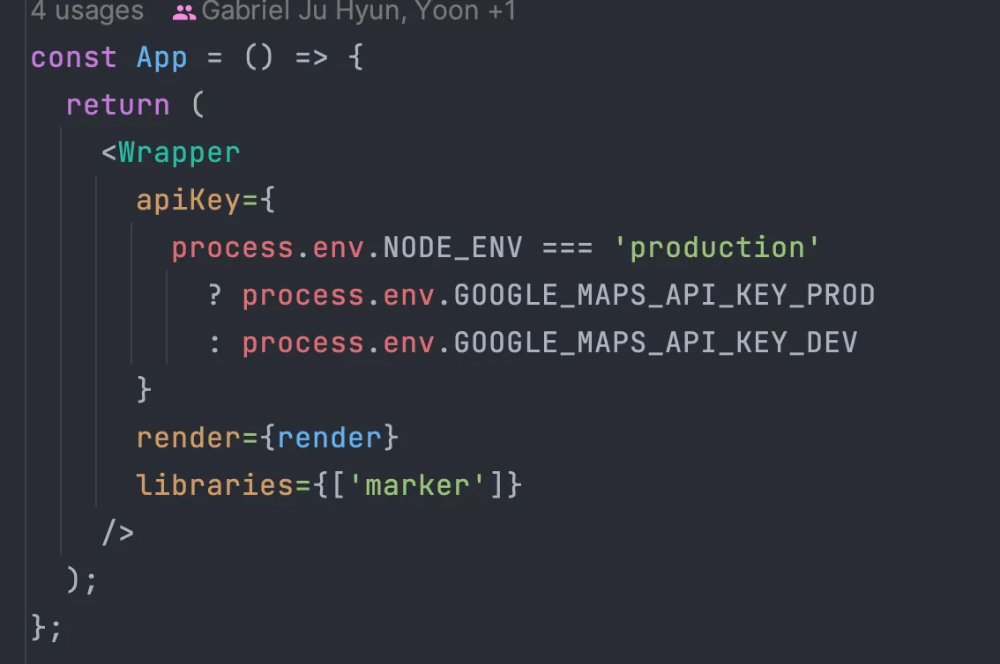

키값을 외부에 노출시키지 않도록 .env를 활용하여 보호합니다.

위 사진 처럼 개발용 키와, 배포용 키를 분리하는 방식도 존재합니다.

3\. 할당량 제한

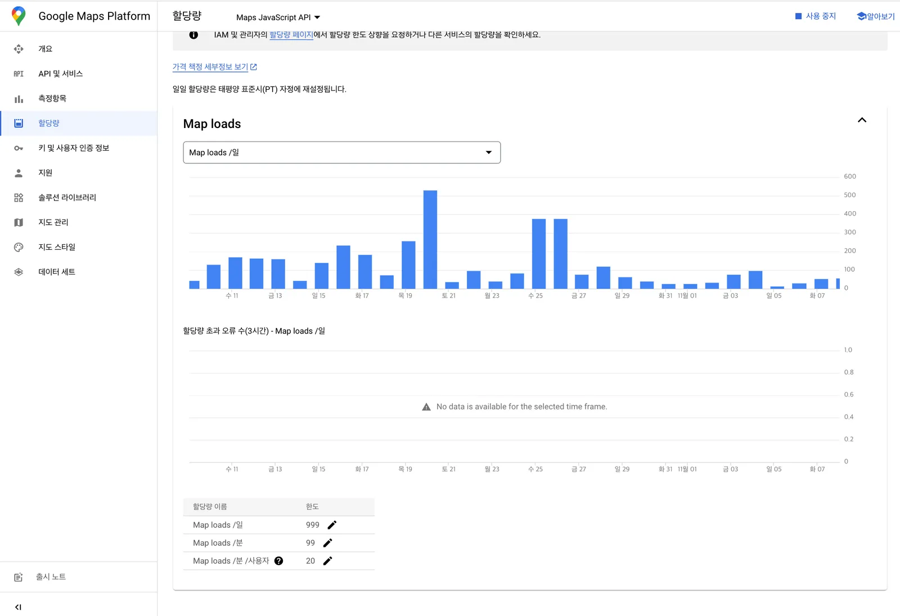

위와 같이 키 접근 한도를 제한하여 여러분의 지갑을 지키는 방법도 존재합니다.


지도 라이브러리가 로드되면 위와 같이 로드 성공이 출력됩니다.

#### 지도 객체 생성 및 할당하기

라이브러리가 동적으로 로드 된 이후에는, 지도 객체를 생성해야 합니다.

위 작업만을 담당할 컴포넌트를 만들어보겠습니다.

React의 StrictMode로 인하여 지도 객체를 일반적인 방법으로 생성하는 것은 어렵습니다.

지도를 생성하는 방식을 두 가지 버전으로 소개하겠습니다. Case1과 Case2로 나눠서 예제를 제시하겠습니다.

StrictMode는 애플리케이션의 컴포넌트를 두 번 렌더링하여 잠재적인 부작용을 식별하는 데 도움을 줍니다. 이중 렌더링은 컴포넌트의 순수성과 예측 가능한 동작을 확인하는 데 유용합니다. 다만, 이중 렌더링 현상으로 인해 development모드에서는 지도도 두 번 부착되게 됩니다. 따라서 다음과 같이 잠재적인 문제를 회피할 수 있습니다.

**GoogleMap.tsx (Case1)**

```typescript
import {useEffect, useRef, useState} from "react";

function GoogleMap(){

  const ref = useRef<HTMLDivElement>(null);
  const [googleMap, setGoogleMap] = useState<google.maps.Map>();

  useEffect(() => {
    if (ref.current) {
      const initialMap = new window.google.maps.Map(ref.current, {
        center: {
          lat: 37.5,
          lng: 127.0,
        },
        zoom: 16,
      });

      setGoogleMap(initialMap);
    }
  }, []);

  return <div ref={ref} id="map" style={{ minHeight: '100vh' }} />
}

export default GoogleMap;
```

위 방식은 useRef를 활용하여 지도가 단 한번 부착되는 방식입니다.

**GoogleMap.tsx (Case2)**

```typescript
import {useEffect, useState} from "react";

function GoogleMap(){

  const [googleMap, setGoogleMap] = useState<google.maps.Map>();

  useEffect(() => {

    const container = document.createElement('div');

    container.id = 'map';
    container.style.minHeight = '100vh';

    document.body.appendChild(container);

    const instance = new window.google.maps.Map(container, {
      center: {
        lat: 37.5,
        lng: 127.0,
      },
      zoom: 16,
    } );

    setGoogleMap(instance);

    return () => {
      document.body.removeChild(container);
    }

  } ,[])

  return <></>
}

export default GoogleMap;
```

위 방식은 useEffect의 clean up 함수를 사용하여 강제로 지도 conatainer를 제거하여 이중 렌더링 현상을 방지하는 현상입니다.

두 가지 방식 다 유효한 방식이지만, 지도 엘리먼트를 어디에 부착하고 싶은지에 따라 선택하면 됩니다.

**App.tsx**

```typescript
import {Status, Wrapper} from "@googlemaps/react-wrapper";
import GoogleMap from "./GoogleMap.tsx";

const render = (status: Status) => {
  switch (status) {
    case Status.LOADING:
      return <>로딩중...</>;
    case Status.FAILURE:
      return <>에러 발생</>;
    case Status.SUCCESS:
      return <GoogleMap />;
  }
};

function App() {

  return (
    <Wrapper apiKey="구글에서 받은 api key" render={render}/>
  )
}

export default App
```

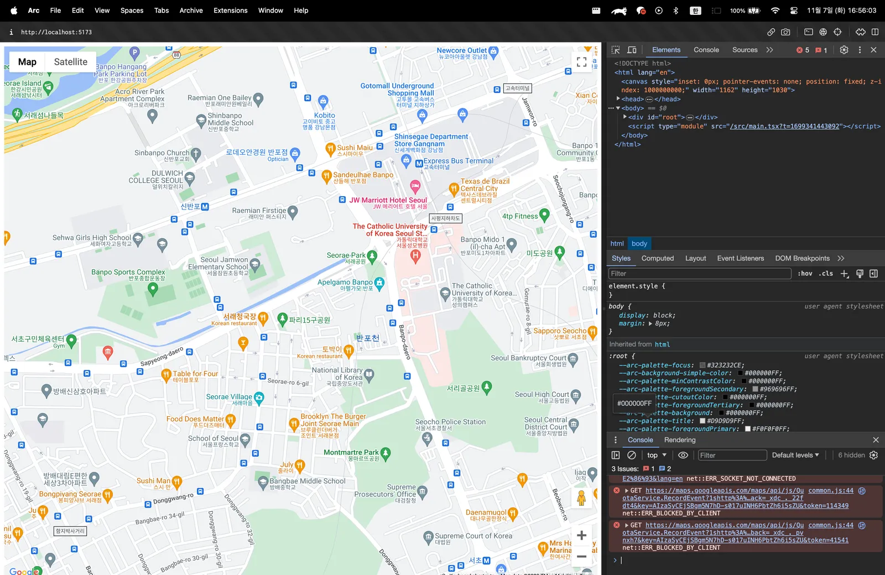

Google Maps API의 기능들을 사용하기 위해서는 반드시 google.maps.Map 객체(GoogleMap.tsx에서 생성한 googleMap 상태)에 자유롭게 접근할 수 있어야 합니다.

따라서 해당 상태를 클라이언트 전역 상태로 두거나 context api 혹은 useSyncExternalStore에 두는 방식으로도 활용할 수 있습니다.

예제에서는 useState에 할당했지만, ***여러분이 편한대로 접근하면 됩니다.*** (저는 지도 객체를 외부 시스템이라고 생각해서 useSyncExternalStore에서 접근 하는 것을 선호합니다.)

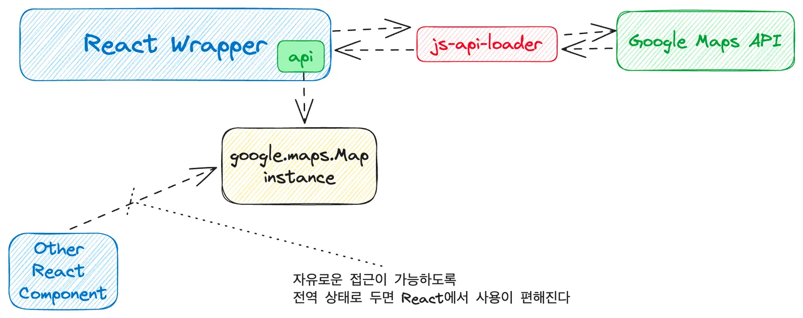

#### 벡터 지도 사용하기


지도를 스크롤 해보면 래스터 지도임을 확인할 수 있습니다.

Google Maps API는 벡터 지도를 지원하며, 이를 적용하면 좀 더 나은 사용자 경험을 제공합니다.

(여담이지만 제가 Google Maps API를 선호했던 이유가 벡터 지도였는데, 최근 네이버 지도에서도 벡터 지도를 지원하기 시작했습니다.)

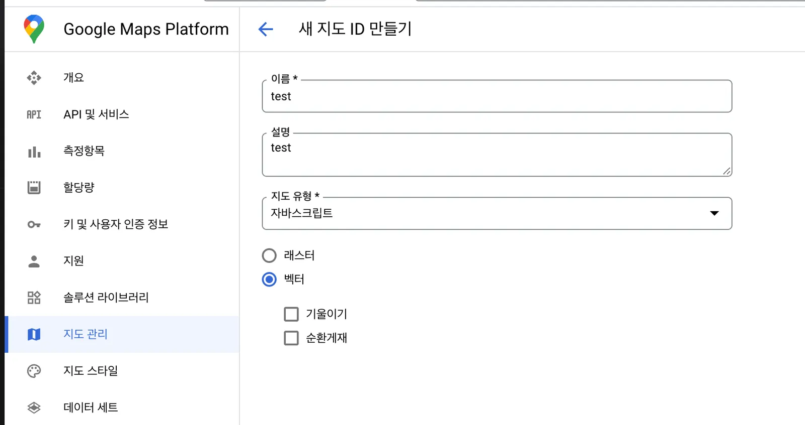

구글 클라우드 플랫폼에 접속해서 지도 ID를 발급 받습니다.

이 아이디는 api key가 아닌, 지도의 설정을 식별하는 역할을 합니다.

지도 유형은 자바스크립트, 벡터지도를 선택해야 합니다.

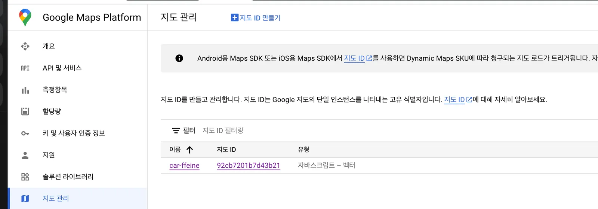

생성된 지도 아이디를 복사합니다.

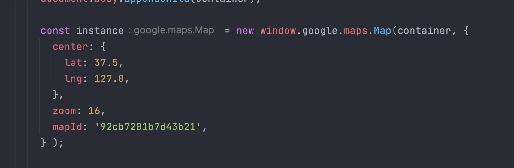

복사한 아이디를 mapId에 전달합니다.


벡터 지도로 전환 된 것을 확인할 수 있습니다.

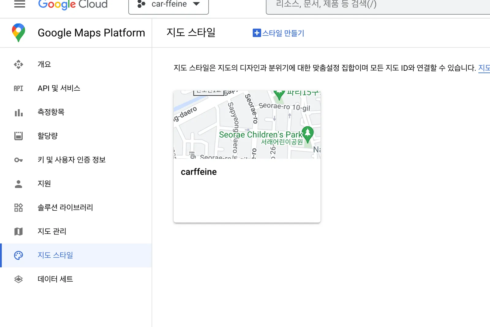

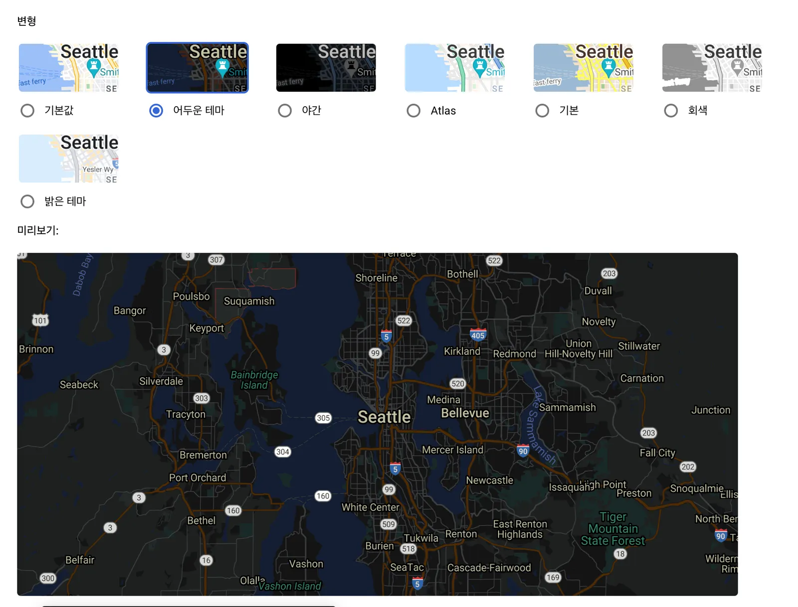

여담이지만 발급받은 지도 아이디에 지도 스타일을 연동하면 지도 스타일링도 커스텀 할 수 있습니다.

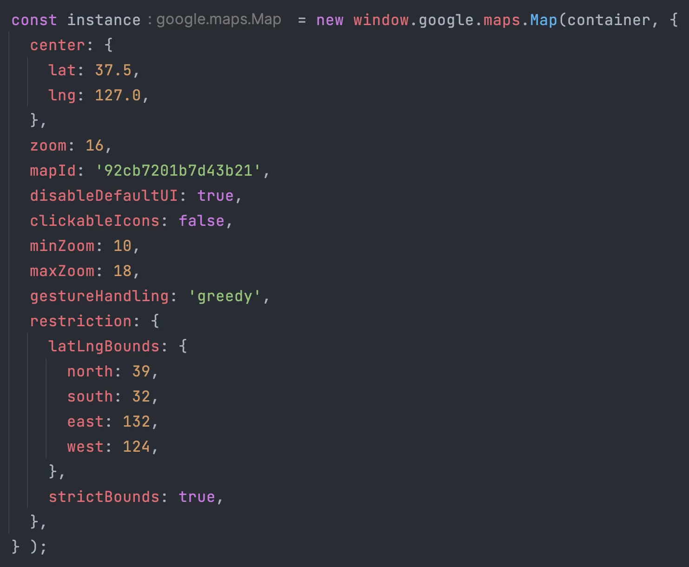

공식 문서에서 제공하는 옵션들을 설정하면 지도의 최소 줌, 최대 줌, 이동 가능 영역, 아이콘 클릭 제한, 기본 UI 제거 등 여러 설정을 적용할 수 있게 됩니다. (공식 문서에 설명이 매우 친절하게 되어있습니다.)

#### 고급 마커(Advanced Marker)란?

2022년 말, Google Maps API의 Marker 기능이 새롭게 출시되었습니다.

새롭게 출시된 Advanced Marker는 현 시점에도 이 기능은 베타이지만, 기존 Marker 보다 훨씬 자유로운 사용이 가능합니다.

이 기능은 베타임에도 불구하고 Google Maps API의 강력한 주요 기능으로 떠오를 가능성이 있다고 생각하는데, 그 이유는 다음과 같습니다. (이 객체도 제가 Google Maps API를 선호하는 이유 중 하나입니다.)

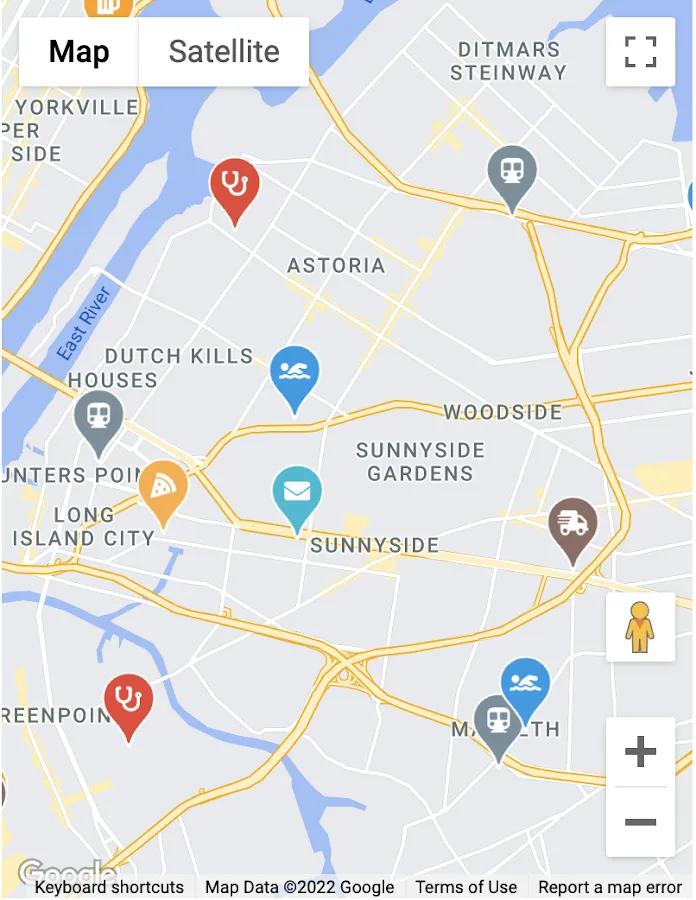

위 사진처럼, 이미지 적용 없이도 기존 마커를 개량하여 사용할 수 있습니다. (위 기능은 PinView를 활용한 예제입니다.)

즉, 굳이 마커용 이미지를 지도 위에 띄우지 않아도 코드에서 직접 기본 빨간색 핀의 색상, 배경, 아이콘 및 윤곽선을 변경할 수 있습니다.


위 예제처럼 CSS를 사용하여 크기 조정, 불투명도, 위치, 색상 등을 변경하는 등 고급 마커의 스타일을 동적으로 지정하고 애니메이션을 적용할 수 있습니다


위 예제처럼 HTML 엘리먼트를 마커에 적용하는 기능도 지원하게 되었습니다. 즉, **AdvancedMarker 객체를 사용하면 아주 자유로운 Marker 사용**이 가능해집니다.

[https://storage.googleapis.com/gmp-maps-demos/advanced-markers/index.html#intro-page](https://storage.googleapis.com/gmp-maps-demos/advanced-markers/index.html#intro-page)

> [**Advanced Markers - Google Maps Platform**](https://storage.googleapis.com/gmp-maps-demos/advanced-markers/index.html#intro-page)  
> More performant, more customizable, more feature rich.

위 링크에 접속하면 Advanced Markers의 활용 사례를 확인할 수 있으니 참고 바랍니다.


위 영상은 실제로 마커에 적용해본 애니메이션 입니다.

참고로 Advanced Marker는 기존보다 66%의 성능 개선이 있으며, 더 많은 마커를 동시에 핸들링 할 수 있습니다.

#### Advanced Marker 렌더링 하기

**App.tsx**

```typescript
import {Status, Wrapper} from "@googlemaps/react-wrapper";
import GoogleMap from "./GoogleMap.tsx";

const render = (status: Status) => {
  switch (status) {
    case Status.LOADING:
      return <>로딩중...</>;
    case Status.FAILURE:
      return <>에러 발생</>;
    case Status.SUCCESS:
      return <GoogleMap />;
  }
};

function App() {

  return (
    <Wrapper apiKey="구글에서 받은 api key" render={render} libraries={['marker']}/>
  )
}

export default App
```

라이브러리로 marker를 추가합니다. (베타 버전 종료 이후에는 삭제될 수도 있습니다.)

**GoogleMap.tsx**

```typescript
import {useEffect, useState} from "react";
import {createRoot} from "react-dom/client";

function GoogleMap(){

  const [googleMap, setGoogleMap] = useState<google.maps.Map>();

  useEffect(() => {

    const mapContainer = document.createElement('div');

    mapContainer.id = 'map';
    mapContainer.style.minHeight = '100vh';

    document.body.appendChild(mapContainer);

    const instance = new window.google.maps.Map(mapContainer, {
      center: {
        lat: 37.5,
        lng: 127.0,
      },
      zoom: 16,
      mapId: '92cb7201b7d43b21',
      disableDefaultUI: true,
      clickableIcons: false,
      minZoom: 10,
      maxZoom: 18,
      gestureHandling: 'greedy',
      restriction: {
        latLngBounds: {
          north: 39,
          south: 32,
          east: 132,
          west: 124,
        },
        strictBounds: true,
      },
    } );

    setGoogleMap(instance);

    return () => {
      document.body.removeChild(mapContainer);
    }

  } ,[])

  useEffect(() => {
    const markerContainer = document.createElement('div');
    const markerInstance = new google.maps.marker.AdvancedMarkerElement({
      position: {
        lat: 37.5,
        lng: 127.0,
      },
      map: googleMap,
      title: '마커',
      content: markerContainer,
    });
    createRoot(markerContainer).render(<div style={{backgroundColor:'yellow', padding:'10px'}}>마커</div>);
    markerInstance.addListener('click', () => {
      alert('마커 클릭')
    });

    return () => {
      markerInstance.map = null;
    }
  }, [googleMap])

  return <></>
}

export default GoogleMap;
```

위 예제는 정말 억지로 useEffect를 동작시켜 마커 1개를 정적으로 등록해 본 것이지만, 만약 googleMap 상태를 전역으로 관리하고 마커 데이터를 서버에서 받아온다면, 별도의 컴포넌트에서도 마커를 동적으로도 그리고 지울 수 있게 됩니다. (이 글은 이후에 TanStack Query 버전과 함께 작성할 것입니다.)

코드를 일부 설명하면

markerContainer로 엘리먼트를 하나 생성하고, 해당 엘리먼트를 AdvancedMarkerElement에 지도 객체와 함께 부착합니다.

createRoot로 markerContainer에 ReactDOM을 동적으로 생성하고, 해당 위치에 React Component을 그리는 방식입니다.

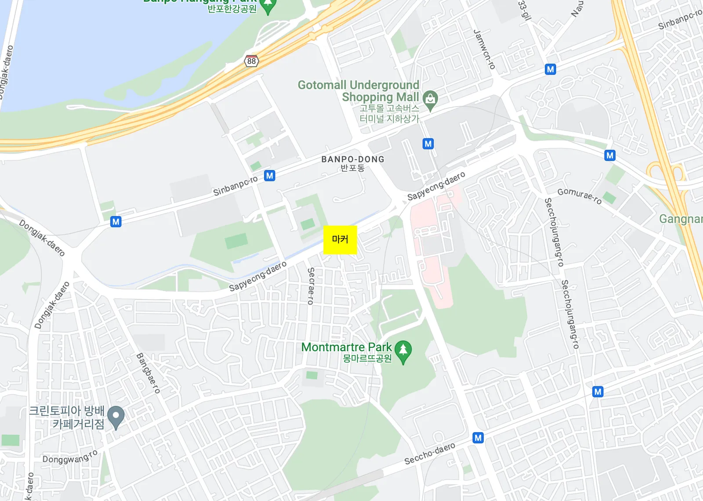

위 예제는 정말 대충 디자인 한 것이지만, 원하시면 더 다양한 디자인을 할 수 있을 것입니다.

또, 마커를 생성하는 부분을 별도의 컴포넌트로 이전하면 좀 더 효율적인 구조가 탄생할 것입니다.

글 초반 부에도 강조했지만, 이와 같은 방식으로 Google Maps API를 React와 결합하게 된다면 ***Google Maps API의 공식문서에 나온 모든 기능을 아무런 제한 없이 사용할 수 있게 됩니다.***

이렇게 의존성이 강한 라이브러리를 사용하지 않고, 동적 호출에만 활용하면 Google Maps Plaform 팀에서도 권장하는 라이브러리 로드 방식에도 부합하게 됩니다.

이제 여러분의 의도에 따라 지도를 호출하는 컴포넌트, 마커를 생성하는 컴포넌트(이 글에서는 미구현) 등을 적절하게 커스터마이징하여 재 렌더링을 피하는 설계도 진행할 수 있게 될 것입니다.

useMemo와 useCallback을 사용한다거나, [useSyncExternalStore를 사용](../2023-07-05-tistory-151/)한다거나, 클라이언트 상태 관리 라이브러리를 사용한다거나 등등 여러 아이디어를 통해 지도 환경과 React UI의 환경을 최대한 분리하려는 시도를 할 수 있으니 다양한 아이디어로 지도 기능을 활용하면 됩니다.

## **⚡️****⚡️****⚡️**TanStack Query와 함께 동적으로 마커 렌더링하기**⚡️****⚡️****⚡️**

[React에서 Google Maps API, Tanstack Query로 대용량 마커 데이터를 관리하는 방법](../2023-10-26-tistory-160/)

> [**React에서 Google Maps API, Tanstack Query로 대용량 마커 데이터를 관리하는 방법**](../2023-10-26-tistory-160/)  
> 최근 진행한 프로젝트에서는 다음과 같은 핵심 기능이 필요했습니다. 1. 대량의 데이터(전국 약 6만여 건)를 사용자의 화면에 해당하는 영역만 적당하게 마커로 렌더링 해줄 것 2. 사용자가 움직
