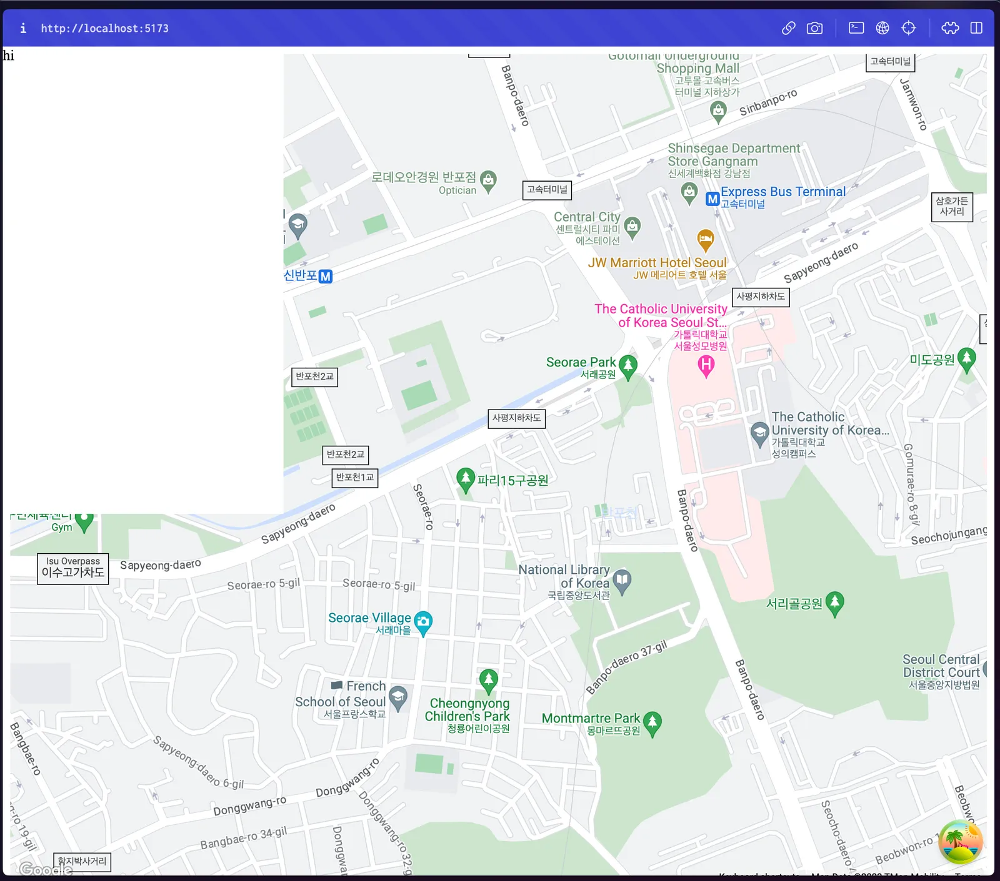
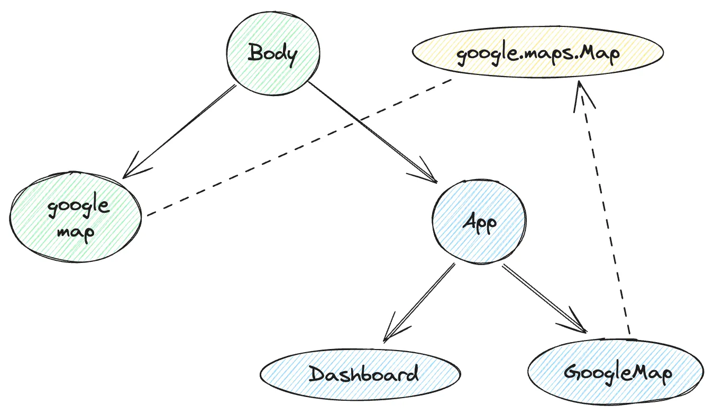
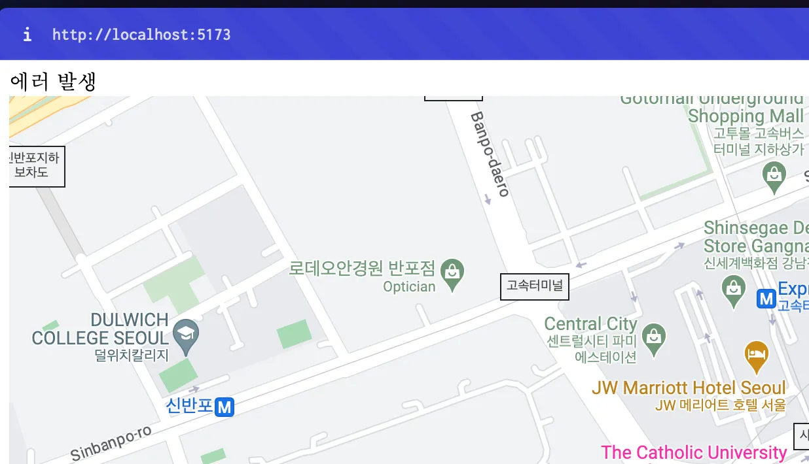
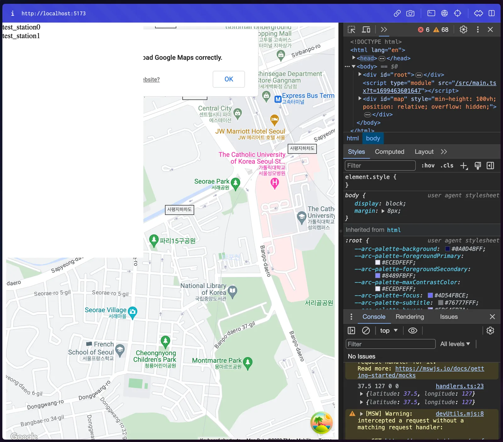
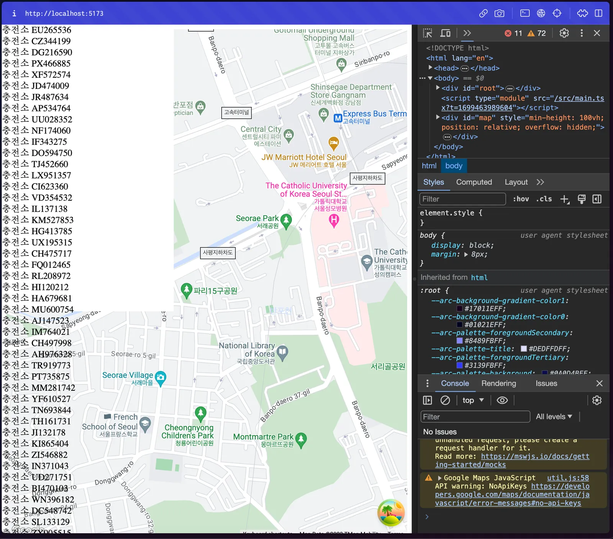
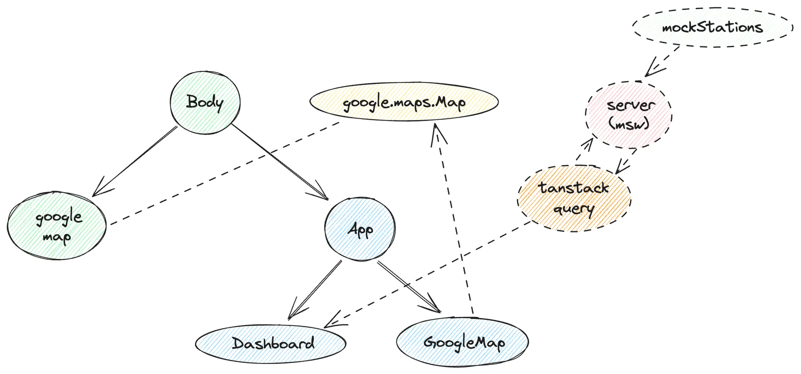
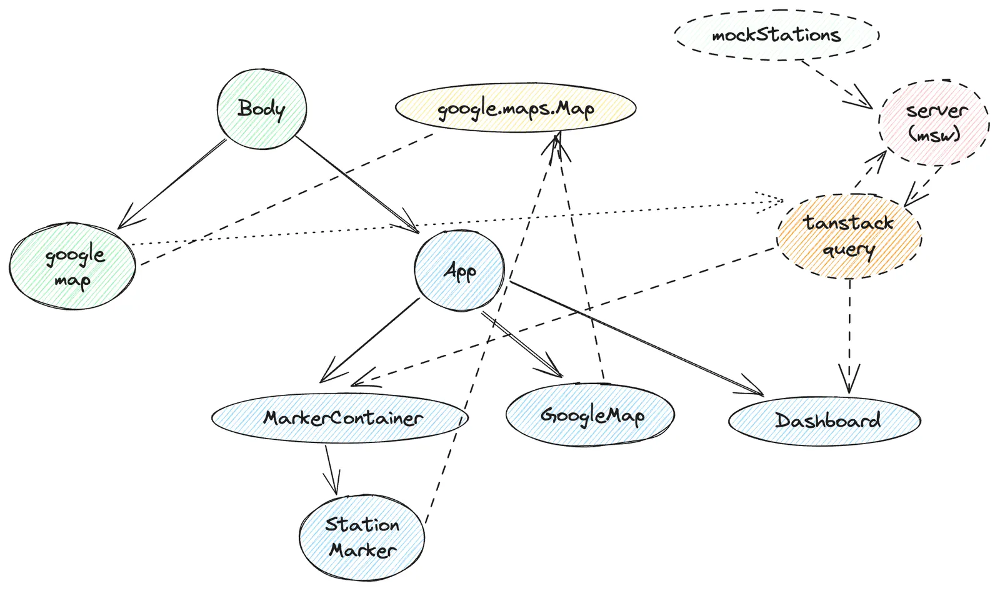

> 이 글은 2023-10-26에 티스토리 블로그(leirbag.tistory.com/160)에 처음 작성한 글을 옮겨온 것입니다.


[최근 진행한 프로젝트](https://github.com/woowacourse-teams/2023-car-ffeine)에서는 다음과 같은 핵심 기능이 필요했습니다.

1\. 대량의 데이터(전국 약 6만여 건)를 사용자의 화면에 해당하는 영역만 적당하게 마커로 렌더링 해줄 것

2\. 사용자가 움직일 때 마커 렌더링을 새롭게 진행할 것

3\. 한번 렌더링 한 마커는 유지하고, 화면에서 벗어난 마커는 해제할 것

4\. 사용자가 화면을 축소하는 경우 마커를 다른 방식으로 보여줄 것

5. 지도는 지도대로 동작하고, React는 React대로 동작하여 독립적인 환경을 보장할 것


이 프로젝트에서는 Google Maps API, React, Tanstack Query를 사용했으며, 이를 적절하게 제어할 수 있는 전략이 필요했습니다.

일단, 미리 말씀드리자면.. 일정한 수 이하의 데이터를 다루거나 마커가 동적으로 관리될 필요가 없는 프로젝트라면 이 글에서 소개하는 방식이 오버 엔지니어링일 가능성이 있습니다. 본인 프로젝트에 맞는 상황인지를 판단하시고, 정말 필요로 하는 부분만 아이디어를 적용하시면 됩니다.

우선 사전 지식이 필요하므로 다음 글은 반드시 읽어주시기 바랍니다.

[고밀도 지도 데이터 관리를 위한 효과적인 전략: 지도 확대 및 마커 제어](../2023-08-25-tistory-154/)

> [**고밀도 지도 데이터 관리를 위한 효과적인 전략: 지도 확대 및 마커 제어**](../2023-08-25-tistory-154/)  
> 지도 기능에서 가장 핵심인 기능 두 가지를 뽑자면, 지도 그 자체와 지도 위에 그려지는 마커를 뽑을 수 있을 것입니다. 지도 위에 마커를 그리는 일은 그다지 어렵지 않고, documents 에 있는 예제

위 글에서 나온 개념들은 이 글에서 자주 등장할 개념입니다.

사용자가 바라보는 화면을 기준으로 마커 데이터를 요청하는 것은 어떤 지도 라이브러리에서도 가능할 것입니다.

사실 백엔드 단에서 데이터를 어떻게 조회하던 간에, 프론트에는 마커의 좌표 배열이 도착할 것입니다!

따라서 도착한 마커 배열 데이터를 어떻게 동적으로 관리할 수 있는지에 대한 아이디어를 소개합니다.

## 실습을 위한 기본 설치

### React 설치

[왕빠른 Vite React를 사용하여 GitHub Pages 및 Storybook 자동 배포 설정하기](../2023-05-12-tistory-146/)

> [**왕빠른 Vite React를 사용하여 GitHub Pages 및 Storybook 자동 배포 설정하기**](../2023-05-12-tistory-146/)  
> Create React App에서 리액트 프로젝트와 Storybook 배포를 자동화 하는 것은 자료가 많고 매우 쉽습니다. 하지만 Vite라면 어떨까요? 아직까지 Vite는 다소 귀찮은 작업들이 존재하는데요, 자료가 거의

위 글에 따라 vite의 기본 설치를 진행해주세요. 자동 배포 설정이나 Storybook은 설치하지 않아도 됩니다.

### @googlemaps/react-wrapper 설치

[React에서 Google Maps API를 자유롭게 사용하는 방법 (@googlemaps/react-wrapper)](../2023-10-24-tistory-158/)

> [**React에서 Google Maps API를 자유롭게 사용하는 방법 (@googlemaps/react-wrapper)**](../2023-10-24-tistory-158/)  
> React에서 Google Maps API를 사용하기 위해 사용하는 @react-google-maps/api나 react-google-maps 같은 라이브러리들을 사용하는 방법이 있을 것입니다. 이 라이브러리들을 사용하면 Google Maps API에 있는 주요 기

위 글에 따라 @googlemaps/react-wrapper를 설치해주시고 기본적인 세팅(지도를 화면에 띄우는 것)을 진행해주세요.

참고로 벡터 지도 설정도 해주셔야 뒤에서 실습 할 AdvancedMarkerElement 객체를 사용할 수 있습니다.

### msw 설치

[msw 2.0를 활용한 api mocking (설치 및 기본 세팅)](../2023-11-01-tistory-167/)

> [**msw 2.0를 활용한 api mocking (설치 및 기본 세팅)**](../2023-11-01-tistory-167/)  
> 프론트엔드 개발을 하기 위해서는 서버와의 통신이 필연적입니다, 하지만 개발을 하다보면 백엔드에서 api의 제작이 늦어질 수 있습니다. 이런 경우에는 어떻게 해야할까요? 백엔드에서 api를 다

msw 2.0이 출시되었으므로 새로운 버전에 맞춰 코드를 작성할 예정입니다.

msw도 설치해주시고 기본 세팅을 진행해주세요.

### TanStack Query 설치

```bash
yarn add @tanstack/react-query
```

```bash
yarn add -D @tanstack/eslint-plugin-query
```

```bash
yarn add @tanstack/react-query-devtools
```

위 패키지들을 설치해줍니다. (tanstack query에 대해서 어느정도 알고 있다고 가정하고 설명하겠습니다.)

**src/main.tsx**

```typescript
import React from 'react'
import ReactDOM from 'react-dom/client'
import App from './App.tsx'
import {QueryClient, QueryClientProvider} from "@tanstack/react-query";
import {ReactQueryDevtools} from "@tanstack/react-query-devtools";

async function deferRender() {
  if (process.env.NODE_ENV !== 'development') {
    return
  }

  const { worker } = await import('./mocks/browser')

  return worker.start()
}

const queryClient = new QueryClient()

deferRender().then(() => {
  ReactDOM.createRoot(document.getElementById('root')!).render(
    <React.StrictMode>
      <QueryClientProvider client={queryClient}>
        <App />
        <ReactQueryDevtools initialIsOpen={false} />
      </QueryClientProvider>
    </React.StrictMode>,
  )
})
```

위와 같이 기본적인 쿼리 세팅과 함께 msw까지 적용해주시면 됩니다.

### external-state 설치

[useSyncExternalStore로 만들어보는 전역상태관리 라이브러리](../2023-07-05-tistory-151/)

> [**useSyncExternalStore로 만들어보는 전역상태관리 라이브러리**](../2023-07-05-tistory-151/)  
> 몇 달 전부터 전역상태관리 라이브러리를 직접 만들어보고 싶었는데, 우테코 방학 기간에 심심해서 만들어 봤습니다. 혹시 useSyncExternalStore가 무엇인지 처음 들어보신다면 이 문서를 확인해보시

위 글은 useSyncExternalStore를 활용한 상태관리 라이브러리를 만드는 글 입니다.

외부시스템인 지도를 다루는 것은 물론이고, 클라이언트 전역상태를 관리할 수 있습니다.

(기본적인 사용법이 recoil과 상당히 유사하므로 금방 익히실 것입니다.)

패키지를 설치해서 사용하는 것도 가능하니, 필요하시다면 설치해서 사용하시면 됩니다.

이 글에서는 해당 도구를 이용하여 전역 상태에 접근하는 것을 예제로 보여드릴 것입니다.

```typescript
yarn add external-state
```

라이브러리 사용법은 다음과 같습니다.

[https://github.com/gabrielyoon7/external-state/blob/main/docs/readme-kr.md](https://github.com/gabrielyoon7/external-state/blob/main/docs/readme-kr.md)

만일, 이를 원치 않는다면 편하신 방법으로 전역 상태 관리 라이브러리를 선택하셔도 좋습니다.

## 지도 생성 및 레이아웃 나누기

지도 생성과 함께 데이터 확인용 레이아웃을 만들어보겠습니다.

**src/googleMapStore.ts**

```typescript
// src/googleMapStore.ts

import {store} from "external-state";

export const INITIAL_CENTER = {
  lat: 37.5,
  lng: 127.0,
}
export const INITIAL_ZOOM_LEVEL = 16;

export const getGoogleMapStore = (() => {
  let googleMap: google.maps.Map;

  const container = document.createElement('div');

  container.id = 'map';
  container.style.minHeight = '100vh';

  document.body.appendChild(container);

  return () => {
    if (!googleMap) {

      googleMap = new window.google.maps.Map(container, {
        center: INITIAL_CENTER,
        zoom: INITIAL_ZOOM_LEVEL,
        disableDefaultUI: true,
        mapId: '92cb7201b7d43b21',
      });
    }

    return store<google.maps.Map>(googleMap);
  };
})();
```

클로저를 활용하여 구글 지도 객체를 단 한번만 생성할 수 있도록 합니다. 단, 생성된 객체는 store 객체에 담깁니다.

**src/Dashboard.tsx**

```typescript
// src/Dashboard.tsx

import {CSSProperties} from "react";

const dashboardStyle: CSSProperties = {
  position: 'absolute',
  width: '300px',
  height: '500px',
  backgroundColor: 'white',
  top: '0',
  left: '0',
  zIndex: 100,
};

function Dashboard() {

  return (
    <div style={dashboardStyle}>
      hi
    </div>
  );
}

export default Dashboard;
```

아직은 비워져있지만, 앞으로 충전소 상태를 보여줄 React UI 입니다.

**src/GoogleMap.tsx**

```typescript
// src/GoogleMap.tsx

import {useExternalValue} from "external-state";
import {getGoogleMapStore} from "./googleMapStore.ts";

function GoogleMap() {

  const googleMap = useExternalValue(getGoogleMapStore());

  return <></>
}

export default GoogleMap;
```

구글 지도 객체가 store에 담겨 전역적으로 접근할 수 있으므로 , useExternalValue훅으로 호출합니다.

**src/App.tsx**

```typescript
// src/App.tsx

import {Status, Wrapper} from "@googlemaps/react-wrapper";
import GoogleMap from "./GoogleMap.tsx";
import Dashboard from "./Dashboard.tsx";

const render = (status: Status) => {
  switch (status) {
    case Status.LOADING:
      return <>로딩중...</>;
    case Status.FAILURE:
      return <>에러 발생</>;
    case Status.SUCCESS:
      return (
        <>
          <GoogleMap/>
          <Dashboard/>
        </>
      );
  }
};

function App() {

  return (
    <Wrapper apiKey="" render={render} libraries={['marker']}/>
  )
}

export default App
```



이제 지도 객체가 전역적으로 접근이 가능해졌고, 어떤 상태를 띄울 React 컴포넌트(Dashboard) 또한 렌더링하게 되었습니다!



## 현 위치와 디스플레이 크기 알아내기

일단 현위치와 디스플레이 크기를 알아내어야 서버에 적절한 범위로 데이터를 요청할 수 있습니다.

여기서 사용하는 식에 대한 내용은 맨 위에 첨부한 게시글의 위도델타, 경도델타에 대한 규칙(?) 따라 만들어진 정보입니다.

**src/getDisplayPosition.ts**

```typescript
// src/getDisplayPosition.ts

import {DisplayPosition} from "./types.ts";

export const getDisplayPosition = (map: google.maps.Map): DisplayPosition => {
  const center = map.getCenter();
  const bounds = map.getBounds();

  const longitudeDelta = bounds
    ? (bounds.getNorthEast().lng() - bounds.getSouthWest().lng()) / 2
    : 0;
  const latitudeDelta = bounds
    ? (bounds.getNorthEast().lat() - bounds.getSouthWest().lat()) / 2
    : 0;
  const longitude = center ? center.lng() : 0;
  const latitude = center ? center.lat() : 0;
  const zoom = map.getZoom() || 0;

  return {
    longitude,
    latitude,
    longitudeDelta: longitudeDelta,
    latitudeDelta: latitudeDelta,
    zoom,
  };
};
```

구글 맵 객체에서 현위치의 좌표와, 디스플레이 영역 사이즈를 고려한 델타 값 그리고 줌 레벨을 알아내는 과정입니다.

옵셔널 체이닝을 사용한 이유는 **지도 객체의 로드 상황에 따라 참조 가능 여부가 달라지기 때문**입니다.

**src/types.ts**

```typescript
// src/types.ts

export interface DisplayPosition {
  longitude: number;
  latitude: number;
  longitudeDelta: number;
  latitudeDelta: number;
  zoom: number;
}
```

스크린 크기를 델타로 관리하면 나중에 범위를 배율로 커스터마이징 할 때 편해지고, 약속된 단위로 제어를 할 수 있게 됩니다.

## 충전소 데이터 수신 훅 만들기

마커를 생성하기 전에 Dashboard에 충전소 데이터를 수신해보겠습니다.

**src/useStations.ts**

```typescript
// src/useStations.ts
import {useQuery} from "@tanstack/react-query";
import {getGoogleMapStore} from "./googleMapStore.ts";
import {getDisplayPosition} from "./getDisplayPosition.ts";
import {Station} from "./types.ts";

export const fetchStations = async () => {
  const googleMap = getGoogleMapStore().getState();
  const {latitudeDelta, longitudeDelta, longitude, latitude} = getDisplayPosition(googleMap);

  const stations = await fetch(`/stations?latitude=${latitude}&longitude=${longitude}&latitudeDelta=${latitudeDelta}&longitudeDelta=${longitudeDelta}`).then<Station[]>(async (response) => {
    const data = await response.json();
    return data;
  });

  return stations;
}

export const useStations = () => {
  return useQuery({
    queryKey: ['stations'],
    queryFn: fetchStations,
    refetchOnWindowFocus: false,
  });
};
```

충전소 정보를 수신하는 페치 훅을 만듭니다.

**src/Dashboard.tsx**

```typescript
// src/Dashboard.tsx

import {CSSProperties} from "react";
import {useStations} from "./useStations.ts";

const dashboardStyle: CSSProperties = {
  position: 'absolute',
  width: '300px',
  height: '500px',
  backgroundColor: 'white',
  top: '0',
  left: '0',
  zIndex: 100,
};

function Dashboard() {

  const {data: stations, isLoading, isError} = useStations();

  if (isLoading) {
    return <>로딩중...</>;
  }

  if (isError) {
    return <>에러 발생</>;
  }

  return (
    <div style={dashboardStyle}>
      {stations?.map(station => (
        <div key={station.stationId}>
          {station.stationName}
        </div>
      ))}
    </div>
  );
}

export default Dashboard;
```

대시보드에 연동해서 서버 상태를 보여줍니다.



당연하지만 서버가 없으므로 에러가 발생합니다.

## 요청 모킹하기

**src/mocks/handlers.ts**

```typescript
// src/mocks/handlers.ts
import {http, HttpResponse} from 'msw'

export const handlers = [
  http.get(`/stations`, async ({request}) => {
    const url = new URL(request.url)

    const latitude = url.searchParams.get('latitude');
    const longitude = url.searchParams.get('longitude');
    const latitudeDelta = url.searchParams.get('latitudeDelta');
    const longitudeDelta = url.searchParams.get('longitudeDelta');

    const northEastBoundary = {
      latitude: Number(latitude) + Number(latitudeDelta),
      longitude: Number(longitude) + Number(longitudeDelta),
    };

    const southWestBoundary = {
      latitude: Number(latitude) - Number(latitudeDelta),
      longitude: Number(longitude) - Number(longitudeDelta),
    };

    console.log(latitude, longitude, latitudeDelta, longitudeDelta, northEastBoundary, southWestBoundary)

    return HttpResponse.json([
      {
        stationId: 'test_station0', stationName: 'test_station0', latitude: 0, longitude: 0
      },
      {
        stationId: 'test_station1', stationName: 'test_station1', latitude: 1, longitude: 1
      },
    ]);
  }),
]
```

바깥으로 나가려던 요청을 msw로 모킹하여 확인해보고, 오류가 나지 않도록 임시 데이터를 반환해주는 것을 테스트 해봅니다.



msw가 요청을 잘 가로채고, 테스트 데이터를 반환했음을 확인했습닌다.

다만, 델타 값이 0으로 날라가는 현상이 감지됩니다.

이는 뒤에서 해결하고, 가상의 마커 데이터를 생성해서 반환해보겠습니다.

## 가상의 충전소 데이터 만들기

우선 데이터가 없으므로 랜덤한 마커 데이터를 생성해보겠습니다.

**mocks/data.ts**

```typescript
// src/mocks/data.ts

import {Station} from "../types.ts";

export const generateRandomStationId = () => {
  const letters = 'ABCDEFGHIJKLMNOPQRSTUVWXYZ';
  const numbers = '0123456789';

  const randomChar = (source: string) => source[Math.floor(Math.random() * source.length)];

  const randomLetter1 = randomChar(letters);
  const randomLetter2 = randomChar(letters);
  const randomNumber = Array.from({length: 6}, () => randomChar(numbers)).join('');

  return `${randomLetter1}${randomLetter2}${randomNumber}`;
};

export const mockStations = Array.from({length: 60000}, () => {
  const randomStationId = generateRandomStationId();

  const newStation: Station = {
    stationId: randomStationId,
    stationName: `충전소 ${randomStationId}`,
    latitude: 37 + 0.25 + 9999 * Math.random() * 0.00005,
    longitude: 127 - 0.25 + 9999 * Math.random() * 0.00005,
  };

  return newStation;
});
```

**src/types.ts**

```typescript
// src/types.ts

export interface Station {
  stationId: string;
  stationName: string;
  latitude: number;
  longitude: number;
}
```

위 코드에 따라 랜덤한 마커 데이터가 6만여 개 수도권에 생성될 것입니다.

## msw가 가상의 충전소 데이터를 반환하게 하기

**src/mocks/handlers.ts**

```typescript
// src/mocks/handlers.ts
import {http, HttpResponse} from 'msw'
import {mockStations} from "./data.ts";

export const handlers = [
  http.get(`/stations`, async ({request}) => {
    const url = new URL(request.url)

    const latitude = url.searchParams.get('latitude');
    const longitude = url.searchParams.get('longitude');
    const latitudeDelta = url.searchParams.get('latitudeDelta');
    const longitudeDelta = url.searchParams.get('longitudeDelta');

    const northEastBoundary = {
      latitude: Number(latitude) + Number(latitudeDelta),
      longitude: Number(longitude) + Number(longitudeDelta),
    };

    const southWestBoundary = {
      latitude: Number(latitude) - Number(latitudeDelta),
      longitude: Number(longitude) - Number(longitudeDelta),
    };

    console.log(latitude, longitude, latitudeDelta, longitudeDelta, northEastBoundary, southWestBoundary)

    return HttpResponse.json(mockStations);
  }),
]
```

그리곤, 위와 같이 msw 반환 함수에서 mockStations를 반환해보면 어떻게 나올까요?



세어보지는 않았지만 6만여개의 데이터를 수신했을 것입니다(?)



## idle 상태에 이벤트를 걸어 쿼리 무효화를 날리기

앞서 델타 값이 0으로 측정되는 이유는 google maps api의 bounds 메서드의 활성화 시점과도 관련이 있습니다.

일단, **구글 지도가 bounds를 측정하는 시점은 DOM에 안착된 이후**입니다.

처음 개발할 때에는 이 이유를 몰라 굉장히 고생하였는데, 바닐라 환경에서 개발을 유지하려다보니 디버깅 하기는 쉬웠습니다.

DOM에 달라붙은 이후, 현재 디바이스 스크린의 영역을 찾아내어 해당 위치의 좌표를 할당하게 되는 google maps api의 특성에 따라, **bounds 메서드가 동작하는 그 순간을 이벤트로 검출**해야합니다.

**src/GoogleMap.tsx**

```typescript
// src/GoogleMap.tsx

import {useExternalValue} from "external-state";
import {getGoogleMapStore} from "./googleMapStore.ts";
import {useEffect} from "react";
import {useQueryClient} from "@tanstack/react-query";

function GoogleMap() {

  const googleMap = useExternalValue(getGoogleMapStore());
  const queryClient = useQueryClient();

  useEffect(() => {
    googleMap.addListener('idle', () => {
      queryClient.invalidateQueries({queryKey: ['stations']});
    });

  }, [googleMap]);

  return <></>
}

export default GoogleMap;
```

그 순간을 idle 이벤트로 정의해버립니다.

이 이벤트는 Google Maps API에서 제공하며, **공식문서에 있는 이벤트를 그대로 사용**할 수 있게 됩니다.

화면의 양 끝점을 검출할 수 있게 된 순간, **idle 이벤트가 발동하여 쿼리무효화를 진행**합니다.

즉, 쿼리 무효화로 인해 useQuery가 충전소 데이터를 새롭게 수신하게 됩니다.

**src/mocks/handlers.ts**

```typescript
// src/mocks/handlers.ts
import {http, HttpResponse} from 'msw'
import {mockStations} from "./data.ts";
import {Station} from "../types.ts";

export const handlers = [
  http.get(`/stations`, async ({request}) => {
    const url = new URL(request.url)

    const latitude = url.searchParams.get('latitude');
    const longitude = url.searchParams.get('longitude');
    const latitudeDelta = url.searchParams.get('latitudeDelta');
    const longitudeDelta = url.searchParams.get('longitudeDelta');

    const northEastBoundary = {
      latitude: Number(latitude) + Number(latitudeDelta),
      longitude: Number(longitude) + Number(longitudeDelta),
    };

    const southWestBoundary = {
      latitude: Number(latitude) - Number(latitudeDelta),
      longitude: Number(longitude) - Number(longitudeDelta),
    };

    console.log(latitude, longitude, latitudeDelta, longitudeDelta, northEastBoundary, southWestBoundary);

    const isStationLatitudeWithinBounds = (station: Station) => {
      return (
        station.latitude > southWestBoundary.latitude &&
        station.latitude < northEastBoundary.latitude
      );
    };

    const isStationLongitudeWithinBounds = (station: Station) => {
      return (
        station.longitude > southWestBoundary.longitude &&
        station.longitude < northEastBoundary.longitude
      );
    };

    const foundStations = mockStations.filter(
      (station) =>
        isStationLatitudeWithinBounds(station) && isStationLongitudeWithinBounds(station)
    )
  
    return HttpResponse.json(foundStations);
  }),
]
```

실제로 서버에서 어떻게 연산할지는 프로젝트마다 다르겠지만, 우선은 요청에 들어온 영역 만큼을 잘라내어 보내는 것으로 하겠습니다.

앞선 idle 이벤트로 인해 델타 값이 더이상 0이 아닌, 실제 값으로 검출이 될 것입니다.

따라서 서버 측에서는 델타 값을 활용하여 양 끝점을 복원할 수 있고, 스크린 범위 내의 데이터만을 필터링해서 클라이언트로 보내주면 됩니다. (다만, 이 부분은 정말로 서버의 환경마다 다를 것입니다.)


지도 객체가 idle 상태에 빠질 때 마다 쿼리 무효화를 진행하고, 그 시점의 화면 영역을 읽어와서 새로운 데이터를 수신하여 서버 상태로 관리하는 모습을 확인할 수 있습니다.

## 서버 상태(충전소)를 마커로 렌더링 하기

이제 사용자가 지도를 동작할 때 마다, 스크린 영역을 검출하여 서버로부터 상태를 업데이트합니다.

그렇다면 수신받을 때 마다 충전소 데이터를 마커로 보여줄 방법은 없을까요?

놀랍게도 충전소 마커를 React Component로 관리할 수 있습니다.

분명히 지도 객체는 Vanilla JS의 영역임에도 불구하고 이러한 결합이 가능합니다.

**src/StationMarker.tsx**

```typescript
// src/StationMarker.tsx

import {Station} from "./types.ts";
import {useEffect} from "react";
import {useExternalValue} from "external-state";
import {getGoogleMapStore} from "./googleMapStore.ts";
import {createRoot} from "react-dom/client";

function StationMarker({station}: { station: Station }) {
  const googleMap = useExternalValue(getGoogleMapStore());

  useEffect(() => {
    const {latitude, longitude, stationName} = station;

    const container = document.createElement('div');

    const markerInstance = new google.maps.marker.AdvancedMarkerElement({
      position: {lat: latitude, lng: longitude},
      map: googleMap,
      title: stationName,
      content: container,
    });

    createRoot(container).render(
      <div
        style={{backgroundColor: 'red', width: '10px', height: '10px', borderRadius: '50%'}}
      />
    );

    markerInstance.addListener('click', () => {
      googleMap.panTo({lat: latitude, lng: longitude});
    });

    return () => {
      markerInstance.map = null;
    };
  }, []);

  return <></>
}

export default StationMarker;
```

우선 충전소 마커 컴포넌트를 만듭니다.

이 컴포넌트는 DOM에 직접적으로 무언가를 부착하지 않습니다. 하지만, 간접적으로 지도 객체 위에 리액트 컴포넌트를 부착할 수 있습니다.

createElement로 엘리먼트를 생성하고, 해당 엘리먼트에 React Component를 렌더링 한 다음, 지도 위의 마커에 부착할 수 있습니다.

참고로, 이 컴포넌트가 React 생명주기에 의해 사라지게 된다면 clean up 함수로 지도에서 마커가 탈락하도록 했습니다.

**src/MarkerContainer.tsx**

```typescript
// src/MarkerContainer.tsx
import {useStations} from "./useStations.ts";
import StationMarker from "./StationMarker.tsx";

function MarkerContainer() {
  const {data: stations} = useStations();

  if (stations === undefined) {
    return <></>;
  }

  return stations.map(station => (
    <StationMarker key={station.stationId} station={station}/>
  ));
}

export default MarkerContainer
```

이 컴포넌트는 앞서 만든 StationMarker 컴포넌트를 부착하는 컨테이너 컴포넌트입니다.

useStations라는 쿼리 훅을 사용하여 연동이 가능하게 됩니다.

즉, tanstack query에 의해 관리되는 서버 상태를 기준으로 마커 컴포넌트를 등록했다 해제했다 하면서 렌더링을 적절하게 진행할 수 있게됩니다.

**src/App.tsx**

```typescript
const render = (status: Status) => {
  switch (status) {
    case Status.LOADING:
      return <>로딩중...</>;
    case Status.FAILURE:
      return <>에러 발생</>;
    case Status.SUCCESS:
      return (
        <>
          <GoogleMap/>
          <Dashboard/>
          <MarkerContainer/>
        </>
      );
  }
};
```

마지막으로 컨테이너를 렌더링 하면 됩니다.


1\. 사용자의 움직임에 따라 마커 데이터를 수신하여 서버 상태로 관리하고

2\. React 생명주기에 의해 마커 컴포넌트가 적절하게 마운트/언마운트 되는 모습을 확인하였습니다.

이러한 구조로 가져가게 되면 마커가 함부로 재렌더링 되지 않습니다.

참고로 이 마커 컴포넌트에 애니메이션을 적용하면 어떤 컴포넌트가 실제로 렌더링 되는지 눈으로 확인이 가능합니다.


실제로 마커 렌더링에 동적인 애니메이션을 적용해보면 위와 같습니다. (새로 렌더링 된 컴포넌트만 애니메이션이 붙습니다.)

하지만, 위 구조를 고수하게 되면 gif의 마지막 부분처럼 마커 렌더링이 산발적으로 업데이트 됩니다.

마커의 개수가 아주 많아지면 성능이 많이 떨어진다는 뜻입니다. (하지만 몇 개 없는 상황에서는 최적의 선택입니다.)

문제를 해결하기 위해 useLayoutEffect를 사용한다거나, 마커 렌더링을 관리하는 전용 훅을 제작하여 DOM 접근을 최소화 하는 방안도 있습니다. (아니면 React DOM을 포기하는 방법도 있을 것 입니다.)

실제 프로젝트에서는 트러블 슈팅을 위해 렌더링 관련하여 최적화 과정을 촘촘하게 거쳤으며, 영역을 크게 잡고 재요청을 막는 캐싱 처리를 한다던지, 한 번 알게된 정보는 덜 요청하는 기능을 넣는다던지, 여러 작업들을 거쳐 개선을 거듭하였습니다.

즉, ***이 글에서 제안하는 방식은 최선이 아닙니다.***

실제로 팀 프로젝트 초중반에 이미 이러한 구조를 완성하여 지속적으로 최적화 작업을 진행하여 안정화한 경험이 있습니다.

하지만 이 글에서 언급하는 내용들을 기초로 구조를 잡게 되면 React, Tanstack Query, Google Maps API를 유기적으로 동작하게 하는 단단한 기반이 될 것입니다.

이 글에서 최적화를 마저 언급하지 않는 이유는 이미 글이 너무 길어졌기 때문입니다. ??



*마지막으로 구조를 정리하다보니 순서가 일부 바뀌었다*

참고로 글에서 사용된 코드들의 경로를 기록하긴 했으나, 정말 아무렇게나 배치되어있습니다.

글을 쓰면서 레포를 새로 열고 코드를 새로 작성해서 그런 것이니 필요한 구조로 배치하면 됩니다!
