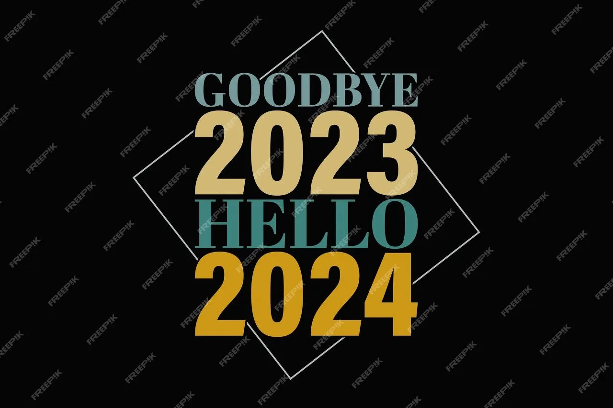
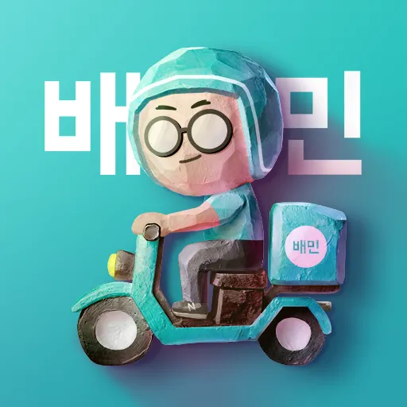
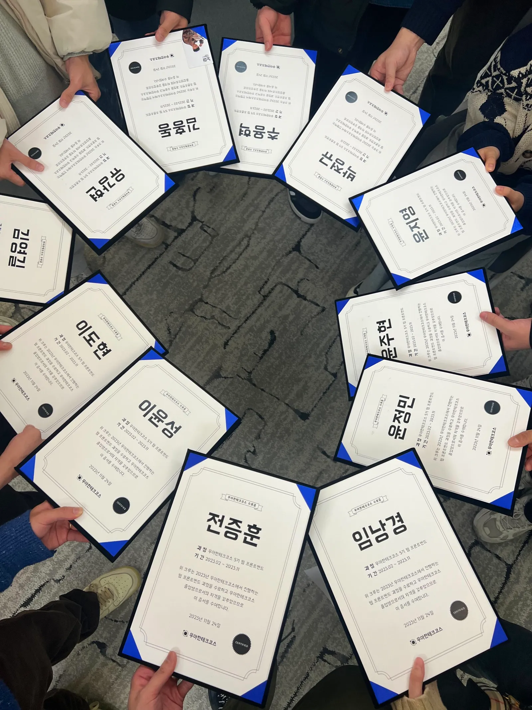
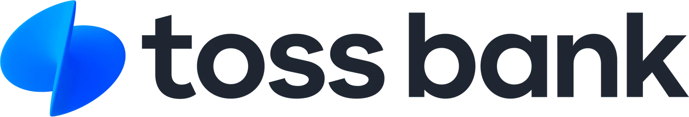
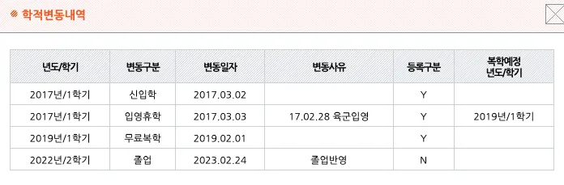
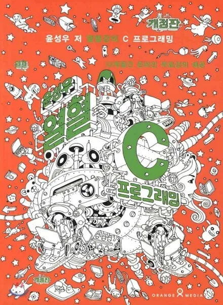
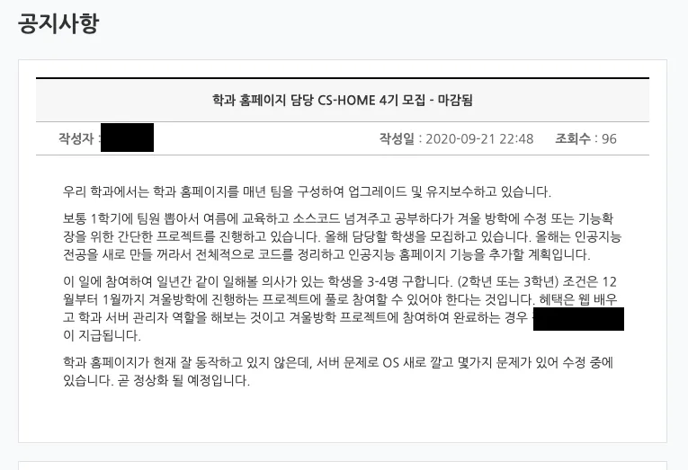
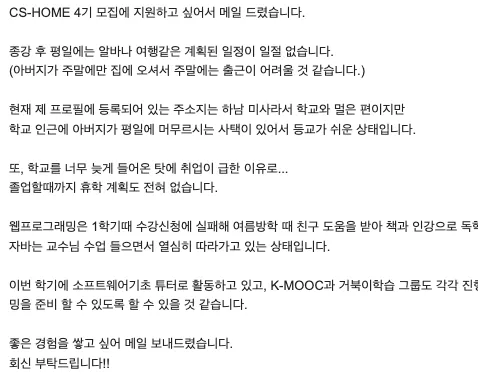
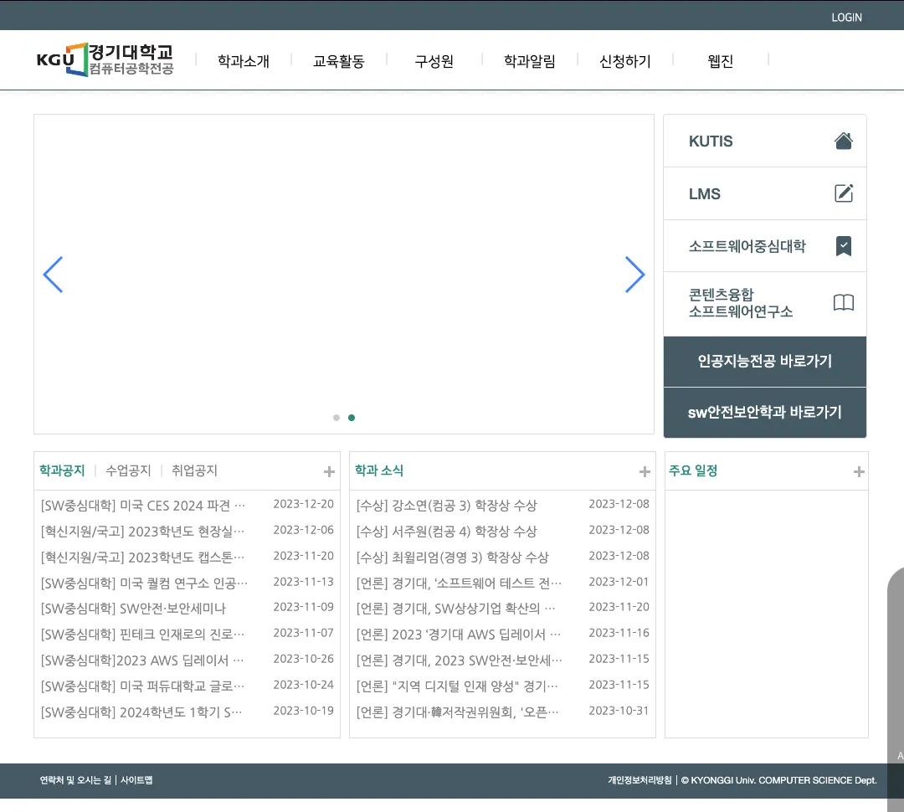

> 이 글은 2023-12-28에 티스토리 블로그(leirbag.tistory.com/173)에 처음 작성한 글을 옮겨온 것입니다.

지난 11월 말, 우아한테크코스를 수료했습니다. 그리고 목표하던 회사도 들어가게 되었습니다.  
2023년을 마무리 하는 글 겸, 개발자가 되기까지의 여정을 회고하려고 합니다.  
  

## 우테코를 마무리하며

그동안은 우테코에서 매 레벨이 끝날 때 마다 회고 글을 하나씩 작성하곤 했으나, 레벨 4~5 회고는 마음의 여유가 없어서 적지 않았습니다.  
레벨 4 기간에는 레벨 3 때 팀 프로젝트로 만든 서비스를 고도화하고, 운영하고 유지보수 하면서 사용자 경험을 얻는 기간이었습니다.  
개인적으로 저에게 이 시기는 **창업은 개발과는 다른 영역**임을 깨닫게 되는 시기였습니다.

*내가 만든 프로그램이 과연 사용자들에게 어떤 도움이 될까? 이렇게 하면 좋아하겠지?*

사용자의 니즈를 정확하게 파악하는 것은 정말로 어려웠습니다.

**우리 서비스의 사용자가 되는 경험을** **직접** **하고 나서야 우리 서비스가 정말로 별로라는 사실도 알게 되었고**, 코치분들이 주셨던 피드백들이 주마등처럼 스쳐가는 기간이었습니다. (이와 관련된 글은 첨부된 글 [\[1\]](../2023-10-11-tistory-157/) [\[2\]](../2023-10-26-tistory-159/) 들을 보면 확인할 수 있습니다.)

이렇게 하면 사용자가 편하겠지? 라는 생각은 직접 해보기 전까지 모르는 일이었습니다.

우테코에서 전기자동차 충전소 지도 프로젝트를 시작하기 18개월 전 부터 기획을 했었고, 당시에는 전기차 충전소로 인해 불편한 사람들을 여럿 봐왔기에 출발 자체는 나쁘지 않았다고 생각합니다.

하지만 지금은 충전소가 당시보다 2.5배 이상 늘었고, 정말 촘촘하게 배치가 되어있습니다. 시간의 흐름에 따라 해결 된 문제였음에도 불구하고, 시장 변화를 정확하게 인지하기 못하고 프로젝트를 진행했습니다. 서비스를 만들고 나서야 수 차례 충전 경험을 해본 결과, 전기차는 기대 이상으로 편리했고 불편하지 않았습니다.

저는 학교 통학 거리가 멀어 하루에 왕복 100km가량 주행을 거의 매일 해야 했었고, 우테코 기간에도 주말엔 수도권에 있는 대형 카페를 찾아다니곤 했습니다. 그만큼 주유소에 들른다는 것이 얼마나 귀찮은 일인지 잘 알고 있습니다. (특히, 출근길에 저렴한 주유소에 가면 20분 이상 대기하기도 합니다.)

하지만 전기차의 경우, 충전소가 있는 목적지를 주기적으로 오가는 상황이라면 일상 생활 도중에 주차하면서 충전이 가능했습니다. **즉, 매일 300km이상 주행하는 것이 아니라면 절대로 배터리가 부족할 일이 없었습니다.** 다시 말하면, 장거리 운행을 해야하는 사람이 아니라면 거주 형태에 따라서 **내연 기관 차량보다 전기자동차가 편할 수도** 있습니다. 장거리 운행인 경우에만 급속 충전기를 활용하여 1시간 내에 배터리를 거의 충전하면 됐고, 평상시에는 남는 완속 충전기를 사용하면 그만이었습니다. 내연기관 자동차만 운전해 왔던 저로서는 전기차가 여전히 불편할 것이라는 **편견을 가지고 개발**해왔다고 생각합니다.

이러한 기술 변화를 잘 모르고 개발했다는 것이 아직도 가장 후회스러운 일로 남고, 스스로에게 조금 가혹할 수도 있지만 실패한 프로젝트 중 하나가 되어버린 것 같아 마음이 아픕니다. 아마 다음번에는 좀 더 사용자의 소리를 듣는 개발을 시작을 할 것 같습니다.

이와 별개로 기술적으로는 해보고 싶은 것들은 원하는 만큼 해봤습니다.

특히 React와 지도 시스템, 그리고 tanstack query을 결합하려는 시도는 React 그 자체의 이해도를 높였을 뿐만 아니라, 프론트엔드 개발에서 창의적인 문제 해결을 경험할 수 있는 기회였다고 생각합니다. 이와 동시에 대규모 데이터를 적절하게 다뤄볼 수 있는 경험까지 하게 되어 팀에서 같은 기능이더라도 도전 거리들을 끊임없이 찾아왔습니다.

지도 다루는게 뭐가 그렇게 어렵나 생각이 들 수 있지만 대량의 데이터를 React의 생명주기와 맞춰서 조작하거나, 지도 위의 기능을 동적으로 React와 연동시키려면 생각보다 많은 고민이 필요했습니다. React와 지도가 각자 돌면서 필요할 때에만 적절하게 소통할 수 있는 구조를 만들기 위해 노력했으며, 이는 앞으로의 프론트엔드 개발을 할 때에도 넓은 사고를 할 수 있도록 하는데 도움이 될 것이라고 생각합니다.

평소에 실생활과 연관된 개발에 관심이 많았고, 그 중에서도 지도에 대한 애착이 강했었는데 지도 가지고 해 볼 수 있는 주제로는 충분했다고 생각합니다. 전국을 상대로 하는 서비스가 너무 하고 싶었는데, 그 꿈을 이룬 것만으로도 팀원들에게 무한한 감사를 표합니다.

아직도 재밌는 도전거리들이 많이 남아있고, 그동안 빠른 속도로 개발하느라 놓치거나 가볍게 지나갔던 부분들을 개선할 수 있다고 생각하지만 프론트엔드 팀원 전원이 취업해 버리는 바람에 더 이상 작업이 없을 수도 있겠다는 생각도 듭니다.

레벨 5에는 취업 준비를 하였습니다.

결론부터 말하면 우아한형제들 전환 채용에 실패했습니다.

서류 조건에 코딩 테스트가 추가되었음에도 불구하고 준비를 하지 않았습니다. 핑계일 수도 있지만 코딩 테스트를 준비할 시간에 팀 프로젝트를 고도화하고 마무리하는 것이 더 중요하다고 생각했습니다. 지금 생각해도 제 스스로가 잘 이해가 가지 않지만 우형 채용에 그다지 적극적이지 않았습니다. 우형에 가고 싶어서 우테코를 시작했던 것이었는데, 막상 지원 기회가 주어지니 다른 생각이 들기 시작했습니다.

서류 조건으로 코딩 테스트 공지가 나왔음에도 불구하고 준비를 거의 하지 않았고, 지원 팀을 정할 때에도 마지막까지 어딜 쓸지 모르겠다고만 하고 다녔을 뿐 별다른 서류 준비를 하지 않았습니다. 지원 동기도 1시간 만에 적었을 정도로 소극적이었습니다.

결국 코딩 테스트에서 탈락하게 되었습니다. 코딩 테스트 문제를 다 푼것도 아니었고, 아예 못 푼 것도 아니었지만 탈락 예감이 들었습니다. 작년과 다르게 면접 시간을 3배 준다는 소식을 듣고, 대충 3분의 1 안에 들지 못하면 안 되겠구나 싶었습니다.

시험 보자마자 정신차리고 그제야 자기소개서를 작성하기 시작했으며, 여러 레퍼런스를 참고하고 우테코 내의 취업 특강을 들으면서 자소서를 뜯어고쳤습니다. 자기소개서가 완성되기까지 약 1주일이 걸렸으며, 최대한 누구나 알아볼 수 있는 문장으로 풀어썼습니다.

우테코 수료하기 전까지 여러 회사를 지원하면서 느낀 점은, 길거리에서 전단지를 나눠주는 기분이었습니다.

*개발 시장에서 나를 증명해야 하는구나!*

생각보다 나를 증명하는 일은 어려웠습니다.

  
내가 과연 이 회사에 기여할 수 있는 사람인지 자신감이 사라지기도 했고, 개발자의 벽이 높아 보였습니다. 나름 공부 열심히 한 것 같고, 오랜 기간 동안 꾸준하게 준비해 왔는데 우테코의 마지막을 장식하기 어렵다는 생각이 들었습니다.

다행히도 서류 통과된 회사 몇 군데가 있어 수료 이후에도 다소 바쁜 일정을 보내게 되었습니다.  
이렇게 레벨 5에는 취업 준비를 위한 기간을 보냈고, 수료식까지 앞으로의 취업 계획과 회사 탐색에 올인했습니다.

갑자기 잡힌 면접 일정들로 인해 수료식 날 집에 일찍 가기도 했던 것이 너무 아쉬웠지만, 어쩔 수 없었습니다.  
수료한 이후에도 일정을 잡지 않고 집에서 면접 준비에 올인했습니다.  
  

## 면접 릴레이와 취업까지

우테코 수료하고 약 2주간 평일에 1~2일에 한번씩 면접을 봤습니다.  
서류에 합격했던 회사 전부 제가 가고 싶던 회사들이었습니다. 도메인도 맘에 들고, 기술도 마음에 들었습니다. 솔직히 어떤 회사를 가도 불만 없이 다닐 수 있는 재밌어 보이는 회사들이었고, 모든 회사들이 전 국민을 대상으로 서비스 중이라는 것도 마음에 들었습니다.  
  
제가 오래전부터 기대했던 회사의 모습은 다음과 같았습니다.

1\. 전국민을 대상으로 하는 서비스가 있을 것  
2\. 꾸준하게 성장해 왔고, 앞으로도 성장 여력이 많이 남아 있는 회사일 것  
3\. 좋은 동료들로 인해 기술적으로 정체되어있지 않고 끊임없는 도전을 하는 회사일 것  
4\. 흥미로운 도메인 or 기성 업계에 도전하는 분야 or 신생 분야  
5\. 사람들에게 많은 지지를 받는 (팬이 많은) 서비스 일 것

정말 모든 회사들이 제가 평소에 좋게 생각하고 있던 회사였기에 어느 곳에 입사하더라도 만족했을 것 같습니다.

  
그래서 그 어느 때 보다 더 집중해서 이 시기를 보냈던 것 같습니다. 이 중 어떤 회사라도 저에게 큰 의미가 있는 장소가 될 것이니 놓치고 싶지 않았습니다. 처음 면접 볼 때는 굉장히 어색하고 떨리고 실수도 많이 했지만, 면접을 진행할수록 노련해졌습니다. 기술 면접이나 팀 프로젝트 관련 질문은 평소에 제가 기여했던 내용이나 알고 있는 지식을 쏟아내면 됐기에 큰 부담이 없었습니다. 그래서 같이 일할 수 있는 사람임을 증명하는 것에 좀 더 초점을 두고 면접을 진행했습니다. 서류가 월드컵 예선전이라면, 면접은 본선이라는 느낌으로 매일매일 준비했습니다. 면접에서 나올 법 한 질문은 미리 정리해 두고 글을 작성했으며, 회사에 대한 조사도 깊게 하였습니다. 서류도 기업 조사를 하고 지원한 것이지만, 면접을 앞두고는 정말 꼼꼼하게 오래전 기사부터 챙겨보았습니다. 최근 이 회사가 어떤 사건이 있었는지? 어디에서 투자를 받았는지? 등 좀 더 깊게 알아봤습니다.

그중에서 가장 흥미로웠던 기업은 토스뱅크였습니다.

기업 조사를 하면 할수록 토스 그룹 자체가 굉장히 매력적인 회사였습니다. 금융권의 신생 기업임에도 불구하고 전 국민의 지지와 관심을 받는 것은 물론이고, 기존 은행의 불편함을 토스만의 언어로 해결하는 것이 매력적이었습니다. 사용자 입장에서 고민하려는 모습이 앱 곳곳에서 보였고, 특유의 업무 문화가 마음에 들었습니다. 업무에 몰입할 수 있는 환경, 속도감 있는 진행 등이 특히나 마음에 들었습니다.

토스 그룹이 어떻게 창업을 했고 성장했는지, 어떤 고민 끝에 지금과 같은 문화가 만들어졌는지는 토스의 창업 이야기가 잘 담긴 ***유난한 도전***에 잘 나와있었습니다. (공식 유튜브의 다큐멘터리나 토스 피드도 좋은 자료였습니다.) 책을 읽으면 읽을수록 가장 가고 싶은 회사가 되었습니다. 심지어 너무 재밌어서 하루 만에 다 읽었습니다. 사실 이미 서류 단계에서 토스뱅크가 뭐 하는 회사인지는 알았고, 재직자들에게 많은 이야기를 듣고 지원한 계열사입니다. 웹으로 은행을 만든다는 사실, 기성 은행에 대한 도전, 그리고 많은 사람들의 관심을 받는 회사라는 것은 저에게 충분히 매력적인 계열사였습니다. 그래서 뱅크로 결정했었습니다. 평소에 토스가 라이브러리를 배포하거나 유튜브에 개발 지식을 전파하는 모습을 보았을 때 기술에도 민감한 회사라고 생각했고, 우테코 내에서도 토스에 대한 긍정적인 소문이 돌았기에 개발에 전념할 수 있는 회사라고 판단했습니다. 특히 면접 과정에서도 면접관님들로부터 굉장히 긍정적인 인상을 받았고, 역질문을 하는 시간에도 애사심이 느껴지는 면접이었습니다. 채용팀에서도 체계적이고 빠른 진행을 해주셔서 남다른 채용 프로세스 경험을 했다고 생각합니다.

그래서 최종 합격 전화가 오자마자 더 이상 다른 고민 없이 합류를 결정했습니다.  

## 2023년을 마무리하며 + 개발자가 되기까지...

2024년, 드디어 개발자 커리어를 시작할 수 있게 되었습니다. 사실 2023년에 뭘 했는지 적자면, 우테코 얘기밖에 없어서 그냥 이전 회고 글의 반복일 것 같습니다. 그래서 이번에는 지금까지 지나온 길을 회고하려고 합니다.

2017년 봄, 컴퓨터공학과 입학 직전에 군 입대를 하는 파격적인 선택을 하였습니다.

2019년도 1학기에, 1학년 1학기로 신입생이자 복학생이 될 예정이었습니다.  
첫 군생활 1년은 군대에서 적응할 겸, 특별한 것을 하지 않았습니다. 그리고 2018년 새해를 맞아 새해 목표를 정하고 싶었고, 복학하기 전에 C언어를 한번 보고 들어가고 싶었습니다. 어차피 1학년 때 C언어를 배운다고 하니, 미리 보고 들어가는 것이 좋겠다고 생각했습니다.

  
그래서 단순하게 윤성우의 열혈 C프로그래밍을 구입하였고, 첫 프로그래밍 언어로 선택했습니다. 이 책에는 C언어에 대한 이야기뿐만 아닌, 기본적인 논리구조에 대한 이야기도 일부 들어있었던 것으로 기억합니다. 첫 언어로 C언어를 선택한 것은 기본적으로 컴퓨터가 메모리를 어떻게 관리하는지 알 수 있는 기회였다고 생각합니다.

2019년 막상 복학을 하니, 개발이 하고 싶지는 않았습니다.  
학교를 처음 다녀보니 왕복 5시간짜리 통학은 너무 힘들었고, 교환학생들이랑 유학생들 데리고 다니면서 노는 게 더 재밌던 시기였습니다. 그래서 방학 때 해외로 나가서 알바도 하고, 동아리도 하면서 1학년은 신나게 놀았습니다. 솔직하게 말하면 통학도 힘들어 죽겠는데 자취 금지령이 내려져서 반항심에 공부할 생각은 없었고, 군 휴학 중에 프로그래밍은 이미 익숙해졌다고 생각해서 놀았습니다. 정말 1년 열심히 놀았고, 공부는 하지 않았습니다. 그냥 알고 있던 지식으로 버텼던 시기였습니다.

2020년 1월, 또 한 번의 해외 알바를 경험했습니다.  
당시 말레이-싱가폴을 왔다 갔다 하고 있던 와중에, 코로나가 발발했고 일상은 사라졌습니다. 모든 수업은 비대면으로 진행했으며, 집 밖에 나갈 수 없는 사회가 되었습니다. 심심해진 저는 자연스럽게 학교 공부에 관심을 가질 수밖에 없었습니다.  
  
당시 집에만 있다 보니 이런 생각이 들었습니다.

1\. 하루에 통학 시간 5시간 +@를 쓰면서, 동아리 하느라 정신없는 나의 1학년 성적은 생각보다 너무 잘 나왔다.  
2\. 그렇다면 통학 시간을 아껴서 공부하면 성적이 훨씬 잘 나오지 않을까?

라는 단순한 생각이 들었습니다.  
  
그러다 보니 성적이 이전보다 훨씬 잘 나오는 것은 물론이고, 더 이상 공부할 게 없다는 생각이 들어 다른 길로 새기 시작했습니다. 개발이라는 것을 해보고 싶었습니다. 사실 전공을 하신 분들은 알겠지만, 전공을 해도 개발을 경험하는 것은 어렵습니다. 그래서 호시탐탐 개발 경험을 가질 기회를 노리던 와중, 학과 홈페이지 개발을 할 학생을 모집한다는 글을 보게 되었습니다.  
  

웹 개발을 해본 경험이 없는 2학년인 제가 어떤 것을 할 수 있을지는 모르겠지만, 일단 하겠다고 강하게 어필했습니다. 무려 학과 홈페이지의 공식 소스 코드를 제가 건들 수 있는 기회라는 생각뿐이었던 것 같습니다. 지금 생각해도 정말 아찔한 결정이었지만, 학과의 전교생이 사용하는 프로그램을 다루는 것은 위험한 결정이기도 했습니다.

*당시에 보냈던 메일이다*

2021년, 본격적인 개발을 시작할 때의 저는 웹 관련 과목을 일절 수강하지 못했습니다. 수강신청에 실패했기 때문이죠. 사실 어느 학교나 상황은 비슷하겠지만, 컴공 수업은 비전공 학생들의 문전성시로 인해 수강하기가 어렵습니다. 전공생을 보호해야 하는 학교에서는 무슨 생각인지 알기 어렵지만 제한을 풀어놔서 제 때 졸업하는 것은 커녕 수업을 듣는 것조차 기적에 가깝습니다. 따라서 저는 웹 관련 학습을 전혀 하지 못한 채 프로젝트를 시작했습니다.  
  
제가 할 수 있는 거라곤 서버를 껐다 켜는 것뿐이었고, 인수인계도 그 정도 선에서 끝났습니다.

*최근 모종의 이유로 최근 유지보수 중단을 선고받고, 새로운 홈페이지로 이주하게 되었지만 여전히 접속은 가능하다*

당시 저는 Java를 간단히 학습한 상황이었기에, 그냥 무턱대고 코드를 통으로 외웠습니다. JSP, jquery, html5, bootstrap, MySQL 등 여러 기술들을 외워서 학습하기 시작했습니다. 코드의 흐름을 파악하고, 어떤 방식으로 데이터가 흘러 다니는지를 중심으로 학습했습니다. 서버 컴퓨터에 접속해서 무작정 모든 코드를 열어보기도 했습니다. tomcat 설정도, 보안 설정도 무턱대고 구글에 검색해 가면서 외워서 했습니다. 그렇게 첫 2달 정도를 몰입하니, 코드가 보이기 시작했습니다. 그동안 학습했던 C나 Java와는 차원이 다른 세상이었습니다.

팀원들은 각자의 사정으로 모두 떠났지만, 저는 그제서야 코드가 읽히기 시작하였고 프로젝트를 계속할 수 있을 것이라 생각했습니다. 그래서 새로운 팀원을 모집하기 시작했습니다. 이렇게 재미있는 것을 혼자 할 수 없었습니다. 교수님을 설득하면서 프로젝트가 끊기지 않도록 노력하였고, 여러 대내 활동을 진행했습니다.

2022년, 4학년이 되면서 앞으로의 진로를 정해야 했는데 그간 경험했던 개발을 돌아봤을 때 jQuery가 제일 재밌었습니다. JSP의 다음 단계인 Spring을 할지, jQuery의 다음 단계인 React를 할지 고민이 많았습니다.

사실 jQuery에 대한 불만이 많았지만, 어찌 됐건 사용자가 직접 사용할 수 있는 소프트웨어를 만들 수 있었기에 웹 프론트엔드 개발자가 되고 싶었습니다. 언어가 독특하고 간결했던 것도 제 마음에 들었습니다. 물론 jQuery로 개발할 바에 JavaScript로 개발하는 것이 더 낫다고 생각했지만, 한편으로는 React를 공부해야겠다는 생각이 들었습니다. 바닐라 환경에서 프론트를 1년 반 정도 개발하다 보니 한계가 너무 많이 느껴졌습니다. 그래서 과감하게 기술 이주를 결정하게 됐습니다. 그런데 제가 처음으로 모던 웹 프론트엔드에서 경험한 것은 React Native였습니다. 다소 황당한 이유지만, 당시에 앱으로 개발하는 것이 좋아 보였습니다. 웹앱의 개념을 잘 모르고 선택한 것이긴 하지만, 본의 아니게 React Native, Node.js, Mongo DB와 같은 JavaScript 기반의 기술들을 익히기 시작했습니다.

공부를 하면 할수록 JavaScript의 매력에 빠졌고, 완전히 프런트엔드 개발자가 되고 싶었습니다. 그러나 막상 취업을 하려고 보니 React가 대세였습니다. React Native와 React는 분명히 다른 기술이지만 공통점이 많았습니다. 그래서 이주하는데 큰 어려움이 없었습니다. 보통은 React를 하다가 React Native로 가곤 하지만, 저는 거꾸로 된 선택을 하게 됐습니다. 그러다 보니 실제 취업 시장에서 불리한 점이 많았습니다. 회사는 React를 원하는데, 저는 React Native가 좀 더 편했던 것이 문제였습니다. 당시 다니던 면접에서도 이런 부분 때문에 부족함을 느끼게 되었습니다.  
  
결국 2022년 10월, 우아한테크코스를 하기로 마음먹었고, 프리코스를 거쳐 12월에 선발되었습니다. 그 이후에는 졸업과 동시에 우아한테크코스에서 교육을 받으면서 프론트엔드 개발자로서의 정체성을 좀 더 가지게 되었고, TypeScript나 모던 프론트엔드에 필요한 기술들을 익히게 되었습니다. 이 과정에 대해서는 블로그에 회고 글 몇 개를 작성해놨으니 참고하시면 좋을 것 같습니다.  
  
  
정리해 보면 진로 결정까지 몇 가지 중대한 선택이 있던 것 같습니다.  
  
1\. 군 휴학 중에 시간을 허비하지 않은 것  
입학하기 전에 프로그래밍과 친해지려고 노력하였고, 영어 공부를 열심히 했습니다. 앞으로 기술 문서를 보려면 영어를 해야 할 것 같았습니다. 그래서 이때 C언어와 영어를 정말 열심히 했습니다. 수능 볼 때 영어를 제일 못했었는데, 이게 앞으로 제 발목을 잡으면 안 된다고 생각했습니다. 그래서 딜리버리 히어로 최종 면접까지 진행했을 때에도 아직 녹슬지 않은 생활 영어에 안도를 느꼈고, 과거의 경험에 감사했습니다.  
  
2\. 1학년 때 원 없이 놀은 것  
영어 공부를 하고 복학했더니, 외국인들이랑 놀러 다니느라 정신이 없었습니다. 물론 지금 생각해 보면, 이때 원 없이 놀아서 여한이 없어진 것 같습니다. 술도 많이 먹고 놀러 다니고 한량 같은 삶을 살았습니다.  
  
3\. 개발자가 되고 싶다는 생각이 든 이후로 개발을 쉬지 않았던 것  
학과 홈페이지 개발을 맡게 된 이후 정말 바쁘게 살았습니다. 개발에는 학습, 성장, 경험 등 여러 키워드들이 있겠지만, 저는 모든 형태의 개발이 그저 즐겁고 행복했습니다. 결론부터 말하자면, 개발을 48시간 이상 멈춘 적이 없습니다. 새벽까지 개발하고 다음 날 일어나서 개발하고, 여행 가서 개발하고, 지하철에서 개발하고, 명절에도 개발하고... 어떤 이유에서도 개발을 48시간 이상 멈추게 하지 못하는 루틴을 만들었습니다. 방학도 마찬가지였습니다. 그래서 매일매일 github에 잔디를 심을 수 있었고, 한 번이라도 더 경험치를 쌓아 기술 학습에 익숙해졌다고 생각합니다. 어딜 가도 노트북을 들고 가고, 어딜 가도 작업할 준비가 되어있도록 (생존)배낭을 가지고 다녔습니다. 우테코에서 등산 할 때마다 이동 시간에 코드 한 줄 더 치겠다는 생각으로 노트북을 들고다닐 정도로 시간을 아껴 썼습니다.  
  
4\. 지식 전파에 공을 들인 것  
주변 사람들에게 제가 알고 있는 사실을 끊임없이 전파해 왔습니다. 이 기술이 왜 이렇게 구성되어 있고, 왜 이렇게 돌아가고, 왜 이렇게 써야 하고... 이런 종류의 지식 공유를 과하다 싶을 정도로 많이 했다는 사실은 학교를 같이 다니던 분들이나 주변 분들이나 모두 알 것입니다. 지금 이 블로그를 보는 제 지인 분들도 알 것이라고 생각합니다. 제가 잘 아는 얘기든, 모르는 얘기든 쉴 새 없이 떠들고 자료 공유해 가면서 좀 더 쉬운 설명을 고민했던 것이 저에게 큰 도움이 되었습니다. 설명하면서 다시 한번 고민해 보고 정리하게 됩니다. 간혹 제가 기술 이야기를 하면 지겹다고 하거나 그만하라는 사람들이 있긴 했지만, 개발이 좋지 않다면 개발자가 왜 되고 싶은지 되묻고 싶었습니다. 여담이지만, 우테코와서는 저 같은 사람들 밖에 없어서 이런 부분에서는 정말 만족스러웠습니다.  
  
5\. 좋아하는 것들과 멀어진 것  
제가 살아가는 데 있어서 필수적인 것을 제외한 것에 시간을 들이는 것이 아까웠습니다. 친구를 만나는 것, 여행을 가는 것, 술자리에 가는 것 등 시간이 너무 아까웠습니다. 제가 좋아하는 것들을 포기하기까지 많은 고민이 있었지만, 열정이 앞선 저에게 다른 선택지는 큰 의미가 없었습니다. 20대를 이렇게 보내는 것이 맞나 싶긴 했습니다. 무려 제20대의 절반인 5년을 컴퓨터와 함께 보낸 것이니깐요. 그럼에도 불구하고 원하는 곳에서 원하는 개발을 하고 싶어서 좀 더 노력했던 것 같습니다. 포기하기 어려운 것들이었지만, 그만큼 열정과 흥미로 인해 포기할만한 가치가 있었다고 생각합니다. 그만큼 간절했습니다.  
  
저는 남들보다 늦게 간 대학, 코로나, 독특한 경험 등 여러 과정을 거치는 바람에 일반적이지 않은 20대를 보냈다고 생각합니다.  
주변에서 저에 대해서 궁금해하는 사람들이 종종 있어서 이 글을 통해 좀 더 자세히 정리를 해봤습니다.  
이런 방법이나 생각도 있었구나 하면서 읽어주셨으면 합니다.  
  

## 2024년, 그리고 앞으로의 계획

지금은 입사 전까지 새로운 기술을 학습하고 있습니다. 앞으로 입사하게 될 팀의 기술을 미리 학습하고 있었으며, 적응기간을 짧게 가져가기 위해 뒷공부를 하고 있습니다. 이제는 프로 데뷔를 하는 스포츠 선수의 심정입니다. 특히 서비스 기업의 개발자는 프로 스포츠 선수와 닮았다고 생각해 왔습니다. 실력과 협업이 중요하고, 이를 유지하려는 것도 중요하다고 생각합니다. 그동안은 우테코라는 유소년 팀에 있었다면, 이제는 토스뱅크라는 프로 팀에 입단하는 것 같습니다. 솔직히 말하면 3MR이 있어 굉장히 부담스럽습니다. 제가 과연 살아남을 수 있을까요? 3개월 뒤에도 즐겁게 일할 수 있을까요?

사실 모르겠습니다.

이 질문은 작년 우테코를 시작할 때에도 했던 질문이기도 합니다. 무시무시한 우테코에서 살아남을 수 있을까? 2023년을 되돌아보니 부담 속에서도 인간적으로나 기술적으로나 성장했고 잘 살아남은 것 같습니다.  
  
지금까지 저와 함께 해주신 주변인들, 같이 공부한 동료들, 저를 도와주신 교수님들, 그리고 개발자로 성장하기 까지 많은 인사이트를 주신 우아한테크코스 코치님들께 감사함을 표하고 싶습니다.  
  
2024년에도 계속 성장할 수 있는 나를 꿈꾸며 글을 마칩니다.
