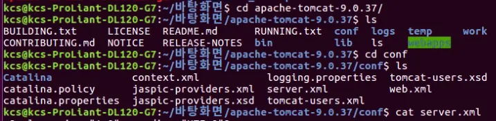

> 이 글은 2021-01-29에 티스토리 블로그(leirbag.tistory.com/27)에 처음 작성한 글을 옮겨온 것입니다.

동일한 서버로 여러 개의 도메인으로 서비스해야 할 때가 있습니다.

특히, 같은 프로젝트를 돌리면서 여러 도메인으로 접속할 수 있게 하는 상황인 것이죠.

예를 들어볼까요.

최근에 저희 과가 두 개로 분리가 되었습니다.

이미 기존에 있던 홈페이지도 두 개로 운영을 해야 했습니다.

(저희 과는 과에서 자체적으로 홈페이지를 운영하고 있습니다.)

이미 서버에는 한 개의 프로젝트가 돌고 있는데,

두 개의 서비스를 시행해야 하는 상황이 발생한 것입니다.

그렇다고 프로젝트를 하나 더 만들어서 두 프로젝트를 돌리기에는 유지 보수가 굉장히 힘들어질 것이 예상되었기에

기존의 프로젝트의 환경을 최대한 참고하면서 사용할 수 있도록

한 개의 프로젝트를 두 개로 나누어 서비스를 하기로 했습니다.

일단 학교에 요청을 해서 도메인을 추가로 받았습니다.

주소가 2개가 생겼는데, 이 두 주소는 한 컴퓨터의 ip를 향하고 있는 꼴이 됩니다.

## 1개 프로젝트 / 1개 url / 2개 주소

예를 들면 제가 tistory.com 도메인을 소유하고 있는 상황이라고 칩시다.

기존에 사용하던 leirbag.tistory.com이고.

접속하면 leirbag.tistory.com:8080/Index과 같이 뜨겠죠.

그런데 여기에서 gabriel.tistory.com:8080/Index도 같이 사용하고 싶다면

다음과 같이 처리하면 됩니다.



*우분투*

이런식으로 톰캣 폴더를 찾아서

conf폴더에 있는 server.xml을 실행합니다.

이 xml 파일을 편집해야 하는데

하단에 보시면

Host 관련 설정이 나옵니다.

```html
</Host>
      <Host name="leirbag.tistory.com"  appBase="webapps"
            unpackWARs="true" autoDeploy="true">

        <Alias> leirbag.tistory.com </Alias>
        <!-- SingleSignOn valve, share authentication between web applications
             Documentation at: /docs/config/valve.html -->
        <!--
        <Valve className="org.apache.catalina.authenticator.SingleSignOn" />
        -->

        <!-- Access log processes all example.
             Documentation at: /docs/config/valve.html
             Note: The pattern used is equivalent to using pattern="common" -->
        <Valve className="org.apache.catalina.valves.AccessLogValve" directory="logs"
               prefix="localhost_access_log" suffix=".txt"
               pattern="%h %l %u %t &quot;%r&quot; %s %b" />

</Host>
```

이렇게 기존에 사용하던 주소를 입력하고 Alias 태그도 걸어줍니다.

만약에 여기에서 Alias태그를 하나 더 늘린다면

```html
</Host>
      <Host name="leirbag.tistory.com"  appBase="webapps"
            unpackWARs="true" autoDeploy="true">

        <Alias> leirbag.tistory.com </Alias>
        <Alias> gabriel.tistory.com </Alias>
        <!-- SingleSignOn valve, share authentication between web applications
             Documentation at: /docs/config/valve.html -->
        <!--
        <Valve className="org.apache.catalina.authenticator.SingleSignOn" />
        -->

        <!-- Access log processes all example.
             Documentation at: /docs/config/valve.html
             Note: The pattern used is equivalent to using pattern="common" -->
        <Valve className="org.apache.catalina.valves.AccessLogValve" directory="logs"
               prefix="localhost_access_log" suffix=".txt"
               pattern="%h %l %u %t &quot;%r&quot; %s %b" />

</Host>
```

leirbag.tistory.com -> leirbag.tistory.com:8080/Index과 같이 기존처럼 사용할 수 있고

수동으로 입력하거나 하이퍼링크를 통해서 gabriel.tistory.com:8080/Index으로도 접속이 가능한 상황이 됩니다.

즉, gabriel로 시작하는 주소는 포트번호까지 직접 쳐야 하는 것이죠.

굉장히 불편합니다. 하지만, 어딘가에 쓰일 수는 있겠죠.

예를 들면 메인 홈페이지가 있고, 거기 안에서 나오는 서브 홈페이지가 잠깐 필요할 때라던지..

필요에 따라서 사용하시면 될 것 같습니다.

## 1개 프로젝트 / 2개 url / 2개 주소

```html
</Host>
      <Host name="leirbag.tistory.com"  appBase="webapps"
            unpackWARs="true" autoDeploy="true">

        <Alias> leirbag.tistory.com </Alias>
        <!-- SingleSignOn valve, share authentication between web applications
             Documentation at: /docs/config/valve.html -->
        <!--
        <Valve className="org.apache.catalina.authenticator.SingleSignOn" />
        -->

        <!-- Access log processes all example.
             Documentation at: /docs/config/valve.html
             Note: The pattern used is equivalent to using pattern="common" -->
        <Valve className="org.apache.catalina.valves.AccessLogValve" directory="logs"
               prefix="localhost_access_log" suffix=".txt"
               pattern="%h %l %u %t &quot;%r&quot; %s %b" />

</Host>

</Host>
      <Host name="gabriel.tistory.com"  appBase="webapps"
            unpackWARs="true" autoDeploy="true">

        <Alias> gabriel.tistory.com </Alias>
        <!-- SingleSignOn valve, share authentication between web applications
             Documentation at: /docs/config/valve.html -->
        <!--
        <Valve className="org.apache.catalina.authenticator.SingleSignOn" />
        -->

        <!-- Access log processes all example.
             Documentation at: /docs/config/valve.html
             Note: The pattern used is equivalent to using pattern="common" -->
        <Valve className="org.apache.catalina.valves.AccessLogValve" directory="logs"
               prefix="localhost_access_log" suffix=".txt"
               pattern="%h %l %u %t &quot;%r&quot; %s %b" />

</Host>
```

이번에는 url을 하나 더 등록하는 상황입니다.

애초에 두 개의 url이 동일한 ip로 받고 있기 때문에

톰캣에서 Host를 두 개로 분리해주면 됩니다.

이렇게 하면 leirbag.tistory.com -> leirbag.tistory.com:8080/Index은 기존처럼 사용할 수 있고

gabriel.tistory.com -> gabriel.tistory.com:8080/Index도 사용이 가능합니다.

물론 프로젝트가 하나 이기 때문에 한 개의 프로젝트가 뜹니다.

하지만 여기에서 마치 한 개의 서버가 돌고 있지만 두 개의 서버가 도는 것처럼 효과를 낼 수 있습니다.

jsp파일을 논리적으로 분리시켜서 겹치지 않게 한다거나 (예를 들면 폴더 분리)

db 구조를 서로 겹치지 않게 하여 한 개의 서버를 두 개의 서버 마냥 나눌 수 있는 것입니다.

만약에 같은 구조 그대로 사용하는데 정보 정도만 다르게 사용하고 싶다면

url주소를 기반으로 한 동작 구조를 나눠서

한 개의 jsp 페이지에서 두 개의 페이지를 가진 것처럼도 활용할 수 있습니다.

예를 들면 leirbag.tistory.com:8080/main.do에서 불러오는 jsp나

gabriel.tistory.com:8080/main.do에서 불러오는 jsp가 동일함에도 불구하고

테마나 페이지에 띄우는 것을 달리 할 수 있습니다.

현재 url을 불러오는 메서드를 사용하면 되기 때문이죠.

## 2개 프로젝트 / 2개 url / 2개 주소

```html
</Host>
      <Host name="leirbag.tistory.com"  appBase="webapps"
            unpackWARs="true" autoDeploy="true">

        <Alias> leirbag.tistory.com </Alias>
        <!-- SingleSignOn valve, share authentication between web applications
             Documentation at: /docs/config/valve.html -->
        <!--
        <Valve className="org.apache.catalina.authenticator.SingleSignOn" />
        -->

        <!-- Access log processes all example.
             Documentation at: /docs/config/valve.html
             Note: The pattern used is equivalent to using pattern="common" -->
        <Valve className="org.apache.catalina.valves.AccessLogValve" directory="logs"
               prefix="localhost_access_log" suffix=".txt"
               pattern="%h %l %u %t &quot;%r&quot; %s %b" />

</Host>

</Host>
      <Host name="gabriel.tistory.com"  appBase="webapps2"
            unpackWARs="true" autoDeploy="true">

        <Alias> gabriel.tistory.com </Alias>
        <!-- SingleSignOn valve, share authentication between web applications
             Documentation at: /docs/config/valve.html -->
        <!--
        <Valve className="org.apache.catalina.authenticator.SingleSignOn" />
        -->

        <!-- Access log processes all example.
             Documentation at: /docs/config/valve.html
             Note: The pattern used is equivalent to using pattern="common" -->
        <Valve className="org.apache.catalina.valves.AccessLogValve" directory="logs"
               prefix="localhost_access_log" suffix=".txt"
               pattern="%h %l %u %t &quot;%r&quot; %s %b" />

</Host>
```

이건 프로젝트를 완전히 분리하는 것입니다.

webapps를 하나만 만드는 게 아니라

두 개의 프로젝트를 만들어서

톰캣 보고 url에 따라서 실행하는 프로젝트를 지정해 주는 꼴입니다.
