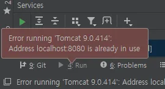
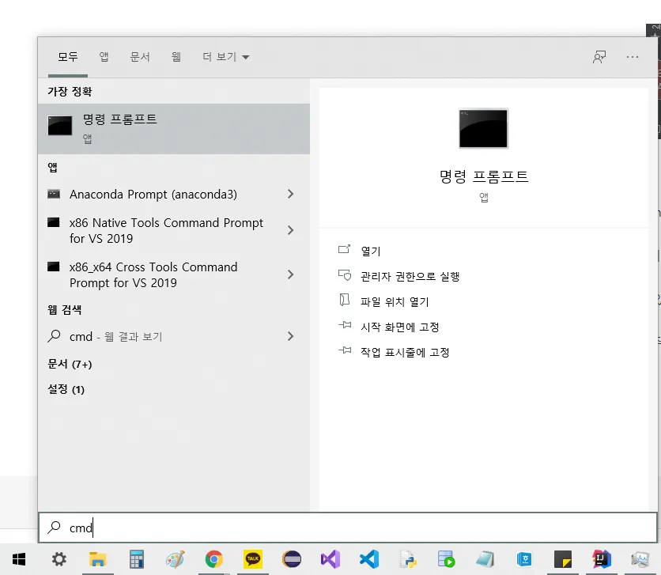
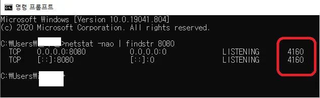
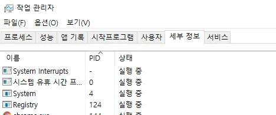
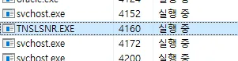
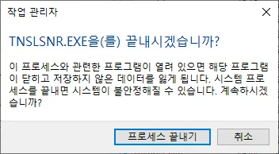

> 이 글은 2021-03-02에 티스토리 블로그(leirbag.tistory.com/32)에 처음 작성한 글을 옮겨온 것입니다.

인텔리제이에서 톰캣을 돌릴때 이런 오류가 발생하는 경우가 있습니다.

Error running 'Tomcat 9.0. ': Address localhost:8080 is already in use

톰캣으로 8080포트를 사용하려고 하는데 이미 사용중인 프로그램이 있는 경우에 해당 오류가 발생합니다.

(자매품으로 1099포트가 사용중인 경우도 있습니다.)

일단 윈도우 키를 누르시고 cmd를 치고 명령 프롬프트를 실행해주세요

다음과 같이 입력하여 PID값을 찾습니다.

netstat -nao | findstr 8080

보시다시피 PID값이 4160으로 나옵니다. (이는 컴퓨터마다 다릅니다)

네모 박스 안에 있는 숫자를 기억해주시면 됩니다.

작업관리자를 실행해주시고 세부정보에 들어가서 PID값을 기준으로 정렬해주세요

아까 cmd에서 찾았던 pid값과 일치하는 프로그램을 찾고 강제로 종료해줍니다.

다시 인텔리제이로 가셔서 톰캣을 실행하시면 잘 돌아가는 것을 확인할 수 있습니다.

일반적으로 TNSLSNR.EXE가 8080포트를 사용중인 경우가 대다수이기 때문에

경험적으로 저 프로그램을 강종 해버리는 것도 괜찮습니다.

가끔 javac.exe가 점유하고 있는 경우도 있는데

아무튼간에 해당 포트를 사용중인 프로그램을 강종해버리면 잘 돌아갑니다!
