> 이 글은 2021-04-29에 티스토리 블로그(leirbag.tistory.com/50)에 처음 작성한 글을 옮겨온 것입니다.

## 1\. IntelliJ 홈페이지 다운로드에 들어갑니다.

[www.jetbrains.com/idea/download/#section=windows](https://www.jetbrains.com/idea/download/#section=windows)

> [**Download IntelliJ IDEA: The Capable & Ergonomic Java IDE by JetBrains**](https://www.jetbrains.com/idea/download/)  
> Download the latest version of IntelliJ IDEA for Windows, macOS or Linux.

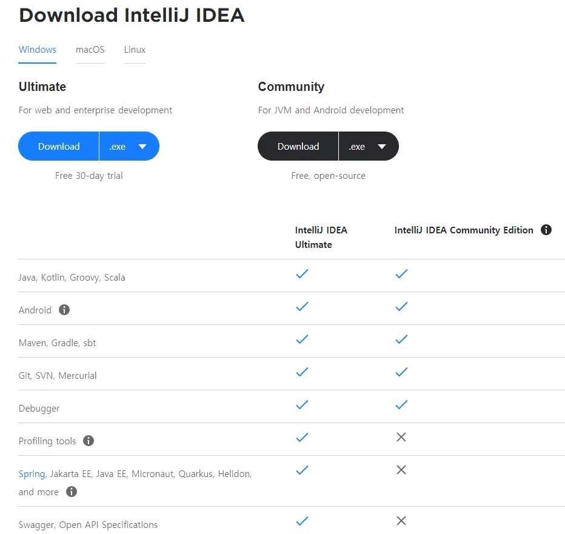

반드시 왼쪽에 있는 Ultimate 버전의 download를 누릅니다.

다운로드하는 동안 아래 있는 학생 계정 인증 절차를 밟아주세요.

## 2\. 학생 계정 인증

Ultimate는 보시다시피 유료 버전입니다.

학생 인증을 하면 공짜로 사용할 수 있습니다.

[goddaehee.tistory.com/215](https://goddaehee.tistory.com/215)

> [**\[IntelliJ\] Intellij 학생 인증, 무료 설치 방법**](https://goddaehee.tistory.com/215)  
> \[IntelliJ\] Intellij 학생 인증, 무료 설치 방법 안녕하세요. 갓대희 입니다. 이번 포스팅은 \[ IntelliJ Ultimate 무료 설치 방법(학생인증) \] 입니다. : ) 이전 버전에서 무료 버전인 IntelliJ Community 버..

학생 인증 방법은 오래전에 해서 까먹은 관계로 다른 사람의 글을 링크합니다.

**반드시 학교 메일(\*.ac.kr)로 가입을 해야 합니다!**

(이 계정이 있으면 JetBrains에서 지원하는 안드로이드 스튜디오, 파이참 등 대부분의 유료버전 사용이 가능합니다.)

## 3\. 첨부파일 실행 및 설치

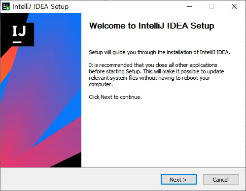

Next

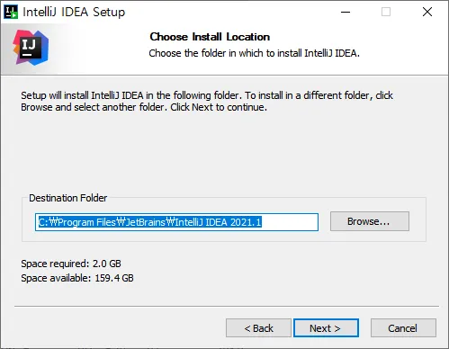

Next

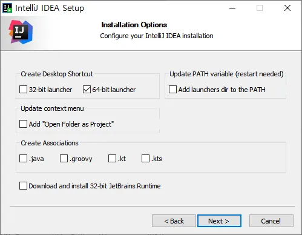

64-bit launcher 체크 후 Next

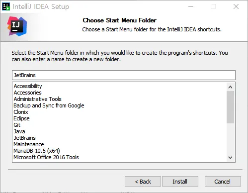

Next

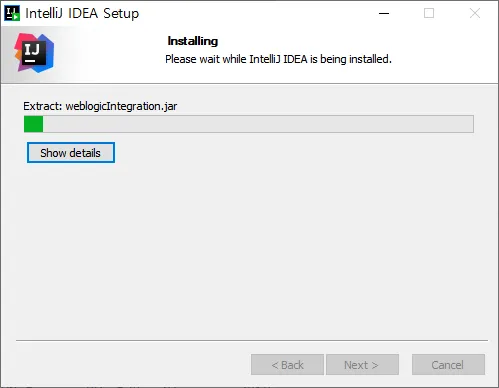

Next

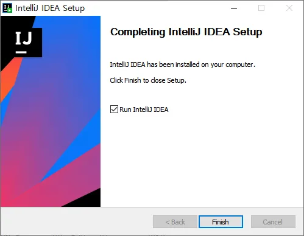

Run IntelliJ Idea에 체크하고 Finnish

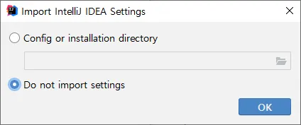

Do not import

## 4\. 학생 계정 로그인

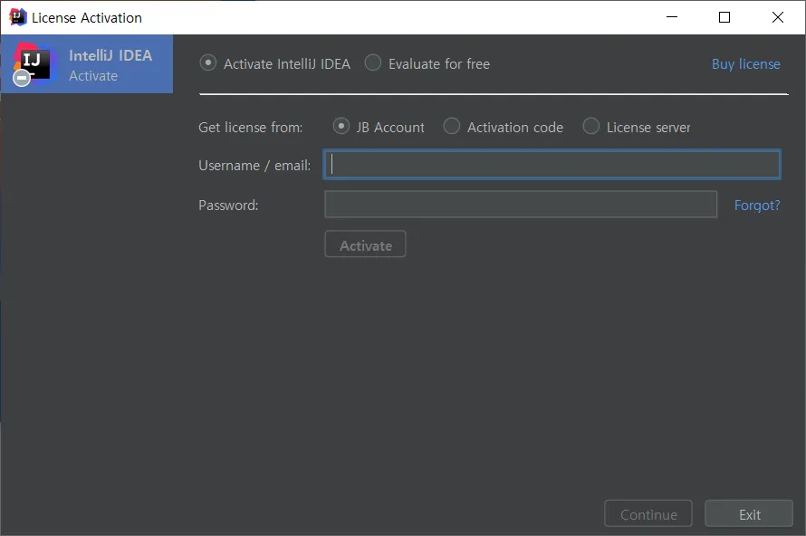

*출처 : https://goddaehee.tistory.com/215*

저는 파이참때문에 인증이 넘어간 것 같은데, Activate가 뜨면 JB Account에 아까 가입하신 JetBrains 계정으로 로그인하시면 됩니다. (로그인 안 하면 30일 제한 걸림)

## 5\. 새 프로젝트 만들어보기

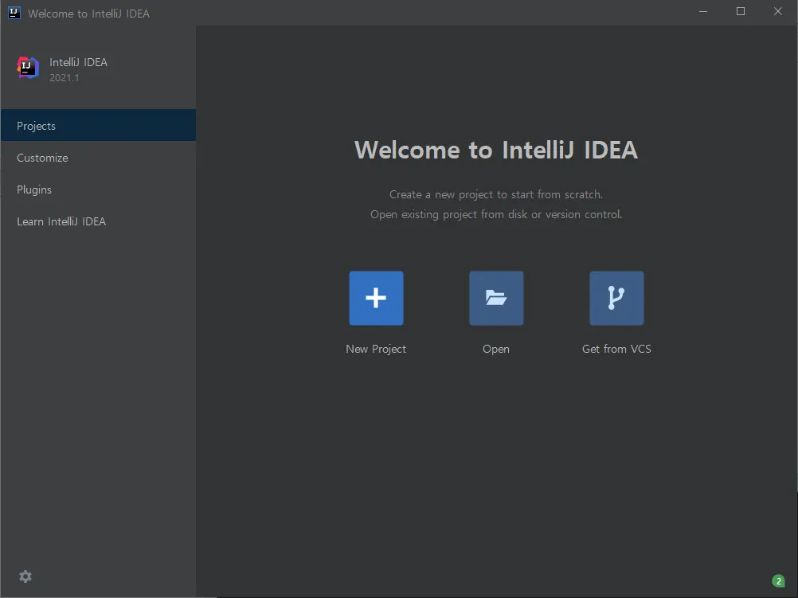

New Project

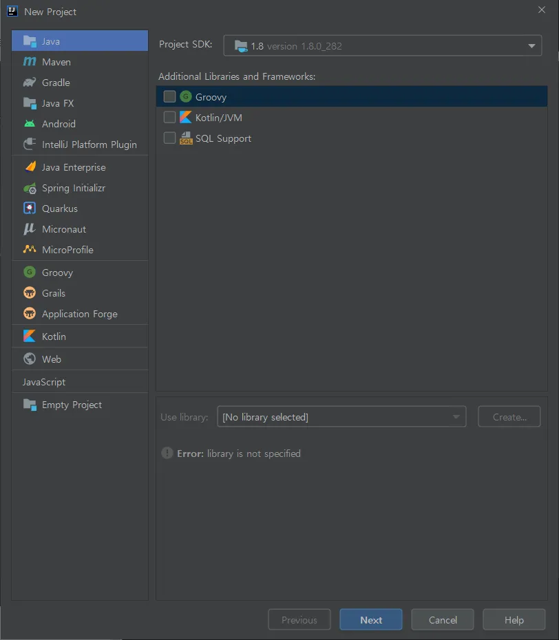

아무것도 클릭하지 않고 Next

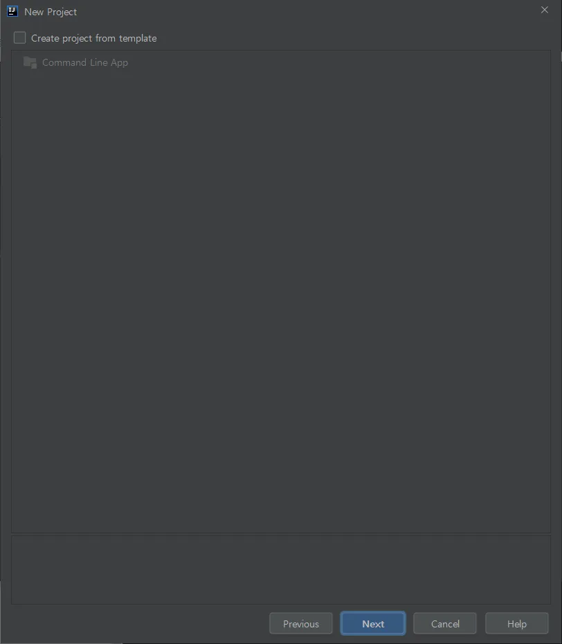

Next 하고 Finnish

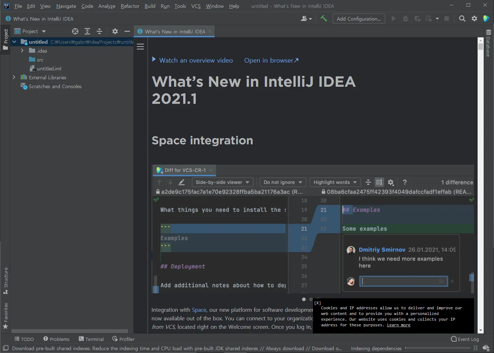

끝
