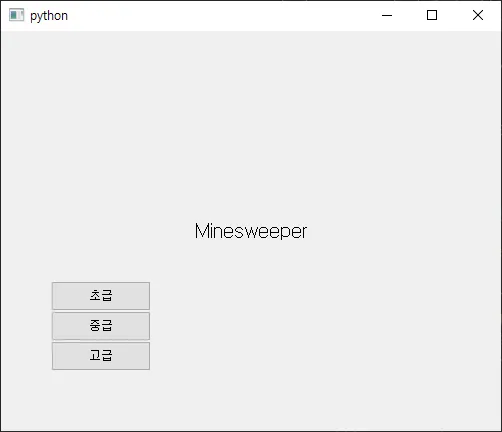
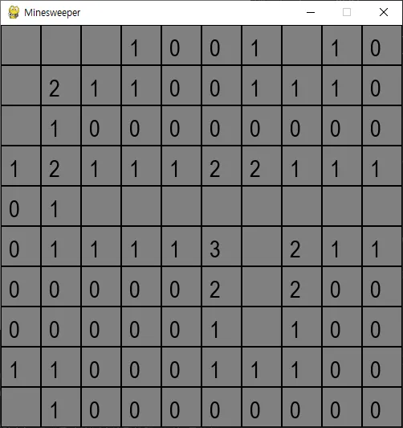

> 이 글은 2021-06-21에 티스토리 블로그(leirbag.tistory.com/73)에 처음 작성한 글을 옮겨온 것입니다.

파이썬으로 만들어 본 지뢰찾기 프로그램입니다.

사용한 모듈 : PyQt5(난이도 선택창), Pygame(게임GUI)

## setting.py

```python
#각종 환경 설정을 위한 "값"을 모아놓는 곳.
#다른 파일에서 코드를 읽을 때 숫자가 무슨 의미를 하는지 이해하기 어려운 요소들은 전부 여기에 넣고 관리하기.
#예를들면 RGB값, 블럭 크기와 같은 것은 코드를 읽을 때 갑자기 숫자로 표현해서 읽는 것이 난해해짐
#다른 py에서 이 값을 불러오고싶으면 import settings를 해주고, settings.WHITE와 같은 방법으로 불러올 수 있음

#창 크기
SCREEN_SIZE_BEGINNER=[250,250]
SCREEN_SIZE_INTERMEDIATE=[500,500]
SCREEN_SIZE_ADVANCED=[1000,500]

#게임 영역 관련

#난이도에 따른 맵 크기 설정 (가로축, 세로축, 지뢰수)
BEGINNER = (5,5,5) #5x5사이즈의 맵 크기에 지뢰 1개
INTERMEDIATE = (10,10,10)
ADVANCED = (20,10,20)

#색상
WHITE = (255,255,255)
RED = (255,0,0)
GREEN = (0,255,0)
BLUE = (0,0,255)
ORANGE = (255,69,0)
GOLD = (255,125,0)
PURPLE = (128,0,128)
CYAN = (0,255,255)
BLACK = (0,0,0)
GRAY = (128, 128, 128)

#셀 크기
CELL_SIZE = 50

#intro 난이도 선택 버튼 위치
BTN_X = 50
BTN_Y = 250
```

각종 세팅 값(변수)을 여기에 몰아넣어서 앞으로 사용되어야 하는 각종 값을 미리 정의했습니다.

## gameLogic.py

```python
import random
from MineSweeper.settings import *

class GameLogic():
    def __init__(self): #게임 초기화 지점
        pass

    def run(self): #실행 부분
        level = self.getLevel()
        map = self.createMap(level)

    def getLevel(self): #난이도 가져오기
        while True:
            level = input("난이도를 입력하세요 (초급, 중급, 고급): ")
            if level == '초보':
                return BEGINNER
            elif level == '중급':
                return INTERMEDIATE
            elif level == '고급':
                return ADVANCED
            else:
                print("난이도를 제대로 입력해주세요.")

    def createMap(self, level): #레벨에 따른 맵 생성 + 레벨에 따른 지뢰 심기 + 지뢰 근처에 적절한 숫자 생성 한번에 처리함.
        width = level[0]
        height = level[1]
        mine = level[2]
        arr = [[0 for row in range(width)] for column in range(height)]
        num = 0
        while num < mine:
            x = random.randint(0, width - 1)  # 지뢰의 x축 범위 랜덤으로 설정
            y = random.randint(0, height - 1)  # 지뢰의 y축 범위 랜덤으로 설정
            print(num)
            if arr[y][x] == 'X':
                print(num)
                continue
            print("[HINT]생성된 지뢰 위치 : (x:", x, ", y:", y, ")")  # 테스트를 용이하게 하기 위해 넣음 (GUI에서는 출력되지 않아야함.)
            arr[y][x] = 'X'  # 생성된 지뢰 좌표에 X로 표현

            # 지뢰 주변 힌트 숫자 생성
            if (x >= 0 and x <= width - 2) and (y >= 0 and y <= height - 1):
                if arr[y][x + 1] != 'X':
                    arr[y][x + 1] += 1  # center right
            if (x >= 1 and x <= width - 1) and (y >= 0 and y <= height - 1):
                if arr[y][x - 1] != 'X':
                    arr[y][x - 1] += 1  # center left
            if (x >= 1 and x <= width - 1) and (y >= 1 and y <= height - 1):
                if arr[y - 1][x - 1] != 'X':
                    arr[y - 1][x - 1] += 1  # top left
            if (x >= 0 and x <= width - 2) and (y >= 1 and y <= height - 1):
                if arr[y - 1][x + 1] != 'X':
                    arr[y - 1][x + 1] += 1  # top right
            if (x >= 0 and x <= width - 1) and (y >= 1 and y <= height - 1):
                if arr[y - 1][x] != 'X':
                    arr[y - 1][x] += 1  # top center
            if (x >= 0 and x <= width - 2) and (y >= 0 and y <= height - 2):
                if arr[y + 1][x + 1] != 'X':
                    arr[y + 1][x + 1] += 1  # bottom right
            if (x >= 1 and x <= width - 1) and (y >= 0 and y <= height - 2):
                if arr[y + 1][x - 1] != 'X':
                    arr[y + 1][x - 1] += 1  # bottom left
            if (x >= 0 and x <= width - 1) and (y >= 0 and y <= height - 2):
                if arr[y + 1][x] != 'X':
                    arr[y + 1][x] += 1  # bottom center
            num += 1
        return arr

    def displayMap(self, map):  # 콘솔 출력용 (GUI랑은 상관 없음)
        for row in map:
            print(" ".join(str(cell) for cell in row))
            print("")

    def checkMine(self, map, x, y):  # 지뢰 찾는 함수. 이기면 True, 지면 False 라는 의미로 설정함.
        if map[y][x] == 'X':
            return False
        return True
```

게임을 돌릴 때 사용할 알고리즘의 집합입니다.

## gui\_intro.py

```python
from PyQt5.QtCore import Qt
from PyQt5.QtWidgets import QVBoxLayout, QLabel, QRadioButton, QWidget
from PyQt5 import QtGui
from settings import *

from PyQt5.QtWidgets import *
from PyQt5.QtCore import Qt
from PyQt5 import QtGui
import sys, gui

#gui 첫 시작 페이지
#버튼 클릭을 통해 난이도를 gui로 넘겨 난이도별 화면 출력

class Window(QWidget):
    def __init__(self):
        super().__init__()
        self.count = 0
        self.initialize()

    def initialize(self):
        self.setGeometry(700, 300, 500, 400)
        layout = QVBoxLayout()
        self.setLayout(layout)

        self.label = QLabel("Minesweeper")
        self.label.setAlignment(Qt.AlignCenter)
        self.label.setFont(QtGui.QFont('Hack', 15))
        layout.addWidget(self.label)

        # GUI를 실행하는 버튼
        btnRun0 = QPushButton("초급", self)  # 버튼 텍스트
        btnRun0.move(BTN_X, BTN_Y)  # 버튼 위치
        btnRun0.clicked.connect(self.btnRun_clicked_0)  # 클릭 시 실행할 function

        btnRun1 = QPushButton("중급", self)  # 버튼 텍스트
        btnRun1.move(BTN_X, BTN_Y+30)  # 버튼 위치
        btnRun1.clicked.connect(self.btnRun_clicked_1)  # 클릭 시 실행할 function

        btnRun2 = QPushButton("고급", self)  # 버튼 텍스트
        btnRun2.move(BTN_X, BTN_Y+60)  # 버튼 위치
        btnRun2.clicked.connect(self.btnRun_clicked_2)  # 클릭 시 실행할 function

    def btnRun_clicked_0(self): #버튼을 눌렀을 때 gui 실행
        gui.GUI("초급")
    def btnRun_clicked_1(self): #버튼을 눌렀을 때 gui 실행
        gui.GUI("중급")
    def btnRun_clicked_2(self): #버튼을 눌렀을 때 gui 실행
        gui.GUI("고급")

app = QApplication(sys.argv)
screen = Window()
screen.show()
sys.exit(app.exec_())
```

난이도 선택창입니다.

## gui.py

```python
import sys, pygame

import MineSweeper.gameLogic
from MineSweeper.settings import *
from pygame.locals import *
from MineSweeper.gameLogic import GameLogic
# 내 생각에는 일단 " "(스페이스 한칸)로 채워져 있는 판을 만들고, 해당 칸을 클릭했을 때, map에 있는 해당 칸으로 바꿔주는게 어떨까 싶음.

class GUI(): #임시. pygame 안써도 됨.
    def __init__(self, level): #초기화
        pygame.init()  # pygame 초기화. 초기화를 해야 pygame을 사용할 수 있다고 함.
        super().__init__()
        SCREEN_SIZE=self.getScreenSize(level)
        SCREEN_WIDTH = self.getScreenSize(level)[0]
        SCREEN_HEIGHT = self.getScreenSize(level)[1]
        self.count = 0
        self.screen = pygame.display.set_mode(SCREEN_SIZE)  # 디스플레이 크기 설정
        pygame.display.set_caption('Minesweeper')  # 프로그램 이름 설정
        gameLevel=self.getLevel(level) #레벨을 tuple 형태로 받아옴.
        arr = GameLogic.createMap(self, gameLevel) #맵을 생성하고 저장
        OPENED = [[False for column in range(len(arr[0]))] for row in range(len(arr))] #오픈한 칸인지 확인
        CHECKED = [[False for column in range(len(arr[0]))] for row in range(len(arr))] #깃발을 체크한 칸인지 확인
        self.draw_Cells(arr)  # 칸 그리기

        while True:  # main game loop (게임에 필요한 메소드 불러오기)
            for event in pygame.event.get(): #창 안의 이벤트를 받는 영역. 예를 들면 종료키, 키보드키, 마우스 클릭 등
                if event.type == QUIT:#상단의 X키 누를 때 까지 프로그램 종료 안하고 유지하기 (필수임)
                    pygame.quit()
                    sys.exit()
                elif event.type == pygame.MOUSEBUTTONDOWN:
                    if event.button == 1:  # 마우스 왼쪽 클릭시
                        column_index = event.pos[0] // CELL_SIZE
                        row_index = event.pos[1] // CELL_SIZE
                        num = 0
                        print(column_index, row_index)
                        if arr[row_index][column_index] == 'X':  # 선택된 칸이 X이면 종료
                            self.open_All(arr, OPENED) #모든 칸 열기
                            print("패배")
                            fail_font = pygame.font.SysFont('Sans', 70)
                            fail_image = fail_font.render('Lose', True, RED)
                            self.screen.blit(fail_image, fail_image.get_rect(centerx=SCREEN_WIDTH // 2,centery=SCREEN_HEIGHT // 2))
                        else:  # 선택된 칸 오픈
                            OPENED=self.open_Cell(arr,OPENED, column_index, row_index)
                        for i in range(len(arr)): #열리지 않은 칸 수 셈
                            for j in range(len(arr[0])):
                                if not OPENED[i][j]:
                                    num += 1
                        if num == gameLevel[2]: #열리지 않은 칸의 수와 지뢰의 수가 같으면 성공 출력 == 지뢰가 없는 칸 모두 오픈
                            success_font = pygame.font.SysFont('Sans', 70)
                            success_image = success_font.render('Win', True, RED)
                            self.screen.blit(success_image,
                                             success_image.get_rect(centerx=SCREEN_WIDTH // 2,
                                                                    centery=SCREEN_HEIGHT // 2))
                    elif event.button == 3: # 마우스 우클릭시 깃발
                        column_index = event.pos[0] // CELL_SIZE
                        row_index = event.pos[1] // CELL_SIZE
                        flag_font = pygame.font.SysFont('Sans', 30)
                        flag_image = flag_font.render('V', True, WHITE)
                        if CHECKED[row_index][column_index]: #이미 깃발이 체크된 칸을 선택시 체크 지우기
                            flag_image.fill(GRAY)
                            CHECKED[row_index][column_index] = False
                        else:
                            CHECKED[row_index][column_index] = True
                        self.screen.blit(flag_image, (column_index * CELL_SIZE + 10, row_index * CELL_SIZE + 5))
                        '''while num>4: # 승리표시가 되는지 확실히 모르겠음
                            if GameLogic().createMap(self) == arr[row_index][column_index]:
                                num+=1
                                continue
                            success_font = pygame.font.SysFont('malgungothic', 70)
                            success_image = success_font.render('승리', True, RED)
                            self.screen.blit(success_image,success_image.get_rect(centerx=SCREEN_WIDTH // 2, centery=SCREEN_HEIGHT // 2))'''
#               self.draw_Cells(arr)  # 칸 그리기
            pygame.display.update()

    def getLevel(self, level): #레벨 가져오기(나중에 수정 필요)
        if level=='초급':
            return BEGINNER
        elif level=='중급':
            return INTERMEDIATE
        elif level=='고급':
            return ADVANCED

    def getScreenSize(self,level):
        if level=='초급':
            return SCREEN_SIZE_BEGINNER
        elif level=='중급':
            return SCREEN_SIZE_INTERMEDIATE
        elif level=='고급':
            return SCREEN_SIZE_ADVANCED

    def draw_Cells(self, arr):
        COLUMN_COUNT = len(arr[0])
        ROW_COUNT = len(arr)

        for column_index in range(COLUMN_COUNT):
            for row_index in range(ROW_COUNT):
                rect = (CELL_SIZE * column_index, CELL_SIZE * row_index, CELL_SIZE, CELL_SIZE)
                pygame.draw.rect(self.screen, GRAY, rect)
                pygame.draw.rect(self.screen, BLACK, rect, 1)

    def open_Cell(self,arr,OPENED,col,row):
        if col < 0 or col >= len(arr[0]) or row < 0 or row >= len(arr):
            return arr
        cell = arr[row][col]  # 선택된 칸
        if OPENED[row][col]: #이미 확인한 칸
            return arr
        OPENED[row][col] = True
        if cell == 0: #셀이 0이면 1 이상의 수가 나올때까지 반복해서 여는 재귀함수 생성 / for 문으로 고쳐야할 듯
            self.open_Cell(arr, OPENED, col + 1, row)
            self.open_Cell(arr, OPENED,col, row + 1)
            self.open_Cell(arr, OPENED,col + 1, row + 1)
            self.open_Cell(arr, OPENED,col - 1, row)
            self.open_Cell(arr, OPENED,col, row - 1)
            self.open_Cell(arr, OPENED,col - 1, row - 1)
            self.open_Cell(arr, OPENED,col + 1, row - 1)
            self.open_Cell(arr, OPENED,col - 1, row + 1)
        # font5 = pygame.font.SysFont('notarisation', 50)
        font5 = pygame.font.SysFont('Sans', 30)
        img5 = font5.render(str(cell), True, BLACK)
        self.screen.blit(img5, (CELL_SIZE*col+10, CELL_SIZE*row+10))
        return OPENED

    def open_All(self,arr,OPENED):
        for i in range(len(arr)):
            for j in range(len(arr[0])):
                self.open_Cell(arr,OPENED,j,i)
```

앞서 올린 gameLogic.py를 적극 활용하여 게임 상황을 실시간으로 표시합니다.

## 실제 동작 화면




