> 이 글은 2021-06-24에 티스토리 블로그(leirbag.tistory.com/80)에 처음 작성한 글을 옮겨온 것입니다.

## 0\. 작업 환경

<table><tbody><tr><td>프로그램 이름 및 버전</td><td>출시연도</td><td>비고</td><td>설치방법</td></tr><tr><td><span>Windows10</span></td><td>2015</td><td>유료</td><td>·</td></tr><tr><td>IntelliJ <b>Ultimate</b> 2021.01</td><td>2021</td><td>유료</td><td><a href="../2021-04-29-tistory-50/">바로가기</a></td></tr><tr><td>JavaEE8</td><td><span>2017</span></td><td>무료</td><td><span>본문에 적용방법 나옴</span></td></tr><tr><td>Tomcat 9.0.48</td><td><span>2018</span></td><td>무료</td><td>다음 게시글에 나옴</td></tr><tr><td>mariaDB 10.5</td><td>2019</td><td>무료</td><td><a href="https://leirbag.tistory.com/46?category=943106">바로가기</a></td></tr><tr><td>openJDK 16</td><td><span>2021</span></td><td>무료</td><td><span>본문에 설치방법 나옴</span></td></tr></tbody></table>

**(중요) 위의 설치방법 링크 참고해서 버전을 맞춰주세요.**

## 1\. 인텔리제이로 프로젝트 생성

New - Project에 들어갑니다.

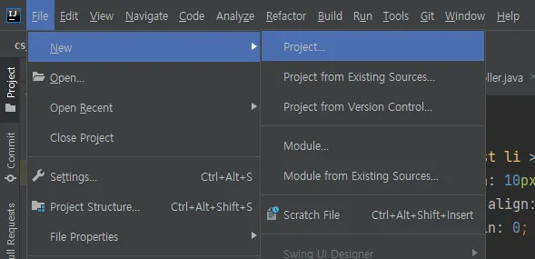

Java에서 Project SDK에 들어가서 Download JDK를 누르고 Version 16에 Oracle JDK 클릭

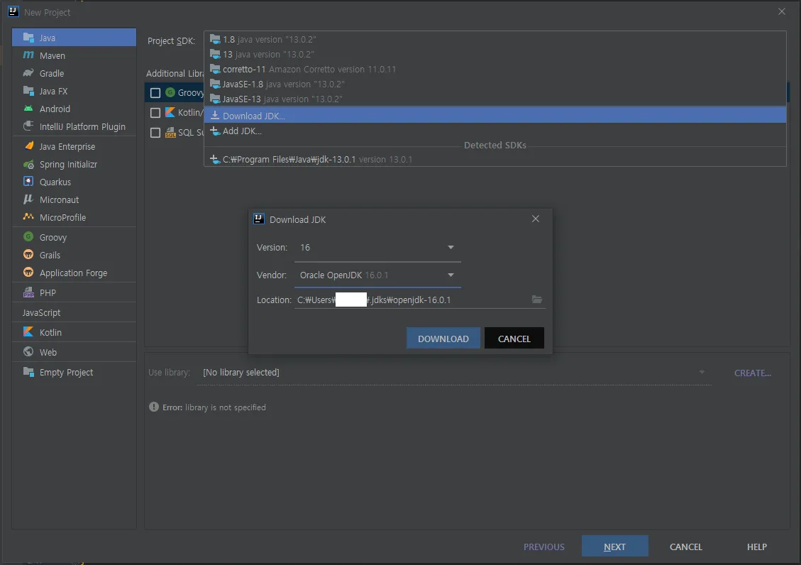

Download 버튼을 누르면

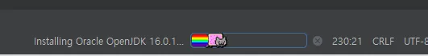

이렇게 뜹니다.

이제 Project SDK가 openjdk-16으로 된 것을 확인할 수 있습니다.

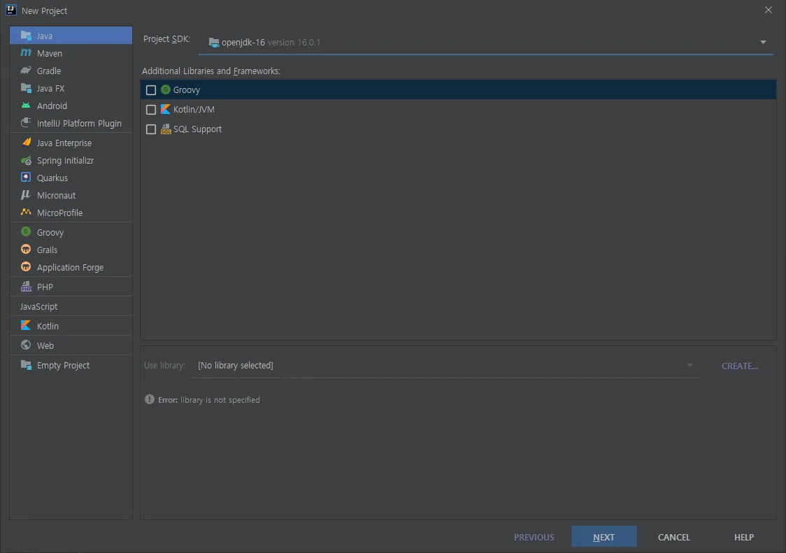

아무것도 체크하지 않고 Next

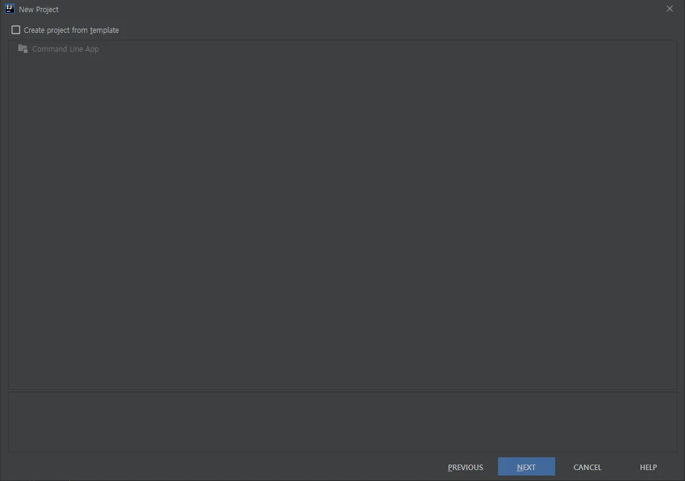

아무것도 체크하지 않고 Next

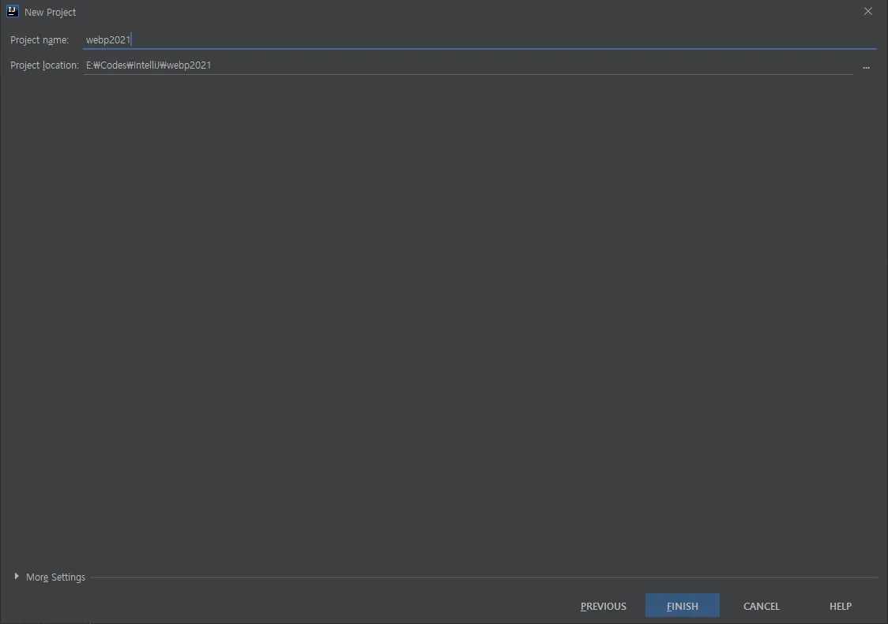

Project Name을 정해주고 Finnish

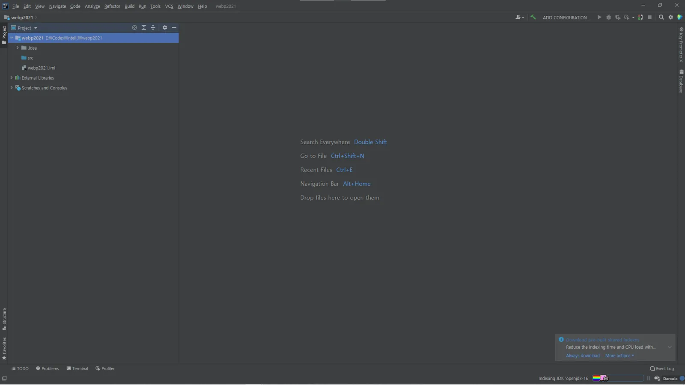

우측 하단의 게이지가 멈출 때 까지 대기해줘야 합니다.

여기까지 생성했으면 평범한 Java 프로젝트입니다.

## 2\. Web Service 추가

프로젝트 폴더에 우클릭 후 Add Framework Support를 누릅니다.

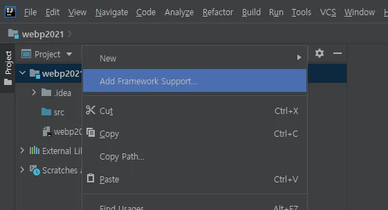

Java EE version이 아래 사진처럼 Java EE 8로 되어있어야 합니다.

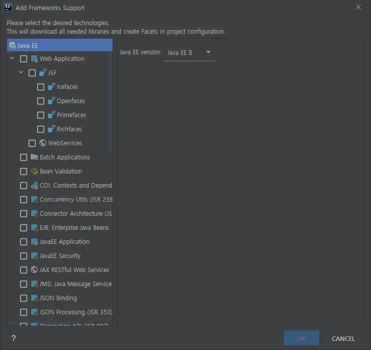

Web Application - WebServices를 체크하고 다음과 같이 설정합니다.

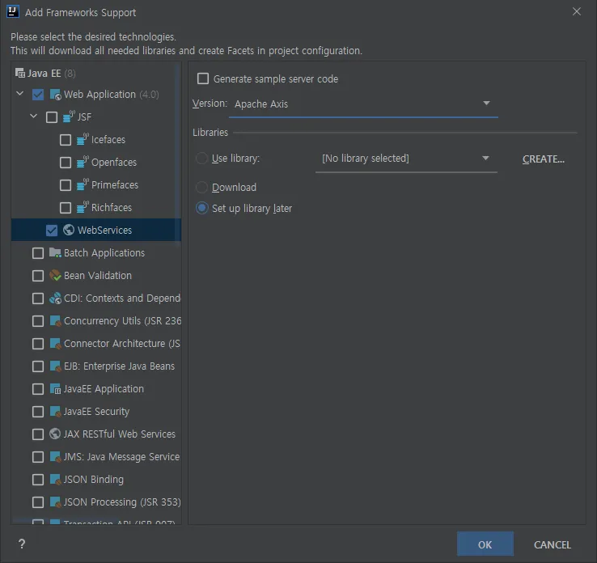

Generate sample server code를 해제하고

Version은 Apache Axis

Libraries는 Set up library later에 체크합니다. 그리고 OK를 누릅니다.

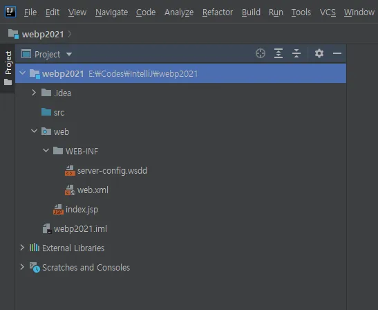

새로운 폴더와 파일들이 자동으로 생성된 것을 확인할 수 있습니다.

## 3\. 프로젝트 뼈대 구성하기(java)

src 폴더에 패키지를 추가합니다.

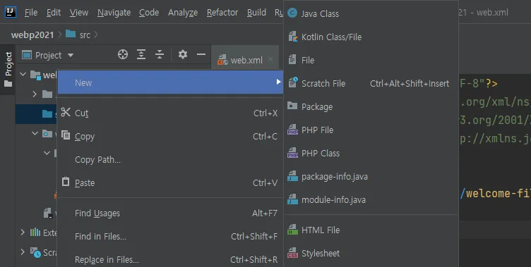

src 폴더에 우클릭 후, New - Package를 누릅니다.

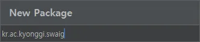

서비스 하려는 홈페이지 주소의 역순으로 적어줍니다.

그리고 해당 패키지 안에 다음과 같이 두 개의 패키지를 추가해줍니다.

kr.ac.kyonggi.swaig.common

kr.ac.kyonggi.swaig.handler

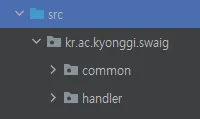

그러면 위와같은 구조가 됩니다.

common 패키지 안에 다음 패키지들을 추가해줍니다.

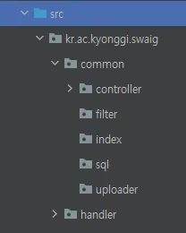

controller 패키지 안에 Controller 클래스를 추가해주고 다음과 같은 내용을 넣습니다.

```java
package kr.ac.kyonggi.swaig.common.controller;

import java.io.FileInputStream;
import java.io.IOException;
import java.io.PrintWriter;
import java.util.Properties;

import javax.servlet.ServletContext;
import javax.servlet.ServletException;
import javax.servlet.http.HttpServlet;
import javax.servlet.http.HttpServletRequest;
import javax.servlet.http.HttpServletResponse;

public class Controller extends HttpServlet{
    /**
     ***
     */
    private static final long serialVersionUID = 1L;

    /**
     ***
     */
    protected void service(HttpServletRequest request, HttpServletResponse response)
            throws ServletException, IOException {
        String RequestURI=request.getRequestURI();
        String contextPath=request.getContextPath();
        String command=RequestURI.substring(contextPath.length());
        Action action = null;
        String forward = null;

        ServletContext context = getServletContext();
        String fullPath = context.getRealPath("/WEB-INF/class.properties");
        Properties prop = new Properties();
        FileInputStream fis = new FileInputStream(fullPath);

        prop.load(fis);

        fis.close();

        String classPath = prop.getProperty(command);

        //System.out.println(command + " ------ " + fullPath);
        try{
            Class<?> url = Class.forName(classPath);

            action = (Action) url.newInstance();
            try {
                forward = action.execute(request, response);
            } catch (Exception e) {
                //세션 잃어버렸는데, 작업을 진행할때
            }
        }catch(ClassNotFoundException ex){
            ex.printStackTrace();
        }catch(InstantiationException ex){
            ex.printStackTrace();
        }catch(IllegalAccessException ex){
            ex.printStackTrace();
        }catch(NullPointerException ex)
        {
            //System.out.println("error class : " + command);
            ex.printStackTrace();
        }
        if(forward != null){

            if(forward.contains("RequestDispatcher:"))
            {
                String jspName = (forward.split(":")[1]);
                request.getRequestDispatcher("WEB-INF/" + forward.split(":")[1]).forward(request, response);
                //System.out.println("/" + jspName);
            }
            else {
                PrintWriter pr = response.getWriter();
                pr.print(forward);
                pr.flush();
                pr.close();
            }
        }
    }
}
```

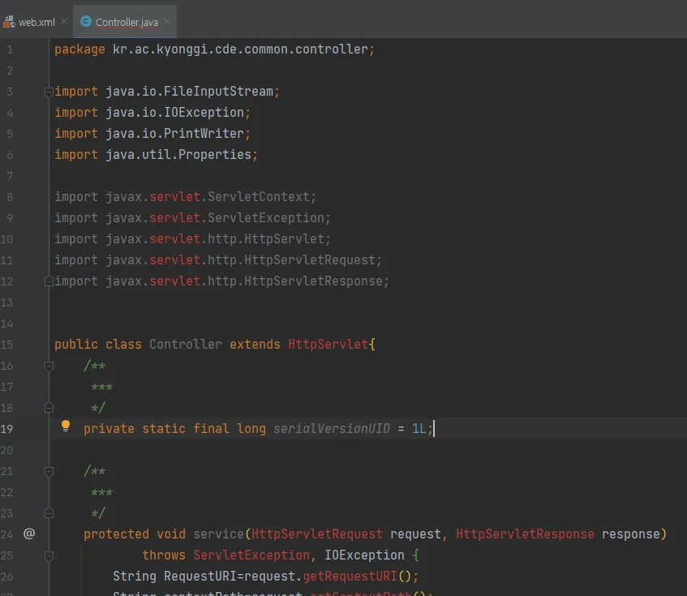

코드를 복붙하면 위와같이 빨간 글씨가 엄청 나옵니다.

servlet에 마우스를 올리면 다음과 같은 도움말이 나옵니다.

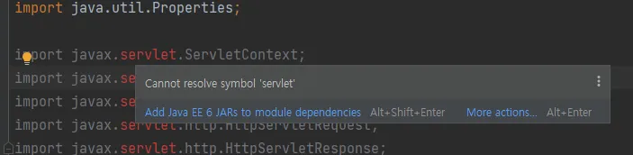

Add Java EE 6 JARs to module dependencies를 누릅니다.

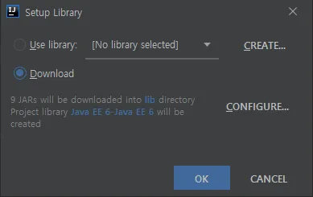

Download를 누르고 OK

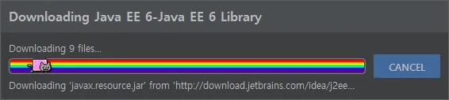

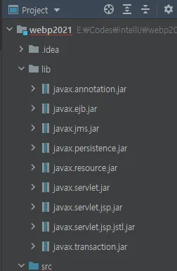

다운받아진 jar 파일들은 이렇게 lib 폴더로 들어오게 됩니다.

이번엔 Action 인터페이스를 controller 패키지 안에 추가해줍니다.

```java
package kr.ac.kyonggi.swaig.common.controller;

import javax.servlet.http.*;

public interface Action {
    public String execute(HttpServletRequest request, HttpServletResponse response) throws Exception;
}
```

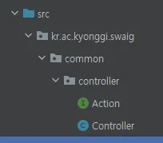

여기까지 잘 따라오셨다면 위와 같은 경로에 파일 두개가 있을겁니다.

이번에는 handler 패키지를 열어 다음과 같이 패키지를 구성합니다.

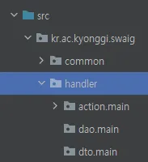

(이번 글에서는 dao와 dto는 설명하지 않으므로 action패키지만 넣어도 됩니다.)

action에 있는 main 패키지 안에 MainAction이라는 클래스를 추가합니다.

```java
package kr.ac.kyonggi.swaig.handler.action.main;

import kr.ac.kyonggi.swaig.common.controller.Action;

import javax.servlet.http.HttpServletRequest;
import javax.servlet.http.HttpServletResponse;

public class MainAction implements Action {
    /**
     * 단순히 main.jsp를 띄워줍니다.
     * */
    @Override
    public String execute(HttpServletRequest request, HttpServletResponse response) throws Exception {
//        System.out.println("dd");
        return "RequestDispatcher:jsp/main/main.jsp";
    }
}
```

위의 코드를 MainAction.java로 복붙하시면 됩니다.

이제 자바쪽 설정은 끝났습니다.

## 4\. 프로젝트 뼈대 구성하기(jsp 및 기타)

**web 폴더의 WEB-INF폴더의 server-config.wsdd는 삭제합니다.**

web폴더의 WEB-INF폴더의 web.xml을 열어줍니다.

내용을 모두 지우고 다음 코드를 복붙합니다.

```html
<?xml version="1.0" encoding="UTF-8"?>
<web-app xmlns="http://xmlns.jcp.org/xml/ns/javaee"
         xmlns:xsi="http://www.w3.org/2001/XMLSchema-instance"
         xsi:schemaLocation="http://xmlns.jcp.org/xml/ns/javaee http://xmlns.jcp.org/xml/ns/javaee/web-app_4_0.xsd"
         version="4.0">

    <welcome-file-list>
        <welcome-file>index.jsp</welcome-file>
    </welcome-file-list>
    <servlet>
        <servlet-name>Controller</servlet-name>
        <servlet-class>kr.ac.kyonggi.swaig.common.controller.Controller</servlet-class>
    </servlet>
    <servlet-mapping>
        <servlet-name>Controller</servlet-name>
        <url-pattern>*.kgu</url-pattern>
    </servlet-mapping>

</web-app>
```

(일반적으로 url-pattern을 \*.do로 하는 경우가 많지만, 저는 학과 홈페이지를 만들고 있기 때문에 학교 약자에 맞춰서 \*.kgu로 설정했습니다.)

web 폴더의 WEB-INF에 우클릭 후 New - File을 누르고 class.properties라고 입력하여 추가합니다.

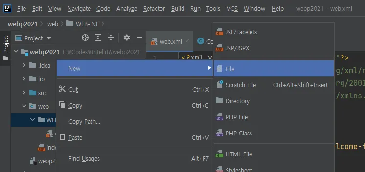

```html
/main.kgu = kr.ac.kyonggi.swaig.handler.action.main.MainAction
```

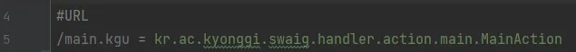

그리고 위와 같이 적어줍니다. (만약 앞선 web.xml 설정에서 \*.kgu로 하지 않았다면 설정하신 패턴으로 해주셔야합니다.)

web - WEB-INF 폴더 안에 다음과 같이 디렉토리를 생성해줍니다.

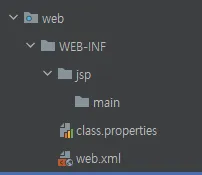

그리고 WEB-INF / jsp / main 폴더에 우클릭 하신 후 New - JSP/JSPX를 누릅니다.

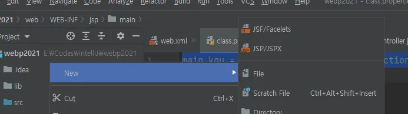

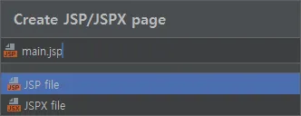

main.jsp를 입력한 후 추가합니다.

그리고 header.jsp도 마찬가지로 추가해줍니다.

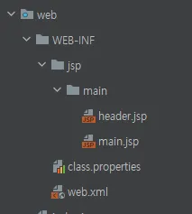

추가하면 위와 같은 구조가 됩니다.

header.jsp를 열고 내용을 다 지워주고 다음과 같이 적습니다.

```html
<%@ page contentType="text/html;charset=UTF-8" language="java" %>
<header>
    <div>
        ****************
        여기는 헤더.
        ****************
    </div>
</header>
```

main.jsp를 열고 내용을 다 지워주고 다음과 같이 적습니다.

```html
<%@ page contentType="text/html;charset=UTF-8" language="java" %>
<html>
<head>
    <title>Title</title>
</head>
<%@include file="./header.jsp"%>
<body>
main 페이지의 내용
</body>
</html>
```

web 폴더에 있는 index.jsp를 열어 다음과 같이 수정해줍니다.

```html
<%@ page contentType="text/html;charset=UTF-8" language="java" %>
<html>
  <head>
    <title>$Title$</title>
  </head>
  <body>
  $END$
  </body>
  <script>
    /**
     * 웹 서버가 처음으로 열려고 시도하는 페이지입니다.
     * 일단 main.kgu로 보냅니다. (.kgu는 web/WEB-INF/class.properties에서 찾습니다.)
     */
    window.location.href = 'main.kgu';
  </script>
</html>
```

## Tomcat 연결 후 실행하기

프로젝트를 실행하는법은 다음에 나와있습니다.

[\[IntelliJ\] JSP 프로젝트 Tomcat 으로 실행하기](../2021-06-24-tistory-81/)

> [**\[IntelliJ\] JSP 프로젝트 Tomcat 으로 실행하기**](../2021-06-24-tistory-81/)  
> 0\. 이전 게시글 https://leirbag.tistory.com/80 \[IntelliJ\] JSP 프로젝트 생성하기 (JavaEE8, Tomcat 9.0, mariaDB) 0. 작업 환경 프로그램 이름 및 버전 출시연도 비고 설치방법 Windows10 2015 유료 · Intelli..
