> 이 글은 2021-06-24에 티스토리 블로그(leirbag.tistory.com/81)에 처음 작성한 글을 옮겨온 것입니다.

## 0\. 이전 게시글

[\[IntelliJ\] JSP 프로젝트 생성하기 (JavaEE8, Tomcat 9.0, mariaDB)](../2021-06-24-tistory-80/)

> [**\[IntelliJ\] JSP 프로젝트 생성하기 (JavaEE8, Tomcat 9.0, mariaDB)**](../2021-06-24-tistory-80/)  
> 0\. 작업 환경 프로그램 이름 및 버전 출시연도 비고 설치방법 Windows10 2015 유료 · IntelliJ Ultimate 2021.01 2021 유료 바로가기 JavaEE8 2017 무료 본문에 적용방법 나옴 Tomcat 9.0.48 2018 무료 본문에 설..

## 1\. Tomcat 설정

[https://tomcat.apache.org/download-90.cgi](https://tomcat.apache.org/download-90.cgi)에 접속해서 9.0.48의 Core에 있는 zip을 누릅니다.

(Tomcat10은 javax를 아직 지원하고 있지 않기 때문에 9버전을 사용해야합니다.)

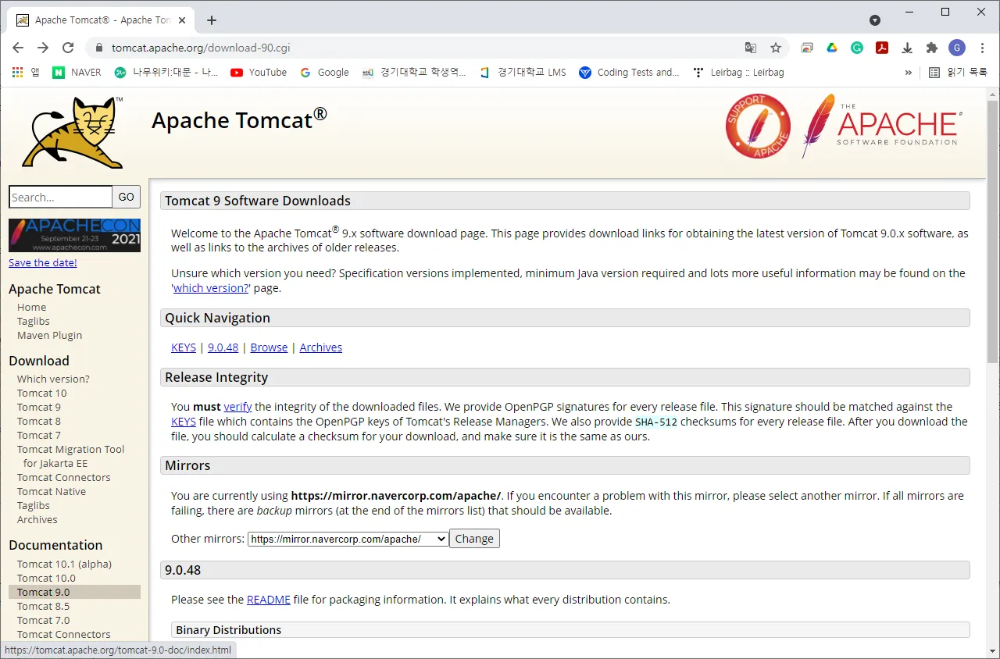

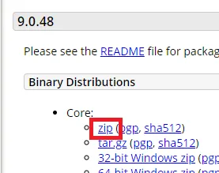

다운로드 받은 zip파일을 압축 해제한 후, 프로젝트와 동일한 경로에 옮겨줍니다.

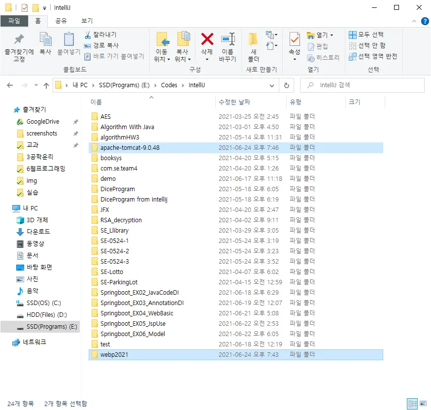

인텔리제이 우측 상단의 Add Configuration을 누릅니다.

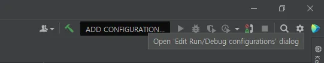

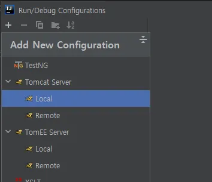

좌측 상단의 +를 누르고 Tomcat Server의 Local을 누릅니다.

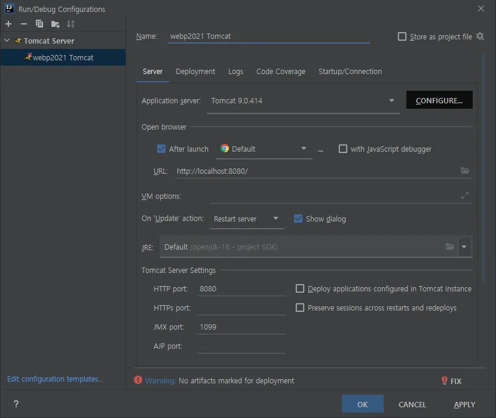

Name은 원하는걸로 바꾸시고 Configure....을 누릅니다.

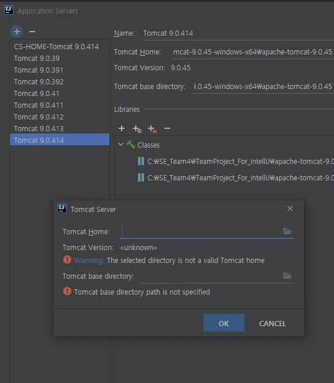

+를 누르고 Tomcat Home에서 폴더 버튼을 누릅니다.

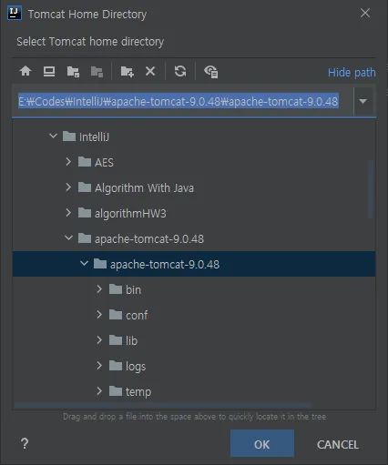

tomcat 폴더 위치를 정해줍니다. (반드시 위와같이 bin 폴더가 들어있는 폴더를 선택해야함)

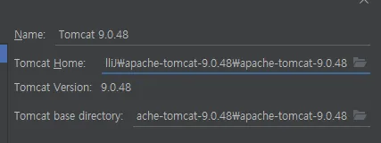

OK

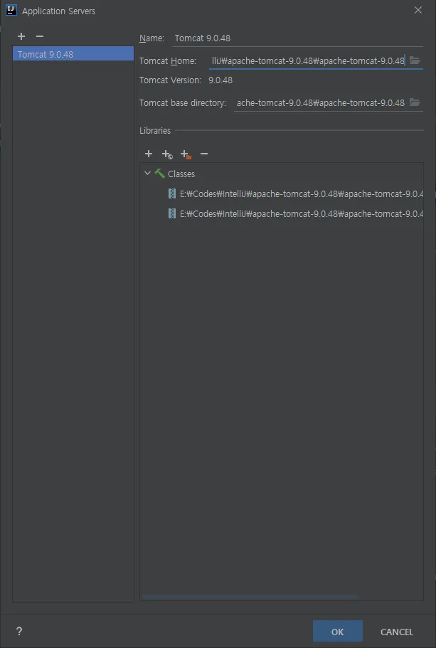

OK

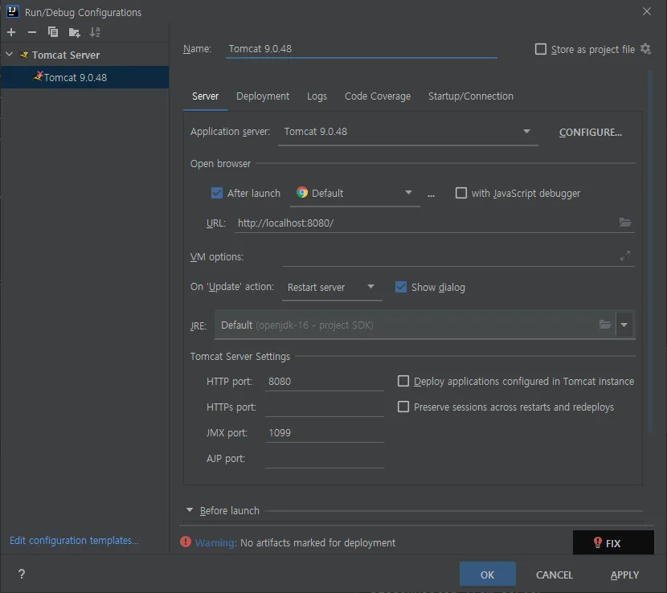

우측 하단의 FIX를 누르고

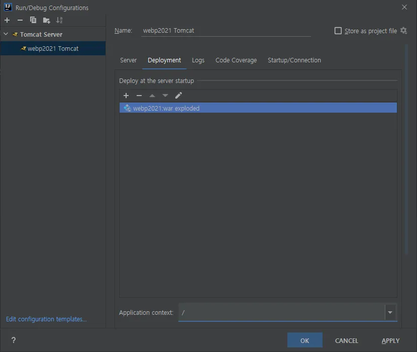

**하단의 Application context를 /으로 바꿔줍니다.**

그리고 OK를 누릅니다.

실행버튼을 누릅니다.

## 6\. Tomcat 설정

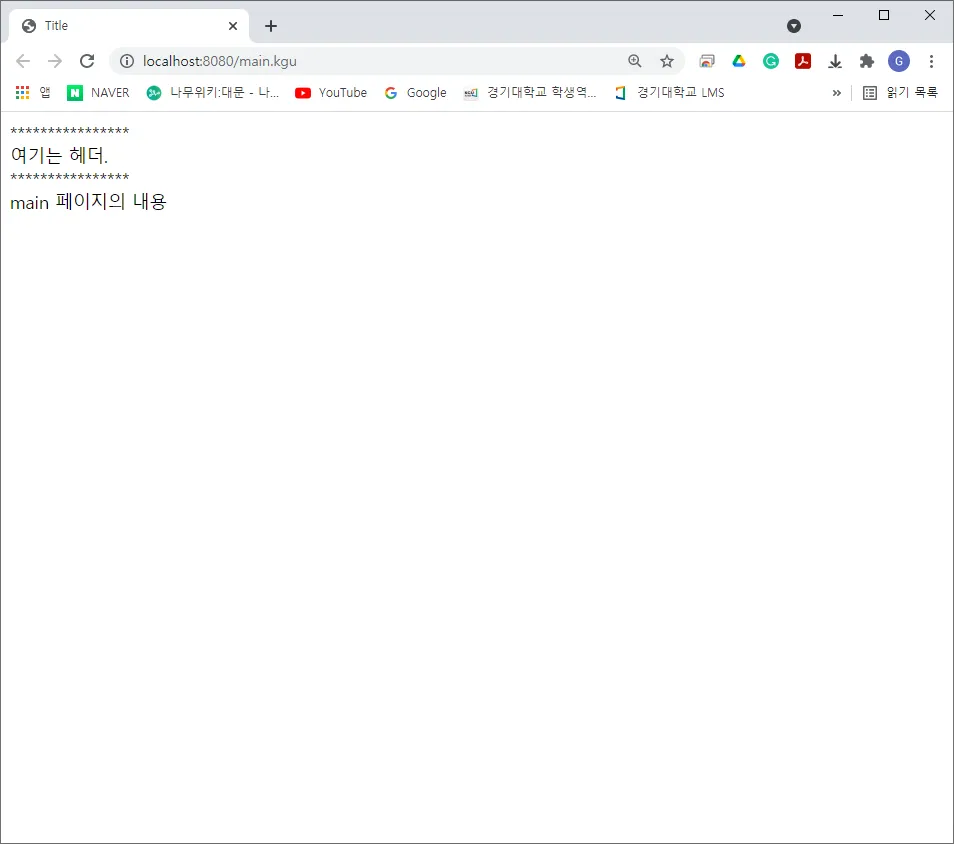

실행하면 다음과 같이 나옵니다.

## 다음 게시글

다음 게시글에는 연습용 페이지를 부트스트랩을 적용하여 추가하는 방법을 설명합니다.

[\[IntelliJ\] 연습용 JSP 페이지 추가하기(부트스트랩 활용)](../2021-06-26-tistory-83/)

> [**\[IntelliJ\] 연습용 JSP 페이지 추가하기(부트스트랩 활용)**](../2021-06-26-tistory-83/)  
> 0\. 이전 게시글 https://leirbag.tistory.com/81 \[IntelliJ\] JSP 프로젝트 Tomcat 으로 실행하기 0. 이전 게시글 https://leirbag.tistory.com/80 \[IntelliJ\] JSP 프로젝트 생성하기 (JavaEE8, Tomcat 9.0, mariaD..
