> 이 글은 2021-06-24에 티스토리 블로그(leirbag.tistory.com/82)에 처음 작성한 글을 옮겨온 것입니다.

## 클론 후 해야하는 작업

## openJDK16 설치

## File - Project Structure - SDKs

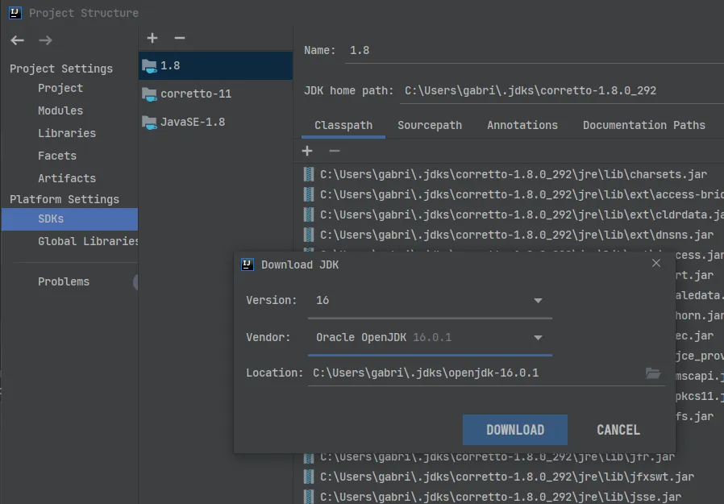

+버튼 누르고 Download JDK 누르고

Version 16에 위 사진처럼 맞춰준 다음 다운로드

\---------------------------------------------------------------

File- Project Structure - Project

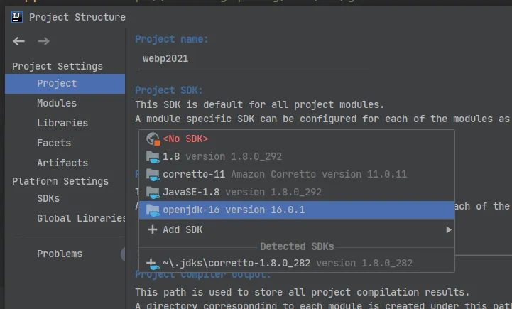

opdenjdk-16 클릭 후 apply

\----------------------------------------------------------------

File - Project Structure - Facets에 있는 +를 누르고 Web 클릭

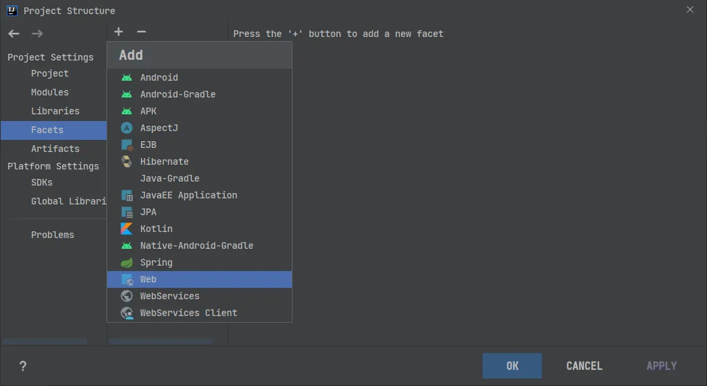

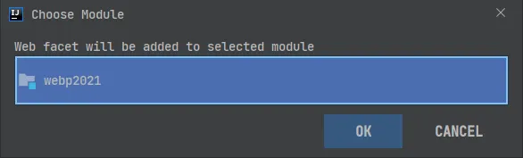

ok

\-----------------------------------------------------------------

## File - Project Structure - Artifacts에 있는 곳에서 + 누르고 Web Application : Exploded 에 마우스 올리고 From Modules 클릭

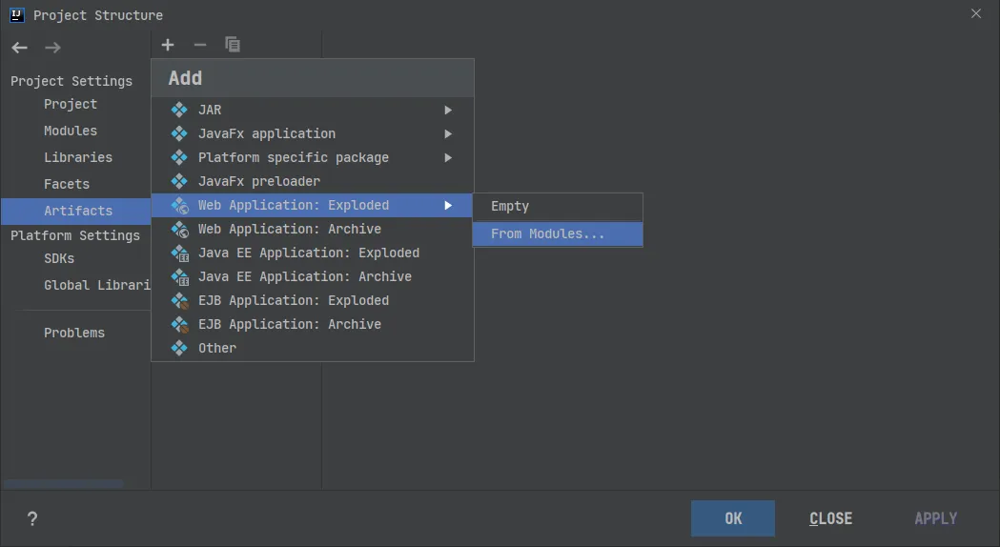

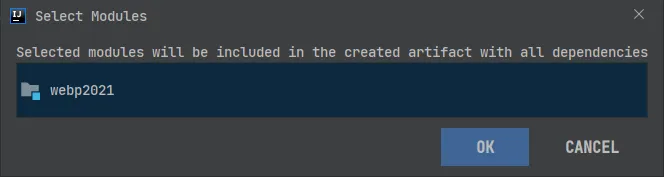

OK 누르면 다음과 같이 변함

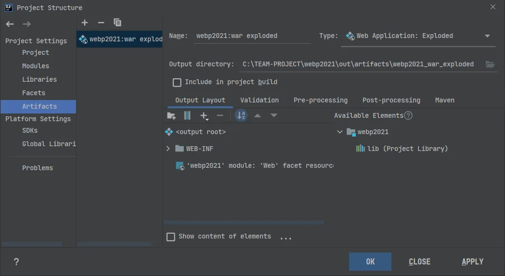

우측 Available Elements에 있는거 전부 더블클릭해서 왼쪽으로 넘김

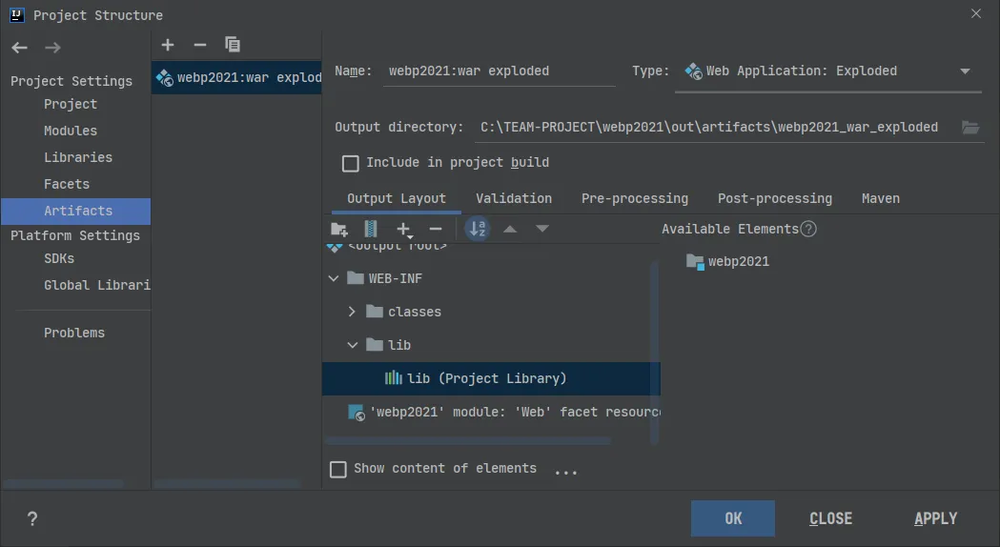

이렇게 넘겨지면 OK

\----------------------------------------------

우측 상단의 Add Configuration...을 누르고 + 누르고 Tomcat Server에서 local 클릭

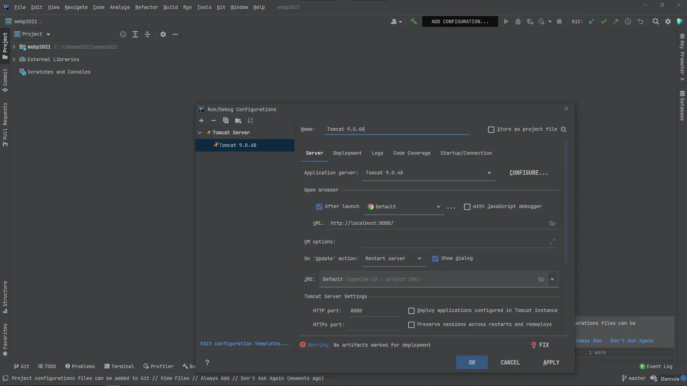

Tomcat 경로 새로 지정해주고(기존 톰캣 폴더 지정방식과 동일함. 9.0.48 다운받아서 하는걸 추천)

우측 하단의 FIX 클릭

하단의 Application context를 /으로 만들어주기

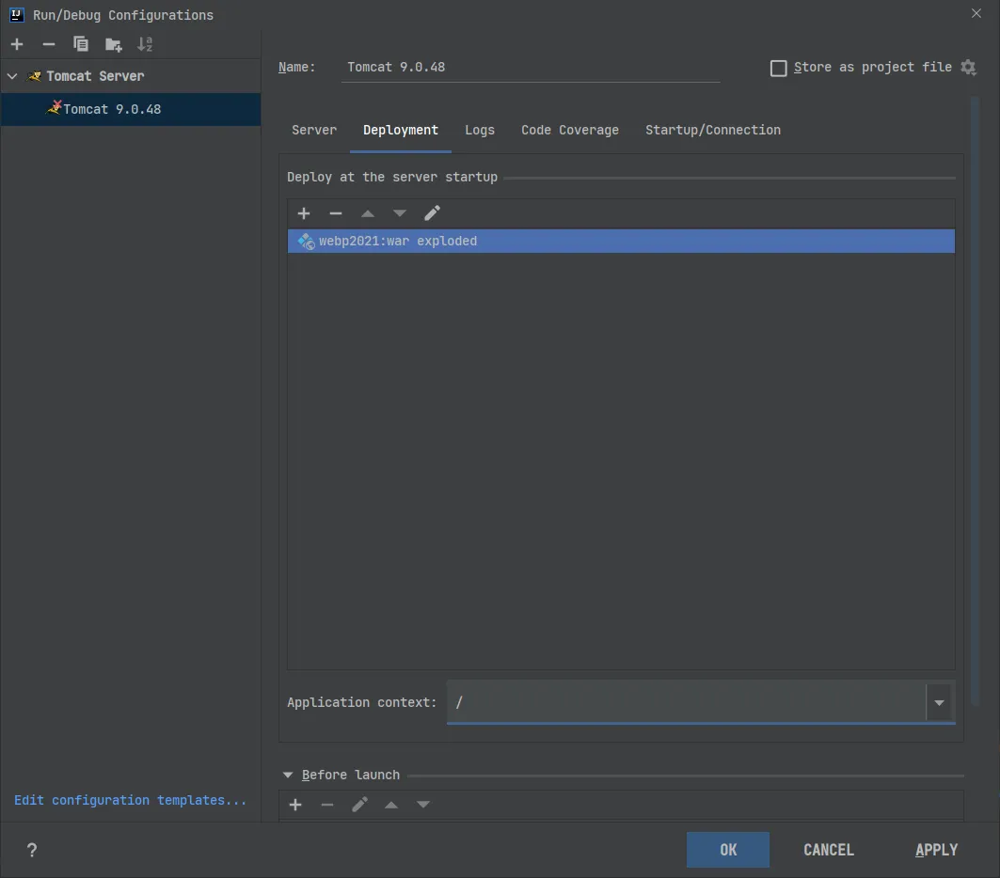

OK 누르고

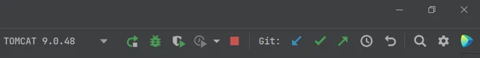

여기서 재생버튼 누르기

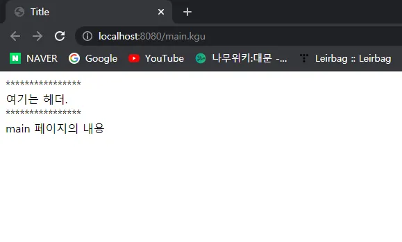

끝
