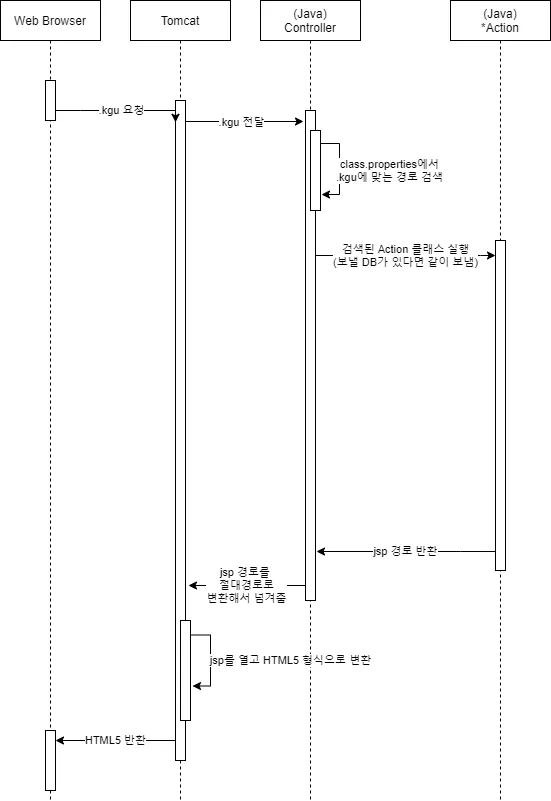
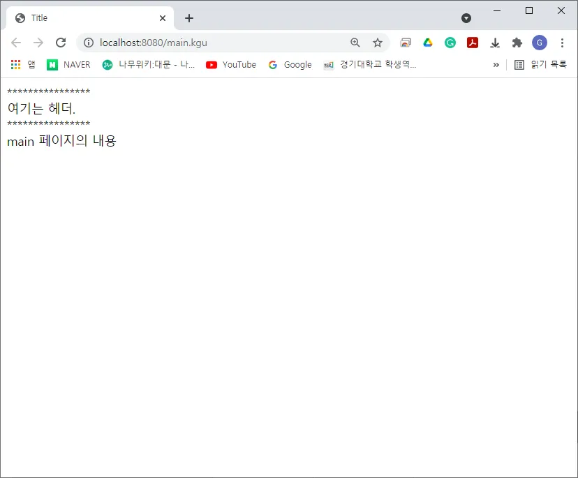
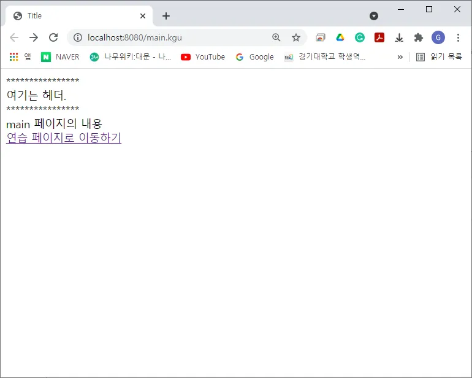
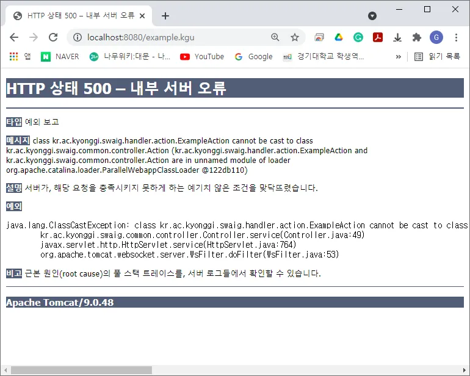
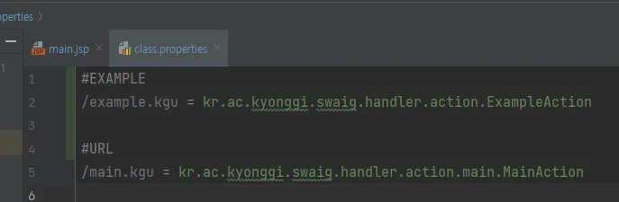
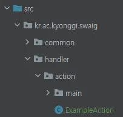
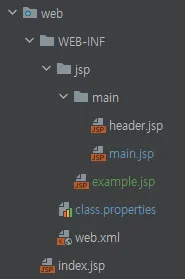
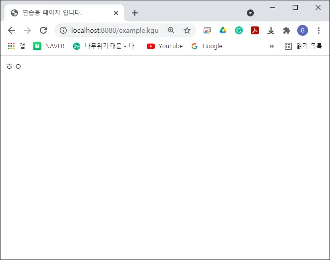
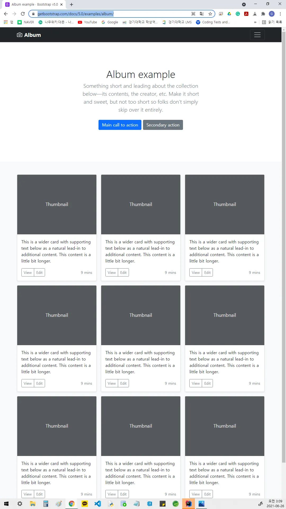
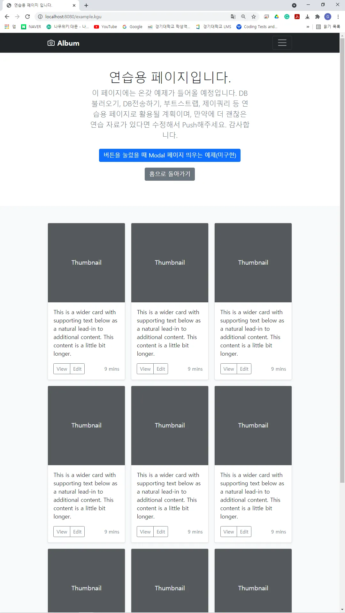

> 이 글은 2021-06-26에 티스토리 블로그(leirbag.tistory.com/83)에 처음 작성한 글을 옮겨온 것입니다.

## 0\. 이전 게시글

[\[IntelliJ\] JSP 프로젝트 Tomcat 으로 실행하기](../2021-06-24-tistory-81/)

> [**\[IntelliJ\] JSP 프로젝트 Tomcat 으로 실행하기**](../2021-06-24-tistory-81/)  
> 0\. 이전 게시글 https://leirbag.tistory.com/80 \[IntelliJ\] JSP 프로젝트 생성하기 (JavaEE8, Tomcat 9.0, mariaDB) 0. 작업 환경 프로그램 이름 및 버전 출시연도 비고 설치방법 Windows10 2015 유료 · Intelli..

## 1\. 지금까지 설계한 구조

지금까지 제 게시글을 잘 따라오셨다면 현재 Action까지 만들어 본 것을 알 수 있습니다.



지금까지는 프로그램이 위와 같은 구조로 제작되어 있는데, JSP에 DB를 받아오는 구조로 개조할 것입니다.

하지만 그 전에 앞서 부트스트랩을 활용하여 연습용 페이지를 만드는 것을 실습해볼까 합니다.

그리고 지난 게시글에서 작성했던 새로운 페이지를 등록하는 방법에 대해 다시 한번 복습하겠습니다.

## 2\. 새로운 연습용 페이지 준비 (지난 게시글 복습)

기존에 구현했던 페이지를 살펴보면



이런 페이지인데 일단 여기에 새로운 링크를 하나 달아줄 것입니다. 즉, 새로운 jsp를 만들어서 예시를 들어볼까 합니다.

지난번에 작성했던 web/WEB-INF/jsp/main/main.jsp를 열어서 다음과 같이 만들어줍니다.

```html
<%@ page contentType="text/html;charset=UTF-8" language="java" %>
<html>
<head>
    <title>Title</title>
</head>
<%@include file="./header.jsp"%>
<body>
main 페이지의 내용<br>
<a href="example.kgu">연습 페이지로 이동하기</a>
</body>
</html>
```

이렇게 해서 실행해보면 메인화면이 다음과 같이 변합니다.



이때 example.kgu를 누르면 다음과 같이 오류가 나옵니다.



지난번에도 설명을 했지만, 복습을 위해 다시 설명하면 .kgu로 끝나는 url 요청은 Controller클래스로 보낼 것이고 example.kgu를 class.properties에서 검색해야하는데, 정의한 것이 없기 때문에 오류가 발생하는 것입니다.

따라서 이번에는 web/WEB-INF/class.properties를 열어 다음과 같이 url을 등록합니다.



```python
#EXAMPLE
/example.kgu = kr.ac.kyonggi.swaig.handler.action.ExampleAction

#URL
/main.kgu = kr.ac.kyonggi.swaig.handler.action.main.MainAction
```

이제 ExampleAction을 만들어줄 차례입니다.

src/kr.ac.kyonggi.sawig/handler/action에 ExampleAction 클래스를 추가해줍니다.



```java
package kr.ac.kyonggi.swaig.handler.action;

import kr.ac.kyonggi.swaig.common.controller.Action;

import javax.servlet.http.HttpServletRequest;
import javax.servlet.http.HttpServletResponse;

public class ExampleAction implements Action {
    @Override
    public String execute(HttpServletRequest request, HttpServletResponse response) throws Exception {
        return "RequestDispatcher:jsp/example.jsp";
    }
}
```

마지막으로 다음 경로에 example.jsp를 추가해줍니다. 아래 경로에 만들어주세요.



```html
<%@ page contentType="text/html;charset=UTF-8" language="java" %>
<html>
<head>
    <title>연습용 페이지 입니다.</title>
</head>
<body>
ㅎㅇ
</body>
</html>
```

이렇게 하면 새 페이지를 만들기 위한 모든 준비가 끝납니다. 이제 실행해서 아까의 그 오류나던 링크를 눌러보면



이렇게 잘 나오는 것을 알 수 있습니다.

## 3\. 부트스트랩5.0을 활용하여 static 페이지 꾸미기

앞으로 DB를 활용하기 전에 시각적인 이해를 적극 돕기 위해 부트스트랩의 도움을 받아볼까 합니다.

[https://getbootstrap.com/docs/5.0/examples/album/](https://getbootstrap.com/docs/5.0/examples/album/)

> [**Album example · Bootstrap v5.0**](https://getbootstrap.com/docs/5.0/examples/album/)  
> This is a wider card with supporting text below as a natural lead-in to additional content. This content is a little bit longer. View Edit 9 mins

위 경로에 접속해보면 다음과 같은 페이지를 확인할 수 있습니다.



아직 이 블로그에서 부트스트랩에 대해 자세하게 다뤄본 적이 없으나,

시간 절약을 위해 자세한 설명을 생략하고 딱 이 페이지만 가져오겠습니다.

일단 web/WEB-INF/jsp/example.jsp를 열어서 다음과 같이 수정해줍니다.

```html

<%@ page contentType="text/html;charset=UTF-8" language="java" %>
<html>
<head>
    <title>연습용 페이지 입니다.</title>
    <link href="https://cdn.jsdelivr.net/npm/bootstrap@5.0.2/dist/css/bootstrap.min.css" rel="stylesheet" integrity="sha384-EVSTQN3/azprG1Anm3QDgpJLIm9Nao0Yz1ztcQTwFspd3yD65VohhpuuCOmLASjC" crossorigin="anonymous">
    <script src="https://cdn.jsdelivr.net/npm/bootstrap@5.0.2/dist/js/bootstrap.bundle.min.js" integrity="sha384-MrcW6ZMFYlzcLA8Nl+NtUVF0sA7MsXsP1UyJoMp4YLEuNSfAP+JcXn/tWtIaxVXM" crossorigin="anonymous"></script>

    <style>
        .bd-placeholder-img {
            font-size: 1.125rem;
            text-anchor: middle;
            -webkit-user-select: none;
            -moz-user-select: none;
            user-select: none;
        }

        @media (min-width: 768px) {
            .bd-placeholder-img-lg {
                font-size: 3.5rem;
            }
        }
    </style>
</head>
<body>

<header>
    <div class="collapse bg-dark" id="navbarHeader">
        <div class="container">
            <div class="row">
                <div class="col-sm-8 col-md-7 py-4">
                    <h4 class="text-white">연습용 페이지</h4>
                    <p class="text-muted">이 페이지의 뼈대는 부트스트랩5.0의 example album에서 가져왔습니다. 디자인에 관한 자세한 내용은 우측 링크에서 확인하세요</p>
                </div>
                <div class="col-sm-4 offset-md-1 py-4">
                    <h4 class="text-white">디자인 관련 참고 링크</h4>
                    <ul class="list-unstyled">
                        <li><a href="https://getbootstrap.com/" class="text-white">부트스트랩 공식 홈페이지</a></li>
                        <li><a href="https://getbootstrap.com/docs/5.0/getting-started/introduction/" class="text-white">부트스트랩 공식 문서</a></li>
                        <li><a href="https://getbootstrap.com/docs/5.0/examples/" class="text-white">부트스트랩 각종 예시</a></li>
                        <li><a href="https://getbootstrap.com/docs/5.0/examples/cheatsheet/" class="text-white">부트스트랩 치트 시트</a></li>
                    </ul>
                </div>
            </div>
        </div>
    </div>
    <div class="navbar navbar-dark bg-dark shadow-sm">
        <div class="container">
            <a href="#" class="navbar-brand d-flex align-items-center">
                <svg xmlns="http://www.w3.org/2000/svg" width="20" height="20" fill="none" stroke="currentColor" stroke-linecap="round" stroke-linejoin="round" stroke-width="2" aria-hidden="true" class="me-2" viewBox="0 0 24 24"><path d="M23 19a2 2 0 0 1-2 2H3a2 2 0 0 1-2-2V8a2 2 0 0 1 2-2h4l2-3h6l2 3h4a2 2 0 0 1 2 2z"/><circle cx="12" cy="13" r="4"/></svg>
                <strong>Album</strong>
            </a>
            <button class="navbar-toggler" type="button" data-bs-toggle="collapse" data-bs-target="#navbarHeader" aria-controls="navbarHeader" aria-expanded="false" aria-label="Toggle navigation">
                <span class="navbar-toggler-icon"></span>
            </button>
        </div>
    </div>
</header>

<main>

    <section class="py-5 text-center container">
        <div class="row py-lg-5">
            <div class="col-lg-6 col-md-8 mx-auto">
                <h1 class="fw-light">연습용 페이지입니다.</h1>
                <p class="lead text-muted">이 페이지에는 온갖 예제가 들어올 예정입니다. DB불러오기, DB전송하기, 부트스트랩, 제이쿼리 등 연습용 페이지로 활용될 계획이며, 만약에 더 괜찮은 연습 자료가 있다면 수정해서 Push해주세요. 감사합니다.</p>
                <p>
                    <a href="#" class="btn btn-primary my-2">버튼을 눌렀을 때 Modal 페이지 띄우는 예제(미구현)</a>
                    <a href="main.kgu" class="btn btn-secondary my-2">홈으로 돌아가기</a>
                </p>
            </div>
        </div>
    </section>

    <div class="album py-5 bg-light">
        <div class="container">

            <div class="row row-cols-1 row-cols-sm-2 row-cols-md-3 g-3">
                <div class="col">
                    <div class="card shadow-sm">
                        <svg class="bd-placeholder-img card-img-top" width="100%" height="225" xmlns="http://www.w3.org/2000/svg" role="img" aria-label="Placeholder: Thumbnail" preserveAspectRatio="xMidYMid slice" focusable="false"><title>Placeholder</title><rect width="100%" height="100%" fill="#55595c"/><text x="50%" y="50%" fill="#eceeef" dy=".3em">Thumbnail</text></svg>

                        <div class="card-body">
                            <p class="card-text">This is a wider card with supporting text below as a natural lead-in to additional content. This content is a little bit longer.</p>
                            <div class="d-flex justify-content-between align-items-center">
                                <div class="btn-group">
                                    <button type="button" class="btn btn-sm btn-outline-secondary">View</button>
                                    <button type="button" class="btn btn-sm btn-outline-secondary">Edit</button>
                                </div>
                                <small class="text-muted">9 mins</small>
                            </div>
                        </div>
                    </div>
                </div>
                <div class="col">
                    <div class="card shadow-sm">
                        <svg class="bd-placeholder-img card-img-top" width="100%" height="225" xmlns="http://www.w3.org/2000/svg" role="img" aria-label="Placeholder: Thumbnail" preserveAspectRatio="xMidYMid slice" focusable="false"><title>Placeholder</title><rect width="100%" height="100%" fill="#55595c"/><text x="50%" y="50%" fill="#eceeef" dy=".3em">Thumbnail</text></svg>

                        <div class="card-body">
                            <p class="card-text">This is a wider card with supporting text below as a natural lead-in to additional content. This content is a little bit longer.</p>
                            <div class="d-flex justify-content-between align-items-center">
                                <div class="btn-group">
                                    <button type="button" class="btn btn-sm btn-outline-secondary">View</button>
                                    <button type="button" class="btn btn-sm btn-outline-secondary">Edit</button>
                                </div>
                                <small class="text-muted">9 mins</small>
                            </div>
                        </div>
                    </div>
                </div>
                <div class="col">
                    <div class="card shadow-sm">
                        <svg class="bd-placeholder-img card-img-top" width="100%" height="225" xmlns="http://www.w3.org/2000/svg" role="img" aria-label="Placeholder: Thumbnail" preserveAspectRatio="xMidYMid slice" focusable="false"><title>Placeholder</title><rect width="100%" height="100%" fill="#55595c"/><text x="50%" y="50%" fill="#eceeef" dy=".3em">Thumbnail</text></svg>

                        <div class="card-body">
                            <p class="card-text">This is a wider card with supporting text below as a natural lead-in to additional content. This content is a little bit longer.</p>
                            <div class="d-flex justify-content-between align-items-center">
                                <div class="btn-group">
                                    <button type="button" class="btn btn-sm btn-outline-secondary">View</button>
                                    <button type="button" class="btn btn-sm btn-outline-secondary">Edit</button>
                                </div>
                                <small class="text-muted">9 mins</small>
                            </div>
                        </div>
                    </div>
                </div>

                <div class="col">
                    <div class="card shadow-sm">
                        <svg class="bd-placeholder-img card-img-top" width="100%" height="225" xmlns="http://www.w3.org/2000/svg" role="img" aria-label="Placeholder: Thumbnail" preserveAspectRatio="xMidYMid slice" focusable="false"><title>Placeholder</title><rect width="100%" height="100%" fill="#55595c"/><text x="50%" y="50%" fill="#eceeef" dy=".3em">Thumbnail</text></svg>

                        <div class="card-body">
                            <p class="card-text">This is a wider card with supporting text below as a natural lead-in to additional content. This content is a little bit longer.</p>
                            <div class="d-flex justify-content-between align-items-center">
                                <div class="btn-group">
                                    <button type="button" class="btn btn-sm btn-outline-secondary">View</button>
                                    <button type="button" class="btn btn-sm btn-outline-secondary">Edit</button>
                                </div>
                                <small class="text-muted">9 mins</small>
                            </div>
                        </div>
                    </div>
                </div>
                <div class="col">
                    <div class="card shadow-sm">
                        <svg class="bd-placeholder-img card-img-top" width="100%" height="225" xmlns="http://www.w3.org/2000/svg" role="img" aria-label="Placeholder: Thumbnail" preserveAspectRatio="xMidYMid slice" focusable="false"><title>Placeholder</title><rect width="100%" height="100%" fill="#55595c"/><text x="50%" y="50%" fill="#eceeef" dy=".3em">Thumbnail</text></svg>

                        <div class="card-body">
                            <p class="card-text">This is a wider card with supporting text below as a natural lead-in to additional content. This content is a little bit longer.</p>
                            <div class="d-flex justify-content-between align-items-center">
                                <div class="btn-group">
                                    <button type="button" class="btn btn-sm btn-outline-secondary">View</button>
                                    <button type="button" class="btn btn-sm btn-outline-secondary">Edit</button>
                                </div>
                                <small class="text-muted">9 mins</small>
                            </div>
                        </div>
                    </div>
                </div>
                <div class="col">
                    <div class="card shadow-sm">
                        <svg class="bd-placeholder-img card-img-top" width="100%" height="225" xmlns="http://www.w3.org/2000/svg" role="img" aria-label="Placeholder: Thumbnail" preserveAspectRatio="xMidYMid slice" focusable="false"><title>Placeholder</title><rect width="100%" height="100%" fill="#55595c"/><text x="50%" y="50%" fill="#eceeef" dy=".3em">Thumbnail</text></svg>

                        <div class="card-body">
                            <p class="card-text">This is a wider card with supporting text below as a natural lead-in to additional content. This content is a little bit longer.</p>
                            <div class="d-flex justify-content-between align-items-center">
                                <div class="btn-group">
                                    <button type="button" class="btn btn-sm btn-outline-secondary">View</button>
                                    <button type="button" class="btn btn-sm btn-outline-secondary">Edit</button>
                                </div>
                                <small class="text-muted">9 mins</small>
                            </div>
                        </div>
                    </div>
                </div>

                <div class="col">
                    <div class="card shadow-sm">
                        <svg class="bd-placeholder-img card-img-top" width="100%" height="225" xmlns="http://www.w3.org/2000/svg" role="img" aria-label="Placeholder: Thumbnail" preserveAspectRatio="xMidYMid slice" focusable="false"><title>Placeholder</title><rect width="100%" height="100%" fill="#55595c"/><text x="50%" y="50%" fill="#eceeef" dy=".3em">Thumbnail</text></svg>

                        <div class="card-body">
                            <p class="card-text">This is a wider card with supporting text below as a natural lead-in to additional content. This content is a little bit longer.</p>
                            <div class="d-flex justify-content-between align-items-center">
                                <div class="btn-group">
                                    <button type="button" class="btn btn-sm btn-outline-secondary">View</button>
                                    <button type="button" class="btn btn-sm btn-outline-secondary">Edit</button>
                                </div>
                                <small class="text-muted">9 mins</small>
                            </div>
                        </div>
                    </div>
                </div>
                <div class="col">
                    <div class="card shadow-sm">
                        <svg class="bd-placeholder-img card-img-top" width="100%" height="225" xmlns="http://www.w3.org/2000/svg" role="img" aria-label="Placeholder: Thumbnail" preserveAspectRatio="xMidYMid slice" focusable="false"><title>Placeholder</title><rect width="100%" height="100%" fill="#55595c"/><text x="50%" y="50%" fill="#eceeef" dy=".3em">Thumbnail</text></svg>

                        <div class="card-body">
                            <p class="card-text">This is a wider card with supporting text below as a natural lead-in to additional content. This content is a little bit longer.</p>
                            <div class="d-flex justify-content-between align-items-center">
                                <div class="btn-group">
                                    <button type="button" class="btn btn-sm btn-outline-secondary">View</button>
                                    <button type="button" class="btn btn-sm btn-outline-secondary">Edit</button>
                                </div>
                                <small class="text-muted">9 mins</small>
                            </div>
                        </div>
                    </div>
                </div>
                <div class="col">
                    <div class="card shadow-sm">
                        <svg class="bd-placeholder-img card-img-top" width="100%" height="225" xmlns="http://www.w3.org/2000/svg" role="img" aria-label="Placeholder: Thumbnail" preserveAspectRatio="xMidYMid slice" focusable="false"><title>Placeholder</title><rect width="100%" height="100%" fill="#55595c"/><text x="50%" y="50%" fill="#eceeef" dy=".3em">Thumbnail</text></svg>

                        <div class="card-body">
                            <p class="card-text">This is a wider card with supporting text below as a natural lead-in to additional content. This content is a little bit longer.</p>
                            <div class="d-flex justify-content-between align-items-center">
                                <div class="btn-group">
                                    <button type="button" class="btn btn-sm btn-outline-secondary">View</button>
                                    <button type="button" class="btn btn-sm btn-outline-secondary">Edit</button>
                                </div>
                                <small class="text-muted">9 mins</small>
                            </div>
                        </div>
                    </div>
                </div>
            </div>
        </div>
    </div>

</main>

<footer class="text-muted py-5">
    <div class="container">
        <p class="float-end mb-1">
            <a href="#">Back to top</a>
        </p>
        <p class="mb-1">Album example is &copy; Bootstrap, but please download and customize it for yourself!</p>
        <p class="mb-0">New to Bootstrap? <a href="/">Visit the homepage</a> or read our <a href="../getting-started/introduction/">getting started guide</a>.</p>
    </div>
</footer>
</body>
</html>
```

코드가 정말 길지만 일단 이렇게 복사해서 넣으시면 다음과 같은 결과가 나옵니다.

(일부 내용은 제 입맛대로 수정했습니다.)



이제 저희는 이 페이지를 바탕으로 여러가지 테스트를 하려고 합니다.

다음 게시글에는 dao로 DB를 불러오는 것과, 제이쿼리를 활용하여 HTML을 반복적으로 찍어내는 것을 실습하고자 합니다.
