> 이 글은 2021-06-26에 티스토리 블로그(leirbag.tistory.com/84)에 처음 작성한 글을 옮겨온 것입니다.

**이 게시글은 앞선 게시글들을 충분히 따라왔다는 가정하에 진행됩니다.**

**특히 mariaDB는 컴퓨터에 설치되어있어야 합니다. 설치되지 않으신 분들은 앞선 링크를 타고 돌아가서**

**[이번 JSP시리즈의 첫 게시글](../2021-06-24-tistory-80/)에 나와있는 설치법을 따라주시기 바랍니다.**

## 0\. 이전 게시글

[\[IntelliJ\] 연습용 JSP 페이지 추가하기(부트스트랩 활용)](../2021-06-26-tistory-83/)

> [**\[IntelliJ\] 연습용 JSP 페이지 추가하기(부트스트랩 활용)**](../2021-06-26-tistory-83/)  
> 0\. 이전 게시글 https://leirbag.tistory.com/81 \[IntelliJ\] JSP 프로젝트 Tomcat 으로 실행하기 0. 이전 게시글 https://leirbag.tistory.com/80 \[IntelliJ\] JSP 프로젝트 생성하기 (JavaEE8, Tomcat 9.0, mariaD..

지난 시간에는 정적인 연습용 페이지를 부트스트랩으로 만들어봤습니다.

## 1\. mariaDB 준비

마리아 디비가 설치되어 있다는 가정 하에 sql문을 작성해보겠습니다.

일단 인텔리제이에 db.sql 파일을 만들어줍니다.

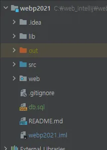

일단 db.sql이라는 파일을 만들어 보겠습니다.

그리고 다음과 같이 적어서 db.sql에 저장합니다.

```java
DROP DATABASE if EXISTS swaig ;
CREATE DATABASE swaig DEFAULT CHARACTER SET UTF8;
USE swaig ;
CREATE TABLE Example (
 `oid` INT(11) NOT NULL AUTO_INCREMENT,
 `title` VARCHAR(100) DEFAULT NULL,
 `content` VARCHAR(100) DEFAULT NULL,
 `date` DATE DEFAULT NULL, PRIMARY KEY (`oid`)
) ;
INSERT INTO Example(oid, title, content, DATE) VALUES(1,'title1','content1','2021-06-26');
INSERT INTO Example(title, content, DATE) VALUES('title2','content2','2021-06-27');
INSERT INTO Example(title, content, DATE) VALUES('title3','content3','2021-06-28');
```

heidiSQL을 열고 로그인 합니다.

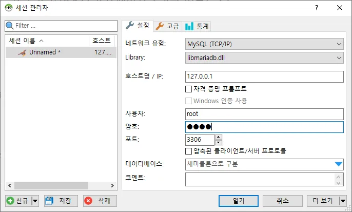

저는 아이디와 비밀번호를 root와 \*\*\*\*으로 했습니다.

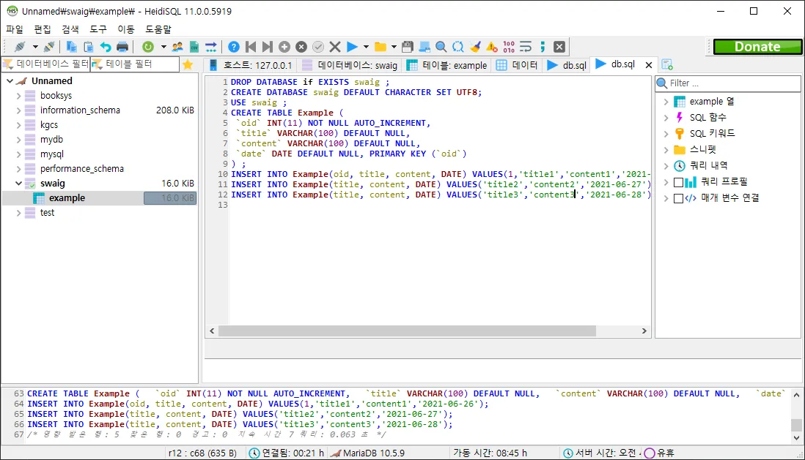

앞서 작성했던 db.sql을 열어주고 실행하게되면 위와같이 뜹니다.

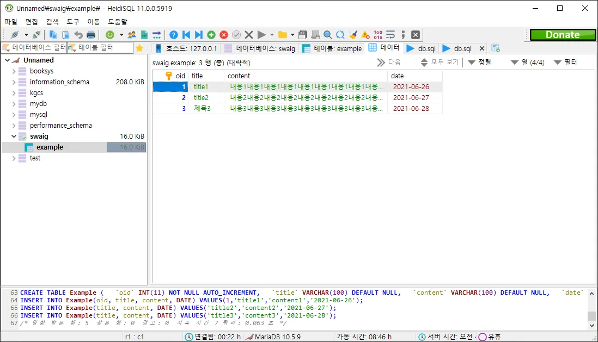

## 2\. 필수 클래스 준비

클래스 준비에 앞서 라이브러리 적용이 필요합니다.

저는 DBUtils와 Gson을 사용할 것이기에 다음과 같은 jar 파일을 적용해줘야 합니다.

[c3p0-0.9.1.1.jar](https://mvnrepository.com/artifact/c3p0/c3p0/0.9.1.1)

[commons-dbutils-1.5.jar](https://mvnrepository.com/artifact/commons-dbutils/commons-dbutils/1.5)

[gson-2.8.6.jar](https://mvnrepository.com/artifact/com.google.code.gson/gson/2.8.6)

[mariadb-java-client-2.6.0.jar](https://mvnrepository.com/artifact/org.mariadb.jdbc/mariadb-java-client/2.6.0)

위 파일들을 다운받으신 후,

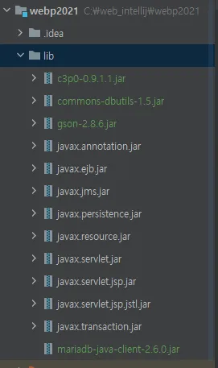

여기에 위치해주세요

그리고 File- Project Structure - Libraries - lib 을 눌러주시고 +를 눌러서 방금 다운받은 jar 파일 네개를 지정하고 OK 합니다.

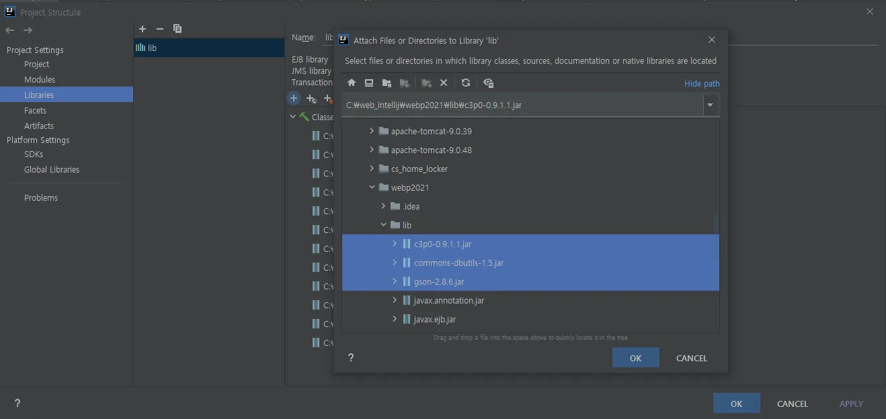

추가되면 다음과 같이 그림이 나옵니다.

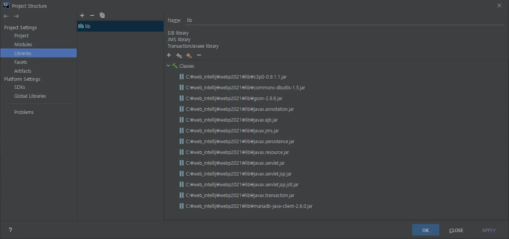

OK 눌러주시면 외부 라이브러리 사용 준비는 끝납니다.

이제 앞선 게시글까지 작성했던 코드에 이어서 src 폴더를 다음과 같이 추가해주세요.

Config클래스, DAO클래스, DTO클래스가 필요합니다.

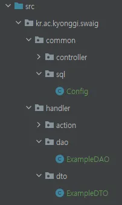

일단 common.sql패키지의 Config 클래스를 작성해보겠습니다.

이 클래스는 mariaDB와 통신하기위한 클래스로, 앞으로 모든 로그인과 접속을 대신해줄 클래스입니다.

```java
package kr.ac.kyonggi.swaig.common.sql;

import java.sql.Connection;
import java.sql.DriverManager;

// Enum Singleton
public class Config {
	/**
	 * DB 로그인을 대신 해주는 클래스 입니다. 로그인만 대신해주고, 쿼리문을 입력하는건 외부(DAO)에서 DBUtils 라이브러리를 사용합니다.
	 * */
	private Config() {}
	private static class Singleton {
		private static final Config instance = new Config();
	}

	public static Config getInstance() {
		return Singleton.instance;
	}
	// DB 커넥션 Variable
	private Connection conn = null;
	// DB 정보
	private String url ="jdbc:mariadb://localhost:3306/swaig?user=root&password=****";

	public Connection sqlLogin() {
		try {
			Class.forName("org.mariadb.jdbc.Driver");
			conn = DriverManager.getConnection(url);
		} catch (Exception e) {
			e.printStackTrace();
			System.out.println("DB 연결 실패. mariaDB의 아이디 비밀번호가 Config 클래스와 일치하는지 확인해주세요.");
		}
		return conn; //DB 사용을 요구했던 메소드에게 로그인 정보를 돌려줌.
	}
}
```

이어서 DAO 클래스를 만들어 보겠습니다.

DAO클래스는 mariaDB에 접근할 직접적인 클래스입니다.

```java
package kr.ac.kyonggi.swaig.handler.dao;

import com.google.gson.Gson;
import com.google.gson.reflect.TypeToken;
import kr.ac.kyonggi.swaig.common.sql.Config;
import kr.ac.kyonggi.swaig.handler.dto.ExampleDTO;
import org.apache.commons.dbutils.DbUtils;
import org.apache.commons.dbutils.QueryRunner;
import org.apache.commons.dbutils.handlers.MapListHandler;

import java.sql.Connection;
import java.sql.SQLException;
import java.util.ArrayList;
import java.util.List;
import java.util.Map;

public class ExampleDAO {
    public static ExampleDAO it;

    public static ExampleDAO getInstance() { //인스턴스 생성
        if (it == null)
            it = new ExampleDAO();
        return it;
    }
  
    public ArrayList<ExampleDTO> getAllExampleData() { //모든 Example 데이터를 받아오기
        List<Map<String, Object>> listOfMaps = null;
        Connection conn = Config.getInstance().sqlLogin();
        try {
            QueryRunner queryRunner = new QueryRunner();
            listOfMaps = queryRunner.query(conn, "SELECT * FROM `Example`", new MapListHandler());
        } catch (SQLException se) {
            se.printStackTrace();
        } finally {
            DbUtils.closeQuietly(conn);
        }
        Gson gson = new Gson();
        ArrayList<ExampleDTO> selectedList = gson.fromJson(gson.toJson(listOfMaps), new TypeToken<List<ExampleDTO>>() {
        }.getType()); //위에서 불러온 DB를 ExampleDTO 타입으로 만들어서 return 해줌
        return selectedList;
    }
}
```

DBUtils를 사용하여 mariaDB에 접근하고 있고, 돌려받은 DB를 DTO형식과 JSON(GSON)에 태워서 return 합니다.

이어서 DTO 클래스를 만들어 보겠습니다.

이 클래스는 sql로 부터 받은 db를 자바로 변환하는 클래스입니다.

```java
package kr.ac.kyonggi.swaig.handler.dto;

public class ExampleDTO {
    private String oid;
    private String title;
    private String content;
    private String date;

    public String getOid() {
        return oid;
    }

    public void setOid(String oid) {
        this.oid = oid;
    }

    public String getTitle() {
        return title;
    }

    public void setTitle(String title) {
        this.title = title;
    }

    public String getContent() {
        return content;
    }

    public void setContent(String content) {
        this.content = content;
    }

    public String getDate() {
        return date;
    }

    public void setDate(String date) {
        this.date = date;
    }

}
```

지난 시간에 만들었던 ExampleAction 클래스의 내용을 다음과 같이 수정합니다.

```java
package kr.ac.kyonggi.swaig.handler.action;

import com.google.gson.Gson;
import kr.ac.kyonggi.swaig.common.controller.Action;
import kr.ac.kyonggi.swaig.handler.dao.ExampleDAO;

import javax.servlet.http.HttpServletRequest;
import javax.servlet.http.HttpServletResponse;

public class ExampleAction implements Action {
    @Override
    public String execute(HttpServletRequest request, HttpServletResponse response) throws Exception {
        Gson gson = new Gson();
        request.setAttribute("ExampleData", gson.toJson(ExampleDAO.getInstance().getAllExampleData()));
        return "RequestDispatcher:jsp/example.jsp";
    }
}
```

보시다시피 지난번에는 그저 jsp 경로만 return 해줬다면, 이번에는 DAO를 실행하여 돌려받는 데이터를 setAttribute 해주고 있습니다.

여기까지가 클래스 작업이었습니다.

이제 톰캣이 JSP와 ExampleData를 잘 결합할 수 있도록 지시하는 것이 필요합니다.

## 3\. JSP에 데이터 연결하기

지난번에 작성했던 연습용 페이지에 데이터를 넣기 위해 example.jsp를 열어줍니다.

앞서 설정한 setAttribute의 DB를 받기 위해 다음과 같이 작업해야합니다. (최종 코드는 마지막에 올리겠습니다.)

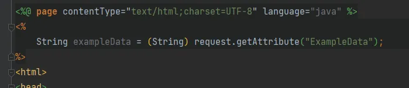

현재 페이지 구조상 html이 반복적으로 아래처럼 카드를 만들고 있는데

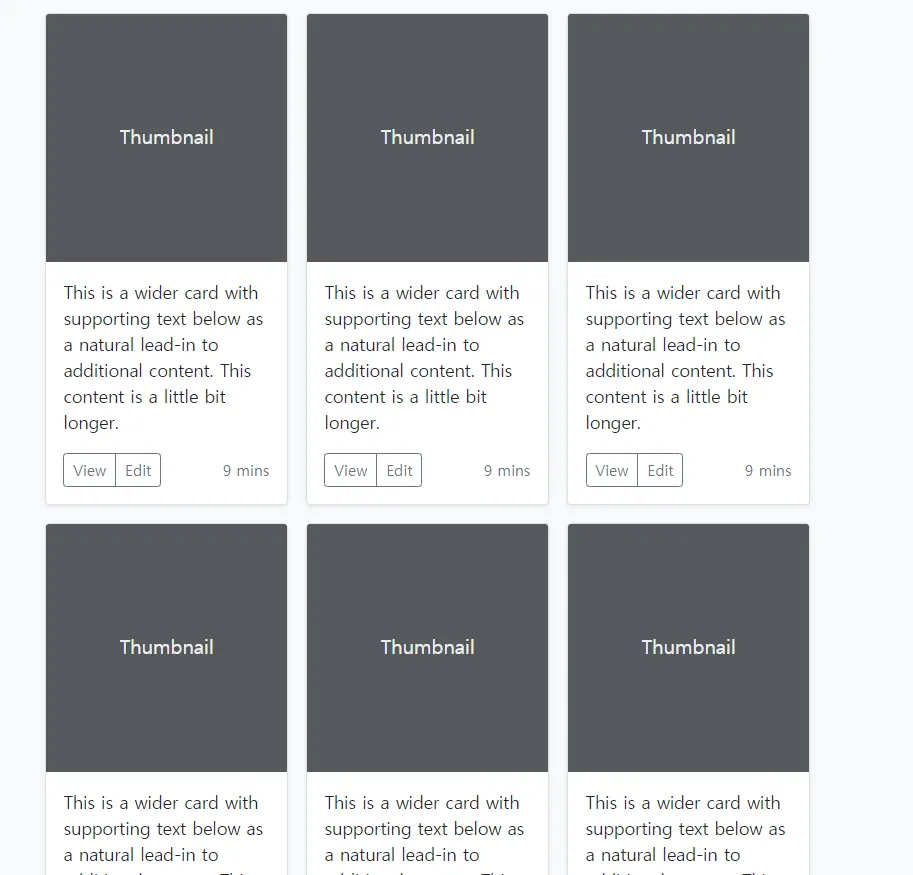

저는 일단 html 태그에 반복적인 구조를 카드 하나만 남기고 지워보겠습니다.

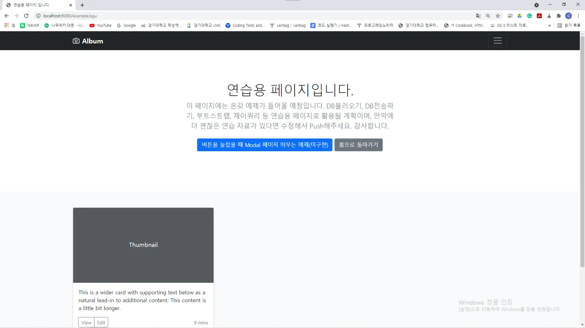

그리고 이제 이 카드에 DB를 있는 대로 반복해서 찍어내려고 합니다.

이제 제이쿼리를 사용하여 카드 반복을 할 것인데

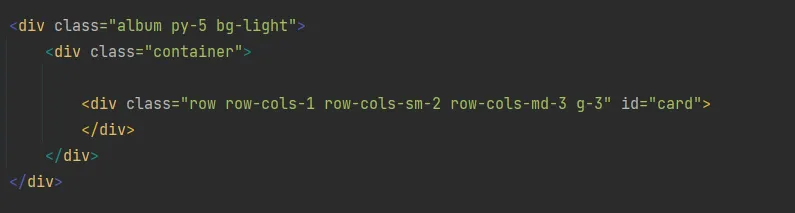

기존 코드의 반복구조의 상위 div에 id를 정해줍니다.

그리곤 jQuery를 활용하여 해당 id에 태그를 넣어줄 것입니다.

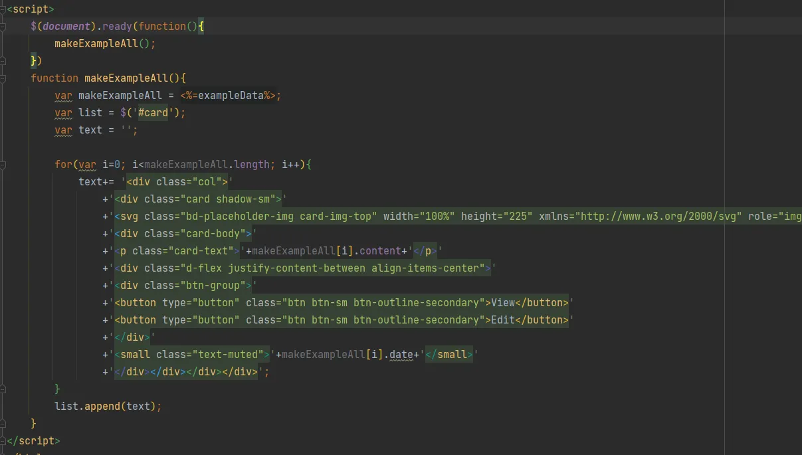

이런식으로 for문을 사용하여 앞서 getAttribute한 DB를 넣어서 반복적인 카드 구조를 만들 수 있습니다.

실행 결과는 다음과 같습니다.

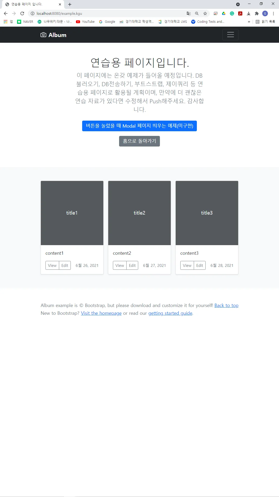

입력한 DB가 3개 이므로 위와같이 뜹니다.

example.jsp 코드 전문은 다음과 같습니다.

```html

<%@ page contentType="text/html;charset=UTF-8" language="java" %>
<%
    String exampleData = (String) request.getAttribute("ExampleData");
    System.out.println(exampleData);
%>
<html>
<head>
    <title>연습용 페이지 입니다.</title>
    <link href="https://cdn.jsdelivr.net/npm/bootstrap@5.0.2/dist/css/bootstrap.min.css" rel="stylesheet" integrity="sha384-EVSTQN3/azprG1Anm3QDgpJLIm9Nao0Yz1ztcQTwFspd3yD65VohhpuuCOmLASjC" crossorigin="anonymous">
    <script src="https://cdn.jsdelivr.net/npm/bootstrap@5.0.2/dist/js/bootstrap.bundle.min.js" integrity="sha384-MrcW6ZMFYlzcLA8Nl+NtUVF0sA7MsXsP1UyJoMp4YLEuNSfAP+JcXn/tWtIaxVXM" crossorigin="anonymous"></script>
    <script  src="http://code.jquery.com/jquery-latest.min.js"></script>
    <style>
        .bd-placeholder-img {
            font-size: 1.125rem;
            text-anchor: middle;
            -webkit-user-select: none;
            -moz-user-select: none;
            user-select: none;
        }

        @media (min-width: 768px) {
            .bd-placeholder-img-lg {
                font-size: 3.5rem;
            }
        }
    </style>
</head>
<body>

<header>
    <div class="collapse bg-dark" id="navbarHeader">
        <div class="container">
            <div class="row">
                <div class="col-sm-8 col-md-7 py-4">
                    <h4 class="text-white">연습용 페이지</h4>
                    <p class="text-muted">이 페이지의 뼈대는 부트스트랩5.0의 example album에서 가져왔습니다. 디자인에 관한 자세한 내용은 우측 링크에서 확인하세요</p>
                </div>
                <div class="col-sm-4 offset-md-1 py-4">
                    <h4 class="text-white">디자인 관련 참고 링크</h4>
                    <ul class="list-unstyled">
                        <li><a href="https://getbootstrap.com/" class="text-white">부트스트랩 공식 홈페이지</a></li>
                        <li><a href="https://getbootstrap.com/docs/5.0/getting-started/introduction/" class="text-white">부트스트랩 공식 문서</a></li>
                        <li><a href="https://getbootstrap.com/docs/5.0/examples/" class="text-white">부트스트랩 각종 예시</a></li>
                        <li><a href="https://getbootstrap.com/docs/5.0/examples/cheatsheet/" class="text-white">부트스트랩 치트 시트</a></li>
                    </ul>
                </div>
            </div>
        </div>
    </div>
    <div class="navbar navbar-dark bg-dark shadow-sm">
        <div class="container">
            <a href="#" class="navbar-brand d-flex align-items-center">
                <svg xmlns="http://www.w3.org/2000/svg" width="20" height="20" fill="none" stroke="currentColor" stroke-linecap="round" stroke-linejoin="round" stroke-width="2" aria-hidden="true" class="me-2" viewBox="0 0 24 24"><path d="M23 19a2 2 0 0 1-2 2H3a2 2 0 0 1-2-2V8a2 2 0 0 1 2-2h4l2-3h6l2 3h4a2 2 0 0 1 2 2z"/><circle cx="12" cy="13" r="4"/></svg>
                <strong>Album</strong>
            </a>
            <button class="navbar-toggler" type="button" data-bs-toggle="collapse" data-bs-target="#navbarHeader" aria-controls="navbarHeader" aria-expanded="false" aria-label="Toggle navigation">
                <span class="navbar-toggler-icon"></span>
            </button>
        </div>
    </div>
</header>

<main>

    <section class="py-5 text-center container">
        <div class="row py-lg-5">
            <div class="col-lg-6 col-md-8 mx-auto">
                <h1 class="fw-light">연습용 페이지입니다.</h1>
                <p class="lead text-muted">이 페이지에는 온갖 예제가 들어올 예정입니다. DB불러오기, DB전송하기, 부트스트랩, 제이쿼리 등 연습용 페이지로 활용될 계획이며, 만약에 더 괜찮은 연습 자료가 있다면 수정해서 Push해주세요. 감사합니다.</p>
                <p>
                    <a href="#" class="btn btn-primary my-2">버튼을 눌렀을 때 Modal 페이지 띄우는 예제(미구현)</a>
                    <a href="main.kgu" class="btn btn-secondary my-2">홈으로 돌아가기</a>
                </p>
            </div>
        </div>
    </section>

    <div class="album py-5 bg-light">
        <div class="container">

            <div class="row row-cols-1 row-cols-sm-2 row-cols-md-3 g-3" id="card">
            </div>
        </div>
    </div>

</main>

<footer class="text-muted py-5">
    <div class="container">
        <p class="float-end mb-1">
            <a href="#">Back to top</a>
        </p>
        <p class="mb-1">Album example is &copy; Bootstrap, but please download and customize it for yourself!</p>
        <p class="mb-0">New to Bootstrap? <a href="/">Visit the homepage</a> or read our <a href="../getting-started/introduction/">getting started guide</a>.</p>
    </div>
</footer>
</body>
<script>
    $(document).ready(function(){
        makeExampleAll();
    })
    function makeExampleAll(){
        var makeExampleAll = <%=exampleData%>;
        var list = $('#card');
        var text = '';

        for(var i=0; i<makeExampleAll.length; i++){
            text+= '<div class="col">'
                +'<div class="card shadow-sm">'
                +'<svg class="bd-placeholder-img card-img-top" width="100%" height="225" xmlns="http://www.w3.org/2000/svg" role="img" aria-label="Placeholder: Thumbnail" preserveAspectRatio="xMidYMid slice" focusable="false"><title>Placeholder</title><rect width="100%" height="100%" fill="#55595c"/><text x="50%" y="50%" fill="#eceeef" dy=".3em">'+makeExampleAll[i].title+'</text></svg>'
                +'<div class="card-body">'
                +'<p class="card-text">'+makeExampleAll[i].content+'</p>'
                +'<div class="d-flex justify-content-between align-items-center">'
                +'<div class="btn-group">'
                +'<button type="button" class="btn btn-sm btn-outline-secondary">View</button>'
                +'<button type="button" class="btn btn-sm btn-outline-secondary">Edit</button>'
                +'</div>'
                +'<small class="text-muted">'+makeExampleAll[i].date+'</small>'
                +'</div></div></div></div>';
        }
        list.append(text);
    }
</script>
</html>
```

참고로 제이쿼리 라이브러리를 삽입하였습니다.

## 4\. 이 게시글을 통해 확장된 구조

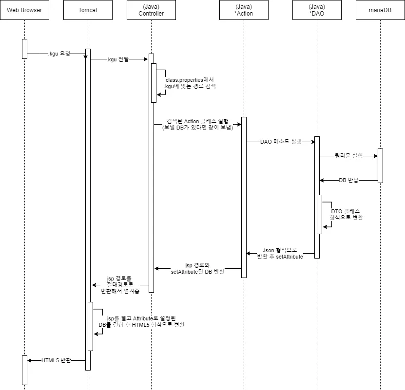
