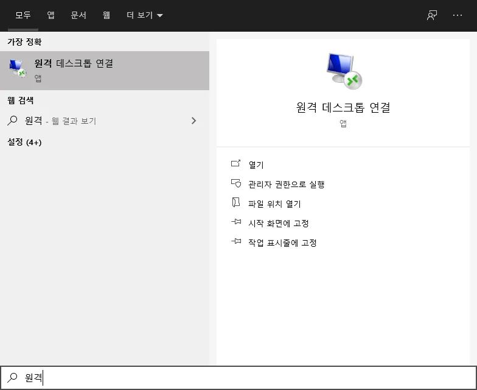
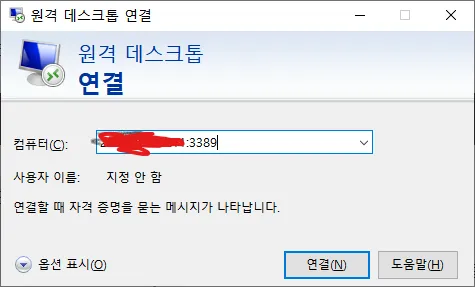
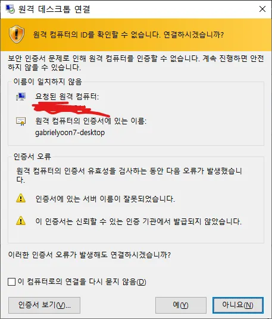
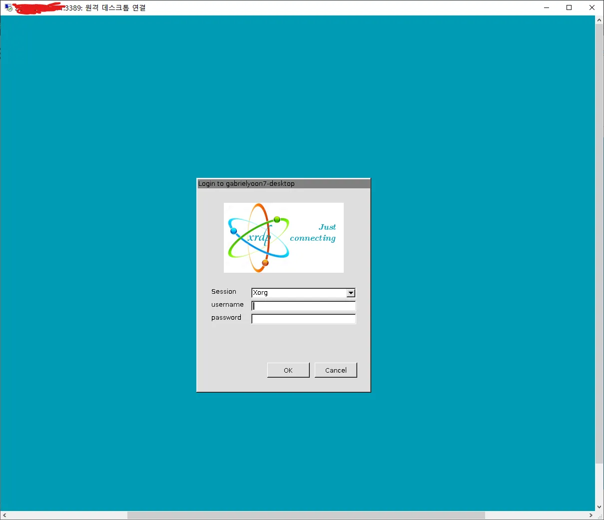
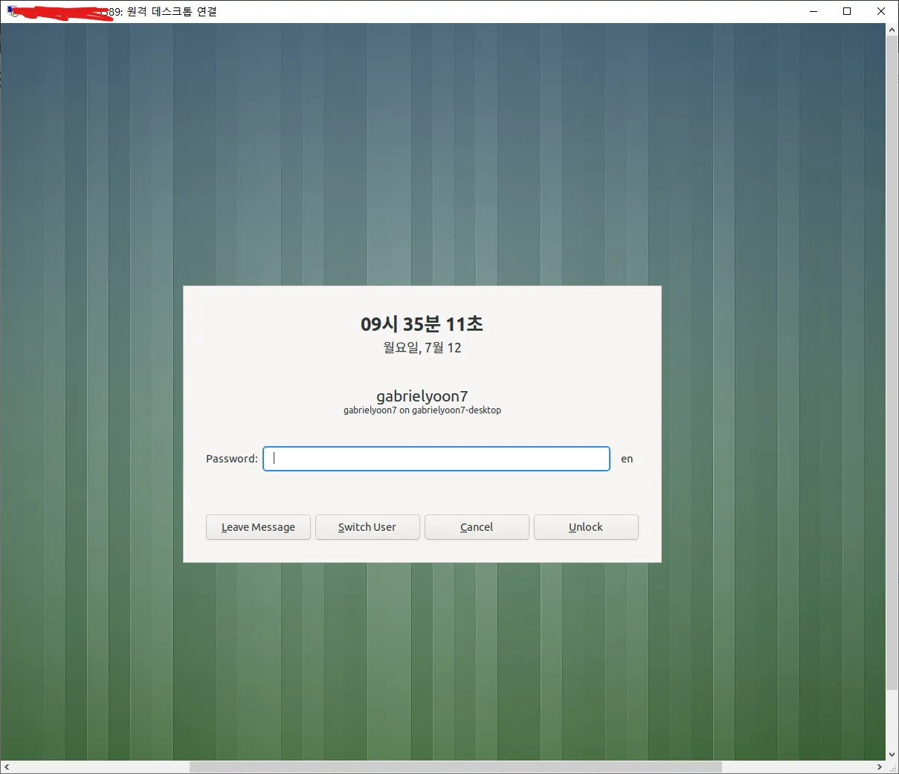
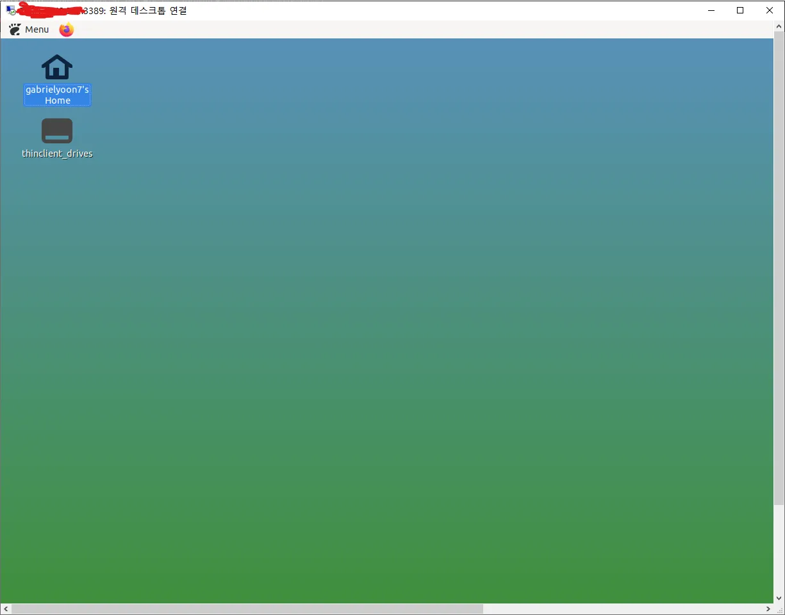

> 이 글은 2021-07-12에 티스토리 블로그(leirbag.tistory.com/86)에 처음 작성한 글을 옮겨온 것입니다.

이 게시글은 라즈베리파이용 우분투의 쉬운 원격 접속을 위한 글입니다.

x86이나 AMD64버전의 우분투는 그냥 anydesk 사용하시면 됩니다.

라즈비안 OS도 우분투도 같은 데비안계열이고

ARM기반으로 제작되었으니 anydesk가 돌아갈거라고 생각했는데

설치만 가능하고 실행은 안됩니다.. 팀뷰어도 마찬가지..

이외 기타 프로그램들은 arm 지원 자체를 하지 않습니다.

라즈베리파이에 우분투를 올리는 것을 하는 사람이 별로 없는지 자료도 너무 빈약하고

해외 자료도 굉장히 추상적으로 나와 있어 문서 파편화가 되어있습니다.

한국어로 작성된 문서들 역시 이걸 제대로 다루는게 없어서, 제가 까먹을까봐 적습니다.

(다들 터미널로 작업하셔서 그런 것일 수도 있습니다.)

xrdp와 xorg를 사용하여 접속하는 방법입니다.

## 1\. 라즈베리파이용 우분투 환경설정 방법

<table><tbody><tr><td>0. 라즈베리파이에 우분투 설치 후 기본 설정 나중에 문서 작성 예정   1. xrdp 설치 sudo&nbsp;apt-get&nbsp;install&nbsp;xrdp sudo&nbsp;apt-get&nbsp;update sudo&nbsp;apt-get&nbsp;install&nbsp;mate-core&nbsp;mate-desktop-environment&nbsp;mate-notification-daemon   2. 방화벽 열기 sudo&nbsp;ufw&nbsp;allow&nbsp;3389/tcp sudo&nbsp;ufw&nbsp;allow&nbsp;22/tcp   3. 공유기로 포트포워딩 설정 공유기로 ip를 외부에 공개토록 설정하고, 포트포워딩 설정을 해줘야합니다. 포트번호 3389로 설정해서 열어줍니다. 3-1. 고급설정 - 네트워크관리 - DHCP 서버 설정 현재&nbsp;접속중인&nbsp;데스크탑(서버)컴퓨터를&nbsp;DHCP&nbsp;서버&nbsp;주소관리&nbsp;명단에&nbsp;등록 3-2. 고급설정 - NAT/라우터 관리 - 포트포워드 설정 -&nbsp;ssh용 현재&nbsp;접속된&nbsp;ip주소&nbsp;체크&nbsp;후&nbsp;프로토콜은&nbsp;TCP,&nbsp;외부포트&nbsp;및&nbsp;내부&nbsp;포트는&nbsp;22~22로&nbsp;통일&nbsp;후&nbsp;적용 -&nbsp;xrdp용 현재 접속된 ip주소 체크 후 프로토콜은 TCP, 외부 포트 및 내부 포트는 3389~3389로 통일 후 적용 </td></tr></tbody></table>

## 2\. 윈도우에서 접속방법

라즈베리파이를 동작시킵니다. **(전원만 넣고 로그인은 하지 않습니다. 로그인 하면 충돌나서 튕김)**

윈도우키 - 원격 데스크톱 연결 실행

ip와 앞서 설정해준 포트번호를 적습니다.

ex) xxx.xxx.xxx.xxx:3389

여기에서 라즈베리파이가 먹통인 경우에는 다음 화면이 나오지 않습니다.

만약 이 화면이 나오지 않는다면

1\. 인터넷 설정이 제대로 되었는지 (공유기 설정)

2\. 라즈베리파이가 켜져있는지

3\. 본 기기에서 root계정으로 로그인을 하지 않았는지 생각해봅니다.

만약 아무 이상이 없다면 다음 화면이 나옵니다.

예 클릭

session은 Xorg로 하고, 평소에 우분투에 로그인 하듯 루트계정과 비밀번호를 입력합니다.

지금부터는 라즈베리파이에서 윈도우OS로 화면을 실시간 전송하고 있는 것입니다.

기존에 사용하던 우분투UI랑 다르지만.. 우분투 마테 모드로 돌아가는 것으로 생각됩니다.

다시한번 로그인 해줍니다.

끝
