> 이 글은 2021-12-09에 티스토리 블로그(leirbag.tistory.com/103)에 처음 작성한 글을 옮겨온 것입니다.

내부적으로 자료 공유를 목적으로 작성하는 글

(우분투 환경 관련해서는 따로 정리를 하겠음)

두 개의 프로젝트를 동시에 설치하려고 합니다. 잘 따라와주세요.

## 1\. 윈도우 환경 구축 관련

<table><tbody><tr><td>&nbsp;</td><td>webp</td><td>webp2021</td></tr><tr><td>IDE</td><td colspan="2">IntelliJ Ultimate</td></tr><tr><td>Java</td><td>openJDK1.8</td><td>openJDK16</td></tr><tr><td>JavaEE</td><td>JavaEE6</td><td>JavaEE8</td></tr><tr><td>Tomcat</td><td colspan="2">Tomcat 9</td></tr><tr><td>Database</td><td>MySQL 8</td><td>MariaDB 10</td></tr></tbody></table>

지난 활동에서 환경 세팅이 그대로시라면 인텔리제이와 MariaDB 설치가 되어있을 것으로 생각됩니다.

## 2.  Tomcat 및 프로젝트 위치

지난 학기 중 활동 간 여러 팀원분들의 폴더를 봤을 때,

제가 영상으로 소개드렸던 위치와 다르게 다양한 위치에 설치해오셨다는 사실을 알게되었습니다.

어떤 분은 D드라이브에 설치하고.. 어떤 분은 인텔리제이 기본 폴더에 저장하고 등등..

저도 이 부분을 왜 지켜야하는지는 잘 모르겠으나,

전임자가 이 위치에 프로젝트를 넣어야 오류가 발생하지 않는다고 했던 점을 보았을 때

내부기능 중 어떤 것에 영향을 끼칠 수도 있어서 그런가 싶기도 합니다.

(사실 오류는 둘째 치고, 이 위치에 있는게 나중에 WAR파일 찾기 쉽긴 합니다.)

따라서 Tomcat 위치부터 다시 잡고 가겠습니다.

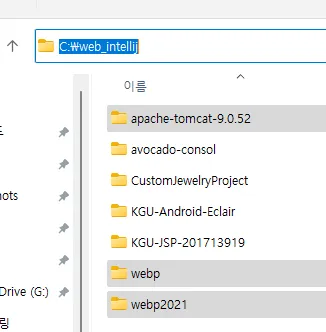

일단 C 드라이브에 web\_intellij라는 폴더를 만들어준 다음, 그 위치에 apacahe-tomcat-9.0.xx 폴더가 와야합니다.

**톰캣 폴더 위치가 동일하다구요? 그러면 스크롤을 내리셔서 다음 번호로 넘어가도 좋습니다.**

전에 쓰시던 톰캣 복붙해오셔도 좋지만, 톰캣 홈페이지 가서 새로 받아오셔도 좋습니다.

단, 버전은 반드시 9버전을 사용합니다. (10버전 부터는 패키지 이름 변경으로 인한 호환 문제가 존재)

그리고 후술하겠지만, webp폴더와 webp2021폴더도 이 위치에 와야합니다.

## 3\. 인텔리제이로부터 프로젝트 클론받기

webp 먼저 받겠습니다.

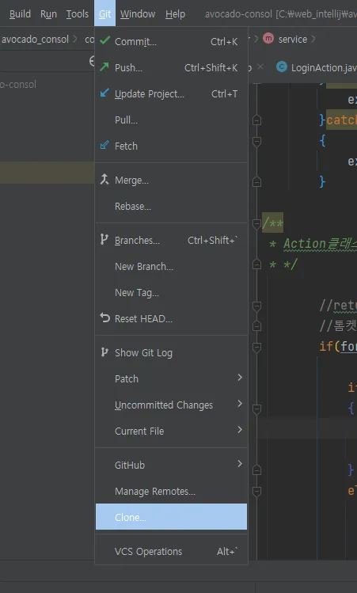

인텔리제이 상단에 Git - Clone...을 누릅니다.

(만약에 Git 탭이 없으시면 대신에 VCS라는 탭이 있을텐데 거기에서 Enable Version Control 어쩌구 버튼 누르고 Git 선택하면 활성화 됩니다.)

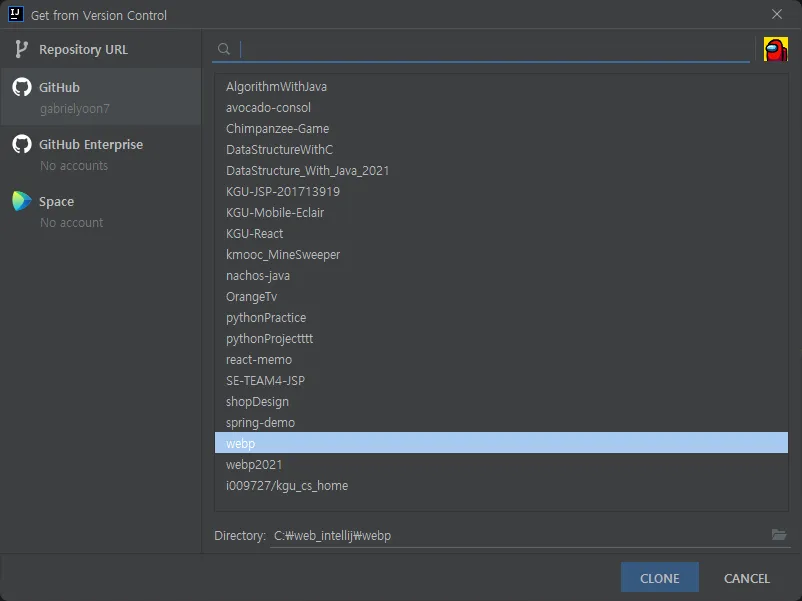

깃허브 로그인이 되어있으시다면 좌측에 GitHub탭을 눌러서 webp을 선택합니다.

그리고 하단 디렉토리를 위와 같이 설정 해줍니다.

프로젝트가 안뜨신다구요? 메일함에서 깃허브 프로젝트 초대 메일을 확인하시고 수락해주세요!

그리고 Clone 버튼을 눌러주시면 됩니다.

약간의 로딩 시간이 지나면 다음과 같은 팝업이 뜹니다.

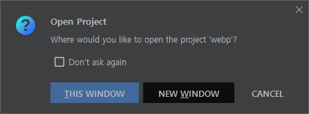

This Window를 눌러주세요

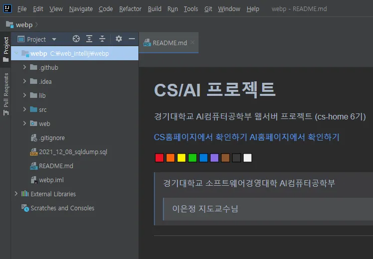

클론 받으셨다면 webp2021도 받아볼게요.

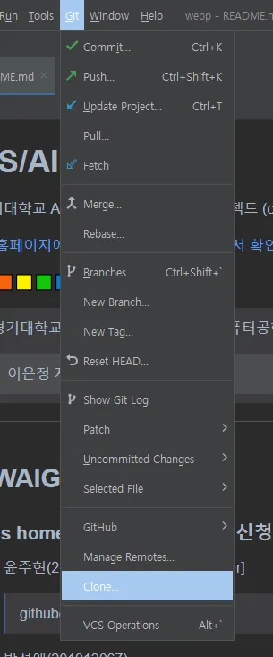

앞선 방법과 마찬가지로 Git - Clone을 눌러주시고

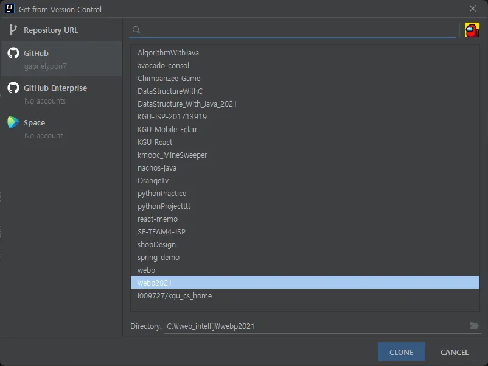

webp2021을 위 디렉토리로 정해줍니다.

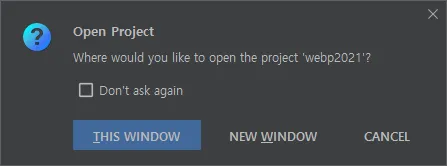

마찬가지로 This Window 해주시면 됩니다.

약간의 로딩 시간이 지나면 다음과 같이 뜹니다.

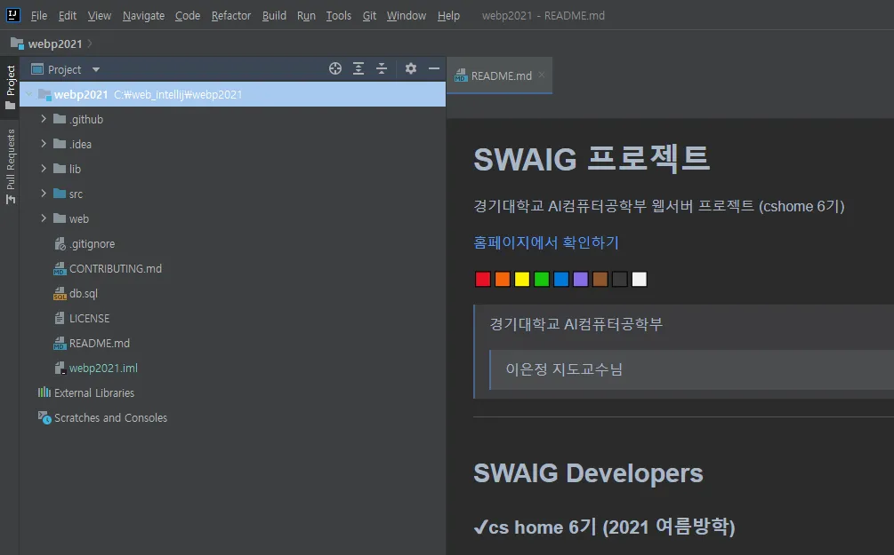

## 4\. 웹 프레임워크 환경 설정하기 및 톰캣 연결

웹 프레임워크 설정 작업은 webp2021에만 필요한 작업입니다.

이유는 모르겠으나, webp는 자동으로 잡아주는 반면에 webp2021은 수동으로 잡아줘야합니다.

아래 링크의 설명과 약간 다른부분이 있다면... 여러분은 이미 openjdk16버전을 다운 받으셔서 다운로드하는 과정을 건너 뛸 수도 있습니다. (webp2021도 자바16씁니다. webp는 자바1.8)

[\[IntelliJ\] JSP 클론 후 환경설정](../2021-06-24-tistory-82/)

> [**\[IntelliJ\] JSP 클론 후 환경설정**](../2021-06-24-tistory-82/)  
> 클론 후 해야하는 작업 openJDK16 설치 File - Project Structure - SDKs +버튼 누르고 Download JDK 누르고 Version 16에 위 사진처럼 맞춰준 다음 다운로드 -------------------------------------------------..

webp2021에 대해서만 위 링크와 같이 진행해주세요.

아마 마지막 부분에 있는 재생버튼을 누르면 오류가 날 것입니다.

디비 구축이 안되어서 그런 것이니 일단 서버 정지 해주세요

이제 다시 webp으로 넘어가겠습니다.

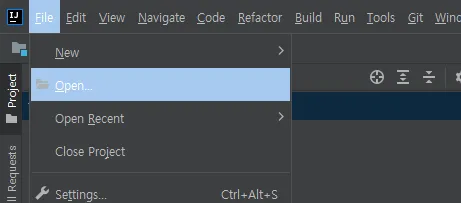

File - Open 누릅니다.

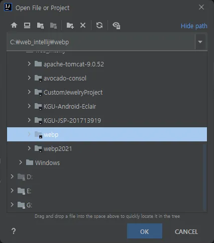

webp 누르고 OK 후 This Window 누릅니다.

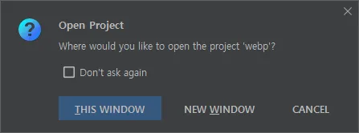

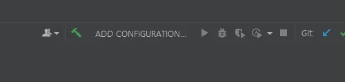

Add configuration 눌러주시고

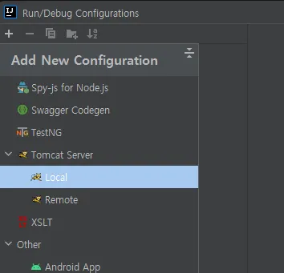

Tomcat Server - Local

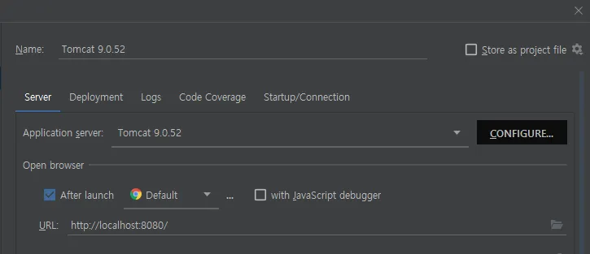

앞선 webp2021 설정을 잘 따라왔다면 상단의 Application server가 자동으로 잡혀있을 것 입니다.

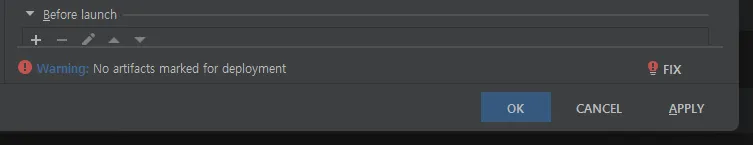

하단의 FIX를 누릅니다.

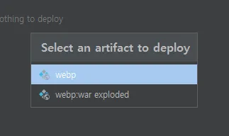

이게 안뜨는 사람도 있겠지만, 뜬다면 webp를 눌러주시고, 아니라면 webp:war exploded를 누릅니다.

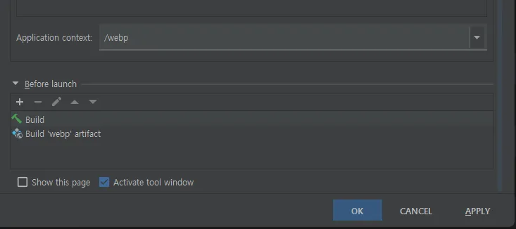

 Application context를 /webp으로 만들고 OK 누릅니다.

혹시 몰라 적지만 인텔리제이에서 자바 1.8이 안깔려 있을 수도 있습니다.

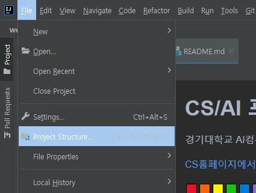

File - Project Structure에 오시고

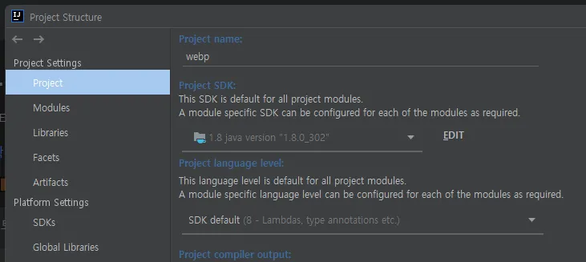

Project SDK가 위 그림처럼 1.8이 아니라면

앞선 링크에서 보여드렸던 것 처럼

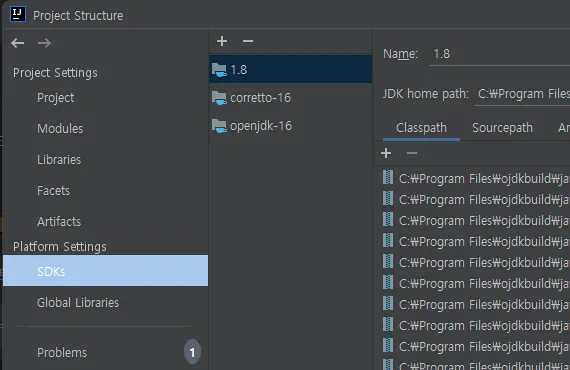

SDKs 탭에 1.8을 따로 받아주셔야 합니다.

아마 이 부분은 자동으로 되어있을 것으로 생각됩니다.

이제 DB 세팅을 하러 갑시다.

## 5\. 디비 적용

 지금 켜져있는 것이 webp 프로젝트니깐 webp 프로젝트 먼저 해보겠습니다.

전에 제가 드렸던 링크를 잘 따라오셨다면 MySQL이 설치되어있을텐데요

윈도우키를 누르고

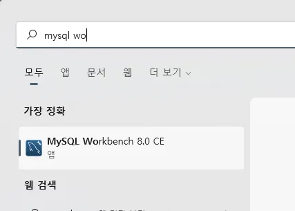

위 사진처럼 검색하시면 MySQL Workbench 8.0 CE가 나옵니다.

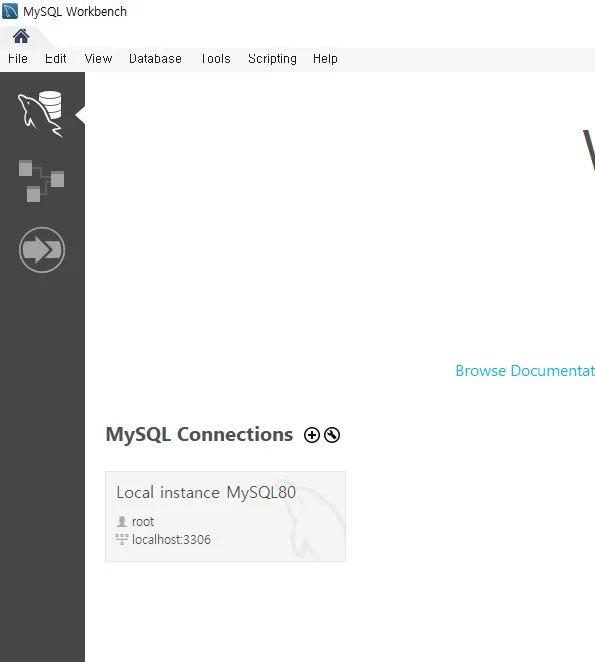

Local instance MySQL80을 누릅니다.

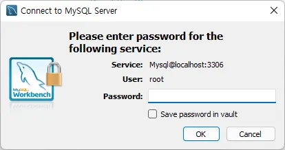

저희 SQL 비밀번호를 적습니다. (다들 아시죠?)

접속에 성공하셨다면 좌측 상단의 두번째 아이콘을 누릅니다.

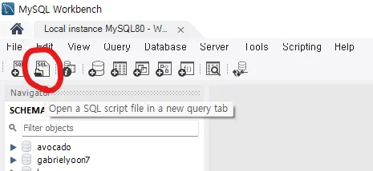

그 다음 C드라이브 - web\_intellij - webp 폴더에 들어와서 다음 sql 파일을 엽니다.

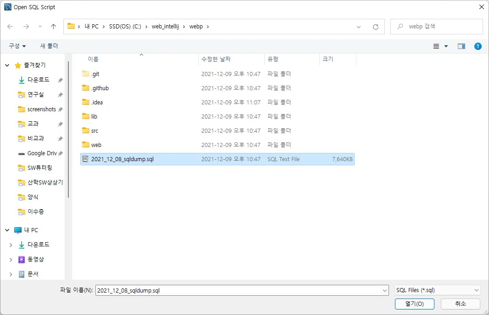

열렸으면 왼쪽 번개버튼을 누릅니다.

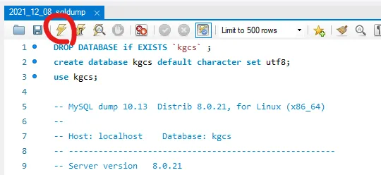

하단 output이 다음과 같이 처리가 됨을 확인할 수 있습니다.

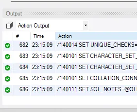

DB가 잘 들어왔다면 좌측 Schemas에서 새로고침을 하신다음

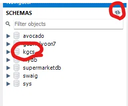

kgcs 가 생성되었는지 봅니다.

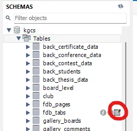

이렇게 펼친다음 위의 버튼을 누르면

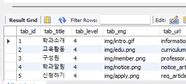

DB 현황도 볼 수 있습니다.

이번엔 webp2021의 DB를 실행하겠습니다. 일단 HeidiSQL을 실행합니다.

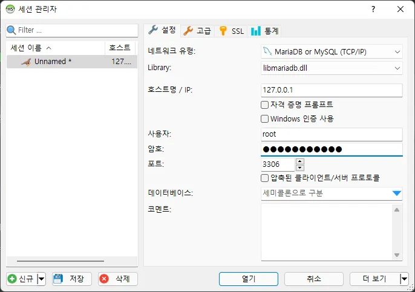

이 부분은 하도 하셔서 다들 어떻게 하는지 아시죠?

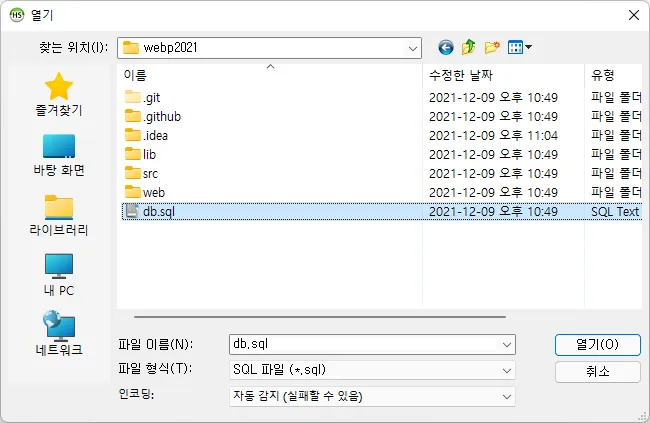

C드라이브 - intellij - webp2021폴더에 오셔서 db.sql을 열고 실행합니다.

## 6\. 인텔리제이에서 톰캣 실행

여기까지 잘 따라오셨다면 이제 두 프로젝트 모두 톰캣 실행이 될 것입니다.

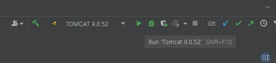

(단, 두 프로젝트를 동시실행하는 것은 불가능합니다.)

포트번호를 둘 다 8080을 써서 그래요.

프로젝트를 어떻게 open 하는지는 위에서 계속 했으니 아실테니 설명을 생략하겠습니다.

webp는 어떤 오류인진 모르겠으나, 실행 시 다음과 같은 오류 메세지가 뜹니다.

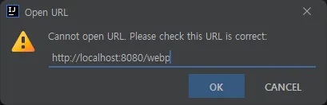

위 링크를 직접 크롬에 입력해주시면

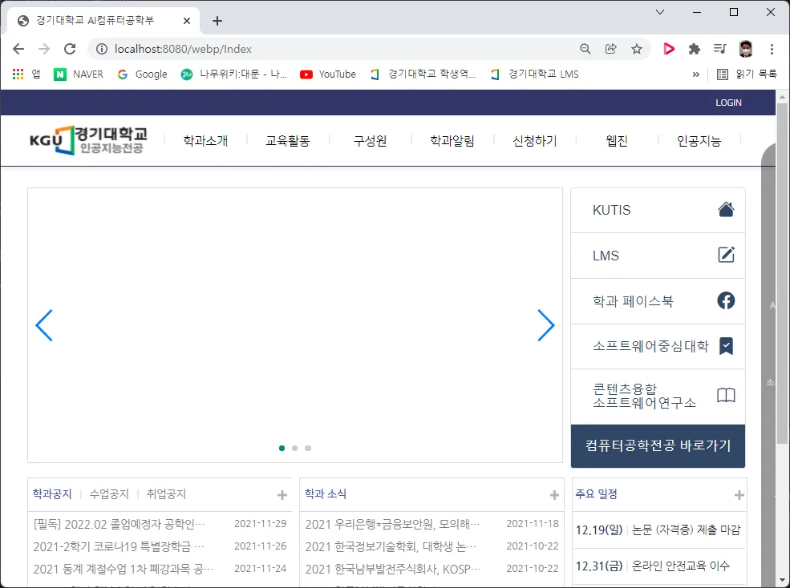

로컬 환경에서 동작하는 것을 확인하실 수 있습니다.

webp2021은 톰캣을 실행하면

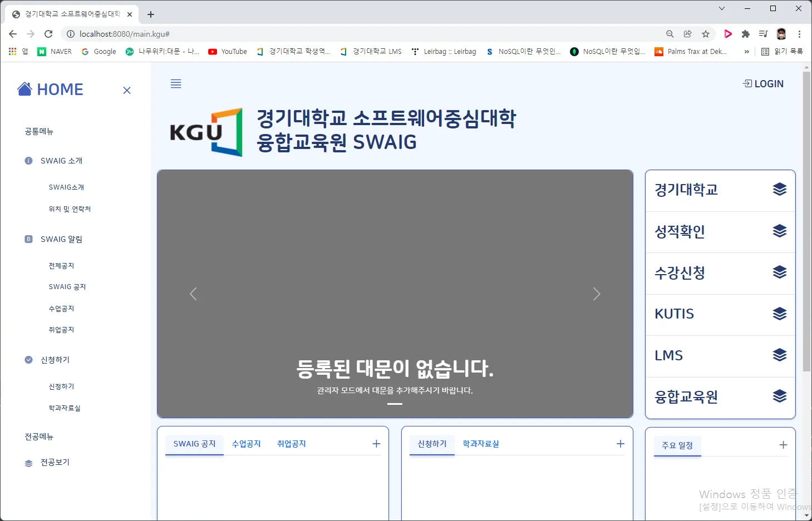

이렇게 잘 뜹니다.

두 프로젝트 주소의 차이는 context path가 있냐 없냐도 있습니다.

이상입니다.
