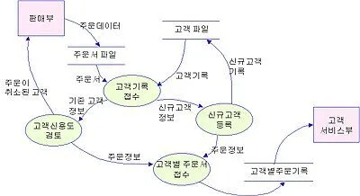
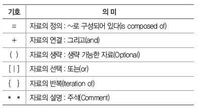
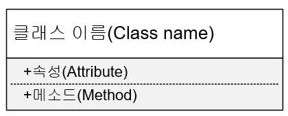

> 이 글은 2022-01-28에 티스토리 블로그(leirbag.tistory.com/109)에 처음 작성한 글을 옮겨온 것입니다.

## Chapter 01 : 요구사항 확인

### 1\. 현행 시스템 분석

#### 1\. 플랫폼 기능 분석

(1) 플랫폼의 개념

> **플랫폼(Platform)이란?** 애플리케이션을 구동시키는데 필요한 소프트웨어 환경

-   동일 플랫폼 내에서는 상호 호환이 가능하도록 만들어짐
-   공급자와 수요자 등 복수 그룹이 참여가능
-   각 그룹이 얻고자 하는 가치를 공정한 거래를 통해서 교환할 수 있도록 구축된 환경

(2) 플랫폼의 유형

<table><tbody><tr><td>유형</td><td>설명</td><td>사례</td></tr><tr><td>싱글 사이드 플랫폼</td><td>제휴 관계를 통해 소비자와 공급자를 연결하는 형태</td><td>아이튠즈, 안드로이드 마켓</td></tr><tr><td>투 사이드 플랫폼</td><td>두 그룹을 중개하고 모두에게 개방하는 형태</td><td>소개팅 앱</td></tr><tr><td>멀티 사이드 플랫폼</td><td>다양한 이해관계 그룹을 연결하여 중개하는 형태</td><td>페이스북, 인스타그램</td></tr></tbody></table>

(3) 플랫폼의 기능

-   소프트웨어 개발 및 운영 비용의 감소
-   생산성의 향상
-   동일 플랫폼의 커뮤니티를 형성하여 네트워크 효과를 유발

> 네트워크 효과란? 어떤 상품에 대한 수요가 형성되면 다른 사람들의 상품 선택에 큰 영향을 미치는 현상

(4) 플랫폼 기능 분석 절차

<table><tbody><tr><td>순서</td><td>절차</td><td>설명</td></tr><tr><td>1</td><td>현행 플랫폼 자료 수집</td><td>필요 자료 수집 및 파악, 인터뷰 결과서, 현행 플랫폼 구성도 도출</td></tr><tr><td>2</td><td>수집 자료 분석</td><td>수집된 자료를 취합/정제 작업</td></tr><tr><td>3</td><td>결과 산출물 작성</td><td>수집된 자료를 기반으로 플랫폼 기능분석도 작성</td></tr></tbody></table>

#### 2\. 플랫폼 성능 특성 분석

(1) 플랫폼 성능 특성 분석 이유

-   플랫폼 성능 분석을 통해 사용자의 서비스 이용 시 속도의 적정성 파악
-   사용자 요구사항 중 성능에 대한 개선요청 항목은 현재 시스템 플랫폼 성능이 느린 것으로 제기될 가능성이 높음

(2) 플랫폼 성능 특성 분석 기법

<table><tbody><tr><td>기법</td><td>설명</td><td>산출물</td></tr><tr><td>사용자 인터뷰</td><td>현행 플랫폼 사용자 인터뷰를 통해 속도의 적정성 확인</td><td>인터뷰 결과서</td></tr><tr><td>성능 테스트</td><td>현행 플랫폼을 대상으로 성능, 부하 테스트를 수행</td><td>성능 및 부하 테스트 결과서</td></tr><tr><td>산출물 점검</td><td>현행 플랫폼과 유사한 타사 제품의 성능 자료 등을 분석</td><td>벤치마킹 테스트 결과서</td></tr></tbody></table>

(3) 플랫폼 성능 특성 측정 항목

<table><tbody><tr><td>측정 항목</td><td>설명</td></tr><tr><td>경과 시간</td><td>애플리케이션에 작업을 의뢰(요구)한 시간부터 처리가 완료될 때 까지 걸린 시간</td></tr><tr><td>사용률</td><td>애플리케이션이 의뢰한 작업을 처리하는 동안 CPU, 메모리 등의 자원 사용률</td></tr><tr><td>응답시간</td><td>애플리케이션에 요청을 전달한 시간부터 응답이 도착할 때까지 걸린 시간</td></tr><tr><td>가용성</td><td>서버와 네트워크, 프로그램 등의 정보 시스템이 정상적으로 사용 가능한 정도</td></tr></tbody></table>

#### 3\. 운영체제 분석

(1) 운영체제의 개념

-   운영체제는 하드웨어 및 소프트웨어 자원을 효율적으로 관리 + 공통된 기능 제공하는 SW
-   사용자가 컴퓨터를 좀 더 쉽게 사용할수 있도록 지원 하는 SW

(2) 운영체제 현행 시스템 분석

<table><tbody><tr><td>관점</td><td>고려사항</td><td>설명</td></tr><tr><td rowspan="2">품질측면</td><td>신뢰도</td><td>- 장기간 시스템 운영 시 운영체제의 장애 발생 가능성 - 운영체제의 버그로 인한 재가동 여부</td></tr><tr><td>성능</td><td>- 대규모 및 대량 파일 작업(배치 작업)처리 - 지원 가능한 메모리 크기 (32/64 bit)</td></tr><tr><td rowspan="3">지원측면</td><td>기술 지원</td><td>- 공급사들의 안정적인 기술 지원 - 오픈 소스 여부</td></tr><tr><td>주변 기기</td><td>- 설치 가능한 하드웨어 - 다수의 주변 기기 지원 여부</td></tr><tr><td>구축 비용</td><td>- 지원 가능한 하드웨어 비용 - 설치할 응용 프로그램의 라이선스 정책 및 비용 - 유지 및 관리 비용</td></tr></tbody></table>

(3) 운영체제 종류 및 특징

<table><tbody><tr><td>구분</td><td>종류</td><td>저작자</td><td>특징</td></tr><tr><td rowspan="3">컴퓨터</td><td>윈도우</td><td>MS</td><td>중/소규모 서버, 일반 PC 유지 및 관리 비용의 장점</td></tr><tr><td>유닉스</td><td>IBM,HP,SUN</td><td>대용량 처리 안정성 높은 엔터프라이즈급 서버</td></tr><tr><td>리눅스</td><td>리누스 토르발즈</td><td>중/대규모 서버, 높은 보안성 하드웨어 및 소프트웨어 측면에서 가장 적은 비용 필요</td></tr><tr><td rowspan="2">모바일</td><td>안드로이드</td><td>구글</td><td>스마트폰, 태블릿PC, 다양한 기기의 호환성</td></tr><tr><td>iOS</td><td>애플</td><td>스마트폰, 태블릿PC, 높은 보안성과 고성능</td></tr></tbody></table>

#### 4\. 네트워크 분석

(1) 네트워크의 개념

> 네트워크란? 컴퓨터 장치들이 노드 간 연결(데이터 링크)을 사용하여 서로에게 데이터를 교환하는 기술  
> (데이터 링크들은 광케이블과 같은 유선 매체 또는 와이파이와 같은 무선 매체를 통해 성립됨)

(2) 네트워크 현행 시스템 분석

-   현행시스템이 구성된 네트워크 구조를 네트워크 구성도를 통해 분석
-   네트워크 구성도의 작성을 통해 서버 위치, 서버 간 연결 방식을 파악
-   백본망, 라우터, 스위치, 게이트웨이, 방화벽 등을 대상으로 분석
-   물리적인 위치 관계 파악, 조직 내 보안 취약성 분석 및 대응이 쉬움
-   네트워크 장애 발생 추적 및 대응 등의 다양한 용도로 활용 가능

#### 5\. DBMS 분석

(1) DBMS의 개념

> DBMS란? 데이터베이스라는 데이터의 집합을 만들고, 저장 및 관리할 수 있는 기능들을 제공하는 응용 프로그램

(2) DBMS의 기능

<table><tbody><tr><td>기능</td><td>설명</td></tr><tr><td>중복 제어</td><td>동일한 데이터가 여러 위치에 중복으로 저장되는 현상 방지</td></tr><tr><td>접근 통제</td><td>권한에 따라 데이터에 대한 접근 제어</td></tr><tr><td>인터페이스 제공</td><td>사용자에게 SQL 및 CLI, GUI 등 다양한 인터페이스 제공</td></tr><tr><td>관계 표현</td><td>서로 다른 데이터 간의 다양한 관계를 표현할 수 있는 기능 제공</td></tr><tr><td>샤딩/파티셔닝</td><td>구조 최적화를 위해 작은 단위로 나누는 기능 제공</td></tr><tr><td>무결성 제약조건</td><td>무결성에 관한 제약조건을 정의/검사하는 기능 제공</td></tr><tr><td>백업 및 회복</td><td>데이터베이스 장애 발생 시 데이터의 보존 기능 제공</td></tr></tbody></table>

(3) DBMS 현행 시스템 분석

<table><tbody><tr><td>관점</td><td>고려사항</td><td>설명</td><td>&nbsp;</td><td>&nbsp;</td></tr><tr><td rowspan="3">성능 측면</td><td>가용성</td><td><ul><li>장기간 시스템을 운영할 때 장애 발생 가능성</li><li>백업 및 복구 편의성</li><li>DBMS 이중화 및 복제 지원</li></ul></td><td>&nbsp;</td><td>&nbsp;</td></tr><tr><td>성능</td><td><ul><li>대규모 데이터 처리 성능</li><li>대량 거래 처리 성능</li><li>다양한 튜닝 옵션 지원 여부</li><li>비용 기반 최적화 지원 및 설정의 최소화</li></ul></td><td>&nbsp;</td><td>&nbsp;</td></tr><tr><td>상호 호환성</td><td><ul><li>설치 가능한 운영체제 종류</li><li>다양한 운영 체제에서 지원되는 JDBC, ODBC</li></ul></td><td>&nbsp;</td><td>&nbsp;</td></tr><tr><td rowspan="3">지원 측면</td><td rowspan="2">기술 지원</td><td rowspan="2"><ul><li>공급 업체들의 안정적인 기술 지원</li><li>다수의 사용자 간의 정보 공유</li><li>오픈 소스 여부</li></ul></td><td>&nbsp;</td><td>&nbsp;</td></tr><tr><td>&nbsp;</td><td><ul><li>&nbsp;</li></ul></td></tr><tr><td>구축 비용</td><td><ul><li>라이선스 정책 및 비용</li><li>유지 및 관리 비용</li></ul></td><td>&nbsp;</td><td>&nbsp;</td></tr></tbody></table>

#### 6\. 비즈니스 융합 분석

(1) 비즈니스 융합의 개념

> 비즈니스 융합이란? 융합 기술이 제공하는 기회나 융합의 원리를 적용해서 새로운 제품, 서비스, 산업을 창출하거나 기존 제품을 혁신하기 위한 기업 활동

산업 또는 시장 간 경계를 허물어 정보통신 기술을 적용해 새로운 비즈니스 모델로의 범위를 확대하는 것을 의미함

(2) 비즈니스 융합 유형

<table><tbody><tr><td>유형</td><td>설명</td><td>사례</td></tr><tr><td>고객 가치(Why)</td><td>개인, 사회, 인류의 행복과 번영을 위한 가치 창출</td><td>신재생 에너지 개발, 친환경 농산물 생산</td></tr><tr><td>시장 유통(Whom)</td><td>신시장 개척 또는 미래시장 선점</td><td>자율주행 자동차, 글로벌 통신망</td></tr><tr><td>가치 제안(What)</td><td>시장/고객의 미충족 욕구 대응을 위한 신상품 개발</td><td>드론 배송, 협동 로봇, 소셜 로봇</td></tr><tr><td>공급 역량(Who)</td><td>신기술, 신규역량을 활용한 상품 생산 및 판매</td><td>스마트 밴드, 스마트 헬스케어</td></tr><tr><td>생산 방식(How)</td><td>제품/서비스의 생산, 판매 프로세스 혁신</td><td>스마트 팩토리, 옴니 채널</td></tr></tbody></table>

(3) 비즈니스 융합 분석 절차

산업/시장 내 기업 환경 요인과 경쟁 전략을 분석하여 핵심 비즈니스 융합 영역에 대해 분석 절차를 수립

<table><tbody><tr><td>순서</td><td>절차</td><td>설명</td></tr><tr><td>1</td><td>기업전략 분석</td><td>기업환경과 그에 대응하기 위한 경쟁전략 분석</td></tr><tr><td>2</td><td>영역 및 방향 설정</td><td>기업전략을 고려한 영역에 대한 설정</td></tr><tr><td>3</td><td>포트폴리오 선정</td><td>부합성, 생존성, 경쟁, 성장성 등을 평가</td></tr><tr><td>4</td><td>융합모델 설계/평가</td><td>구체적으로 수행할 비즈니스 모델을 설계 융합모델 유효성 평가 및 시범 적용</td></tr><tr><td>5</td><td>비즈니스 융합 실행/개선</td><td>프로토타이핑, 사업화 타당성 확인</td></tr></tbody></table>

### 2\. 요구사항 확인

#### 1\. 요구분석 기법

(1) 요구분석의 개념

> 요구분석이란?  
> 1\. 도출된 요구사항 간 상충을 해결하고 소프트웨어의 범위를 파악하여 외부 환경과의 상호작용을 분석하는 과정  
> 2\. 개발 대상에 대한 사용자의 요구사항 중 명확하지 않거나 모호하여 이해되지 않는 부분을 발견하고 이를 걸러내기 위한 과정

(2) 요구분석의 특징

-   요구 분석은 SW 개발의 실제적인 첫 단계
-   사용자의 요구에 대해 이해하는 단계
-   분석 결과의 문서화를 통해 향후 유지보수에 유용하게 활용
-   보다 구체적인 명세를 위해 소단위 명세서가 활용
-   개발 비용이 가장 많이 소요되는 단계는 아님 (가장 많이 소요되는 단계 == 유지보수 단계)
-   요구 분석 중 도메인 분석은 요구에 대한 정보를 수집하고 배경을 분석하여 이를 토대로 모델링을 하게 됨

> 소단위 명세서란?  
> 데이터 흐름도에 나타나 있는 처리 항목을 1~2페이지 정도의 소규모 분량으로 요약하여 작성하는 논리적 명세서

(3) 요구사항 분석 단계 절차

요구사항 분석을 통해서 요구사항을 기술할 때

-   요구사항의 확인(Validation)
-   요구사항 구현의 검증(Verification)
-   비용 추정

이 가능해야 하도록 충분하고 정확하게 기술

<table><tbody><tr><td>순서</td><td>절차</td><td>설명</td></tr><tr><td>1</td><td>요구사항 분류</td><td><ul><li>요구사항이 기능인지 비 기능인지 확인</li><li>요구사항이 SW에 미치는 영향의 범위를 파악</li><li>요구사항이 SW 생명주기 동안 변경이 발생하는지를 확인</li><li>하나 이상의 상위 요구사항에서 유도된 것인지 또는 이해관계자나 다른 원천으로부터 직접 발생한 것인지 분류</li></ul></td></tr><tr><td>2</td><td>개념 모델링 생성 및 분석</td><td><ul><li>요구사항을 더 쉽게 이해할 수 있도록 현실 세계의 상황을 단순화, 개념적으로 표현한 것을 모델이라고 함</li><li>모델링은 이러한 모델을 만드는 과정</li><li>객체 모델, 데이터 모델, 상태 모델 등 다양한 모델 작성 가능</li><li>모델링 표기를 위해 DFD(Data Flow Diagram), UML 다이어그램, ER다이어그램 사용이 가능함</li></ul></td></tr><tr><td>3</td><td>요구사항 할당</td><td><ul><li>요구사항을 만족시키기 위한 아키텍처 구성요소를 식별하는 활동</li><li>다른 구성요소와 어떻게 상호 작용하는지 분석을 통해 추가적인 요구 사항을 발견할 수 있다</li></ul></td></tr><tr><td>4</td><td>요구사항 협상</td><td><ul><li>두 명의 이해관계자가 서로 상충하는 요구하는 경우, 어느 한 쪽을 지지하기 보다 적절한 지점에서의 합의하기 위한 기법</li><li>요구사항이 서로 충돌되는 경우 각각 우선 순위를 부여하면 무엇이 더 중요한지를 인식할 수 있어 문제 해결에 도움이 된다.</li></ul></td></tr><tr><td>5</td><td>정형 분석</td><td><ul><li>형식적으로 정의된 의미를 지닌 언어로 요구사항을 표현</li><li>구문과 의미를 갖는 정형화된 언어를 사용하여 수학적 기호로 표현</li><li>요구사항 분석의 마지막 단계에서 이루어진다</li></ul></td></tr></tbody></table>

(4) 요구사항 분석 기술

<table><tbody><tr><td>분석 기술</td><td>설명</td></tr><tr><td>청취 기술</td><td>이해관계자로부터 의견을 듣는 방법</td></tr><tr><td>인터뷰 &amp; 질문 기술</td><td>이해관계자를 만나 정보를 수집하고 이야기를 나누는 기술</td></tr><tr><td>분석 기술</td><td>추출된 요구사항에 대해 충돌, 중복, 누락 등의 분석을 통해 완전성과 일관성을 확보하는 방법</td></tr><tr><td>중재 기술</td><td>이해관계자들의 상반된 요구에 대한 중재 기술</td></tr><tr><td>관찰 기술</td><td>사용자가 작업하는 것을 관찰하면서 사용자가 언급하지 않은 미묘한 의미를 탐지할 수 있는 기술</td></tr><tr><td>작성 기술</td><td>문서 작성 기술</td></tr><tr><td>조직 기술</td><td>수집된 방대한 정보를 일관성 있는 정보로 구조화하는 능력</td></tr><tr><td>모델 작성 기술</td><td>수집한 자료를 바탕으로 제어의 흐름, 기능 처리, 동작 행위, 정보 내용 등을 이해하기 쉽도록 모델로 작성하는 기술</td></tr></tbody></table>

(5) 요구사항 분석에 사용하는 기능 모델링 기법

1\. 데이터 흐름도(DFD / Data Flow Diagram)

가. 데이터 흐름도 개념

> 데이터 흐름도란? 데이터가 각 프로세스를 따라 흐르면서 변환되는 모습을 나타낸 그림

-   시스템 분석과 설계에서 매우 유용하게 사용되는 다이어그램
-   데이터 흐름도는 시스템의 모델링 도구로서 가장 보편적으로 사용
-   자료 흐름 그래프 또는 버블 차트라고 부른다

*데이터 흐름도 사례*

나. 데이터 흐름도 특징

-   구조적 분석 기법에 이용
-   데이터의 흐름에 중심을 두는 분석용 도구
-   제어의 흐름은 중요하지 않음
-   시간 흐름을 명확하게 표현하지 못하는 단점이 있다.

다. 데이터 흐름도의 구성 요소

<table><tbody><tr><td>구성요소</td><td>설명</td></tr><tr><td>처리기 (Process)</td><td>입력된 데이터를 원하는 형태로 변환하여 출력하기 위한 과정. DFD에서는 원 모양으로 표시한다</td></tr><tr><td>데이터 흐름 (Data Flow)</td><td>DFD의 구성요소(프로세스, 데이터 저장소, 외부 엔터티)들 간의 주고받는 데이터 흐름을 나타내며, DFD에서는 화살표( -&gt; )로 표시한다</td></tr><tr><td>데이터 저장소 (Data Store)</td><td>데이터가 저장된 장소이고, 평행선(=)으로 표시하며, 평행선 안에는 데이터 저장소의 이름을 넣는다</td></tr><tr><td>단말 (Terminator)</td><td>프로세스 처리 과정에서 데이터가 발생하는 시작과 종료를 나타내고, 사각형으로 표시하며, 사각형 안에는 외부 엔터티의 이름을 넣는다.</td></tr></tbody></table>

2\. 자료 사전 (DD / Data Dictionary)

가. 자료 사전의 개념

> 자료 사전이란?  
> 1\. 자료 요소, 자료 요소들의 집합, 자료의 흐름, 자료 저장소의 의미와 그들 간의 관계, 관계 값, 범위, 단위들을 구체적으로 명시하는 사전이다.  
> 2\. 자료 사전은 파일 혹은 데이터베이스에 있는 자료에 대한 자료 또는 각 자료 항목에 주어진 이름과 길이 그리고 서술과 같은 데이터를 포함하는 참조를 위한 작업이다.

나. 자료 사전의 작성 목적

-   자료 사전은 조직에 속해있는 다른 사람들에게 특정한 자료 용어가 무엇을 의미하는지를 알려주기 위하여, 용어의 정의를 조정하고 취합하고 문서로 명확히 하는 목적이 있음
-   자료 흐름도에 나타나는 어떤 자료의 흐름도 자료 사전에 정의되어 있어야 한다

다. 자료 사전 기호

라. 자료 사전의 작성 원칙

<table><tbody><tr><td>작성 원칙</td><td>설명</td></tr><tr><td>자료의 의미 기술</td><td><ul><li>자료의 의미는 주석을 통해서 기술한다</li><li>자료의 의미를 기술할 때는 그 자료가 대상 시스템에서 사용되는 적합한 뜻을 표현해야 한다</li><li>중복되는 기술을 회피하는 것은 간결하고 이해하기 쉬운 자료 사전을 작성하는 데 중요하다</li></ul></td></tr><tr><td>자료 구성 항목의 기술</td><td><ul><li>구성항목들을 그룹으로 묶는다</li><li>각 그룹에 대하여 의미 있는 이름을 부여한다</li><li>이름이 붙여진 각 그룹을 다시 정의한다</li></ul></td></tr><tr><td>동의어 규정 준수</td><td><ul><li>사용자마다 동일한 문서나 자료에 대해 서로 다른 이름들을 갖고 있을 수 있으며, 사용자들의 용어를 통일시키는 것보다는 사용하는 용어를 이용하여 자료를 정의하는 것이 간단하다</li><li>분석가가 자료를 하향식으로 분할하는 과정에서 부주의하게 동의어를 사용할 수 있다</li></ul></td></tr><tr><td>자료 정의의 중복 제거</td><td><ul><li>동일한 자료에 대해 여러 명의 분석가가 독립적으로 분석을 시행한다면 서로 다른 이름을 사용할 가능성이 있다.</li><li>따라서 자료 정의의 중복 제거가 필요하다</li></ul></td></tr></tbody></table>

(6) 요구사항 분석이 어려운 이유

-   개발자와 사용자 간의 지식이나 표현의 차이가 크다 (즉, 상호작용의 어려움)
-   사용자의 요구사항이 모호하고 불명확함
-   SW개발 과정 중에 요구사항이 계속 변한다
-   사용자의 요구에는 예외가 많아 열거와 구조화가 어렵다

#### 2\. UML

1\. UML(Unified Modeling Language)의 개념

> UML이란?  
> 객체 지향 소프트웨어 개발 과정에서 산출물을 명세화, 시각화, 문서화할 때 사용되는 모델링 기술과 방법론을 통합해서 만든 표준화된 범용 모델링 언어

2\. UML의 특징

<table><tbody><tr><td>특징</td><td>설명</td></tr><tr><td>가시화 언어</td><td>개념 모델 작성 시 오류가 적고 의사소통이 용이</td></tr><tr><td>구축 언어</td><td>다양한 프로그래밍 언어로 실행 시스템의 예측 가능 UML을 소스 코드로 변환하여 구축 가능, 역 변환하여 역공학 가능</td></tr><tr><td>명세화 언어</td><td>정확한 모델 제시, 완전한 모델 작성 가능</td></tr><tr><td>문서화 언어</td><td>시스템에 대한 평가 및 의사소통의 문서</td></tr></tbody></table>

3\. UML의 구성요소

<table><tbody><tr><td>구성요소</td><td>내용</td></tr><tr><td>사물(Things)</td><td><ul><li>추상적인 개념으로, 주제를 나타내는 요소</li><li>단어 관점에서 명사 또는 동사를 의미</li></ul></td></tr><tr><td>관계(Relationships)</td><td><ul><li>사물의 의미를 확장하고 명확히 하는 요소</li><li>사물과 사물을 연결하여 관계를 표현하는 요소</li><li>단어 관점에서 형용사 또는 부사를 의미</li></ul></td></tr><tr><td>다이어그램(Diagrams)</td><td><ul><li>사물과 관계를 모아 그림으로 표현한 형태</li><li>형삭과 목적에 따라 9가지로 정의</li></ul></td></tr></tbody></table>

4\. UML 다이어그램

<table><tbody><tr><td>구분</td><td>다이어그램</td><td>설명</td></tr><tr><td rowspan="6">구조적 다이어그램 (Structural D.)  정적 다이어그램 (Static D.)</td><td>클래스 (Class)</td><td><ul><li>시스템 내 클래스의 정적 구조를 표현</li><li>속성(Attribute)와 동작(Behavior)으로 구성</li><li>시스템의 구조를 파악하고 구조상의 문제점 도출 가능</li><li>클래스와 클래스, 클래스의 속성 사이의 관계를 표현</li></ul></td></tr><tr><td>객체 (Object)</td><td><ul><li>클래스에 속한 사물(객체)들, 즉 인스턴스(instance)를 특정 시점의 객체와 객체 사이의 관계로 표현</li><li>객체 인스턴스를 나타내는 대신 실제 클래스를 사용</li><li>연고나된 모든 인스턴스를 표현</li></ul></td></tr><tr><td>컴포넌트 (Component)</td><td><ul><li>코드 컴포넌트 기반의 물리적 구조 표현</li><li>실질적 프로그래밍 작업에 사용</li></ul></td></tr><tr><td>배치 (Deployment)</td><td><ul><li>컴포넌트 사이의 종속성을 표현</li><li>결과물, 프로세스, 컴포넌트 등 물리적 요소들의 위치를 표현</li></ul></td></tr><tr><td>복합체 구조 (Composite Structure)</td><td><ul><li>클래스나 컴포넌트가 복합 구조를 갖는 경우 그 내부 구조를 표현</li></ul></td></tr><tr><td>패키지 (Package)</td><td><ul><li>유스케이스나 클래스 등의 모델 요소들을 그룹화한 패키지들의 관계를 표현</li></ul></td></tr><tr><td rowspan="6">행위적 다이어그램 (Behavioral D.)  동적 다이어그램 (Dynamic D.)</td><td>유스케이스 (Usecase)</td><td><ul><li>사용자 관점에서 시스템의 활동을 표현</li><li>유스케이스는 시스템의 기능적 요구 정의에 활용</li></ul></td></tr><tr><td>시퀀스 (Sequence)</td><td><ul><li>객체 간 상호 작용을 메세지 흐름으로 표현</li><li>객체 사이 메세지를 보내는 시간을 표현</li><li>교류 다이어그램(interaction D.)의 한 종류로 볼 수 있다</li></ul></td></tr><tr><td>커뮤니케이션 (Communication)</td><td><ul><li>시퀀스 다이어그램과 같이 동작에 참여하는 객체들이 주고 받는 메시지를 표현</li><li>메시지 뿐만 아니라 객체 간의 연관까지 표현한다</li></ul></td></tr><tr><td>상태 (State)</td><td><ul><li>하나의 객체가 자신이 속한 클래스의 상태 변화 혹은 다른 객체와의 상호 작용에 따라 상태가 어떻게 변화하는지 표현</li><li>모든 가능한 상태와 전이를 표현</li><li>진입 조건, 탈출 조건, 상태 전이 등 기술</li></ul></td></tr><tr><td>활동 (Activity)</td><td><ul><li>시스템이 어떤 기능을 수행하는지를 객체의 처리 로직이나 조건에 따른 처리의 흐름으로 순서대로 표현</li><li>활동의 순서대로 흐름을 표현</li></ul></td></tr><tr><td>타이밍 (timing)</td><td><ul><li>객체 상태 변화와 시간 제약을 명시적으로 표현</li></ul></td></tr></tbody></table>

※ 컴포넌트, 배치 다이어그램은 구현 단계에서 사용되는 다이어그램이다.

> 인스턴스란? 객체 지향 프로그래밍에서 해당 클래스의 구조로 컴퓨터 저장 공간에서 할당된 실체

5\. UML 상세

1\. 클래스 다이어그램

가. 클래스 다이어그램 개념

> 클래스 다이어그램이란?  
> 객체 지향 모델링 시 클래스의 속성 및 연산과 클래스 간 정적인 관계를 표현한 다이어그램  
> (클래스와 클래스, 즉 클래스 속성 사이의 관계를 표현)

나. 클래스 다이어그램 구성요소

※ 접근 제어자 (혹은 접근 제한자) : 속성과 메소드(연산)

<table><tbody><tr><td>구성요소</td><td>설명</td></tr><tr><td>클래스 이름</td><td>클래스의 이름</td></tr><tr><td>속성</td><td>클래스의 특징에 이름을 부여</td></tr><tr><td>연산</td><td>클래스에 속하는 객체에 적요오딜 메소드를 정의 클래스의 동작을 의미 UML에서는 동작에 대한 인터페이스를 지칭한다</td></tr><tr><td>접근제어자</td><td>클래스에 접근할 수 있는 정도를 표현한다  - 클래스 내부 접근만 허용 (private) + 클래스 외부 접근을 허용 (public) # 동일 패키지 및 파생 클래스에서 접근 가능 (protected) ~ 동일 패키지 클래스에서 접근 가능 (default)</td></tr></tbody></table>

2\. 유스케이스 다이어그램

가. 유스케이스 다이어그램 개념

> 유스케이스 다이어그램란?  
> 시스템이 제공하고 있는 기능 및 그와 관련된 외부 요소를 사용자의 관점에서 표현하는 다이어그램

나. 유스케이스 다이어그램 구성요소

<table><tbody><tr><td>구성요소</td><td>설명</td><td>표기법</td></tr><tr><td>유스케이스</td><td><ul><li>시스템이 제공해야 하는 서비스</li><li>액터가 시스템을 통해 수행하는 일련의 행위</li></ul></td><td></td></tr><tr><td>액터</td><td><ul><li>사용자가 시스템에 대해 수행하는 역할</li><li>시스템과 상호 작용하는 사람 또는 사물</li></ul></td><td></td></tr><tr><td>시스템</td><td><ul><li>전체 시스템의 영역을 표현</li></ul></td><td></td></tr></tbody></table>

[더 자세한 글 바로가기](https://googry.tistory.com/2)

3\. 시퀀스 다이어그램

가. 시퀀스 다이어그램 개념

> 시퀀스 다이어그램이란?  
> 시스템이 제공하고 있는 기능 및 그와 관련된 외부 요소를 사용자의 관점에서 표현하는 다이어그램

나. 유스케이스 다이어그램 구성요소

<table><tbody><tr><td>구성요소</td><td>설명</td><td>표기법</td></tr><tr><td>객체</td><td>객체는 위쪽에 표현되며 아래로 생명선을 가짐 객체는 사각형 안에 밑줄 친 이름으로 명시</td><td>&nbsp;</td></tr><tr><td>생명선</td><td>객체로부터 뻗어 나가는 점선 실제 시간이 흐름에 따라 객체의 생명 주기 동안 발생하는 이벤트를 명시</td><td>&nbsp;</td></tr><tr><td>실행</td><td>직사각형은 오퍼레이션(함수)이 실행되는 시간을 의미 직사각형이 길어질 수록 오퍼레이션 수행 기간이 긺</td><td>&nbsp;</td></tr><tr><td>메세지</td><td>객체 간의 상호 작용은 메세지 교환으로 이루어짐 한&nbsp;</td><td>&nbsp;</td></tr></tbody></table>

**Chapter 02 : 화면 설계**

## Chapter 03 : 애플리케이션 설계

## Chapter 04 : 인터페이스 설계
