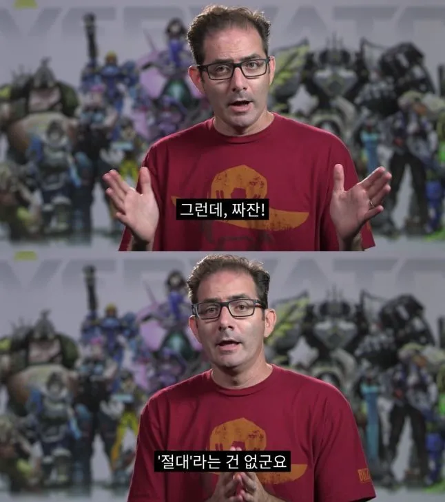
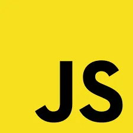
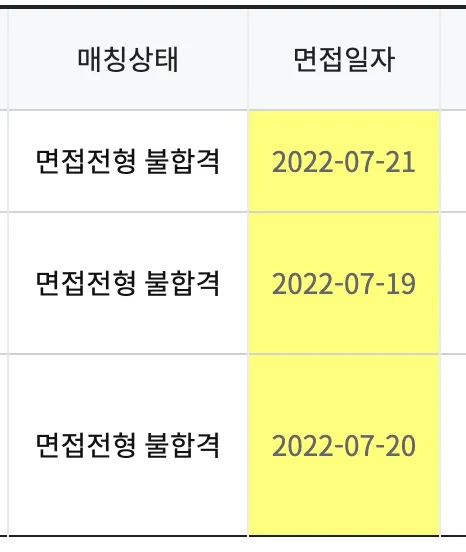
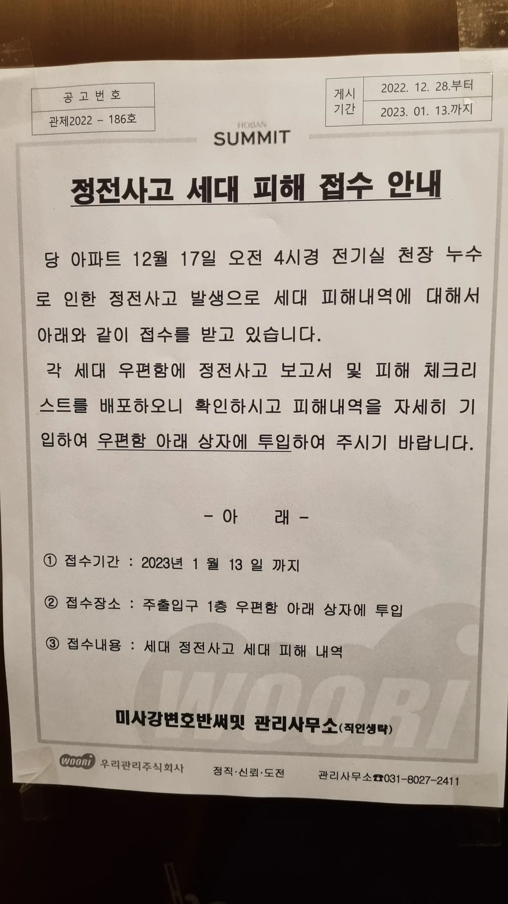
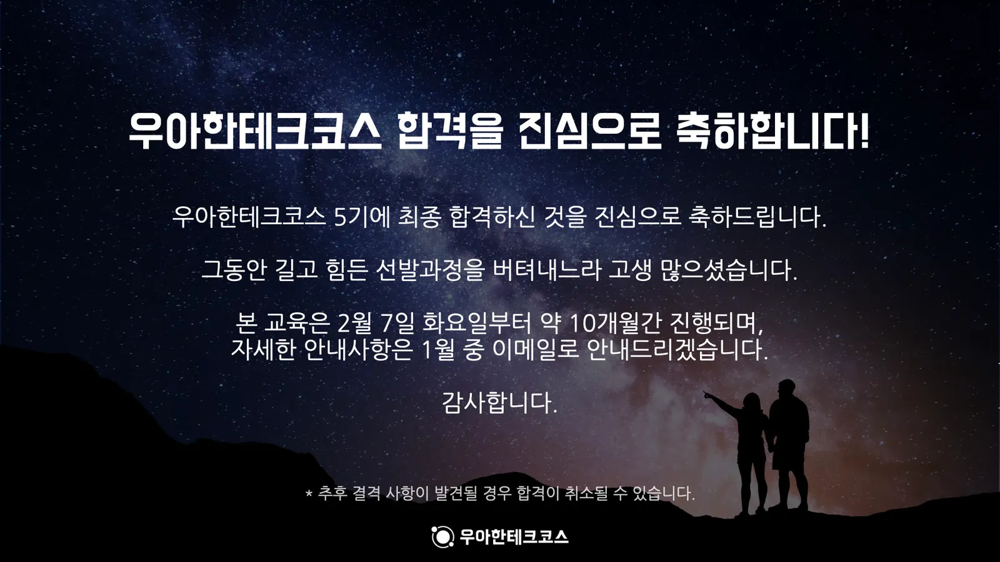
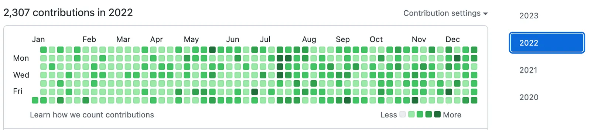

> 이 글은 2023-01-10에 티스토리 블로그(leirbag.tistory.com/128)에 처음 작성한 글을 옮겨온 것입니다.

~~비록 2022년이 지나서 지금은 2023년이지만 뒤늦게 쓰는 회고록~~

## 인생을 살면서 그저 그렇게 지나가는 해도 있기 마련이라고 생각합니다.

하지만 2022년은 굉장히 잊지 못할 한 해로 남을 것 같다는 생각이 듭니다.

## 2021년의 연말

3학년이 끝나가던 2021년 말 까지만 해도 어떤 진로로 나아가야할지 확정하지 못해서

이것저것 다 공부했던 저는 Java가 제 주력 언어 중 하나였습니다.

Java가 우리나라에서는 정말 강력한 언어 중 하나기에 미래가 보장된다는 점,

디자인 패턴이 굉장히 납득이 가는 방식이라 설계와 유지보수가 편했다는 점,

학교에서 수준 높은 Java 강의를 지속적으로 수강할 수 있었다는 점 등

여러 이유로 자연스럽게 Java를 해왔고, 계속 이쪽으로 나아갈 것으로 생각했습니다.

*인생은 예상하는 대로 흘러가지 않는다*

하지만 그간 학과 홈페이지를 관리하면 할 수록 프론트의 매력에서 벗어날 수 없었습니다.

당시에는 jQuery로 DOM을 조작하는 방식으로 개발을 하였는데,

제가 그동안 들었던 javascript의 악명과는 다르게, 생각보다 문법이 간결하고 편했습니다.

이제 4학년인데 javascript를 시작해도 되는지 확신이 서지 않았지만, 일단 도전해보고 생각하기로 했습니다.

Java에 대한 자신감이 충분하여 언제든 돌아올 수 있던 이유도 있었고,

프론트엔드 기술에 관심이 많이 생겨 꼭 도전하고 싶었습니다.

## 2022년 연초

*자바스크립트를 제대로 공부하기 시작하다.*

2022년이 되자마자 JavaScript 학습에 많은 노력을 기울였습니다.

물론 이전에도 JS를 해본 적은 있으나, 사실 큰 의미가 없었던 것이 저는 공부를 한 것이 아니라 복사 붙여넣기를 해왔습니다.

바닐라JS로 HTML을 조작할 때 그렇게 많은 로직이 필요하지 않는 경우가 많았고, 구글에 검색하면 결과가 나오는 경우가 대부분이었습니다.

겨울 방학은 JS와 React 학습에 거의 대부분의 시간을 보냈던 것 같습니다.

## 2022년 1학기

다들 아시다시피 2022년은 대면수업의 해입니다.

정말 오랜만에 학교에서 수업을 들으려니 통학이 문제였습니다.

통학 거리가 편도 기준 2시간+@이기에 다시는 통학을 하고싶지 않았습니다. ~~대면수업 멈춰!~~

정말 고민이 많았는데, 첫 번째로는 제가 막 JS와 React에 불이 붙기 시작했던 시점이었기 때문입니다.

공부할 시간이 없는데 더이상 통학으로 스트레스 받고싶지 않았습니다.

처음에는 집에 제가 알아서 독립하겠다 선언을 했으나,

이런 저런 이유로 학교에 차를 가지고 통학 하는 것으로 얘기가 되어 시간을 엄청 아낄 수 있었습니다.

안그래도 시간 아껴가면서 하루 웬종일을 프로젝트와 씨름을 하고있던 저에게 투자를 하셨다고 생각했습니다.

1학기를 지나면서 React에 대한 자신감이 어느정도 붙은 저는, 인턴에 눈을 들이기 시작했습니다.

## 2022년 여름방학

운좋게 ICT 인턴쉽 코테에 통과했던 저는, 이때가 가장 기고만장했던 시기라고 생각합니다.

회사 이름을 밝히지는 않겠지만, 이 사이트에서 있는 회사 중 정말 괜찮은 곳들 위주로 썼습니다.

결과는 3곳 모두 서류합!

주변을 찾아봐도, 오픈채팅 같은 곳에서 익명의 지원자들을 찾아봐도 서류가 모두 붙은 사람은 없었습니다.

면접을 안보러 간 곳도 있고, 전화 면접으로 탈락한 곳도 있었는데

이 두 곳은 떨어져도 별 생각이 없었습니다.

하지만 1곳은 저에게 과제를 출제했는데, 정의문서에 따라 React로 웹 사이트 하나를 구현하는 것이 과제였습니다.

저는 제 영혼을 갈아 넣은 홈페이지 하나를 만들어 갔고, 결과는 처참했습니다.

최적화 이슈도 있었고, 나중에 문제를 복기하다보니 React는 그렇게 하는 것이 아니었습니다.

결국 저는 다시 공부를 해야겠다고 마음을 먹고 빠른 취업보다 일단 공부를 충분히 할 필요가 있다고 느꼈습니다.

그래놓고도 괜히 2학기에 학교가 가기 싫어서 학교 홈페이지에 올라와있는 학점 연계 인턴 기업 1곳에 지원하였으나

면접 보다 말고 추노했습니다.

블박회사라서 JS같은거 쓰지 않을 뿐더러, C++을 해야한다 하셔서 양해를 구하고 면접을 중단했습니다.

사실 이 회사에서 지도 서비스도 하고 있어서 내심 기대를 했으나, 알고보니 임베디드 직종이었다고.. 합니다.

회사가 워낙 유명하다보니 제 눈에는 그냥 그 서비스가 그 서비스인줄 알았는데 알고보니 자회사들마다 업무 분야가 많이 다르다나 뭐라나..

결국 학교 탈출은 없던 일이 되어버린 저는 2학기에 얌전히 학교에 다니게 됩니다.

***그리고 제 위치가 어디인지, 더 열심히 해야한다는 동기부여를 확실하게 얻은 시기이기도 합니다.***

## 2022년 2학기

학교에서 들어야 하는 과목은 최소한으로 하면서, 학교에서 진행하는 공모전과 연구실에서 진행하는 프로젝트에 집중하면서 시간을 보내고 있었습니다.

그러다가 제 눈에 들어온 광고가 있었는데, 바로 우아한테크코스였습니다.

부족한 실력을 알기에 지원해야하나 말아야하나 많은 고민이 있었지만 결국 제출했고 하던 일은 모두 멈추고 우테코 프리코스에 전념했습니다.

(자세한 과정은 블로그에 이전에 작성해 둔 글이 있습니다.)

여름 방학 때 몇번의 충격을 받은 끝에 JS를 다루는 실력이 크게 향상되었는지 프리코스에서 정말 최선을 다할 수 있었습니다.

최종 코테 당일날 정전+단수라는 믿기 힘든 일이 일어나서 액땜을 제대로 했고,

*거짓말 같지만 진짜 있었던 황당사건이다...*

최종 코테에서 시간 조절을 실패하는 바람에 테스트케이스를 놓치는 대형사고를 쳐버렸었다고 글을 남겼었죠.

최종 발표날까지 정말 견디기 힘든 불안한 시간을 보냈습니다.

*흑흑*

마지막으로 주어진 기회를 다시는 놓치지 않겠습니다.

p.s.) 2022년에 시작한 commit streak challenge는 다음과 같은 광기로 완성됐습니다.

*살짝 미쳐버린 잔디밭*

물론 2023년에도 이어가는 중 입니다.

## 2023년이 밝았는데...

정말 지난 몇년 간 쉬지 않고 달려왔는데, 제 열정이 쉽게 꺼지지 않았나봅니다.

지금도 무언가 더 배우고 싶고, 더 하고 싶고 그렇네요.

정말 휴식 없이 달려온 몇년이 이렇게 보상(?) 혹은 인정(?) 받았다고 생각하니 이미 충성심 만땅이 됐습니다.

우테코가 아직 꺼지지 않은 제 열정에 기름을 붓는 사건이 되길 바랍니다.

올해의 목표는, 아무래도 **우테코에서 살아남기**가 아닌가 싶습니다.

정말 대단한 사람들이 많이 붙었습니다.

합격자들과의 경쟁은 불가능에 가깝다고 생각할 정도로 높게 평가하고 있습니다. *~~보잘 것 없는 나~~*

그분들의 장점을 최대한 흡수하고 노하우를 한 수 배워가는 1년이 됐으면 좋겠습니다.
