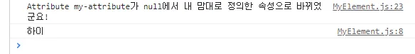
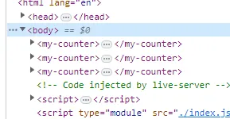

> 이 글은 2023-03-01에 티스토리 블로그(leirbag.tistory.com/132)에 처음 작성한 글을 옮겨온 것입니다.

과거의 정적인 웹 페이지 구현과 달리, html을 동적으로 적절하게 관리한다는 것은 결코 쉽지 않습니다. 특히 SPA를 구현할 때, 많은 분들이 비슷한 고민을 겪게 될 것으로 생각됩니다.

동적인 화면 변화가 잦다면 정적인 html은 큰 도움을 주지 못합니다.

html이 없으면 사용자에게 어떤 것을 보여줄 수 없지만, 그렇다고 해서 처음 부터 모든 태그들이 고정된 자리를 잡는 것은 동적인 웹 페이지를 그리는데 큰 도움을 주지 못할 가능성이 큽니다.

특히 ajax의 등장 이후, 웹 페이지를 동적으로 관리하려는 시도는 차츰 늘어오다가, 이를 해결하기 위해 상태 관리를 중심으로 한 react, vue, angular 등이 웹 프론트엔드 기술의 대세로 떠올랐고, 과거의 jquery는 이제 영광을 뒤로하고 퇴장을 준비하고 있습니다.

이런 라이브러리 없이 웹 페이지를 동적으로 관리하기란 쉽지 않습니다만, 라이브러리 없이 바닐라 환경에서도 이를 흉내낼 수 있습니다.

### 엘리먼트 정의

일단 customElements에 대해서 알아봐야 합니다.

javascript로 html 태그를 정의해서 사용할 수 있는 기능인데요

일단 html의 body태그 내에 다음과 같이 적어봅시다.

```html
<my-element></my-element>
```

my-element라는 태그는 html에 정의되어있지 않습니다.

당연하지만 이 태그는 제가 마음대로 만든 태그의 이름입니다.

그러므로 html의 실행 결과도 변화가 없을 것입니다.

JavaScript에는 다음과 같이 적어줍니다.

```lasso
customElements.define('my-element', MyElement);
```

MyElement라는 클래스를 my-element 태그로 정의하겠다라는 의미입니다.

그렇다면 이제 MyElement 클래스를 정의 해줘야 합니다.

```scala
class MyElement extends HTMLElement {
  constructor() {
    super();
    this.innerHTML = 'Hello, world!';
  }
}

export default MyElement; // 독립 파일로 관리하는 경우에만 삽입
```

이제 웹 화면을 확인해보면 `Hello, world!` 라는 문장이 출력될 것입니다.

`<my-element></my-element>`이 곧 MyElement라는 클래스이므로, 이 영역의 innerHTML이 `Hello, world!`로 정의되는 것입니다.

### 엘리먼트의 생성과 소멸

그럼 이번엔 이 클래스에 몇 가지 메서드를 추가해 보겠습니다.

```javascript
class MyElement extends HTMLElement {
  constructor() {
    super();
    this.innerHTML = 'Hello, world!';
  }
  connectedCallback() {
    console.log('하이');
  }
  disconnectedCallback() {
    console.log('바이');
  }
}

export default MyElement;
```

`connectedCallback()`은 이 엘리먼트가 삽입될 때 동작하는 것입니다.

`disconnectedCallback()`은 이 엘리먼트가 사라질 때 동작하는 것입니다.

위 두 메서드는 상속받아 동작합니다.

react 클래스 문법의 mount/unmount와 비슷한 기능이고, hook(useEffect)의 빈 배열\[\]을 줄 때 최초 1회성 동작이나, return을 활용한 clean-up과 비슷한 역할을 할 수 있습니다.

위와 같이 코드를 수정하고, DOM을 조작해 보면, 엘리먼트(`<my-element></my-element>`)가 DOM tree에 포함될 때 `connectedCallback()`이 동작하고, 제거될 때 `disconnectedCallback()`이 동작하게 됩니다.

~~이 문서를 진지하게 읽고 있을 정도면 DOM조작은 특별한 설명이 없어도 이해하실 것으로 믿습니다.~~

### 엘리먼트의 속성

속성을 읽는 것도 가능할까요?

이번에는 html 코드를 다음과 같이 고쳐봅니다.

```html
<my-element id="foo" my-attribute="bar"></my-element>
```

그리고 클래스는 다음과 같이 코드를 수정해 봅니다.

```javascript
class MyElement extends HTMLElement {
  constructor() {
    super();
    const myAttribute = this.getAttribute('my-attribute');
    this.innerHTML = `Hello, world! ${myAttribute}`;
  }
  connectedCallback() {
    console.log('하이');
  }
  disconnectedCallback() {
    console.log('바이');
  }

}

export default MyElement;
```

이제 코드를 실행해 보면 `Hello, world! bar`가 출력될 것입니다.

보시다시피 생성자 함수가 attribute값을 읽어 출력하는 것이 가능합니다.

### 엘리먼트의 속성 변경 감지

그렇다면 속성 값이 바뀌었을 때를 감지할 수도 있을까요?

이번에는 클래스를 다음과 같이 고쳐봅니다.

```javascript
class MyElement extends HTMLElement {
  constructor() {
    super();
    const myAttribute = this.getAttribute('my-attribute');
    this.innerHTML = `Hello, world! ${myAttribute}`;
  }
  
  connectedCallback() {
    console.log('하이');
  }
  
  disconnectedCallback() {
    console.log('바이');
  }

  static get observedAttributes() {
    return ['my-attribute'];
  }

  attributeChangedCallback(name, oldValue, newValue) {
    console.log(`Attribute ${name}가 ${oldValue}에서 ${newValue}으로 바뀌었군요!`);
  }
}

export default MyElement;
```

이제 코드를 실행해 보면

`Attribute my-attribute가 null에서 bar으로 바뀌었군요!`  
`하이`

가 콘솔창에 순서대로 출력될 것입니다.



*속성 이름에 따라 위 사진과 같이 값이 달라진다.*

`observedAttributes()`에는 어떤 속성을 감시하고 싶은지를 배열로 등록해 두면 되고, 그다음 동작을 어떻게 할지를 `attributeChangedCallback()`로 정의할 수 있습니다.

해당 엘리먼트의 속성을 강제로 업데이트해보겠습니다.

```javascript
const el = document.getElementById('foo');
el.setAttribute('my-attribute','baz');
```

이번에는 콘솔 창에 `Attribute my-attribute가 bar에서 baz으로 바뀌었군요!`가 출력될 것입니다.

만약 렌더링 하는 부분을 생성자함수에서 직접 하는 것이 아닌 메서드화 한다면, 속성이 바뀔 때마다 자동으로 렌더링을 하는 것도 가능합니다.

그렇다면 이번에는 다음과 같이 클래스를 수정해 보겠습니다.

```javascript
class MyElement extends HTMLElement {
  constructor() {
    super();
    this.myAttribute = this.getAttribute('my-attribute');
    this.render();
  }
  connectedCallback() {
    console.log('하이');
  }
  disconnectedCallback() {
    console.log('바이');
  }

  render() {
    this.innerHTML = `Hello, world! ${this.myAttribute}`;
  }

  static get observedAttributes() {
    return ['my-attribute'];
  }

  attributeChangedCallback(name, oldValue, newValue) {
    console.log(`Attribute ${name}가 ${oldValue}에서 ${newValue}으로 바뀌었군요!`);
    this.myAttribute = newValue;
    this.render();
  }
}

export default MyElement;
```

이번에는 `render()`가 무엇을 그릴지 결정해 줍니다.

생성자 함수도 초기 값을 그리고, `attributeChangedCallback()`도 변경을 감지한 이후에 새로운 값을 그리려고 시도할 것입니다.

다시 다음과 같이 속성 수정을 시도하게 되면

```reasonml
const el = document.getElementById('foo');
el.setAttribute('my-attribute','baz');
```

이제는 속성 변경 결과가 콘솔에만 찍히는 것이 아닌 html이 자동으로 업데이트될 것입니다.

### 엘리먼트의 독립성

좀 더 재밌는 걸 해보겠습니다.

React에서도 counter는 상태를 설명하기에 가장 적합하고 쉬운 주제이기도 합니다.

customElements에서도 counter를 예제로 들겠습니다.

html 태그를 다음과 같이 body에 넣어줍니다.

```html
<my-counter></my-counter>
```

my-counter를 정의하고

```lasso
customElements.define('my-counter', MyCounter);
```

MyCounter클래스는 다음과 같이 적습니다.

```scala
class MyCounter extends HTMLElement {
  constructor() {
    super();
    this.state = { count: 0 };
  }

  connectedCallback() {
    this.render();
    this.addEventListener('click', this.handleClick.bind(this));
  }

  render() {
    this.innerHTML = `Count: ${this.state.count}`;
  }

  handleClick() {
    this.state.count++;
    this.render();
  }
}
export default MyCounter;
```

이제 브라우저 화면에 `Count: 0`이 그려져 있을 것입니다.

해당 영역을 마우스로 클릭하면 Counter의 숫자가 증가할 것입니다.

이제 가장 중요한 부분이 등장하게 되는데, html을 다음과 같이 수정해 봅시다.

```apache
<div>
    <my-counter></my-counter>
</div>
<div>
    <my-counter></my-counter>
</div>
<div>
    <my-counter></my-counter>
</div>
```

이제 counter가 3개가 차례로 등장하는 모습을 확인할 수 있는데요,

이 counter들을 각각 클릭해 보면 개별적으로 카운팅이 됩니다.

즉, 컴포넌트를 html에서 호출함에도 불구하고 `각각 독립적으로 동작하는 컴포넌트`임을 확인할 수 있습니다.


*각 커스텀 엘리먼트는 독립적으로 동작한다*



*단순히 엘리먼트를 DOM에 붙였을 뿐인데...*

그렇다면 특정 컴포넌트의 상태 값을 외부에서 수정하려면 어떻게 해야 할까요?

react를 생각해 보면 setState 따위를 다른 곳에서 조작하는 것이 가능한데요,

customElements도 비슷한 방법으로 구현이 가능합니다.

카운터 태그에 id를 주고, 이를 동작시킬 버튼 하나를 만듭니다.

```xml
<div>
  <my-counter id="hey"></my-counter>
</div>
<div>
  <button onclick="increaseCounter()">카운트를 증가시켜줘</button>
</div>
```

그리고 해당 버튼이 동작할 함수를 다음과 같이 만들어줍니다.

```javascript
function increaseCounter() {
  const myCounter = document.getElementById('hey');
  myCounter.handleClick();
}
```

`hey`라는 `id`의 엘리먼트를 불러내어, 해당 엘리먼트의 인스턴스가 가지고 있는 `handleClick()` 메서드를 동작하게 하는 방식으로 특정 카운터를 증가시킬 수 있습니다.

즉, 다시 말해 react처럼 어떤 상태값을 직접 조작하는 행위는 불가능하지만, 이런 방식으로 특정 인스턴스의 메서드를 조작하여 간접적으로 조작하는 것은 가능합니다.

~~(이후의 글에서 언급하겠지만, 커스텀이벤트와 이벤트리스너를 이용하여 직접 조작하는 방법도 있기는 합니다.)~~

### 배열 관리하기 예제

상태를 배열로 관리하는 태그를 만들어 보겠습니다.

html태그는 다음과 같습니다.

```html
<my-array></my-array>
```

그리고 해당 태그를 등록해 줍니다.

```lasso
customElements.define('my-array', MyArray);
```

클래스는 다음과 같습니다.

```javascript
class MyArray extends HTMLElement {
  constructor() {
    super();
    this.state = { items: [] };
  }

  connectedCallback() {
    this.render();
  }

  render() {
    this.innerHTML = `
      <ul>
        ${this.state.items.map((item) => `<li>${item}</li>`).join('')}
      </ul>
      <button id="add-btn">아이템 추가</button>
      <button id="remove-btn">마지막 아이템 제거</button>
    `;
    this.addEvents();
  }

  addEvents() {
    this.querySelector('#add-btn').addEventListener('click', this.handleAddClick.bind(this));
    this.querySelector('#remove-btn').addEventListener('click', this.handleRemoveClick.bind(this));
  }

  handleAddClick() {
    this.state.items.push(`아이템 : ${this.state.items.length + 1}`);
    this.render();
  }

  handleRemoveClick() {
    this.state.items.pop();
    this.render();
  }
}
export default MyArray;
```

이 컴포넌트를 실행해 보면, 배열을 어떻게 상태로 관리할 수 있는지 확인할 수 있습니다.


*버튼을 누르면 알아서 재렌더링이 된다...!*
