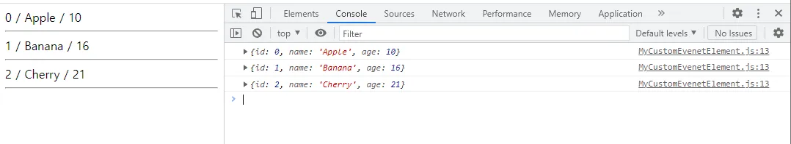

> 이 글은 2023-03-27에 티스토리 블로그(leirbag.tistory.com/135)에 처음 작성한 글을 옮겨온 것입니다.

이전에 작성한 글들을 잘 참고해보면 커스텀 엘리먼트는 외부에서 어트리뷰트 값을 직접 넘길 수는 있지만, 직접 객체를 넘기는 방법은 지원하지 않습니다.  
많은 사람들이 이를 해결하기 위해 다양한 방법을 활용했을 것으로 예상됩니다.  
가장 쉬운 방법으로는, 특정 엘리먼트를 불러와서 어떤 메서드를 통해 객체를 전달하는 방법이 가장 일반적일 것입니다.  
예를 들면 다음과 같은 방법이 있을 것입니다.

```javascript
import MyElement from "./MyElement.js";

customElements.define('my-element', MyElement);
```

```javascript
class MyElement extends HTMLElement {
  state = { value: 'init value' };

  constructor() {
    super();
    this.render();
  }

  setState(newObejct) {
    this.state = newObejct;
  }

  render() {
    this.innerHTML = `현재 상태는? : ${this.state.value}`;
  }
}

export default MyElement;
```

```html
<!DOCTYPE html>
<html lang="en">

<head>
  <meta charset="UTF-8">
  <meta http-equiv="X-UA-Compatible" content="IE=edge">
  <meta name="viewport" content="width=device-width, initial-scale=1.0">
  <title>Document</title>
</head>

<body>
  <my-element id="myElement"></my-element>
  <button onclick="updateSate()">myElement의 값을 `새로운 값`으로 수정해보자</button>
</body>

<script type="module" src="./index.js"></script>

<script>
  function updateSate() {
    const el = document.getElementById('myElement');
    el.setState({ value: 'new value' });
    el.render();
  }
</script>

</html>
```

위 방법은 굉장히 일반적입니다.  
어떤 커스텀 엘리먼트 객체 하나를 호출하여 어떤 메서드를 통해서 객체를 전달해서 저장해주면 됩니다.  
하지만 저는 이번 글에서 CustomEvent를 통해 객체를 넘기는 방법에 대해서 두 가지 소개하려고 합니다.

### CustomEvent를 이용하여 엘리먼트에 객체 넘겨주기

```javascript
import MyCustomEvenetElement from "./MyCustomEvenetElement.js";

customElements.define('my-custom-event-element', MyCustomEvenetElement);
```

```javascript
export default class MyCustomEvenetElement extends HTMLElement {
  state = 'initial value';
  constructor() {
    super();
    this.render();
  }
  connectedCallback() {
    this.addEventListener('myCustomEvent', (event) => {
      console.log(`myCustomEvent : ${event.detail.key}`);
      this.state = event.detail.key;
      this.render();
    });
  }
  render() {
    this.innerHTML = `-${this.state}-`;
  }
}
```

```html
<!DOCTYPE html>
<html lang="en">

<head>
  <meta charset="UTF-8">
  <meta http-equiv="X-UA-Compatible" content="IE=edge">
  <meta name="viewport" content="width=device-width, initial-scale=1.0">
  <title>Document</title>
</head>

<body>
  <my-custom-event-element></my-custom-event-element>
  <button onclick="dispatchCustomEvent()">CustomEvent 건드리기</button>
</body>
<script type="module" src="./index.js"></script>
<script>
  function dispatchCustomEvent() {
    const customEvent = new CustomEvent('myCustomEvent', { detail: { key: 'new value' } });
    const myCustomElement = document.querySelector('my-custom-event-element');
    myCustomElement.dispatchEvent(customEvent);
  }
</script>

</html>
```


엘리먼트의 메서드를 직접 접근하는 방법이 아닌, 엘리먼트 자체가 커스텀 이벤트 리스너를 가지도록 하여 객체를 이벤트로 발송하는 방식으로 구현해봤습니다.

  
이전에 프롤로그에서 작성했던 [JavaScript의 customElements에서 Proxy을 활용한 객체 변화 감지](https://prolog.techcourse.co.kr/studylogs/2783)과 굉장히 유사한 방법이지만, 클래스 필드에 직접 접근이 아닌 이벤트 객체를 통해서 접근한다는 차이가 있습니다.  
어떤 장점이 있을까요?  
클래스 필드를 은닉할 수 있지 않을까요?  
어떤 장점이 있는지는 여러분이 생각해보시고 댓글로 의견 남겨주시면 감사하겠습니다.

### CustomEvent를 이용하여 엘리먼트에 객체 넘겨주기 (배열편)

앞선 단일 객체 전송 예제를 보신다면 필연적으로 배열로 관리를 하는 것을 시도해보고 싶으실 것입니다.  
이번에는 어떤 객체 배열로부터 커스텀 엘리먼트를 대량으로 찍어내는 예제를 작성해보겠습니다.

```javascript
import MyCustomEvenetElement from "./MyCustomEvenetElement.js";

const players = [
  {
    id: 0,
    name: 'Apple',
    age: 10,
  },
  {
    id: 1,
    name: 'Banana',
    age: 16,
  },
  {
    id: 2,
    name: 'Cherry',
    age: 21,
  },
];

customElements.define('my-custom-event-element', MyCustomEvenetElement);

const el = document.querySelector('.people-list');
el.innerHTML = players.map((player) => `<my-custom-event-element id="player-${player.id}"></my-custom-event-element>`).join(''); // 일단 그림만 그리고
players.forEach((player) => { // 이벤트를 발송한다.
  const customEvent = new CustomEvent('playerEvent', { detail: player });
  const playerElement = document.getElementById(`player-${player.id}`);
  playerElement.dispatchEvent(customEvent);
});
```

```javascript
export default class MyCustomEvenetElement extends HTMLElement {
  player = {
    id: 0,
    name: 'Apple',
    age: 10,
  };
  constructor() {
    super();
    this.render(); // 일단 기본 값을 그리고
  }
  connectedCallback() {
    this.addEventListener('playerEvent', (event) => { // 새로운 값의 수신을 기다린다.
      console.log(event.detail);
      this.player = event.detail;
      this.render();
    });
  }
  render() {
    this.innerHTML = `
    <div>${this.player.id} / ${this.player.name} / ${this.player.age}</div>
    <hr/>
    `;
  }
}
```

```html
<!DOCTYPE html>
<html lang="en">

<head>
  <meta charset="UTF-8">
  <meta http-equiv="X-UA-Compatible" content="IE=edge">
  <meta name="viewport" content="width=device-width, initial-scale=1.0">
  <title>Document</title>
</head>

<body>
  <div class="people-list">

  </div>
</body>
<script type="module" src="./index.js"></script>

</html>
```



*가만히 있던 커스텀 엘리먼트들이 객체를 수신받는다.*

이번에는 어떤 객체 배열로부터 커스텀 엘리먼트를 일단 그려내고, 그려진 엘리먼트에 이벤트를 발송하는 방식으로 구현해봤습니다.  
일단 그려낸 엘리먼트들은 기본적으로 커스텀 이벤트 리스너(’playerEvent’)가 탑재되어 있어 언제든 값을 업데이트 하는 것을 기다리게 합니다.  
물론 이 글에서 소개한 방식이 아니더라도 일반적인 방법으로 CustomElement에게 객체를 전달하는데 전혀 지장이 없지만, 이런 아이디어로도 객체 전달을 구현할 수 있다는 것을 소개해드리기 위해서 글을 작성했습니다!
