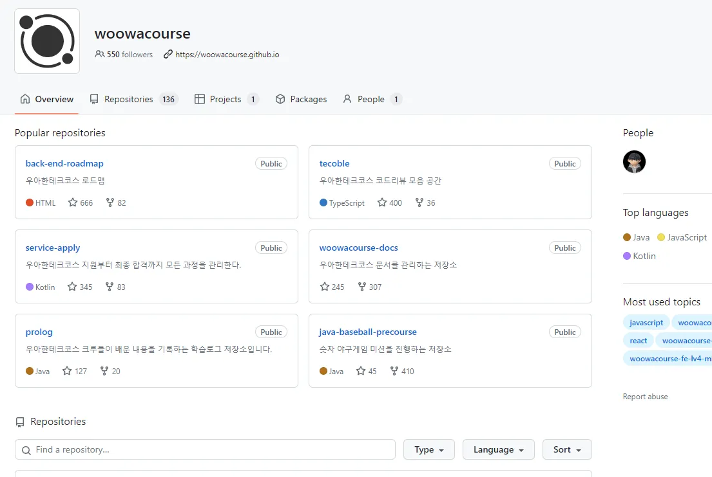
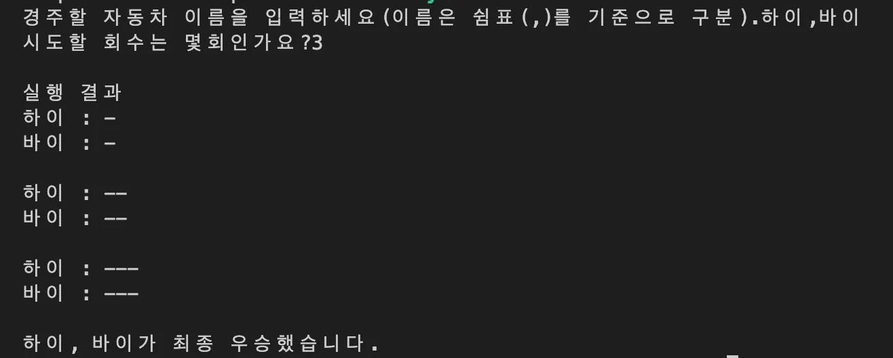
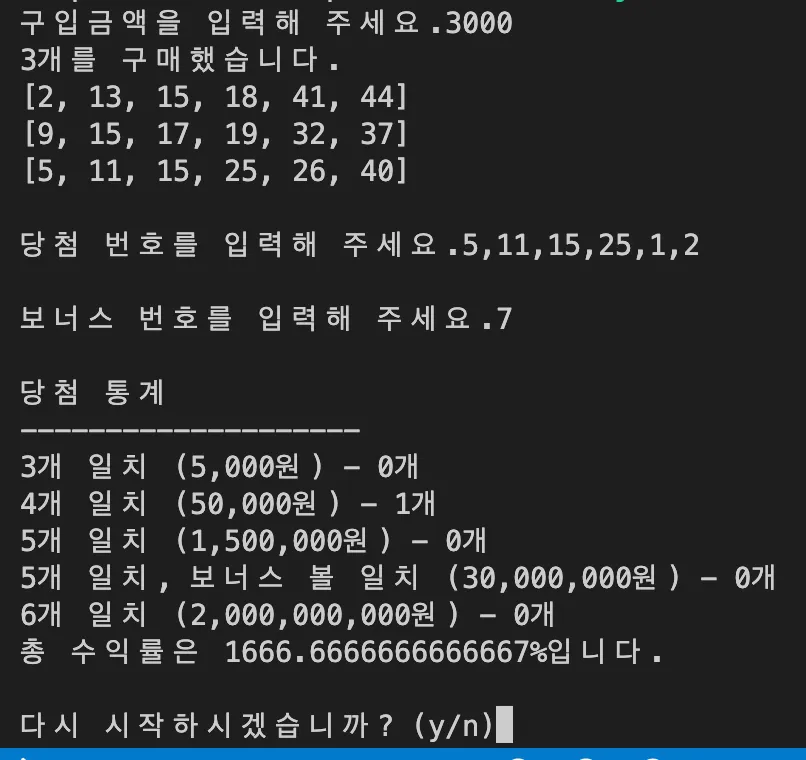
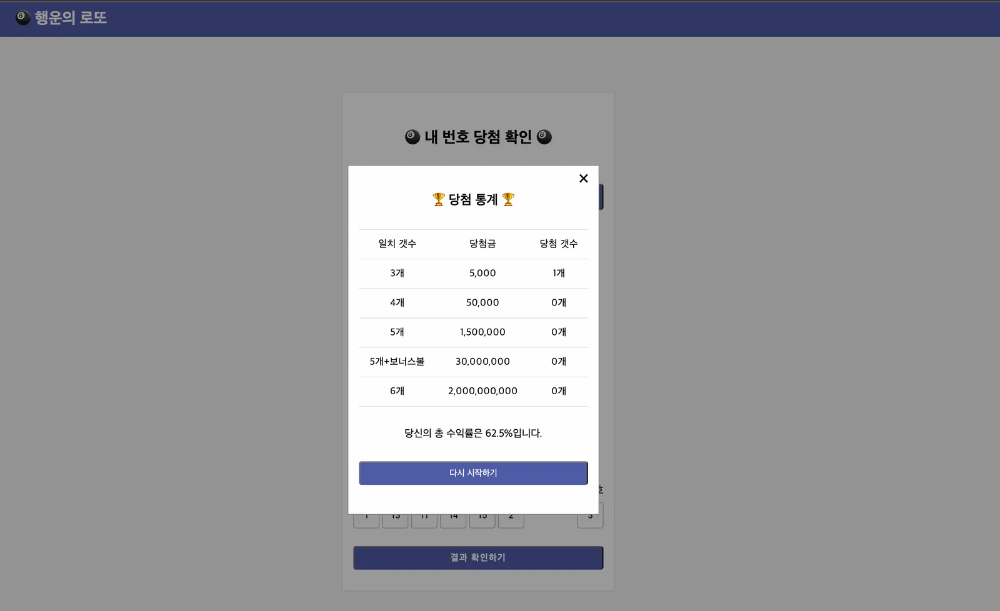
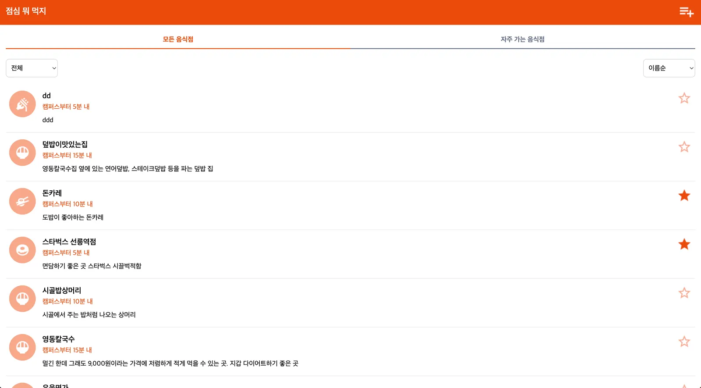
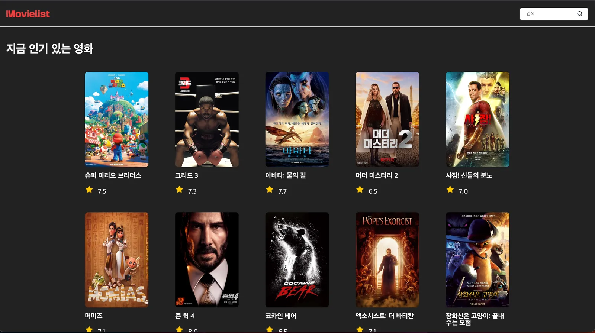
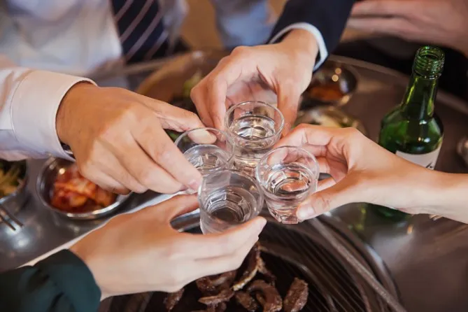
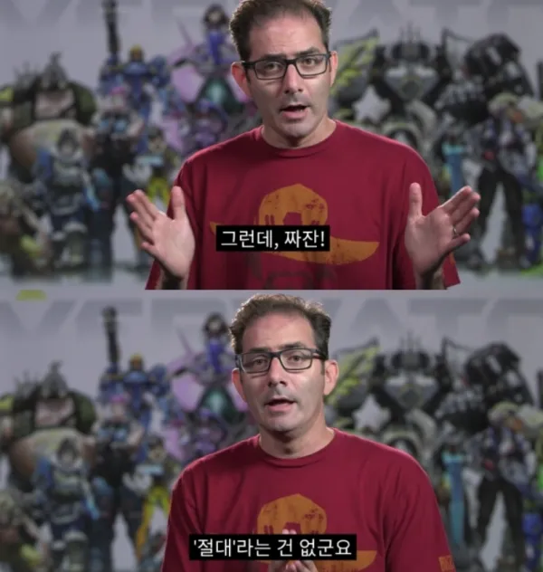
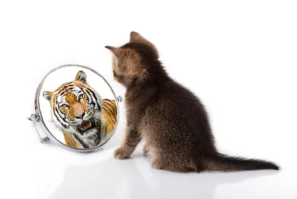
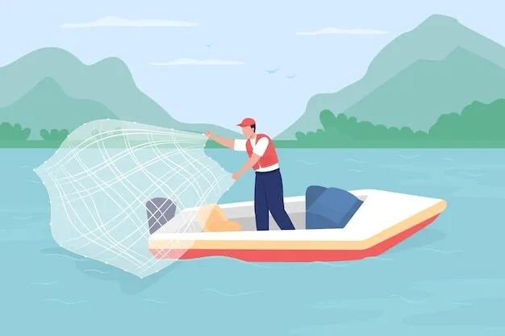

> 이 글은 2023-04-15에 티스토리 블로그(leirbag.tistory.com/141)에 처음 작성한 글을 옮겨온 것입니다.

원래의 계획은 레벨 1이 끝날 때 회고를 하나 작성하려고 하였으나..  
중간에 글쓰기 미션 때문에 [한 달 생활기](../2023-03-18-tistory-134/)를 이미 적어버리고 말았습니다...??  
사실 그때는 분량 제한도 있고, 미처 하지 못했던 말들이 많습니다.  
이 글에서는 활동 시작 이후의 감정과 회고에 대해서 작성을 하려고 하고, 혹시 선발 과정에 대해서 궁금하신 분만 아래의 링크에 들어와서 먼저 읽으시면 될 것 같습니다.

> [\[회고\] 우아한테크코스 5기 프리코스 (FE)](../2022-11-29-tistory-125/)  
> [우아한테크코스 5기 프리코스 (FE) 1차 합격!](../2022-12-14-tistory-126/)  
> [우아한테크코스 5기 (FE) 최종 코딩테스트 후기](../2022-12-21-tistory-127/)  
> [2022년을 보내며, 그리고 새해 다짐](../2023-01-10-tistory-128/)

  
우아한테크코스에서 진행하는 커리큘럼은 [우아한테크코스 공식 홈페이지](https://woowacourse.github.io/)나 [배민다움](https://story.baemin.com/2936/)에서 확인할 수 있기도 하고, 제가 전에 작성했던 글인 [우아한테크코스 한 달 생활기](../2023-03-18-tistory-134/)에도 잘 나와있으니 생략하겠습니다.

*우아한테크코스에서 진행하는 모든 미션들은 깃허브 저장소 에서 오픈소스로 확인할 수 있으니 참고하면 좋을 것 같습니다.*

## 미션

#### 미션 1 - 자동차 경주 게임

<table><tbody><tr><td>&nbsp;</td><td>Repository</td><td>Feedback</td></tr><tr><td>Step1</td><td><a href="https://github.com/gabrielyoon7/javascript-racingcar/tree/step1">바로가기</a></td><td><a href="https://github.com/woowacourse/javascript-racingcar/pull/153">바로가기</a></td></tr><tr><td>Step2</td><td><a href="https://github.com/gabrielyoon7/javascript-racingcar/tree/step2">바로가기</a></td><td><a href="https://github.com/woowacourse/javascript-racingcar/pull/208">바로가기</a></td></tr></tbody></table>

자동차 경주 게임은 node.js 기반의 콘솔 게임이었습니다.

프리코스 때와 달리 미션에 필요한 모든 함수를 직접 구현해야 했습니다.  
심지어 테스트 코드도 직접 작성해야 했는데, 이 과정에서 jest로 mocking을 하는 방법을 알아낸다거나 node 버전에 따라서 readline함수가 지원되거나 그렇지 않은 경우가 있다는 사실을 알게 됐습니다.  
다만, 처음 비동기를 사용하려던 계획과는 달리 콜백으로 작성하는 방식으로 회귀하여 다시 프리코스의 맛을 느낄 수 있던 미션이었습니다.

[코드의 가독성을 위해 필수로 알아야 할 .every()와 .some()](../2023-04-04-tistory-136/)

[JavaScript 클래스 문법은 어떻게 쓰는 것일까?](../2023-02-22-tistory-130/)  
자바스크립트에서 클래스를 사용하는 것은 프로토타입을 신경 쓰지 않을 수 있도록 돕는 좋은 도구라는 것을 알게 됐습니다.  
물론 프로토타입을 직접 다룰 수 있는 기회가 없어서 다소 아쉬웠지만, 어찌 됐든 클래스가 거의 모든 상황에서 커버할 수 있었습니다.  

#### 미션 2 - 로또

<table><tbody><tr><td>&nbsp;</td><td>Repository</td><td>Feedback</td></tr><tr><td>Step1</td><td><a href="https://github.com/gabrielyoon7/javascript-lotto/tree/step1">바로가기</a></td><td><a href="https://github.com/woowacourse/javascript-lotto/pull/176">바로가기</a></td></tr><tr><td>Step2</td><td><a href="https://github.com/gabrielyoon7/javascript-lotto/tree/step2">바로가기</a></td><td><a href="https://github.com/woowacourse/javascript-lotto/pull/252">바로가기</a></td></tr></tbody></table>

[***구현한 페이지 보기***](https://gabrielyoon7.github.io/javascript-lotto/)

이 미션에서는 콘솔에서 웹으로 이식을 했었습니다.  
과거에 학교에서 자바 콘솔에서 스윙으로 이식을 하는 경험을 했었는데 굉장히 유사한 작업이었습니다.  
특히 이 미션에서 TDD를 경험할 수 있는 기회가 있어서 콘솔에서 작성한 도메인 로직이 웹에서도 조립이 가능했습니다.

이 미션까지는 웹에서 전역 변수를 globalThis 따위로 처리하여 값을 공유하곤 했었습니다.  
도대체 컨트롤러 없이 데이터를 공유할 수 있는 방법이 무엇인지 많은 고민을 하게 됐습니다.

이 미션 기간에는 테코톡이 있어서 많은 시간을 들이지 못했던 주간이었습니다.  
5기 프론트엔드에서 클래스와 객체를 주제로 테코톡 발표를 가장 먼저 했는데, 정말 재밌었던 경험이었습니다.  
[테코톡에서 사용한 예제 및 발표자료](https://github.com/gabrielyoon7/javascript-for-tecotalk)  
오랜만에 바닐라 자바스크립트로 웹 프로젝트를 작성을 하다 보니, 그간 제이쿼리로 했던 개발들이 정말 잘못됐다는 것을 느끼게 됐습니다. 결정적으로 좀 더 효율적인 방법으로 작성할 방법이 있는지 고민을 하는 기간이었습니다.  
특정 엘리먼트가 DOM에 동적으로 달라붙은 이후에 이벤트를 어떻게 관리할 수 있는지, 탈락이 잦은 경우에는 이를 어떻게 효율적으로 처리할 수 있을지를 고민하게 됐습니다.

[.onsubmit과 .addEventListener의 차이](../2023-02-27-tistory-131/)

이벤트 리스너는 자바스크립트 개발에서의 핵심이자 다른 개발과의 차별화되는 부분이라고 생각했었는데, 그 생각이 좀 더 강해지는 프로젝트였습니다.  

### 미션 3 - 점심 뭐 먹지

<table><tbody><tr><td>&nbsp;</td><td>Repository</td><td>Feedback</td></tr><tr><td>Step1</td><td><a href="https://github.com/gabrielyoon7/javascript-lunch/tree/step1">바로가기</a></td><td><a href="https://github.com/woowacourse/javascript-lunch/pull/19">바로가기</a></td></tr><tr><td>Step2</td><td><a href="https://github.com/gabrielyoon7/javascript-lunch/tree/step2">바로가기</a></td><td><a href="https://github.com/woowacourse/javascript-lunch/pull/58">바로가기</a></td></tr></tbody></table>

[***구현한 페이지 보기***](https://gabrielyoon7.github.io/javascript-lunch/)

점심 뭐 먹지에서는 커스텀 엘리먼트를 알게 됐습니다.  
크루가 힌트를 준 웹 컴포넌트 기술이었는데, 이 기술은 바닐라 자바스크립트를 좀 더 풍성하게 해주는 기능이라고 생각했습니다.  
특히 저는 이 미션에서 커스텀 엘리먼트에 프록시를 적용하여 좀 더 동적이고 체계적인 프로젝트를 작성할 수 있었습니다.  
자바스크립트에서의 프록시는 굉장히 독특하고 특이한 기능으로 동작하고 있었는데, 이벤트 기반의 프로그래밍에서 유용할 것 같다는 생각을 하게 됐습니다.

[JavaScript에서 customElements를 활용하여 독립적인 상태 관리하기](../2023-03-01-tistory-132/)

[JavaScript의 customElements에서 Proxy을 활용한 객체 변화 감지](../2023-03-03-tistory-133/)

[HTMLElement와 JavaScript 간의 상호작용을 개선하는 dataset (데이터 속성)](../2023-04-08-tistory-138/)

  
커스텀 엘리먼트는 웹 컴포넌트를 작성하는 데 있어서 굉장히 유용하지만, 한계도 명확한 기술이라고 생각됐습니다.  
어찌 됐든 이 기술은 html과 js의 상호작용이 굉장히 인상적이었으며, 현재 바닐라 자바스크립트가 SPA 시장에서 다소 외면받는 상황에서 어떤 노력이 있었는지를 잘 알 수 있었습니다.  

#### 미션 4 - 영화 리뷰

<table><tbody><tr><td>&nbsp;</td><td>Repository</td><td>Feedback</td></tr><tr><td>Step1</td><td><a href="https://github.com/gabrielyoon7/javascript-movie-review/tree/step1">바로가기</a></td><td><a href="https://github.com/woowacourse/javascript-movie-review/pull/14">바로가기</a></td></tr><tr><td>Step2</td><td><a href="https://github.com/gabrielyoon7/javascript-movie-review/tree/step2">바로가기</a></td><td><a href="https://github.com/woowacourse/javascript-movie-review/pull/81">바로가기</a></td></tr></tbody></table>

[***구현한 페이지 보기***](https://gabrielyoon7.github.io/javascript-movie-review/)

외부 api인 tmdb를 활용하여 영화를 표시하는 미션이었습니다.  
비동기 상황에서 (특히 수신 이후에) 자바스크립트를 어떻게 제어할 수 있는지를 경험할 수 있었습니다.

지난 점심 뭐 먹지 미션에서 다소 아쉬웠던 부분(Custom Element)에 대해서 학습할 수 있는 기회였고,  
무한스크롤을 구현하는 최신 방법에 대해서 학습할 수 있었습니다.  
api key를 숨기는 과정 등 클라이언트에서 고민해야 할 부분에 대해서도 다시 생각해 보게 됐습니다.  

[CustomEvent를 활용하여 customElements에 객체를 전달하는 방법](../2023-03-27-tistory-135/)

[IntersectionObserver를 활용한 element 감지 및 응용 (무한스크롤, 중간광고 예제 포함)](../2023-04-08-tistory-137/)

[JavaScript의 모듈 시스템과 Singleton 패턴을 통한 객체 공유](../2023-04-11-tistory-139/)

[JavaScript의 cloneNode와 이벤트 버블링을 활용한 HTML template tag 활용법](../2023-04-11-tistory-140/)

  
싱글턴 패턴이나 커스텀 이벤트 같은 기술들을 이 미션에서 적용하다 보니 가장 크게 느낀 것은...  
웹 컴포넌트 간의 소통이나 관계가 너무 복잡하게 되어 이를 관리할 어떤 기능이 절실하게 필요하다는 것이었습니다.  
시간이 좀 더 있었다면 이벤트 버스를 도전할 수 있었겠다는 아쉬움이 남는 미션이었습니다.  

## 우테코에서 살아남기

우테코의 10개월은 절대 짧은 기간이 아닙니다.  
장기간 동안 이 기간을 즐기기 위해서 루틴을 세우기로 했습니다.  
주변에서 칼퇴요정이라고 부를 정도로 규칙적인 퇴근을 지향했는데요, 그 이유가 무엇이었을까요?  

#### 평일 쪼개기

*의욕과 열정은 오히려 올라갔다*

정말 프로그래밍에만 집중할 수 있는 커리큘럼에 만족하면서 다니고 있는 저에게는 휴식 === 프로그래밍입니다.  
그게 바닐라가 됐던, 리액트가 됐던 자바스크립트와 관련된 것이라면 뭐든 재밌습니다.  
하루 종일도 할 수 있었습니다.  
  
하지만 하루 종일 캠퍼스에 있던 날과, 칼퇴하는 날을 비교해 봤을 때 후자가 성향에 좀 더 맞았습니다.  
집에 도착하고 나서 씻고 나면 새로운 하루가 시작된 기분이 드는 저에겐  
칼퇴가 마치 하루를 반으로 갈라서 1부, 2부로 나눠서 쓰는 기분이 들었습니다.  
공부하는 환경이 한 번씩 바뀔 때 다시 집중력과 체력이 충전되는 기분이라고 해야 할까요?  
  
출퇴근 길에는 캠퍼스나 집에서 뭘 하면 좋을지 검색하는데 시간을 보내곤 하는데,  
이때 재밌는 아이디어를 발견하거나 호기심이 생기는 것은 그날그날 시도하려고 합니다.  
아이패드 미니를 들고 다니다 보니 특히 지하철에서 굉장히 유용했습니다.  
출근하는 길에 알게 된 사실은 캠퍼스에서 학습 고도화를 하고  
퇴근하는 길에 알게 된 사실은 집에서 ~~뒷~~공부를 해보는 식으로 시간을 보냈습니다.  

#### 주말은...

주말에는 캠퍼스에 일절 나가지 않았습니다.  
주말에 딱히 정해진 일정이 있는 것은 아니었지만, 대부분 이렇게 시간을 보냈는데요,  
토요일에는 집에서 최대한 멀리 떨어져서 여행을 했고, 일요일에는 집에서 밀린 리뷰 피드백을 반영했습니다.  
물론 항상 노트북을 들고 다녀서 언제나 미션과 함께하는 주말이지만, 국내 여기저기 돌아다니면서 얼마 남지 않은 20대를 재밌게 보내고 있습니다.  

#### 건강

평소에 몸이 아프거나 안 좋은 적이 거의 없어서 건강에 대해 크게 신경 쓰지 않았지만, 캠퍼스 생활 중에 많은 부분이 개선되었습니다.

일단 술이 확실히 줄었습니다.  
집안의 음주 문화의 영향도 있겠지만, 저는 술에 대해서 굉장히 관대합니다.  
하지만 지금은 음주의 생활화를 하던 과거를 청산하고 맨 정신으로 있는 날이 많습니다.  
아무래도 다음 날 일찍 일어나야 하므로 저녁에 여유를 부릴 수 없었습니다.  
술을 끊으니 잠도 좀 더 일찍 잘 수 있게 됐습니다.  
우테코를 시작하기 전에는 오전에 일정이 거의 없는 편이다 보니  
늦은 기상 => 저녁 반주 => 취해서 자다가 자정쯤 기상 => 새벽에 취침 순의 일상이었지만  
이런 악순환을 끊을 수 있게 됐습니다.

하지만 커피가 늘었습니다.  
평소에 1일 1 아아를 실천해 왔다면, 지금은 1일 2 아아를 실천하고 있습니다.  
확실하게 커피를 마시는 양이 늘었다고 느낀 것이, 카페 사장님께서 제 쿠폰이 몇 개인지를 알고 계실 정도였습니다.  
커피를 많이 마시면 건강에 안 좋은지는 모르겠지만, 지금은 물 보다 많이 마시는 것 같습니다.  

#### 스터디

우테코에서 가장 고민스러웠던 것은 스터디입니다.  
개인적으로는 인강이나 스터디 모두 성공한 경험이 없기도 하고 성향에 잘 맞지도 않았습니다.  
특히 어떤 교재나 강의를 누군가와 함께 완독 하는 것은 굉장히 비효율적이라고 생각하기에 스터디를 할 생각이 없었습니다.  
혼자 공부할 때에는 제 스케줄에 맞춰서 폭풍 진도를 나가거나 미루거나 중간에 적당히 끊고 새로운 것으로 도전할 수 있기 때문이죠.  
그래서 스터디를 안 할 줄 알았습니다.

*이 세상에 절대적인 것은 굉장히 적다는 것을 알면서도 강한 착각을 하는 나*

하지만 결국 두 가지 스터디에 들어갔는데, 다른 스터디들과는 사뭇 분위기가 다릅니다.  

**떼꼬똑**

제가 우테코 FE에서 처음으로 테코톡 발표를 맡게 되었는데, 이 날 테코톡 발표가 끝나자마자 몇몇 크루가 모여서 제 발표 주제에 대해서 토의를 하기 시작했습니다.  
제가 발표했던 자료 중, Classes가 가지는 getter/setter의 무한 참조 문제가 주요 쟁점이었는데, 이 날 이 문제를 해설하러 초청(?) 받았다가 들어가게 됐습니다.  
1\. 일주일에 한 번 모여서 아무 주제로 스터디를 합니다. 정해진 것도 없고 슬랙에서 긴급 호출을 통해 모입니다.  
2\. 보통은 그 주에 진행한 테코톡 발표 주제를 상세하게 물고 뜯는 일명 갈비챗(?)을 합니다. 발표에서 다룬 내용들이 빠르게 건너가는 경향들이 있어서 좀 더 세밀하게 알아봅니다.  
3\. 모임에 나오든 말든 그 누구도 신경 쓰지 않습니다.  
정말 자유롭고 호기심을 자극할만한 주제들만 가득한 이 스터디는, 대개 높은 난도로 인해 몰? 루 엔딩으로 끝나지만 이 과정에서 굉장한 인사이트를 얻게 됩니다.  
저를 강제로 끌고 가는 분위기도 아니고, 학술적인 대화들이 오가는 환경이 저에게 훨씬 잘 맞았습니다.  
우테코 선릉캠은 [테크 살롱](https://story.baemin.com/3168/)이라는 컨셉이 있는데, 이 문화와 가장 알맞은 스터디라고 강력하게 주장합니다.  

**블로그 포스팅 스터디**

이 스터디는 들어간 지 얼마 안 됐는데, 매주 글을 꾸준하게 작성하는 스터디라고 합니다. ~~(사실 이름만 스터디)~~  
최근 들어 블로그에 다시 글을 작성하기 시작하기도 했고, 다른 크루들은 글을 어떻게 쓰는지 궁금해서 들어갔습니다.  
물론 이 스터디도 강제적인 공부와 관련된 스터디가 아니라서 들어갔습니다.  

#### 빨대 주도 성장

우테코에서는 주변 크루들의 능력을 흡수해 가면서 성장하는 것을 권장합니다.  
제 스스로 몰랐던 대단한 능력이 하나 있었는데요, 그것은 바로 빨대 꼽기입니다.

*사실 나는 빨대 그 자체가 아닐까?*

주변 크루들이 뭐 하는지 잘 보고 잘 따라 합니다.  
크루들이 보여준 코드의 장점들이나 개발 방법론을 재빠르게 익힌다는 사실을 알게 됐습니다.  
처음 보는 기술에 대한 공식문서나 레퍼런스를 봐도 좀 더 빠르게 사용법을 익혀서 다른 크루들한테 설명이 가능하다는 것을 알게 됐습니다.  
물론 그 정보가 맞던 틀리던 돌아가는 쓰레기를 만들고 생각하기에 최적화된 사람이 아닌가 싶습니다.  
초고속으로 학습을 하다 보니 특정 기술이 가진 모든 스펙에 대해서 아는 것보다는, 킬러 기능 정도는 익혀서 응용까지 가능한 것에 좀 더 집중했던 것 같습니다.

*어쩌면 나는 인간 스펀지가 아닐까?*

평소에 새로운 정보를 받아들이는 것에 있어서 편견이 없는 편이라고 생각했는데  
주변의 정보를 흡수해 버리고 제 것으로 만들어버리는 능력을 알게 됐던 시간이었습니다.  

## 레벨 2에 들어가는 다짐

*거울을 봤을 때 호랑이인줄 알았죠*

지난 두 달간 우테코 레벨 1에서 느낀 점을 요약하자면 부족한 저를 알게 되는 시간이었습니다.  
프리코스 때와 마찬가지로 제가 아는 세상이 다가 아니었다는 것을 알게 되었고, 무엇을 더 해야 할지를 알게 되는 시간이었습니다.  
열정이 넘치고 훌륭한 크루들이 정말 많아서 배울 점도 많았고, 하루하루 기본기를 다지면서 JS/TS의 시야를 넓힐 수 있었습니다.  
이미 몇 차례 대화를 통해 크루들이 이 내용에 모두 공감하지 않는다는 사실을 알고 있지만...  
두 달간 라이브러리 없이 개발을 한 경험은 시간낭비가 아닌 제 시야를 넓혀준 과정이었다고 생각합니다.  
저는 이를 그물 주도 학습이라고 표현하고 싶은데요..!  

#### 그물 주도 학습

배에서 물고기를 잡으려면 어떤 방법이 있을까요?  
물론 낚싯대를 가지고 할 수도 있지만, 그물로 잡는 것이 좀 더 확실히 잡히지 않을까요?  
그렇다면 그 그물은 어떤 형태여야 물고기가 더 많이 잡힐까요?

*그물망이 좋아야 고기가 많이 잡힌다*

저는 이렇게 기본부터 학습을 시키는 과정은 ***그물망을 촘촘히 하는 과정***이라고 생각했습니다.  
제가 알고 있는 지식 하나하나가 늘어갈 때마다 경험치가 쌓이는 것처럼 그물망이 점차 빽빽해집니다.  
그물망이 촘촘할수록 더 작은 물고기들을 잡을 수 있게 될 것입니다.  
즉, 기본부터 공부를 제대로 하면 할수록 새로운 어려운 지식을 얻기 쉬워질 것입니다.  
그래서 저는 자바스크립트 학습에 진심이었습니다.  
이제는 리액트입니다.  
리액트도 레벨 1 때와 마찬가지로 여러 시행착오를 반복해서 리액트에 대한 시야를 넓히려고 합니다.  

#### 꾸준히 글 쓸 수 있을까?

제가 배운 것들이 휘발성이 강하다는 점을 고려하여 기록을 열심히 하고 있습니다.  
하지만 글 작성에는 정말 많은 시간이 소요됩니다.  
회고 글은 글의 구성에 좀 더 신경을 써야 하고, 기술 글은 예제에 더 많은 노력을 기울여야 합니다.  
그럼에도 불구하고 글을 작성하면 메타인지가 되어 더 오래 기억에 남는 것 같습니다.  
  
이상 레벨 1 회고 끝!
