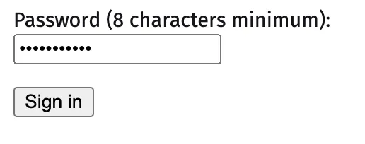

> 이 글은 2023-04-27에 티스토리 블로그(leirbag.tistory.com/143)에 처음 작성한 글을 옮겨온 것입니다.

웹 환경에서 사용자가 어떤 값을 입력하게 할 때 input 태그를 쓰는 것은 매우 당연합니다.

그렇다면 이 input 의 값을 숨기는 방법으로는 무엇이 있을까요?

대표적으로는 [password 타입](https://developer.mozilla.org/en-US/docs/Web/HTML/Element/input/password)이 있는데요, 사용자가 어떤 값을 입력하더라도 \*로 치환하여

화면 상에서 보이지 않도록 숨기는 역할을 합니다.



*MDN 문서에서 확인할 수 있는 비밀번호 예제*

하지만 이 input 입력 폼에 특정한 값만 숨기고, 특정한 값은 노출시키고 싶다면 어떻게 할 수 있을까요?

예를 들면 사용자가 카드 번호 16자리를 입력할 때, 뒤 8자리만 가려지게 할 수는 없을까요?

그러면서 하이픈까지 넣어주는 센스를 발휘할 수 있을까요?

1111222233334444 를 차례로 입력하면 1111 - 2222 - \*\*\*\* - \*\*\*\* 으로 변환되어 input태그에 출력할 수 있을까요?

일단 앞선 숫자를 오른쪽의 변환된 형태로 출력하는건 어렵지 않을 것 같습니다.

예를 들면 사용자의 입력 상태에 따라서 다음과 같이 변환되어 출력되어야 합니다.

11112222 => 1111 - 2222

111122223 => 1111 - 2222 - \*

1111222233 => 1111 -2222 - \*\*

리액트에서의 input 태그는 value 값을 상태에 엮어서 관리할 수 가 있으므로 여러 아이디어가 있을 수 있는데요,

그중에서 굉장히 일반적인 input 태그 속성을 활용한 아이디어를 생각해보면 다음과 같습니다.

1\. 상태를 선언해서 input 태그에 value 속성에 상태 값을 걸어둔다.

2\. onChange 속성에는 값을 필터링 하여 상태를 업데이트 할 수 있는 함수를 걸어둔다.

자. 그렇다면 실제로 이런 설계가 가능한지 한번 만들어 볼까요?

```javascript
const [value, setValue] = useState('');

const handleValue = (e) => {
    const securedValue = 어떤변환함수(e.target.value);
    setValue(securedValue);
}

return (
    <input value={value} onChange={handleValue} />
)
```

아마 이를 실제로 구현해보신다면 한가지 큰 문제에 직면할 것 입니다.

일단 onChange에 걸린 이벤트는 현재 input태그에 있는 값을 기준으로 연산하므로 하이픈이나 \*이 포함된 상태로 값을 읽어오게 됩니다.

하이픈은 정규식으로 어떻게 하면 잘 지울 수 있겠지만, \*로 가려진 숫자는 어떻게 복원할 수 있을까요?

예를 들면 1111 - 2222 (실제 값 11112222)에서 3을 누르는 순간 1111 - 2222 - \* 이 출력 될 것이고, 상태도 1111 - 2222 - \* 가 저장되게 됩니다.

이는 아주 큰 문제인데요, 사용자가 어떤 값을 입력하더라도 onChange에 걸린 이벤트는 원본이 훼손된 value를 읽으려고 시도하게 되므로 결국 나머지 8자리는 값이 사라지게 됩니다.

그렇다면 원본을 어딘가에 별도로 저장하려는 시도는 어떨까요?

```javascript
const [value, setValue] = useState('');

const handleValue = (e) => {
    foo(e.target.value) // 항상 마지막 값을 어딘가에 저장해주는 함수 (이때까지의 마지막 값은 훼손되지 않는다.)
    const securedValue = 어떤변환함수(e.target.value);
    setValue(securedValue);
}

return (
    <input value={value} onChange={handleValue} />
)
```

이런식으로 마스킹 되지 않은 마지막 값을 읽어들여서 어떻게 잘 하면 원본을 유지할 수 있지 않을까요?

좋은 아이디어였지만 한 가지 치명적인 문제가 있습니다.

만일 사용자가 input 태그를 순서대로 즉, 마지막 자리에 이어서 작성 행위에서 벗어나는 입력을 시도하게 되면 ***어떤 값이 새로운 값인지 알아내기 굉장히 어려워집니다***.

추적이 어려워진 값을 이용하여 원본을 업데이트를 하는 것은 굉장히 신뢰도가 낮거나 이를 처리하기 위해 너무 많은 함수가 동원되어 배보다 배꼽이 더 큰 상황이 될 것입니다.

물론 어떻게 잘 하면 구현할 수 있겠지만요.

이를 단순한 아이디어로 구현하는 방법에 대해서 소개하려고 합니다.

## 눈 속임을 이용한 커스텀 비밀 번호 만들기

핵심 아이디어는 다음과 같습니다.

1\. 표시용 input 태그와 실제로 값을 관리할 input 태그를 각각 둡니다.  
2\. 표시용 input 태그는 값을 직접 관리하지 않고 사용자에게 값을 표시하는 역할만을 하게 됩니다.  
3\. 표시용 input 태그를 누르게 되면 실제로 값을 관리할 input 태그로 focus를 이동하게 합니다. (움짤에서도 표시용을 누르는 순간 다른 곳으로 포커싱이 이동됩니다.)  
4\. 실제로 값을 관리하는 input 태그는 값을 입력받고, 상태를 업데이트하는 역할을 합니다.  
5\. 업데이트 된 상태의 값은 표시용 input 태그에서 변환하여 보여줍니다.


*이렇게 input 을 두개로 두는 이유는 뒤에 나옵니다.*

아직 이게 도대체 무슨 소리인지 당연히 이해가 가지 않을 것입니다.

왜 input 창을 두개로 둬야하지? 이에 대한 답은 후술하겠습니다.

```javascript
import { useRef, useState } from "react";

const convertSecuredCreditCard = (number: string) => {
  const creditCardNumberLength = number.length;
  const securedCreditNumber = creditCardNumberLength <= 8
    ? number
    : number.slice(0, 8) + '●'.repeat(number.length - 8);
  const numberArrays = securedCreditNumber.match(/.{1,4}/g) ?? [];
  return numberArrays.map((n) => n.split(''));
};

function CustomPassword() {
  const inputRef = useRef<HTMLInputElement>(null);
  const [maskedPassword, setMaskedPassword] = useState('');
  const [rawPassword, setRawPassword] = useState('');

  const handleChangeCreditCardNumber = (event: React.ChangeEvent<HTMLInputElement>) => {
    const newCreditCardNumber = event.target.value.replace(/\D/g, '');
    if (newCreditCardNumber.length > 16) return;

    const markedNumber = convertSecuredCreditCard(newCreditCardNumber)
      .filter((numbers) => !!numbers.length)
      .map((numbers) => numbers.join('')).join(' - ');

    setMaskedPassword(markedNumber);
    setRawPassword(newCreditCardNumber);
  };

  return (
    <div>
      <h1>커스텀 패스워드</h1>
      <div>
        ↓ 표시용 패스워드
      </div>
      <div>
        <input
          value={maskedPassword}
          onClick={() => {
            if (inputRef.current) {
              inputRef.current.focus();
            }
          }}
        />
      </div>
      <div>
        <input
          ref={inputRef}
          value={rawPassword}
          onChange={handleChangeCreditCardNumber}
        />
      </div>
      <div>
        ↑ 진짜 패스워드
      </div>
    </div>
  )
}
export default CustomPassword;
```

이렇게 input 두개를 이용하여 표시용과 입력용을 나눈 후,

***이후에 실제로 입력받는 input을 css로 가려버리면 됩니다. 겹쳐도 됩니다.***

굉장히 황당한 아이디어지만, input 창 하나로 데이터를 관리를 할 수 있다는 장점이 있습니다.

다만, 사용자 입장에서는 커서도 보이지 않고, 중간 수정이 불가능하게 되어 당황할 수 있습니다.

사실 표시용 input은 input이 아니어도 됩니다.

input과 동일한 디자인을 가진 div나 span태그여도 상관이 없습니다.

다만 디자인을 쉽게 하기 위한 제안 중 하나입니다.


*표시용 태그와 입력용 input 태그를 css로 겹치면 이런 효과도 쉽게 구현할 수 있습니다.*

위와 같은 기능 처럼 여러 CSS적인 효과를 추가로 주게 되면 사용자가 눈치채지 못하게 구현할 수 있습니다.

이전의 아이디어와 마찬가지로 입력값의 중간 수정은 여전히 어렵다는 단점이 있습니다.

하지만 더 적은량의 코드로 구현할 수 있다는 강력한 장점이 있습니다.
