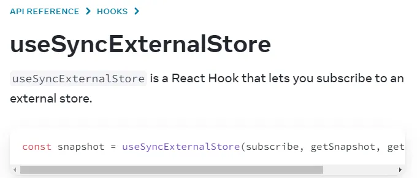
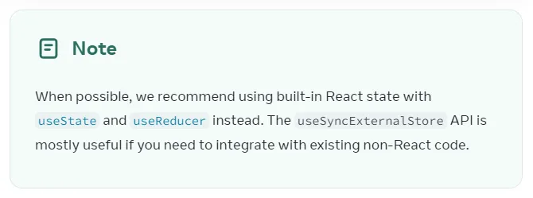
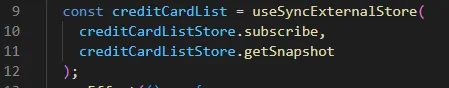
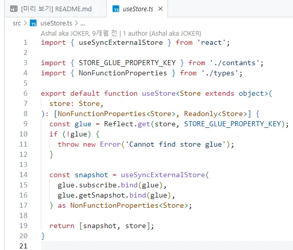

> 이 글은 2023-05-02에 티스토리 블로그(leirbag.tistory.com/144)에 처음 작성한 글을 옮겨온 것입니다.



지금 이 글을 쓰는 이 시점(2023년 5월)에서 useSyncExternalStore는 리액트 생태계에서 여전히 생소한 주제일 뿐만 아니라, 리액트 18부터만 지원하는 훅입니다. 이 훅은 외부의 저장소(store)를 구독할 수 있도록 하는 기능을 가지고 있습니다. 저는 이 글에서 Tearing 현상이나 해결법에 관련한 글이 아닌, 이 기능을 오용(?)하여 전역 상태처럼 관리할 수 있는 기능에 대해 소개하려고 합니다. 사실 이 글을 쓰는 지금 이 순간에도 useSyncExternalStore에 대한 정보를 찾아보려고 해도 국내에는 많은 레퍼런스가 존재하지 않기에 불분명한 출처의 자료가 될 수도 있습니다. ~~다행히도 저와 같은 주장을 하는 해외 기사 몇 가지를 발견했지만요.~~ 또한, 후술하겠지만 제가 앞으로 설명할 방법에 대해서 React 공식 문서에서 비추천하는 부분이 다소 섞여 있으므로 단순히 흥미로운 아이디어나 기능 소개글 중 하나로 읽어보시기 바랍니다. ~~반란군~~

### 가능성을 알게 되다 ...

최근 주변 사람과 식사를 하던 도중 흥미로운 이야기를 들었는데요, 전에 참석했던 FE 컨퍼런스에서 알게된 훅이 굉장히 재밌다는 것이었습니다. 그 훅은 다름이 아닌 useSyncExternalStore으로, 뭔가 잘 건들면 전역 상태 관리의 영역에서도 활용이 가능할 것 같다는 힌트를 줬습니다. (사실 이게 무슨 역할인지는 자세히는 모르고 해당 컨퍼런스에서 누군가 이 기능으로 상태 관리의 전쟁을 끝내겠다는 주제로 발표를 했다고 했습니다.)

안 그래도 최근 상태 관리 라이브러리 없이 컴포넌트 간에 정보를 전달할 수 있는 방법이 Context API나 굉장히 복잡한 과정의 훅을 조합한 구현체 말고 간단한 방법이 무엇이 있는지 굉장히 궁금해하던 찰나에 이런 귀중한 키워드를 알게 된 저는 밥을 먹는 둥 마는 둥 하면서 [공식문서](https://react.dev/reference/react/useSyncExternalStore)를 쭉 읽어보게 됐습니다.

### useSyncExternalStore란?

이 문서에서의 핵심 내용은 다음과 같습니다.

```typescript
import { useSyncExternalStore } from 'react';
import { todosStore } from './todoStore.js';

function TodosApp() {
  const todos = useSyncExternalStore(todosStore.subscribe, todosStore.getSnapshot);
  // ...
}
```

useSyncExternalStore는 저장소(store)에 있는 데이터의 snapshot을 반환합니다. 제가 이해한 것이 맞다면 일반적으로 React에서의 snapshot이란 어떤 특정 순간의 상태를 의미하겠지요. 마지 영화를 볼 때 frame의 한 장면처럼요.

이 스냅샷을 받기 위해서는 2가지의 함수를 파라미터로 전달해야 하는데요,

첫 번째 인자로 전달하는 subscribe 함수는 저장소에 구독을 하거나 취소를 할 수 있는 함수를 전달해야 합니다. 스토어가 변경되면 제공된 콜백을 호출할 수 있어야 하며, 단일 콜백 인자를 사용하여 저장소를 구독할 수 있는 함수입니다.

두 번째 인자로 전달하는 getSnapshot 함수는 저장소에서 데이터의 스냅샷을 읽어야 합니다.

세 번째 인자는 옵셔널 하지만, 서버 렌더링 중 hydration과 관련이 있는 인수라고 합니다. 저는 next.js 같은 서버 사이드 렌더링 프레임워크에 대한 이해도가 굉장히 낮으므로 이 옵션에 대해서는 특별하게 드릴 말씀이 없습니다. ([제가 찾아본 영상들 중에는 이를 활용한 영상](https://youtu.be/GMeQ51MCegI?t=856)이 존재하였으나, SSR에 관련된 어떤 문제가 있는지를 모르는 저는, 제대로 된 이해를 할 수 없었습니다.??)

저장소의 스냅샷은 반드시 immutable(불변해야) 하고 변경할 수 없는 데이터를 반환해야 한다고 합니다. 저장소에 변경 가능한 데이터가 있는 경우에 해당 데이터가 변경된 경우, 변경할 수 없는 새 스냅샷을 반환한다고 합니다. 마치 useState에서의 상태 값을 다루는 것과 비슷한 느낌입니다. useState의 상태도 기본적으로 불변하지는 않지만, 불변하다고 가정하고 setState로 다루는 것이 권장되듯이 아주 강력한 강제성이 있는 것 같지는 않게 설명이 되어있습니다.

> 하지만 결국 불변성을 지키지 않으면 사용자가 의도한 대로 동작하지 않을 것이니, 불변성을 유지해야만 할 것입니다.

일반적인 React의 컴포넌트들은 props, state, context 정도만을 읽어서 동작할 것입니다. 하지만 상태 관리 라이브러리(ex. redux, recoil, mobx, zustand 등)를 사용하거나 Browser API를 사용하여 특정 값을 읽어 들여 리액트에서 사용해야 할 때에는 어떤 문제(예를 들면 티어링)가 발생하는 것 같습니다. 제가 읽어본 문서들 중 많은 도움이 됐던 문서나 영상들을 추가로 첨부해 드리면 다음과 같습니다.

[\- What is tearing? #69](https://github.com/reactwg/react-18/discussions/69)

> [**What is tearing? · reactwg/react-18 · Discussion #69**](https://github.com/reactwg/react-18/discussions/69)  
> Overview Tearing is a term traditionally used in graphics programming to refer to a visual inconsistency. For example, in a video, screen tearing is when you see multiple frames in a single screen,...

[\- React 18 for External Store Libraries](https://www.youtube.com/watch?v=oPfSC5bQPR8)

<iframe src="https://www.youtube.com/embed/oPfSC5bQPR8" title="video" style="width:100%;aspect-ratio:16/9;border:0" loading="lazy" allowfullscreen=""></iframe>

티어링 현상이 특히 React 18에서 상태 관리 라이브러리를 사용할 때 발생하는 것으로 알려져 있는데요, 18 버전으로 넘어오면서 Concurrent Rendering(동시 렌더링, [Dan Abramov가 설명한 부분](https://github.com/reactwg/react-18/discussions/46)으로 갈음하겠습니다.)을 지원하는 과정에서 React DOM 바깥과의 소통이 내부적으로 더 복잡해지고 어려워진 것 같습니다. 티어링에 관한 문제는 이 글에서 소개하는 것보다 구글링을 하시는 것이 더 정확한 정보를 얻을 수 있겠습니다.

위 링크에 있는 React Conf 2021에서 useSyncExternalStore 소개 영상의 주인공이자 해당 기능을 주도하여 개발한 [Daishi Kato의 Will this React global state work in concurrent rendering?](https://github.com/dai-shi/will-this-react-global-state-work-in-concurrent-rendering/) 문서에서 확인해 볼 수 있듯이 전역 상태 관리라이브러리의 티어링 관련 실험 결과에 따르면 서드파티 라이브러리의 문제가 발생하는 듯합니다.

즉, 이런 티어링 문제를 해결하기 위해서 타사의 라이브러리와의 연결을 할 어떤 기능이 필요했고, [개발 과정에서 useMutableSource 같은 기능들이 제시되었지만 결국 useSyncExternalStore이 출시되는 것으로 확정](https://github.com/reactwg/react-18/discussions/86)이 되었습니다.

useSyncExternalStore는 저장소(store)에 대한 업데이트를 강제 동기화하여 외부 저장소가 concurrent reading(동시 읽기)를 지원할 수 있도록 하는 새로운 hook입니다. 외부 데이터 원본에 대한 구독을 구현할 때 useEffect가 필요하지 않으며 [React 외부 상태와 통합되는 모든 라이브러리에 권장](https://react.dev/blog/2022/03/29/react-v18#usesyncexternalstore)된다고 합니다.

실제로 공식문서에 나와있는 참고문에 따르면 다음과 같습니다.



*리액트 공식 문서에서 찾을 수 있는 NOTE 이다.*

React 코드가 아닌 어떤 API (ex. 상태 관리 라이브러리)와 통합할 때 굉장히 유용하다고 합니다. 즉, ***React가 상태관리를 정상적으로 하고 있는 상황이라면 useState나 useReducer로 상태 관리를 하도록 권장하고 있습니다.***

## useSyncExternalStore로 전역 상태 관리해보기

하지만 저는 이 과정에서 의문(?)을 품고 ***리액트 팀에서 비권장하는 방법을 시도***하였는데요,

일단 제가 해보고 싶은 것은 여러 페이지에서 어떤 배열(creditCardList)을 전역적으로 공유하게 하고 싶었습니다.

```typescript
import { creditCardListStore } from 'stores/creditCardListStore';
import { useSyncExternalStore } from 'react';

function Home() {
  const creditCardList = useSyncExternalStore(
    creditCardListStore.subscribe,
    creditCardListStore.getSnapshot
  );
  ...
```

이렇게만 말하면 무슨 소리인지 이해하기가 어려우니 스냅샷을 다루는 코드까지 첨부를 하겠습니다.

```typescript
/* eslint-disable no-restricted-syntax */
import * as T from 'types';

let creditCardList: T.CreditCard[] = [];
let listeners: Array<() => void> = [];

function emitChange() {
  for (const listener of listeners) {
    listener();
  }
}

export const creditCardListStore = {
  addCreditCard(newCreditCard: T.CreditCard) {
    creditCardList = [...creditCardList, newCreditCard];
    emitChange();
  },
  subscribe(listener: () => void) {
    listeners = [...listeners, listener];
    return () => {
      listeners = listeners.filter((l) => l !== listener);
    };
  },
  getSnapshot() {
    return creditCardList;
  },
};
```

이와 같이 subscribe와 getSnapshot 메서드는 반드시 필수로 구현하여 useSyncExternalStore에서 반드시 접근할 수 있도록 하였으며, 해당 메서드들이 리스너를 구독/해지하거나 현재의 스냅샷인 creditCardList를 외부로 배출해 주는 역할을 하도록 하였습니다. 또, 별도로 상태(creditCardList)를 관리하고 싶다면 addCreditCard()와 같이 해당 상태를 조작하는 메서드를 하나씩 늘려주면 됩니다.

직접 만든 커스텀 메서드에는 항상 리스너를 실행(emitChange())시켜줄 수 있도록 해야합니다.

~~다만 여기에서 creditCardList를 상태라고 명명해도 되는지 모르겠습니다.~~

분명히 이 저장소 코드(creditCardListStore)는 전혀 React 스럽지 않고 vanillaJS스러운 코드가 맞습니다.

그럼에도 불구하고 어떤 컴포넌트에서든지 다음과 같이 useSyncExternalStore로 접근하게 되면 동일한 값을 활용하고, 마치 useState의 상태처럼 재렌더링까지 할 수 있게 됩니다.



*어떤 컴포넌트라도 전역 상태처럼 접근할 수 있다.*

실제로 공식 문서에 있는 예제를 구현해서 테스트해보면 여러 컴포넌트에 접근이 가능해지는 것은 물론이고 Context API와 달리 특정 영역만 재렌더링이 되는 것을 확인할 수 있습니다.


*최적화의 문제에서 자유로운 것일까?*

### 그래서 왜 비권장 하는 방법으로 useSyncExternalStore를 쓰는 법을 공유했나요?

사실 제가 이 글을 쓰기 전, 쓸까 말까 엄청난 고민 끝에 업로드할 수 있게 된 계기는 다음과 같습니다.

저 말고도 이미 이런 시도를 하신 분들이 계셨다는 것입니다...

[https://youtu.be/KEDUqA9JeIo](https://youtu.be/KEDUqA9JeIo)

<iframe src="https://www.youtube.com/embed/KEDUqA9JeIo" title="video" style="width:100%;aspect-ratio:16/9;border:0" loading="lazy" allowfullscreen=""></iframe>

위 영상은 제가 구현한 코드와 달리 도메인 로직을 클래스로 전부 구현해 버리셔서 저와는 분명히 다른 코드이지만, 동작 방식 자체나 컨셉 자체는 굉장히 유사합니다. 제 생각에는 티어링 같은 부분을 고려하기 보다는 상태 관리할 수 있는 툴로써 작성하신 것 같습니다. 시간이 없으시면 위 영상 하나만 봐도 모든게 이해가 될 정도로 깔끔하게 설명하셨습니다.

참고로 위 영상에서 [useSyncExternalStore로 만든 전역상태관리 라이브러리](https://github.com/seed2whale/usestore-ts)도 있다고 합니다.



*라이브러리 구조는 위와 같습니다.*

[https://javascript.plainenglish.io/usesyncexternalstore-to-manage-global-state-in-react-ac31c7191376](https://javascript.plainenglish.io/usesyncexternalstore-to-manage-global-state-in-react-ac31c7191376)

> [**UseSyncExternalStore to Manage Global State in React**](https://javascript.plainenglish.io/usesyncexternalstore-to-manage-global-state-in-react-ac31c7191376)  
> We all know how React want us to manage states, mostly through the Hook. I wrote a book about it Designing React Hooks the Right Way where…

[https://betterprogramming.pub/react-state-management-without-dependencies-237c8c7e1c5](https://betterprogramming.pub/react-state-management-without-dependencies-237c8c7e1c5)

> [**React State Management Without Dependencies**](https://betterprogramming.pub/react-state-management-without-dependencies-237c8c7e1c5)  
> How to create global state management in React applications without side dependencies and unnecessary rerendering

위 두 개의 자료도 마찬가지입니다.

저와 코드가 겹치지는 않지만, 스냅샷을 다루는 구조 자체는 굉장히 유사합니다.

물론 저는 그냥 공식 문서에 있는 자료만 따라 했을 뿐이지만 말이죠.

리액트 팀에서는 이 기능을 외부 전역상태관리 라이브러리에 연결해서 쓰라고 출시한 것 같지만, ***꼭 그렇게만 사용해야 할까?*** 라는 엉뚱한 아이디어에서 출발한 글이었습니다. 실제로 위 사례들을 봤을 때 저처럼 티어링 문제를 해결하기 위한 목적이 아닌 순수 리액트에서만 전역 상태 관리를 손쉽게 하려는 목적으로 사용하려는 사람들이 존재하는 것 같습니다.

애초에 국내에 자료가 거의 없기도 하고, 너무 최신 기능이기도 하고, 애초에 전역 상태 관리 라이브러리를 쓰는 것을 가정하고 나온 API다 보니 논의도 잘 되지 않는 것 같은데 다른 사람들의 의견이 궁금해지는 기술이네요.

#### 추가로 읽어보면 좋은 자료

\- [리액트의 상태 관리가 춘추전국시대를 겪은 이유](https://frontendmastery.com/posts/the-new-wave-of-react-state-management/)가 나와있는 글

\- useSyncExternalStore 없이 hook으로 [전역 상태 관리를 구현](https://academind.com/tutorials/global-state-management-with-react-hooks)하는 글 (난이도 上, 이 글에서도 옵저버 패턴으로 구현을 시도)

\------ 추가 ------

이 훅으로 만들어보는 전역상태관리 라이브러리입니다.

기존 공식문서 예제를 추상화하면 유용한 기능으로 재탄생 됩니다.

[useSyncExternalStore로 만들어보는 전역상태관리 라이브러리](../2023-07-05-tistory-151/)

> [**useSyncExternalStore로 만들어보는 전역상태관리 라이브러리**](../2023-07-05-tistory-151/)  
> 몇 달 전부터 전역상태관리 라이브러리를 직접 만들어보고 싶었는데, 우테코 방학 기간에 심심해서 만들어 봤습니다. 혹시 useSyncExternalStore가 무엇인지 처음 들어보신다면 이 문서를 확인해보시
