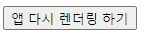
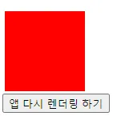

> 이 글은 2023-05-17에 티스토리 블로그(leirbag.tistory.com/147)에 처음 작성한 글을 옮겨온 것입니다.

React로 작성 된 프로젝트가 규모가 커지면 커질수록 관리해야하는 컴포넌트의 갯수가 많아지게 됩니다.

큰 규모의 애플리케이션에서는 React 컴포넌트의 렌더링 성능이 곧 사용자 경험에 영향을 미치게 됩니다.

따라서 렌더링을 최소화 하여 React의 성능을 극대화할 필요가 있는데요, 그 중에서도 리액트의 메모이제이션을 소개하려고 합니다.

메모이제이션이나 memo, useMemo, useCallback같은 경우에는 리액트 공식 문서에도 좋은 예제와 함께 설명도 잘 되어있지만

좀 더 명확하게 보일 수 있도록 상황과 예제를 작성해봤습니다.

### React에서는 재렌더링(re-rendering)이 언제 일어나는가?

React는 상태가 바뀌면 본인과 그 자식들이 모두 재렌더링 됩니다.

다음과 같은 코드가 있습니다.

```typescript
import { useState } from "react";

function NonOptimization() {
  const [appRenderCount, setAppRenderCount] = useState(0);

  console.log(`랜더링 횟수 : ${appRenderCount}`);

  return (
    <>
      <button
        onClick={() => setAppRenderCount(appRenderCount + 1)}
      >
        앱 다시 렌더링 하기
      </button>
    </>
  )
}

export default NonOptimization;
```



버튼을 여러번 눌러보면 렌더링이 될 때마다 출력문이 찍히는 것을 확인할 수 있습니다.


당연하지만 이 코드에서는 버튼을 누를 때 마다 자신의 상태를 업데이트 하고 있으므로 재 렌더링이 일어나면서 그에 해당하는 모든 코드들도 다시 실행됩니다.

따라서 콘솔에 계속 값이 찍히게 되는 것이겠죠?

### 재렌더링(re-rendering)이 일어날 때 자식 컴포넌트들은 어떻게 될까?

재렌더링 할 때에는 컴포넌트도 다시 새롭게 그립니다.

이번에는 Box라는 자식 컴포넌트를 추가하여 한번 확인해보겠습니다.

```typescript
import { useState } from "react";

function Box() {
  console.log('Box 렌더링 됨')
  return (
    <div style={{ width: "100px", height: "100px", margin: '3px', backgroundColor: 'red' }} />
  )
}

function NonOptimization() {
  const [appRenderCount, setAppRenderCount] = useState(0);

  console.log(`랜더링 횟수 : ${appRenderCount}`);

  return (
    <>
      <Box />
      <button
        onClick={() => setAppRenderCount(appRenderCount + 1)}
      >
        앱 다시 렌더링 하기
      </button>
    </>
  )
}

export default NonOptimization;
```

마찬가지로 버튼을 누를 때 마다 Box가 다시 그려지는 것을 확인할 수 있습니다.


### React.memo() 를 사용하여 자식 컴포넌트의 재렌더링 방지하기

메모이제이션을 사용하면 React 컴포넌트의 재 렌더링을 방지할 수 있다고들 하는데 실제로 그럴까요?

공식 문서를 확인해보면 다음과 같이 말합니다.

> memo lets you skip re-rendering a component when its props are unchanged.  

props가 변하지 않았을 때에만 재렌더링을 건너 뛴다고 합니다.

Box의 경우에는 현재 넘겨주는 prop 자체가 없으므로 memo를 적용하면 재 렌더링이 방지되지 않을까요?

확인해봅시다.

```typescript
import { memo, useState } from "react";

function Box() {
  console.log('Box 렌더링 됨')
  return (
    <div style={{ width: "100px", height: "100px", margin: '3px', backgroundColor: 'red' }} />
  )
}

const MemoedBox = memo(Box);

function NonOptimization() {
  const [appRenderCount, setAppRenderCount] = useState(0);

  console.log(`랜더링 횟수 : ${appRenderCount}`);

  return (
    <>
      <MemoedBox />
      <button
        onClick={() => setAppRenderCount(appRenderCount + 1)}
      >
        앱 다시 렌더링 하기
      </button>
    </>
  )
}

export default NonOptimization;
```

버튼을 마구마구 눌러보면 다음과 같은 결과가 나오는데요




memo 처리된 컴포넌트의 props의 변화가 없으므로 재렌더링을 건너 뛰게 됨을 확인할 수 있습니다.

해당 컴포넌트가 다시 그려지지 않았으므로 콘솔도 최초 1회만 찍히고 그 다음부터는 조용한 것을 확인할 수가 있습니다.

### 메모이제이션 처리된 컴포넌트의 props 상태가 바뀌면 React.memo() 는 어떤 의미가 있을까?

만약 앞선 예제 상태에서 자식(Box)의 props가 바뀐다면 어떻게 될까요?

Box 컴포넌트가 memo 처리 되어있는데요?

확인해보겠습니다.

```typescript
import { memo, useState } from "react";

function Box({ color }: { color: string }) {
  console.log('Box 렌더링 됨')
  return (
    <div style={{ width: "100px", height: "100px", margin: '3px', backgroundColor: color }} />
  )
}

const MemoedBox = memo(Box);

function NonOptimization() {
  const [appRenderCount, setAppRenderCount] = useState(0);
  const [color, setColor] = useState('red');

  console.log(`랜더링 횟수 : ${appRenderCount}`);

  return (
    <>
      <MemoedBox color={color} />
      <button
        onClick={() => setAppRenderCount(appRenderCount + 1)}
      >
        앱 다시 렌더링 하기
      </button>
      <button
        onClick={() => setColor(color === 'red' ? 'blue' : 'red')}
      >
        색상 바꾸기
      </button>
    </>
  )
}

export default NonOptimization;
```

이번에는 버튼이 두 가지가 있는데요, Box의 prop을 업데이트 하는 버튼과 부모 컴포넌트를 업데이트하는 버튼입니다.

둘을 눌러보면 Box의 재렌더링 여부가 갈리게 됩니다.


보시다시피 색상을 바꾸는 행위는 Box의 props를 업데이트 하는 행위이므로 Box가 memo처리 되어있어도 재렌더링을 진행하게 됩니다.

하지만 부모의 상태를 바꾸는 행위는 Box의 props를 변하게 하지 않기 때문에 부모 컴포넌트만 재렌더링을 진행하고 Box 컴포넌트는 건너 뛰게 됩니다.

### \+ 보너스

Box 컴포넌트 하나를 더 넣어 보겠습니다. 그래도 같은 결과일까요?

```typescript
import { memo, useState } from "react";

function Box({ color }: { color: string }) {
  console.log(`Box 렌더링 됨 : ${color}`)
  return (
    <div style={{ width: "100px", height: "100px", margin: '3px', backgroundColor: color }} />
  )
}

const MemoedBox = memo(Box);

function NonOptimization() {
  const [appRenderCount, setAppRenderCount] = useState(0);
  const [color, setColor] = useState('red');

  console.log(`랜더링 횟수 : ${appRenderCount}`);

  return (
    <>
      <MemoedBox color={color} />
      <MemoedBox color={color === 'red' ? 'blue' : 'red'} />
      <button
        onClick={() => setAppRenderCount(appRenderCount + 1)}
      >
        앱 다시 렌더링 하기
      </button>
      <button
        onClick={() => setColor(color === 'red' ? 'blue' : 'red')}
      >
        색상 바꾸기
      </button>
    </>
  )
}

export default NonOptimization;
```

놀랍게도 React.memo()가 잘 동작하는 것을 확인할 수 있습니다.


자식의 props가 바뀐 경우에만 재렌더링을 하고, 그 이외의 상황(props의 변화 없이 부모만 재렌더링)에는 최적화가 일어나서 다시 렌더링을 하지 않고 건너뜁니다.

### props가 객체일 때에는 어쩔 때에는 안되는 것 같은데요?

위 예제들은 색상 props을 string 형태로 넘겨주고 있었는데요. 이번에는 props를 객체로 바꿔보겠습니다.

실제로 React에서 작업하다보면 props에 객체를 넘기는 행위는 매우 빈번하게 일어나죠?

색상을 넘기는 props을 객체로 수정하면 memo 처리가 갑자기 안되는 것을 알 수 있답니다.

```typescript
import { memo, useState } from "react";

function Box({ params }: {
  params: { color: string }
}) {
  console.log(`Box 렌더링 됨 : ${params.color}`)
  return (
    <div style={{ width: "100px", height: "100px", margin: '3px', backgroundColor: params.color }} />
  )
}

const MemoedBox = memo(Box);

function NonOptimization() {
  const [appRenderCount, setAppRenderCount] = useState(0);
  const [color, setColor] = useState('red');

  console.log(`랜더링 횟수 : ${appRenderCount}`);

  return (
    <>
      <MemoedBox params={{ color }} />
      <button
        onClick={() => setAppRenderCount(appRenderCount + 1)}
      >
        앱 다시 렌더링 하기
      </button>
      <button
        onClick={() => setColor(color === 'red' ? 'blue' : 'red')}
      >
        색상 바꾸기
      </button>
    </>
  )
}

export default NonOptimization;
```


분명 Box는 메모이제이션이 적용되어 있고, 부모가 재렌더링 되더라도 자식 prop은 변하지 않았습니다.

그럼에도 불구하고 자식인 Box 컴포넌트가 재렌더링이 된 이유가 무엇일까요?

그 이유는 자바스크립트가 객체를 취급하는 방식에 있습니다.

위 예제는 이전 예제와 달리 params.color와 같이 객체의 prop을 참조하게 됩니다.

하지만 memo의 경우에는 prop의 얕은 비교([Shallow Comparison](https://legacy.reactjs.org/docs/shallow-compare.html))를 하고 있습니다.

재렌더링 과정에서 { color } 와 같이 객체를 새로 생성하게 되면 다른 주소 값을 참조하게 되므로 다르다고 판단하게 됩니다.

즉, 원시 값이 아니라면, 객체를 생성하는 과정이 있다면 memo 입장에서는 props가 변경되었다고 보게 될 것이므로 메모이제이션이 일어나지 않습니다.

한가지 대안이 있다면 props를 넘길 때 { color } 와 같은 형태로 객체를 생성해서 넘기는 것이 아닌

```typescript
  const [params, setParams] = useState({ color: 'red' });
```

```typescript
 <MemoedBox params={params} />
```

와 같이 넘겨준다면 객체를 새로 생성하지는 않을터이니 메모를 적용할 수 있기는 합니다.

다만, 앞선 예제 처럼 React에서는 컴포넌트에게 props를 넘길 때 객체를 즉시 생성해서 넘겨주는 행위가 빈번하므로 좋은 대안은 아니겠네요.

### 재렌더링으로 본의 아니게 새로 생성된 객체를 이전의 객체와 같은 것 처럼 취급하기 with useMemo()

최적화를 하고 싶은 (재렌더링으로 인해 잠재적으로 새로 생성될 것 같은) 객체에 useMemo를 걸어주면 재 렌더링 시 새로 생성하지 않고 같은 객체로 취급하게 됩니다.

```typescript
import { memo, useMemo, useState } from "react";

function Box({ params }: {
  params: { color: string }
}) {
  console.log(`Box 렌더링 됨 : ${params.color}`)
  return (
    <div style={{ width: "100px", height: "100px", margin: '3px', backgroundColor: params.color }} />
  )
}

const MemoedBox = memo(Box);

function NonOptimization() {
  const [appRenderCount, setAppRenderCount] = useState(0);
  const [color, setColor] = useState('red');

  console.log(`랜더링 횟수 : ${appRenderCount}`);

  const params = useMemo(() => ({ color }), [color]);

  return (
    <>
      <MemoedBox params={params} />
      <button
        onClick={() => setAppRenderCount(appRenderCount + 1)}
      >
        앱 다시 렌더링 하기
      </button>
      <button
        onClick={() => setColor(color === 'red' ? 'blue' : 'red')}
      >
        색상 바꾸기
      </button>
    </>
  )
}

export default NonOptimization;
```


이전 예제에서는 params={ {color} } 와 같이 매번 생성해줬지만, 이제는 const params = useMemo(() => ({ color }), \[color\]); 와 같이 params 자체를 최적화 할 수 있게 됐습니다.

### props에 함수를 넘겨줬더니 메모이제이션이 안됩니다!

앞선 예제에 이어서 이번에는 함수도 props로 넘겨주겠습니다.

다음 예제와 같이 코드를 수정해보면 메모이제이션이 또 다시 되지 않는 것을 확인할 수 있는데요

```typescript
/* eslint-disable @typescript-eslint/no-empty-function */
import { memo, useState } from "react";

function Box({ params, onClick }: {
  params: { color: string };
  onClick: () => void;
}) {
  console.log(`Box 렌더링 됨 : ${params.color}`)
  return (
    <div
      style={{
        width: "100px",
        height: "100px",
        margin: '3px',
        backgroundColor: params.color
      }}
      onClick={onClick}
    />
  )
}

const MemoedBox = memo(Box);

function NonOptimizationByCallback() {
  const [appRenderCount, setAppRenderCount] = useState(0);
  const [color, setColor] = useState('red');

  console.log(`랜더링 횟수 : ${appRenderCount}`);

  return (
    <>
      <MemoedBox params={{ color }} onClick={() => { }} />
      <button
        onClick={() => setAppRenderCount(appRenderCount + 1)}
      >
        앱 다시 렌더링 하기
      </button>
      <button
        onClick={() => setColor(color === 'red' ? 'blue' : 'red')}
      >
        색상 바꾸기
      </button>
    </>
  )
}

export default NonOptimizationByCallback;
```


앞선 객체 생성과 동시에 props으로 넘겨주는 예제에서 확인해보셨듯이 함수를 넘겨주는 행위도 비슷한 이유로 memo 에서 같은 함수라고 판단하지 않습니다.

함수도 마찬가지로 재렌더링 과정에서 새로 생성되는 것으로 취급하기 때문이죠.

그렇다면 어떻게 최적화를 할 수 있을까요?

### 재렌더링으로 본의 아니게 새로 생성된 함수를 이전의 함수와 같은 것 처럼 취급하기 with useCallback()

앞선 객체와 비슷한 방법으로 최적화를 진행할 수 있습니다.

전달할 함수를 useCallback으로 감싸면 함수가 재생성 되지 않아서 최적화 됩니다.

```typescript
/* eslint-disable @typescript-eslint/no-empty-function */
import { memo, useCallback, useMemo, useState } from "react";

function Box({ params, onClick }: {
  params: { color: string };
  onClick: () => void;
}) {
  console.log(`Box 렌더링 됨 : ${params.color}`)
  return (
    <div
      style={{
        width: "100px",
        height: "100px",
        margin: '3px',
        backgroundColor: params.color
      }}
      onClick={onClick}
    />
  )
}

const MemoedBox = memo(Box);

function OptimizationByCallback() {
  const [appRenderCount, setAppRenderCount] = useState(0);
  const [color, setColor] = useState('red');

  console.log(`랜더링 횟수 : ${appRenderCount}`);

  const params = useMemo(() => ({ color }), [color]);
  const onClick = useCallback(() => { }, []);

  return (
    <>
      <MemoedBox params={params} onClick={onClick} />
      <button
        onClick={() => setAppRenderCount(appRenderCount + 1)}
      >
        앱 다시 렌더링 하기
      </button>
      <button
        onClick={() => setColor(color === 'red' ? 'blue' : 'red')}
      >
        색상 바꾸기
      </button>
    </>
  )
}

export default OptimizationByCallback;
```


*화면 하단이 잘려서 콘솔 창이 일부 일치하지 않는 것 처럼 보일 수 있습니다.*

이처럼 함수가 재 생성 되는 것도 메모이제이션 처리를 하여 최적화를 유도할 수 있습니다.
