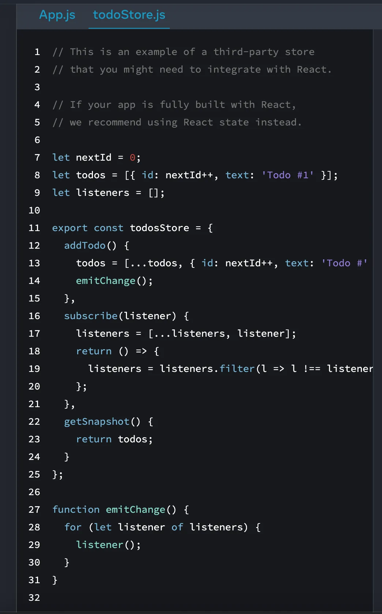
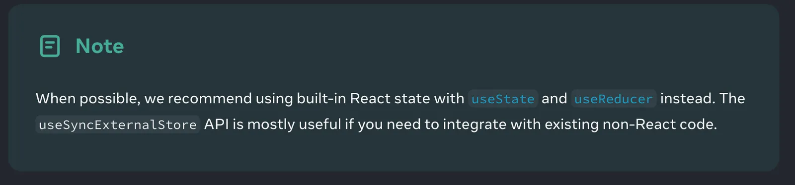
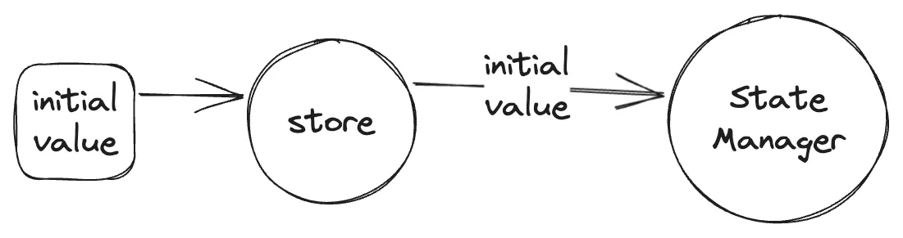
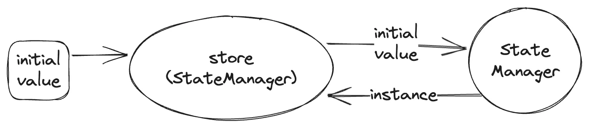
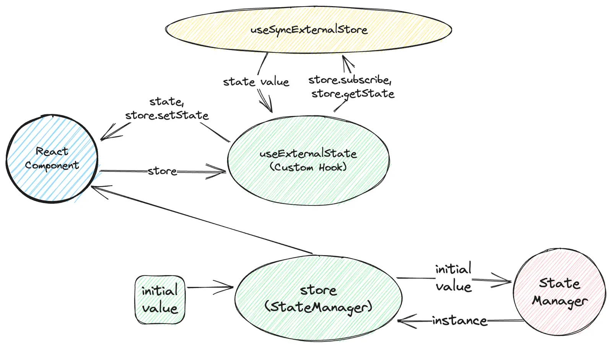

> 이 글은 2023-07-05에 티스토리 블로그(leirbag.tistory.com/151)에 처음 작성한 글을 옮겨온 것입니다.

몇 달 전부터 전역상태관리 라이브러리를 직접 만들어보고 싶었는데, 우테코 방학 기간에 심심해서 만들어 봤습니다.  
혹시 useSyncExternalStore가 무엇인지 처음 들어보신다면 [이 문서를 확인](../2023-05-02-tistory-144/)해보시는 것도 좋습니다.  
제가 사용해 본 라이브러리의 폭이 넓지는 않지만 RTK, recoil, zustand를 사용해 본 결과 여러 가지 불만스러운 점이 많았습니다.  
라이브러리는 아니지만 context API까지의 비교를 해보겠습니다.

<table><tbody><tr><td>&nbsp;</td><td>장점</td><td>단점</td></tr><tr><td>RTK</td><td>주요 비즈니스 로직을 한 곳에 모으도록 하는 탑 다운 방식의 중앙 집중형 상태 관리를 강제한다.</td><td>보일러 플레이트 코드의 양이 상당하고, 러닝 커브가 큰 편이다. react에서 해야할 일을 정해진 함수 내에서 억지로 사용하게 하는 느낌이 든다.</td></tr><tr><td>recoil</td><td>바텀업 방식의 아톰 기반 상태관리를 지원한다. react의 useState훅과 비슷한 사용 방법을 지원한다.</td><td><span>재사용이 가능한 비즈니스 로직을 한 곳에 모으려면</span><span>&nbsp;</span><a href="../2023-06-03-tistory-148/"><span><span>여러 가지 작업</span></span></a>이 필요하다. 제대로 다루지 못하면 최적화가 무용지물이 된다.</td></tr><tr><td>zustand</td><td>쉽다. 누구나 금방 배울 수 있는 난이도와 분량이다.</td><td>개인적으로 다소 납득하기 어려운 사용법(setter)이 존재한다.</td></tr><tr><td>context API</td><td>별도의 라이브러리 설치 없이 react 내장 기능으로만 구현이 가능하다&nbsp;</td><td>보일러 플레이트 코드가 큰 편이고, 최적화 문제가 있다.</td></tr></tbody></table>

  
특히 tanstack-query가 메인스트림으로 부상하고 있는 시점에서 대부분의 상태를 tanstack-query 혹은 SWR이 ***서버 상태***로 관리하게 되어 기존의 [상태관리 라이브러리가 더이상 복잡한 상태 관리를 하지 않아도 될 가능성](https://tkdodo.eu/blog/practical-react-query#client-state-vs-server-state)이 커졌다고 생각합니다. 그렇다고 해서 기존의 상태관리 라이브러리들이 완전히 사라지는 것이 아닌 가벼운 클라이언트 상태 관리 정도만 해줘도 된다고 생각하는데요, 이에 대한 좋은 예시가 다음 영상에 나와있으니 참고하시면 좋을 것 같습니다.  
[https://youtu.be/HcVCb36WZZk](https://youtu.be/HcVCb36WZZk)

<iframe src="https://www.youtube.com/embed/HcVCb36WZZk" title="video" style="width:100%;aspect-ratio:16/9;border:0" loading="lazy" allowfullscreen=""></iframe>

  
이런 상황이다 보니 간단한 상태 관리를 위해 보일러플레이트가 큰 상태관리 라이브러리들을 사용하기보다는 정말 간단한 필수 기능만 있는 간단한 라이브러리들을 선호하게 됐다고 생각합니다.  
단순한 상태 관리를 위해 redux를 쓰는 것은 다소 복잡하고 귀찮은 작업이 될테니깐요  
  
더군다나 저처럼 상태관리 라이브러리를 컴포넌트 간의 단순한 상태 공유를 목적으로만 사용한다면 더더욱 기존의 복잡한 기능들이나 코드들이 불필요하게 느껴지게 됩니다. 상태를 과거의 스냅샷으로 복원한다거나 디버깅하는 것을 잘 쓰지 않는다면 말이죠.  
그래서 recoil, zustand, jotai, context api 등 좀 더 가벼운 기술들이 점점 선호되는 것이 아닌가 생각합니다.  
  
저는 이 중에서도 **zustand의 간결함**과 **recoil의 상태 훅**이 굉장히 마음에 들었고, [useSyncExternalStore](../2023-05-02-tistory-144/) 훅을 사용하면 이를 적절히 섞어서 훨씬 간단한 코드로 구현할 수 있을 것이라고 생각했습니다.  
  

## useSyncExternalStore을 좀 더 우아하게 쓸 수 없을까?

> 해보진 않았지만 분명히 될 것 같은데?

  
그동안은 훅을 [공식 문서에 나와있는 방법](https://react.dev/reference/react/useSyncExternalStore#subscribing-to-an-external-store)으로만 사용했었습니다.  
하지만 예제를 보면 볼수록 추상화가 가능할 것 같았습니다.



*addTodo() 메서드를 제외하면 나머지 코드들은 유틸의 냄새가 강하게 난다*

  
안 그래도 최근 진행하고 있는 프로젝트에서 바닐라 JS로 작성된 google maps api 인스턴스와 리액트의 강한 결합이 필요한 상황이었는데 리액트와 외부 JS인스턴스를 적절하게 통합시켜줄 적절한 기술이기도 했습니다.  
  

## 기본적으로 설계한 아이디어

일단 기본 훅 컨셉은 recoil의 아이디어를 따오기로 생각했습니다.  
어떤 atom역할을 하는 변수가 존재하고, useRecoilState, useRecoilValue, useSetRecoilState 같은 친숙한 훅을 사용할 수 있어야 합니다.  
그리고 [useCallback](https://recoiljs.org/docs/api-reference/core/useRecoilCallback)이나 [Snapshot객체](https://recoiljs.org/docs/api-reference/core/Snapshot)는 굉장히 유용하지만 문법 자체가 너무 지저분하다고 생각하여 과감하게 포기하기로 했습니다.  
참고로 제가 recoil에 가진 [불만은](https://github.com/woowacourse/react-shopping-cart/pull/161)... [여러 곳에](https://github.com/woowacourse/react-shopping-cart/pull/231) 잘 나타나있습니다 ,,, (하지만 원자성을 지닌 컨셉 자체에 대해서는 만족합니다)  
  
두 번째로는 [zustand에 있는 컴포넌트 바깥의 상태 관리 기능](https://github.com/pmndrs/zustand#readingwriting-state-and-reacting-to-changes-outside-of-components)이 필요했습니다.  
비즈니스 로직을 컴포넌트 바깥에 두고 ***모아서 쓰려면*** 이 기능이 반드시 필요했습니다.(개인적으로 생각하는 zustand의 킬러 기능이라고 생각했기 때문입니다.)  
또, 리액트 환경이 아닌 [어떤 인스턴스가 리액트 UI를 외부의 저장소와 강제로 동기화시키는 작업이 필요한 경우에도 유용하게 쓰일 수 있을 것이라고 생각](https://react.dev/reference/react/useSyncExternalStore#subscribing-to-a-browser-api)했습니다. 공식 문서에서는 콕 집어서 예제로 browser API를 언급했지만, 제 생각에는 그냥 non-react인 모든 상황에서 굉장히 유용한 기능입니다.



*실제로 그러라고 나온 훅이다*

  
  

## external-state를 소개합니다

이름을 뭘로 지을까 하다가 외부(바닐라 JS영역)에 두는 상태를 강조하고 싶어서 external-state라고 지었습니다.  
external-state이 어떤 방식으로 동작하는지는 추후에 설명하겠습니다.  
사실 별거 없는데 이름만 거창한 이 라이브러리는 그저 useSyncExternalStore를 유틸화 하고 recoil의 껍데기를 씌운 라이브러리입니다.  
  

**설치**

```bash
npm install external-store

// or

yarn add external-store
```

  
**store(상태 저장소) 생성**

```typescript
import { store } from "external-state";

export const countStore = store<number>(0);
```

이런 식으로 어떤 store를 생성하면 바닐라 JS 환경에서도 상태에 접근할 수 있게 됩니다.  
store.getState()로 store에 저장되어 있는 상태를 읽어낼 수 있으며  
store.setState()로 store에 있는 상태를 갱신할 수 있습니다. 이때, 상태를 갱신하면 store를 구독 중인 모든 컴포넌트들이 재 렌더링 될 것입니다.  
이런 식의 접근과 갱신 방법은 [zustand의 기능과도 거의 유사](https://github.com/pmndrs/zustand#readingwriting-state-and-reacting-to-changes-outside-of-components)합니다.  

**컴포넌트의 store 구독**

컴포넌트는 마치 recoil의 hook처럼 상태를 사용할 수 있습니다.  
**\- useExternalState()**

```typescript
import { useExternalState } from "external-state";

function Count() {
  const [count, setCount] = useExternalState(countStore);

  return (
    <div>
      <div>{count}</div>
      <button onClick={() => setCount(count + 1)}>
        increase
      </button>
    </div>
  )
}

export default Count;
```

  
컴포넌트에서 구독과 상태 업데이트합니다.  
  
**\- useSetExternalState**

```typescript
import { useSetExternalState } from "external-state";

function Count() {
  const setCount = useSetExternalState(countStore);

  return (
    <div>
      <button onClick={() => setCount(count + 1)}>
        increase
      </button>
    </div>
  )
}

export default Count;
```

컴포넌트에서 직접 상태를 업데이트합니다.  
  
**\- useExternalValue**

```typescript
import { useExternalValue } from "external-state";

function Count() {
  const count = useExternalValue(countStore);

  return (
    <div>
      {count}
    </div>
  )
}

export default Count;
```

컴포넌트에서 상태를 구독합니다.  

**비즈니스 로직을 한 군데에 모으기 + 리액트 컴포넌트 바깥에서 조작하기**

```typescript
export const countActions = {
  increase: () => {
    const prevCount = countStore.getState();
    countStore.setState(prevCount + 1);
  },
  decrease: () => {
    const prevCount = countStore.getState();
    countStore.setState(prevCount - 1);
  },
  increaseIfOdd: () => {
    const prevCount = countStore.getState();
    if (prevCount % 2 === 1) {
      countStore.setState(prevCount + 1);
    }
  },
  increaseAsync: async () => {
    const prevCount = countStore.getState();
    const response = await fetchCount(1)
    const amount = response.data;
    countStore.setState(prevCount + amount)
  }
}
```

앞서 서술했던 것처럼 store.setState()로 store에 있는 상태를 갱신할 수 있습니다.  
상태를 갱신하면 store를 구독 중인 모든 컴포넌트들이 정확하게 재 렌더링됩니다.  
특히 상태 값을 항상 구독하지 않고 특정 시점에 정확하게 불러오므로 상태 데이터가 반드시 최신 상태로 호출된다는 특징 때문에 불필요한 재 렌더링 방지에도 큰 도움이 됩니다.  
이 기능은 바닐라 환경에서도 사용이 가능하다는 엄청난 장점을 가지고 있습니다...!  
심지어 async/await도 아무런 제약 없이 사용이 가능합니다.  
이 뜻은 리액트와 강하게 결합해야 하는 어떤 외부 저장소나 라이브러리와의 소통 과정에서 굉장히 유리할 것입니다.  
거의 모든 비즈니스 로직을 리액트 바깥으로 분리할 수 있다는 장점도 가지구요  
  
[자세한 사용법과 설명은 제가 작성해 놓은 공식문서](https://github.com/gabrielyoon7/external-state)에서 확인할 수 있고

> [**GitHub - gabrielyoon7/external-state: Easy and Lightweight State Management for React**](https://github.com/gabrielyoon7/external-state)  
> Easy and Lightweight State Management for React. Contribute to gabrielyoon7/external-state development by creating an account on GitHub.

[라이브러리를 테스트해볼 수 있는 데모 페이지](https://gabrielyoon7.github.io/external-state/)는 다음과 같습니다.  
[npmjs 문서입니다.](https://www.npmjs.com/package/external-state)  

## 라이브러리 구성 및 동작 원리

**Store는 상태 관리 인스턴스를 생성한다**

바깥에서 주어진 초기 상태 값은 StateManager라는 클래스에 전달됩니다.



```typescript
export const store = <T>(initialState: T) => {
  const stateManager = new StateManager<T>(initialState);
  return stateManager;
};
```

초기 상태 값을 전달받은 store 함수는 StateManager라는 어떤 상태 관리 인스턴스를 생성합니다.  
생성된 StateManager 인스턴스가 반환되어 store가 곧 초기 값을 가지는 StateManager가 됩니다.



  
예를 들어, 다음과 같은 코드가 있다고 할 때

```typescript
import { store } from "external-state";

export const countStore = store<number>(0);
```

countStore는 곧 0을 초기값으로 가지는 StateManager 인스턴스이기도 하게 됩니다.  
  
그러면 StateManager에 대해서 알아보겠습니다.  
  
**StateManager는 react 바깥에 있는 어떤 저장소이다. 근데 이게 그냥 저장소는 아니고 좀 특별한 저장소다.**

```typescript
export type SetStateCallbackType<T> = (prevState: T) => T;

export interface DataObserver<T> {
  setState: (param: SetStateCallbackType<T> | T) => void;
  getState: () => T;
  subscribe: (listener: () => void) => () => void;
  emitChange: () => void;
}

class StateManager<T> implements DataObserver<T> {
  public state: T;
  private listeners: Array<() => void> = [];

  constructor(initialState: T) {
    this.state = initialState;
  }

  setState = (param: SetStateCallbackType<T> | T) => {
    if (param instanceof Function) {
      const newState = param(this.state);
      this.state = newState;
    } else {
      this.state = param;
    }

    this.emitChange();
  };

  getState = () => {
    return this.state;
  };

  subscribe = (listener: () => void) => {
    this.listeners = [...this.listeners, listener];

    return () => {
      this.listeners = this.listeners.filter((l) => l !== listener);
    };
  };

  emitChange = () => {
    for (const listener of this.listeners) {
      listener();
    }
  };
}

export default StateManager;
```

StateManager 클래스는 외부에서 받아온 초기값을 상태로 가집니다.  
setState, getState, subscribe, emitChange를 메서드로 가집니다.  
여기서 작성된 코드들은 react에서 외부 저장소와 소통하기 위한 [최소한의 규격](https://react.dev/reference/react/useSyncExternalStore#subscribing-to-an-external-store)입니다.  
\- subscribe: 단일 콜백 인수를 사용하여 스토어에 구독하는 함수입니다. 스토어가 변경되면 제공된 콜백을 호출해야 합니다. 그러면 구성 요소가 다시 렌더링 됩니다. 구독 기능은 구독을 정리하는 기능을 반환해야 합니다. (구독에 관련된 데이터는 리스너 배열 필드에 넣어서 관리합니다.)  
\- emitChange: 리스너 배열 필드에 담겨있는 모든 리스너를 실행합니다. 즉, 구독된 어떤 것을 순차적으로 실행하게 합니다. 이는 리액트 DOM을 강제로 일깨워주는 옵저버 패턴의 역할을 하게 됩니다. 이 과정 때문에 react DOM이 정확한 재 렌더링 지점을 파악할 수 있게됩니다. (최적화 문제에서 자유로워짐)  
\- setState: 상태를 업데이트합니다. 다만 상태가 업데이트 됐음을 알려야 하므로 emitChange를 실행시켜 react DOM을 강제로 동기화시킵니다.  
\- getState: 호출되는 순간 현재 상태 값을 읽습니다.  
  
좀 어렵지만 리액트에서 이런 규격을 가져야 useSyncExternalStore훅을 쓸 수 있게 해 줍니다.  
기존 예제에서는 단순한 자바스크립트 객체로 짜여있었지만 인스턴스를 자유롭게 찍어낼 수 있는 class 구조로 개선하고 추상화하였습니다.  
  
사실 여기까지만 구현해도 useSyncExternalStore를 사용하는데 지장이 없습니다.  
앞서 선언한 store객체에서 subscribe와 getState를 꺼내서 직접 전달해 주면 그만이기 때문이죠.  
  
하지만 결국 이 과정 자체가 반복된 작업을 요구하게 됩니다.  

**리액트 컴포넌트에서 쉽게 접근하도록 출구를 열어주자!**

리액트 컴포넌트에서는 바닐라 JS로 상태를 업데이트하는 것보다는 useState와 비슷한 형태로 훅을 사용하는 것이 훨씬 보기 깔끔할 것입니다.  
매번 스토어에서 무언가를 직접 꺼내지 않도록 하는 중간 커스텀 훅이 필요합니다.

```typescript
export const useExternalState = <T>(
  store: DataObserver<T>
): [T, (param: SetStateCallbackType<T> | T) => void] => {
  const { subscribe, getState, setState } = store;
  const state = useSyncExternalStore(subscribe, getState);

  return [state, setState];
};
```

이 훅은, 바깥에서 받아온 store를 활용하여 구독/업데이트 기능을 배열로 반환합니다.  
모식도를 그려보면 다음과 같습니다.



*이 코드들을 추상화하게 만든 핵심 구조도*

React 컴포넌트는 어디선가 생성된 store() 객체를 useExternalStore에 넘겨주고, \[상태, 상태업데이트함수\]를 받게 됩니다.  
마치 기존의 useState나 useRecoilState처럼 말이죠.  
  
정리하면 다음과 같습니다.  
푸른 영역은 React DOM  
녹색 영역은 직접 호출해야 하는 라이브러리의 영역 (하지만 최대한 단순한 형태로 구성해서 개발자의 부담을 덜어주는 형태)  
빨간색은 개발자가 직접 건들지 못하지만 간접적으로 사용할 수 있는 영역  
노란색은 React 18 엔진의 영역입니다.  
  
이외에 제공되는 다른 커스텀 훅들도 거의 비슷한 구조를 띄고 있습니다.

```typescript
// 추가로 구현할 수 있는 함수들

export const useSetExternalState = <T>(store: DataObserver<T>) => {
  const { setState } = store;

  return setState;
};

export const useExternalValue = <T>(store: DataObserver<T>) => {
  const { subscribe, getState } = store;
  const state = useSyncExternalStore(subscribe, getState);

  return state;
};

// 바닐라JS 영역에서 자연스러운 읽기를 지원하는 함수

export const getStoreSnapshot = <T>(store: DataObserver<T>) => {
  return store.getState();
};
```

  
  
  
더 다양한 예제는 [여기에서 확인](https://github.com/gabrielyoon7/external-state/tree/main/src/examples)할 수 있고  
작성한 라이브러리 코드 전문은 [여기에서 확인](https://github.com/gabrielyoon7/external-state/tree/main/src/lib/external-state)할 수 있습니다.  
  
이후에 시간을 내서 persist 기능을 추가할 예정입니다.  
  
  
전역상태 관리 라이브러리를 다운 받기 싫다면  
이 글처럼 직접 만들어 써보는 것은 어떨까요?  
겨우 파일 수십 줄로 만든 초경량 상태관리 라이브러리였습니다
