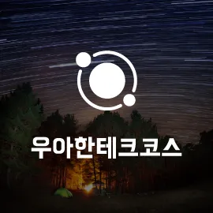
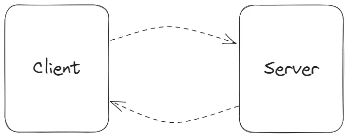
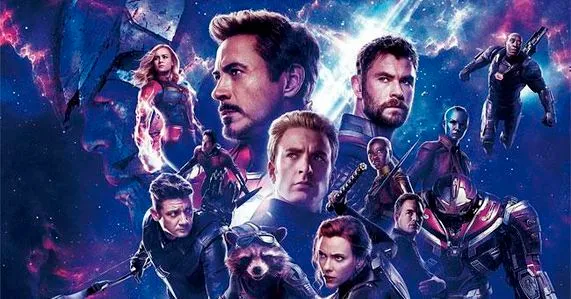
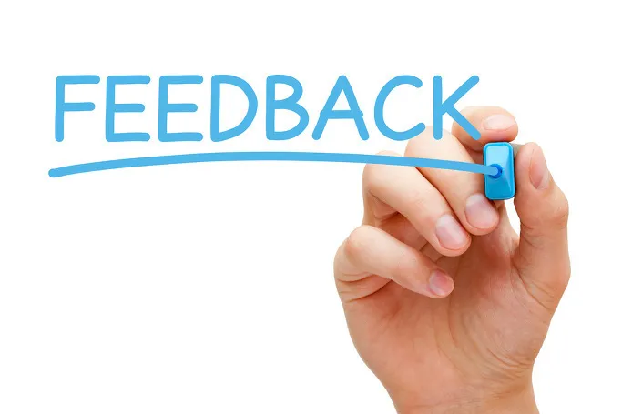
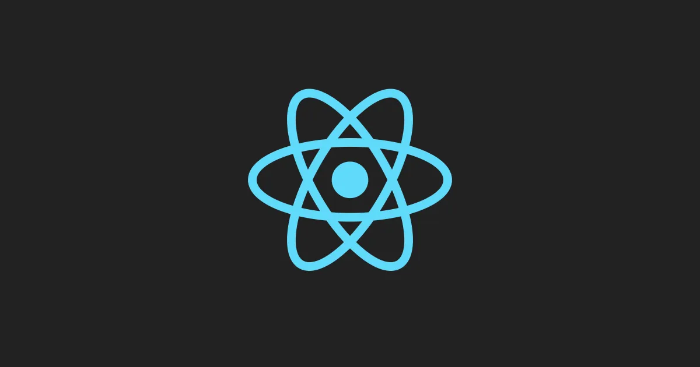
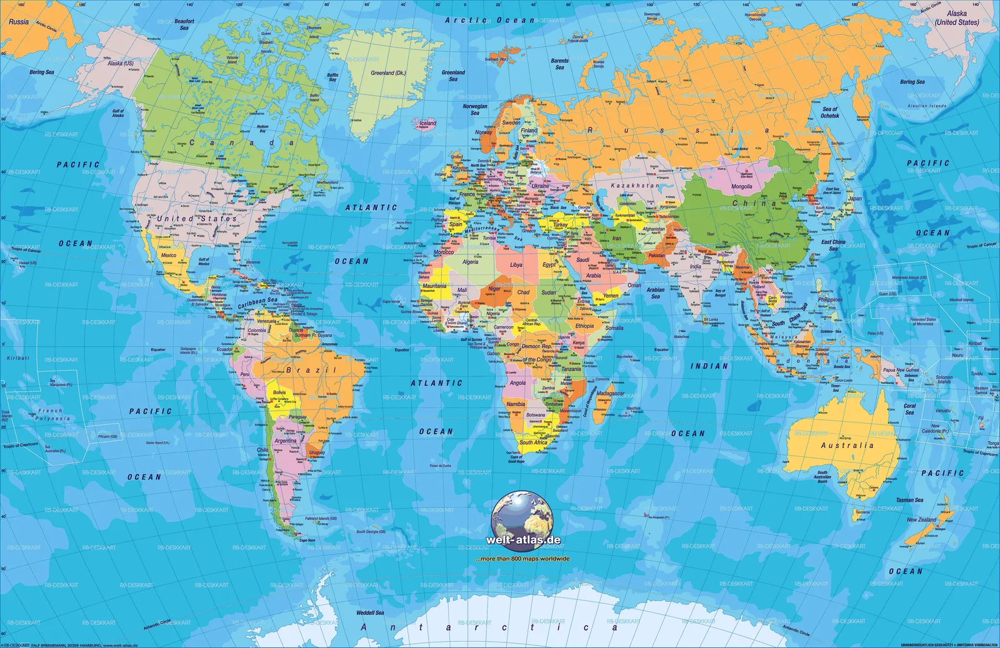
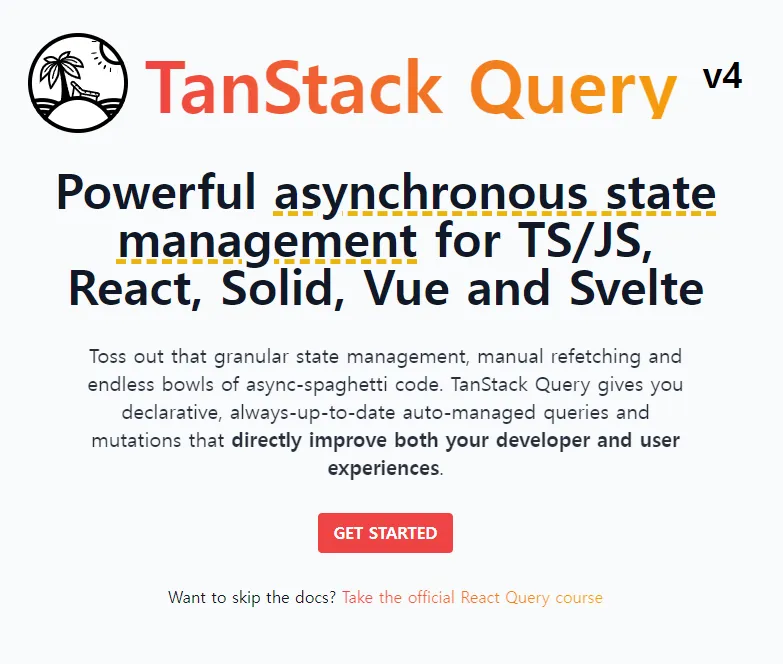

> 이 글은 2023-09-04에 티스토리 블로그(leirbag.tistory.com/155)에 처음 작성한 글을 옮겨온 것입니다.

우아한테크코스의 레벨 3은 팀 프로젝트 기간입니다.

대학교에서 경험했던 캡스톤 수업과 굉장히 유사한 방향으로 진행되지만, 디테일한 측면에서 굉장히 달랐습니다.

프론트엔드와 백엔드 크루들이 한 팀을 이뤄서 프로젝트를 진행하며, 우테코가 끝날 때 까지 진행됩니다.

## 팀 프로젝트는 캡스톤 수업과 어떤 점이 달랐나?

프로젝트에 진입하기 앞서 주제 선정이 굉장히 치열했으며, 선정 이후에도 기획 단계에서도 날카로운~~매운~~ 피드백이 오갔습니다.

우테코에서는 프로그래밍 뿐만 아니라 소프트스킬 습득에도 굉장한 노력을 기울입니다. 어쩌면 팀 프로젝트에서 사용할 소프트스킬을 위해 그동안 이런 노력을 기울인게 아닌가 싶을 정도로 많은 대화가 오가야 했습니다.

팀 프로젝트 주제는 *단순히 프로젝트를 했다!* 가 아닌, 실제 사용자를 고려했어야 했습니다.

프로젝트를 시연하는 것은 기본이고 ***배포와 리팩터링까지 고려***되었으며 이를 통해 ***실사용자와 피드백***을 좀 더 현실성 있게 모으도록 유도합니다.

마지막으로 사용자를 모집하는 과정까지 경험해야 하므로 학교에서 진행하는 캡스톤과는 방향이 다릅니다.

제가 학교에서 경험했던 캡스톤은 마치 신생 스타트업 기업을 만드는 것 처럼 수익 실현 가능성(혹은 투자 유치 가능성)에 대해 좀 더 집중하는 모습이었습니다. 또, 새로운 아이디어와 새로운 기술에만 좋은 평가를 주려는 모습이 보였던 것 같습니다.

하지만 우테코에서는 ***사용자 중심의 프로젝트***를 지향하였으며 이를 통해 어떤 개발이 사용자에게 더 좋을지를 고민하게 되었습니다. 사용자의 관점에서 필요한 것이 무엇일지? 사용자가 진정으로 이 기능이 필요한지? 사용자가 불편함을 느끼지 않는지 등등 여러 측면에서 고민하게 되었고 프로그램이 어떻게 사용자에게 다가갈 수 있는지를 알게 되었습니다. 이 과정에서 필요한 기술은 무엇인지를 알게 되는 시간이기도 했습니다.

프로젝트에서 사용할 수 있는 라이브러리들이 제한되었던 점, 기술적으로 반드시 달성해야 하는 목표가 있었던 점 등 여러 기술적인 가이드라인이 촘촘하게 잡혀있어 프로젝트가 가야 할 방향과 속도가 어느정도 잡혀있기도 했습니다.

다만 학교의 캡스톤 수업은 학교마다 학과마다 환경이 다르므로 이를 비교하는 것이 옳은지 잘 모르겠습니다. 제가 겪었던 캡스톤 과목에서는 산학협력 관련 교수님들께서 지도·평가를 해주셨기에 기술적인 부분의 피드백을 받지 못하였다는 점도 이런 생각을 하게 된 계기일 수 있습니다.

## 실시간 전기자동차 충전소 지도 및 사용 통계 조회 서비스

팀 주제로 굉장히 특이한 것을 잡았습니다. [지난 레벨 2 회고 글 말미](../2023-06-25-tistory-150/)에서도 언급했지만 제가 제출했던 주제가 선정되었습니다.

사실 이 주제는 개인적으로 굉장히 애착이 많이 가는 주제입니다. [공공데이터 포털](https://www.data.go.kr/)에 얼마 없는 ***그나마 쓸만한 API*** 중 하나였고, 원래는 졸업 작품인 캡스톤에서 도전하고 싶었던 주제였습니다.

대량의 데이터(1회 사이클에 약 23만 row의 데이터를 확보 가능함)와 지도를 결합하는 것은 굉장한 도전이기 때문입니다.

하지만 당시에 제가 학부연구생으로 연구실에 들어가 있었고, 해당 주제가 이미 지도 교수님과 긴밀하게 대화가 오간 상황이라 갑자기 캡스톤 수업에서 다른 교수님의 지도를 받기 어색한 상황이 되었습니다. 따라서 주제를 연구실에서만 진행하기로 하였습니다.

연구실에서는 저 말고도 다른 학부 연구생들이 각자의 주제를 가지고 개발을 하는 상황이었기에 사실상 개인 프로젝트로 변해버렸고, 혼자서 클라이언트, 서버, 데이터 수집기를 개발하는데 시간이 매우 부족하여 핵심 기능들을 위주로 구현하느라 ***완성도가 부족***하여 미련이 남게 되었습니다.

그 때의 미련이 남아 우테코의 팀 프로젝트 주제로 다시 제출하였고, 선정되어 이 프로젝트를 진행하게 됐습니다. 주제를 제출하고 발표했을 당시의 저는 "우테코 크루들과 함께라면 이번엔 완성할 수 있지 않을까?" 라는 생각을 했답니다. 사실 프론트엔드 개발을 준비하던 제가 구현했을 때도 [핵심 기능들이 동작하는 것을 보았기에](https://github.com/KGU-DCS-LAB/myPlug) 구현 가능성을 알고 있었던 점도 있습니다. 이러한 이유로 굉장히 독특하고 무거운 주제로 프로젝트를 시작하게 되었던 것 같습니다. 다만 과거에 구현한 코드는 ~~부끄러운탓에~~ 일절 참고하지 않았으며 ***두 번째 도전***인 만큼 A to Z 새로운 기술들과 방식으로 무장하여 처음부터 밑바닥 개발을 하였습니다.

개발 과정에서 여러 어려움이 있었는데, 그 문제는 실제 서비스에도 많은 지장을 주었습니다.

일단 서버의 사양이 그다지 좋지 않았습니다. 아마 대부분의 주제에서는 좋은 사양이나 대용량의 메모리가 당장 필요하지 않았을 것입니다. 사용자가 늘면 그때 늘려도 되었습니다. 이러한 이유로 초기에 저사양의 컴퓨팅 파워가 제공됐을 것으로 생각합니다.

하지만 데이터를 주기적으로 수집하고 누적하고 통계를 제공하는 기능을 구현하는 것이 차별점으로 작용하는 팀 주제에서 이를 포기하기란 쉽지 않았습니다. 전국의 데이터를 보여주려는 팀원들과, (저사양인 만큼) 일단 지역 단위로 서비스를 도전해보라는 코치님들 사이에서는 수 많은 공개 슬랙 메시지들이 오갔지만 상황이 쉽게 해결되지 않았습니다.

원하는 만큼 데이터를 수집하지 못해서 결국 간신히 돌아가도록 구현되었습니다. 제가 프론트엔드이기에 어떤 상황인지 정확하게 알 수 없었으나, 매일 서버가 중단될 정도로 많은 연산이 들어갔다고 합니다. 데이터의 양이 많다보니 사용자가 ***2명*** 만 되어도 제대로 서비스하기 어려울 정도의 상황이었습니다.

다만 이런 제한된 사양에서도 개선에 개선을 거듭하여 속도가 날이 갈수록 개선되고 있어 팀원들도 이 과정에서 많이 고생도 하고 학습도 하지 않았을까 생각합니다.

클라이언트 개발에서도 지도 위에 많은 데이터를 보여주는 것은 굉장한 도전 중 하나였습니다. 최대한 재 렌더링이 일어나지 않도록 하여 지도가 안정적으로 구동되도록 최선을 다했습니다. 재 렌더링은 클라이언트의 무거운 엘리먼트들에 너무 많은 영향을 끼쳤습니다. 마커도 그냥 바닐라 환경에서 출력하는 것이 아닌 React를 결합하여 다루려는 시도를 하였고, 이 과정에서 TanStack Query와 useSyncExternalStore 훅이 적절하게 개입하여 바닐라JS인 Google Maps API를 마치 React 다루듯이 관리할 수 있게 되었습니다. 또, [서버의 대용량 데이터를 대응하기 위해 여러 작업들을 거쳐](../2023-08-25-tistory-154/) 클라이언트가 느려지지 않도록 최선을 다했습니다.

각각의 React 컴포넌트들이 지도와 긴밀하게 결합되어 동작하는 것을 구현한 것은 구조 설계에 있어 많은 학습이 되었고, 앞으로의 프론트엔드 개발 여정에 있어서도 많은 도움이 될 것입니다.

## 협업을 어떻게 하였나?

협업은 주로 github에 있는 주요 기능들을 활용하여 개발하였습니다. 이슈 단위로 작업하고, 브랜치는 이슈와 연계하고, PR후에만 병합이 허용되는 등 질서 있는 협업을 할 수 있었습니다. 그동안 git으로는 데이터를 백업하는데에만 활용했던 저에겐 굉장히 신선하고 효율적으로 느껴졌는데, 특히 github에 있는 숨은 기능들이 많는 것을 알게된 계기가 되었습니다.

개발하면서 버튼 한번 누를 때 일어나는 일들이 간단하지 않고 클라이언트와 서버가 긴밀하게 맞물려 돌아가는 상황이 많았습니다.

정해진 주제에서 요구하는 기능들을 재빠르게 정하고, 해당 기능을 구현하려면 어떤 작업을 해줘야 하는지 팀원들 간에 대화를 통해 수 많은 시뮬레이션을 하였습니다. 서로에게 필요한 것을 정확하게 요구하고 피드백 받으면서 작업하였으며 이 과정에서 서로에게 어떤 문제를 겪고 있는지 이해하기 쉽게 설명하기도 했습니다.

팀에서 주로 했던 토의 방식 중, 효율적이고 유효했던 방법을 소개하자면 다음과 같았습니다.

우선 모든 팀원들이 다음 발표까지 구현하고 싶은 기능들을 모집했습니다. 그리고 구현이 가능하거나 시급한 기능들을 모아 프론트엔드/백엔드 팀원들이 기능 별로 배정되었습니다.

#### 1\. 기능 구체화에 대해 논의합니다.

특정 기능 개발을 맡은 팀원들끼리 무엇을 구현하면 좋을지 흐름을 정합니다.

해당 흐름을 통해 사용자가 어떤 편의를 느끼고, 어떤 불편함이 있을 것 같은지 예상해봤습니다.

흐름은 반드시 단순하고 직관적이어야 했으며, 사용자가 많은 조작을 하거나 피로함을 느끼지 않도록 기능을 구체화 했습니다.

#### 2\. 반드시 주고 받아야 하는 데이터가 무엇인지 정합니다.

*이런건 제가 그리는 그림입니다. . . 누가 질문하길래 . . .*

제 지론이기도 하지만, 클라이언트와 서버는 서로 독립적이어야 합니다.

물론 프로그램이 서로 맞물려 돌아가야 하겠지만, 긴밀하게 동작해야하는 과정도 한번 규칙을 정해놓으면 해당 규칙만 지켜주면 되고, 그 이후에는 개발 과정에서 서로 관여하면 안된다고 생각합니다. (극단적인 예시이지만, 서버에서 어떤 데이터를 조회할 때 클라이언트의 개입이 지속적으로 필요하여 개발 과정에 지속적으로 관여해야한다면 뭔가 이상하고 불편한 상황일 것입니다.) 서로가 서로의 상황을 몰라도 개발이 가능해진다는 것이 현대에 와서 뷰 영역이 독립을 가속화했다고 생각하고 있습니다.

따라서 서로 필요한 데이터가 무엇인지를 한 발 앞서서 정확하게 정하는 것이 굉장히 중요하다고 생각합니다. 내가 이 데이터를 받을 때 어떻게 활용할 것인지 머릿 속에 그려져야 하고, 그 이유를 상대에게 쉽게 설명할 수 있어야 한다고 생각합니다. 그냥 필요하다고 말하는 것 보다는 어떤 이유로 해당 데이터가 필요하다고 의견을 주고 받다 보면 예상 외의 데이터가 필요하게 될 수도 있고, 더 많은 활용 가능성이 나타날 수 있기도 때문입니다.

서로에게 필요한 것이 무엇인지를 정확하게 의견을 주고받고 필요사항을 정확하게 요구하는 분위기여서 더욱 빠른 API 설계가 가능했다고 생각합니다.

#### 3\. 다른 팀원들에게 검증 받습니다.

1~2번 단계에서 정해진 기능의 구체적인 모습이나 흐름을 발표하여 피드백을 받았습니다.

구현에 돌입하기 전, 나머지 팀원들에게 이륙 허가를 받아야만 개발이 시작되었습니다. 몇몇의 팀원들끼리 으쌰으쌰 하고 구현을 해버리지 않고 피드백을 서로 받았습니다. 이 과정에서 개발에 대한 조언을 주고받기도 하고, 불필요한 기능을 쳐내거나 추가하는 등 기능 구체화에 힘을 보탰습니다.

### 우벤져스

팀원들은 하나같이 엄청난 퍼포먼스를 보여줬다고 생각합니다.

정말 한명한명 괴물같은 작업량과 속도를 보여 구체적인 기능들을 더 많이 그리고 세심하게 넣을 수 있었습니다.

다만 너무 강렬한 퍼포먼스를 보인 나머지.. 팀원들이 팀 프로젝트 도중에 면접에 불려가거나 심지어 취업을 하기도 해서 이 팀은 한명씩 내보내냐는 말도 들었습니다(...)

팀 프로젝트를 진행하면서 모든 팀원들이 하나같이 으쌰으쌰해서 밀어 붙였기에 여러가지 흥미로운 도전을 해볼 수 있었다고 생각하는데 앞으로도 이렇게 의욕이 넘치다 못해 납치 당하는 팀원들을 계속해서 만나고 싶다는 생각이 들었습니다.

## 레벨 3에서 얻어간 것

**도메인 지식은 굉장히 중요하다**

전기자동차는 아직도 많은 사람들에게 생소한 주제이고, 저도 잘 모릅니다(?). 전기차(BEV)는 아직 45만여대 밖에 보급되지 않아 전체 차량 시장(2500만대)에서도 극소수를 차지하고 있어 차주를 찾는 것 조차 쉽지 않았습니다. 더군다나 **전기차는 가격대가 상당하여 저희 또래의 경험자를 찾는 것이 결코 쉽지 않습니다.**

그나마 집에서 아버지가 끌고 다니시는 플러그인 하이브리드 차량(PHEV)을 통해 간접적으로 경험하는 것이 다일 뿐이었습니다.

PHEV은 BEV와 완벽하게 동일한 충전 매커니즘을 가지고 있고, 차량 내부에 순수 전기로만 달릴 수 있는 모드가 장착되어있는 경우가 대부분이라 사실상 전기차라고 볼 수 있습니다. (기존의 하이브리드 차량들은 이를 선택할 수 없거나, 대부분 저속에서만 전기 모드로 달리도록 되어있습니다. 충전할 수가 없기 때문이죠.)

하지만 PHEV는 배터리가 BEV만큼 충분하지 않아 일정 주행량이 지나면 결국 화석 연료로 달리도록 되어있어 충전에 대한 태도가 BEV 차주들과는 분명히 다릅니다. 배터리가 부족하면 기름으로 달리면 그만이니깐요. 따라서 저를 비롯한 저희 팀원들은 이를 직접 경험하지 못하고 간접 경험한 것에 의존할 수 밖에 없었습니다.

이러한 문제로 인해 직접적인 경험을 얻는 것은 굉장히 어려웠습니다.

특히 주제가 생소한 팀원들에게 이를 설명하려는 것이 쉽지 않았으며 각종 전기차 동호회나 오픈채팅을 돌면서 대화도 해보고 기사나 유튜브 자료를 여기저기서 긁어 모아 끊임 없이 공유하였습니다. 저도 잘 모르면서 말이죠.

이런 과정에서 도메인 지식이라는 것이 얼마나 중요한지, 이를 공유하고 전파하는 것도 얼마나 어려운 일인지 알게 되었습니다.

**피드백은 당사자로부터 직접 듣는 것이 낫다**

우테코 내에서 저희 팀 주제 관련하여 팀 간에 피드백을 받을 때에도 이런 점을 많이 느꼈습니다. 프로젝트 도중에 다른 팀들로부터 피드백을 주고 받는 활동이 종종 있었는데, 전기차에서 너무 당연하다고 생각되는 부분들이 도메인 지식이 없는 사람들에게는 그렇지 않은 경우가 많았습니다. 특히, 전기차주들에게 당연한 부분들이 관련 지식이 없는 사람 입장에선 공감하기 어려운 경우가 많았습니다.

급속/완속의 차이가 무엇인지, 충전단자가 무엇인지, 충전 사업자가 왜 중요한지, 얼마나 오랫동안 충전하는지, 충전기의 고장이 얼마나 자주 발생하는지는 **전기차를 운용하려면 반드시 알아야하는 상식**이지만 **전기차가 없다면 알 필요도 없고 몰라도 됩니다.** 먼 훗날 전기차를 사고 나서 경험해도 되는 일이니깐요. (사실 그 때 쯤이면 기술 발전으로 문제가 없어질 수도 있겠지만요)

이러한 이유로 피드백을 우테코 내부 크루들이 아닌 외부(현재 전기차 차주들)에서 받았어야 했다는 생각이 지속적으로 들었습니다.

좀 더 빠른 개발을 통해 사용자들에게 피드백을 주기적으로 받았어야 했는데, 서버에서 다수의 사용자를 감당하기 어렵고 클라이언트에서도 지도를 효율적으로 다루는 과정이 너무 복잡했기에 개발 지연이 계속 발생하였습니다. 프로젝트를 안정적으로 돌아가게 하는 것 자체가 너무나도 힘든 일이라 빠른 피드백을 받는 것이 어려웠습니다.

전기자동차의 저렴한 유지비로 인해 장거리의 주행을 하는 사람들이 많았고, 그에 따라 외지에서 느끼는 불편함에 초점을 맞췄기 때문에 지역을 제한한다거나 기능을 축소하는 것은 주제의 핵심 가치를 훼손하는 일이기도 했습니다.

이런 문제를 해결하기 위해 서버 증설이 반드시 필요했는데 이런 부분이 해소가 되지 않으니 ***진짜로 필요한 피드백***을 빠르게 받기 어려웠습니다. 다시 말하면 당사자가 느끼는 니즈와 문제점을 더 자주 들었어야 했다는 생각이 들었습니다.

물론 지금은 기존 기능들을 부수고 다시 만드는 과정을 거치면서 어느정도 해결이 되어가는 중입니다만, 여전히 핵심 기능들 일부를 제한 할 수 밖에 없다는 점이 너무나도 뼈아픈 문제라고 생각하고 있습니다.

**React는 생각보다 유연하다**

제가 느끼기에 React는 굉장히 경직된 라이브러리입니다. 설정해줘야 할 것이 너무 많고 복잡하고 알아야 할 것이 많습니다. 그냥 굉장히 무겁습니다. 라이브러리임에도 불구하고 거의 모든 개발을 React 위에서 하도록 강요합니다. 이런 라이브러리에 바닐라 개발을 얹는다면 어떨까요?

저희 팀에서는 React에 지도를 결합할 방법을 고민하였고, 지도를 라이브러리를 통해 React스럽게 접근하는 것을 고려하기도 하였습니다. 결국 React와 바닐라 환경인 지도가 서로 상호작용 할 수 있는 방법을 고안하였고, 이 과정에서 React가 생각보다 유연한 라이브러리라는 사실도 알게됐습니다.

**지도는 흥미롭다**

*조선시대에 태어났으면 김정호가 됐을 것 같다*

저는 이번 레벨에서 반드시 ***지도 라이브러리***를 경험하고 싶었습니다.

프론트엔드에서 난이도 있는 주제로 여러 가지가 있었겠지만, 팀에서 확보할 수 있는 대량의 데이터를 지도에 효율적으로 찍어내는 것은 흥미로운 도전거리가 될 것임이 분명했습니다.

특히 지도 라이브러리가 바닐라 환경에서 동작하므로 레벨 1에서 학습한 바닐라 환경의 개발에도 적응하여야 했습니다.

이벤트가 어떤 식으로 발동하는지, React가 아닌 지도 위에 React DOM을 어떻게 부착할 수 있는지 등 여러 가지 지도를 통해 바닐라 환경에 React를 부분적으로 얹기도 하며 개발을 할 수 있었습니다.

프로젝트 기간 내내 Google Maps API의 공식 문서를 꼼꼼하게 살펴봤으며, 효율적인 데이터 처리를 해줄 방법을 상당히 많이 고안하였고 지금도 하고 있습니다.

**서버 상태 관리 라이브러리는 반드시 필요하다**

TanStack Query를 프로젝트를 시작하면서 처음 경험하게 되었는데, 이 라이브러리의 잠재력은 대단하다고 생각합니다.

서버에 있는 데이터를 불러와서 상태로 관리하는 것에 특화되어있는데, 직접 구현하면 골치아플 것 같은 기능들이 아주 많았습니다. 그동안 사용해본 라이브러리 중 RTK나 recoil에서 지원하는 기능들은 당연히 지원되었고, 정말 ***알아서*** 해주는 것이 많았습니다.

서버에 지속적으로 데이터를 요청하면서 스스로를 최신 상태로 유지하려는 컨셉에 굉장한 감동을 받았으며, 라이브러리 내부에 있는 여러 기능들은 성공/실패에 대한 핸들링이 가능했습니다.

## 레벨 3에서 얻어가지 못한 것

**질서있고 정형화된 학습**

우테코 레벨 1, 2에서는 책이나 공식 문서에서 얻는 정답같은 정보들이 많았습니다. JS/TS와 React의 기초 원리를 학습할 일이 많았습니다. 하지만 레벨 3에서는 그런 정보보다는 인터넷에 떠도는 정보를 학습할 일이 더 많았습니다.

책을 볼 시간보다 코드를 볼 시간이 압도적으로 많았습니다. 그동안은 시간을 내서 정형화된 자료를 순서대로 찾아보는 것이 가능했지만 프로젝트 기간 동안에는 좀 더 실용적이거나 꼭 필요한 내용을 부분부분 학습할 수 밖에 없었습니다.

소위 말해 가성비 있는 학습을 하게 되어버리는 바람에 정말로 중요한 것을 놓친 것은 아닌지 불안하게 되었습니다.

**블로그 관리**

최근 블로그를 거의 관리하지 못해서 이제라도 밀린 글을 써야 할 것 같습니다. 프로젝트를 하면서 알게 된 새로운 구현법들을 기록으로 남겨야 했는데 그렇지 못했습니다.

티스토리 블로그 대신 [팀 블로그](https://car-ffeine.github.io/archive)에는 이것 저것 남겨놨는데, 거기에 있는 내용을 긁어와서 아카이빙 해야겠네요.

## 취업 준비를 해야한다니?

정신차려보니 9월이네요. 아직 이력서를 쓰고 있지 않지만 이제 슬슬 정리를 해야할 때가 온 것 같습니다.

그동안 한 것이 무엇인지를 정리를 할 때가 됐는데 막막합니다. 나를 증명하고 소개하는 일은 너무 어렵습니다.

그간 경험한 것 중 정말 중요한 것만 골라내서 나를 나타낼 수 있도록 하는 것은 정말 어렵다고 생각합니다.

최근에 토스에서도 연달아 채용을 진행했고, 데브매칭이 있기도 하지만 우테코가 끝날 때 까지 일절 지원하지 않기로 했습니다. 멘탈 관리를 위해서 우테코가 끝날 때 까지는 프로젝트에 집중하려고 합니다.

취업시장은 연애시장과 유사하다는 생각이 들곤 하는데, 짧은 시간 내에 나를 어필하고 (구직)경쟁에서 승리하기란 결코 쉬운 일이 아닌 것 같습니다.

선택 받는 개발자가 되는 것은 어떻게 하는걸까요? ???

## 레벨 4에 들어가며...

우테코 기간 내내 주변으로 부터 들었던 조언이나 갈등은 하나였습니다.

요약하면 ***개발이 인생의 전부가 아니라는 것***인데, 이미 프로그래밍에 중독되어버린 저에게 그런 말이 들릴리가 없었습니다.

애초에 관심사가 프로그래밍이 아니라면 굳이 1년이라는 긴 시간을 여기에 쏟을 이유도 없었습니다. 전공도 하지 않았을 것입니다.

이렇게 안해도 아무데나 취업할 수 있었을테니깐요.

좀 더 제대로 된 개발을 해보고 싶었고, 제대로 된 환경에서 트렌디하게 오래 일하고 싶었습니다. 불특정 다수의 진짜 사용자를 만나고 싶었고, 제가 만든 창작물을 사람들이 마구 사용해줬으면 하는 것이 처음이나 지금이나 저의 목표인 것은 변함이 없습니다.

하지만 정말로 프로그래밍이 제 인생의 전부가 될 수 있을까요?

제 주변 사람들 모두가 저를 지지하고 이해해줄 수 있는 것일까요?

제 커리어가 끝났을 때 정말로 후회가 없을까요?

개인의 꿈은 그럴 수 있을지 모르겠지만, 혼자가 아닐 때에는 많은 고민이 필요한 부분인 것 같습니다.

이러한 이야기를 회고에 꺼내는 것이 굉장히 부담스럽고 조심스럽지만... 레벨 3 기간 도중에 이러한 생각을 뒤흔드는 일이 생겨 나중에 크게 후회하게 되지는 않을지 두려움이 생기기 시작했습니다.

올해 저의 가장 큰 관심사가 우테코에서 살아남기였지만, 이제는 아닐 수 있을 것 같다는 생각이 들기도 할만한 일들이 발생하면서 허무함과 번뇌가 동시에 일어나던 시기였던 것 같습니다.

지금 이 순간이 다시 오지 않는다는 것을 알기에 어찌됐건 최선을 다할 것이고 할 수 있는 역량을 모두 보일 것이지만, 그만큼 제 주변을 돌아봐야 할 것 같다는 생각이 듭니다.

레벨3 회고 끝.
