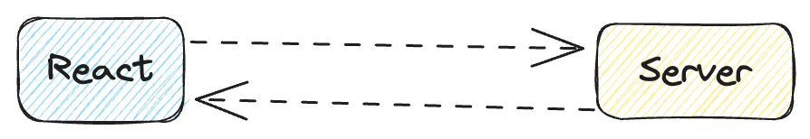
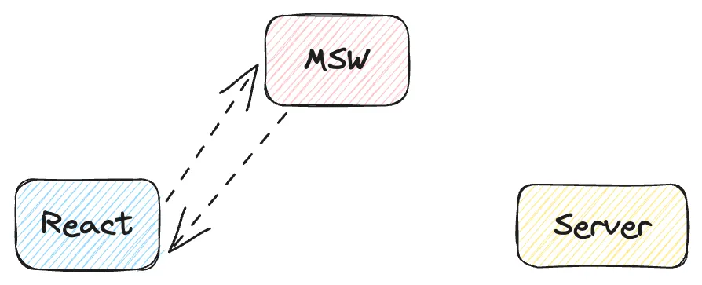
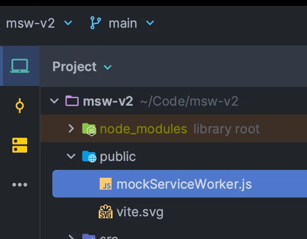
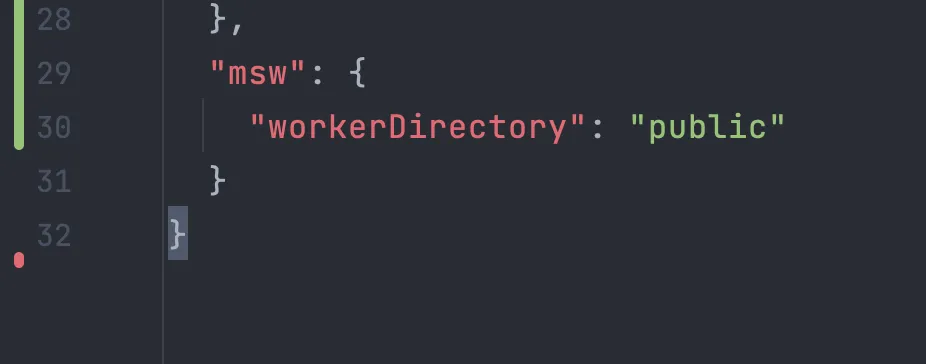

> 이 글은 2023-11-01에 티스토리 블로그(leirbag.tistory.com/167)에 처음 작성한 글을 옮겨온 것입니다.


프론트엔드 개발을 하기 위해서는 서버와의 통신이 필연적입니다,

하지만 개발을 하다보면 백엔드에서 api의 제작이 늦어질 수 있습니다.

이런 경우에는 어떻게 해야할까요? 백엔드에서 api를 다 만들어 줄 때까지 기다려야 할까요?



만약 서버가 완성이 되더라도, 실패에 대한 테스트는 어떻게 진행할 수 있을까요?

msw가 이러한 문제들을 해결해줍니다.



클라이언트 개발 환경에 포함되어있는 msw가 서버의 역할을 대신하면서 요청/응답을 mocking 하게 되며, 각종 통신 상황에 대해서 테스트를 진행합니다.

msw의 핵심 개념은 다음과 같습니다.

**1\. Intercepting requests**

클라이언트에서 발생하는 요청을 가로챕니다.

사용자가 서버로 보내려던 요청이 msw로 흘러갑니다.

**2\. mocking responses**

msw가 대신 응답합니다.

개발자가 원하는 형태의 응답을 회신할 수 있습니다. (~~답정너~~)

기존에 msw를 가지고 잘 개발해왔고, 사용법에 대한 정보가 많아 글을 따로 작성하지 않았지만

최근 msw 2.0 버전이 등장하게 되며 기존과의 사용 방법이 일부 달라졌습니다.

MSW 2.0은 중요한 업데이트로, Fetch API를 완벽하게 지원하며 여러 개선 사항과 버그 수정이 이뤄졌다고 합니다.

표준 JavaScript Fetch API를 사용하도록 변경되어 브라우저 및 Node.js에서 더 효과적인 네트워크 요청 및 응답을 제공합니다.

기존에는 응답이 제대로 동작하지 않거나, 잘못된 에러가 출력되는 등 여러 가지 문제들이 있었는데, 2.0 버전은 어떤지 좀 더 지켜봐야 할 것 같습니다.

  
**Fetch API 지원**

Fetch API를 표준으로 사용하여 네트워크 요청 및 응답을 할 수 있습니다.

이는 표준 방법으로 요청 및 응답을 처리하고 정의하는 데 도움이 됩니다.

기존에는 에러 핸들링이 불편했습니다.

  
**이전 버전과의 호환성 문제 해결**

이전 버전에서 발생한 호환성 문제와 복잡성을 제거하고 표준 Fetch API를 사용합니다.

**폴리필 사용 제거**

더 이상 다른 패키지의 폴리필에 의존하지 않으며, 플랫폼의 기능을 활용합니다. ESM과의 완벽한 호환성을 보인다고 합니다.

***참고로 node.js 18버전 이상에서만 동작합니다.***

[https://mswjs.io/blog/introducing-msw-2.0](https://mswjs.io/blog/introducing-msw-2.0)

> [**Introducing MSW 2.0**](https://mswjs.io/blog/introducing-msw-2.0/)  
> The biggest library release is finally here! Learn more about the changes, motivation behind them, and how to upgrade to the next version today.

[https://mswjs.io/docs/migrations/1.x-to-2.x](https://mswjs.io/docs/migrations/1.x-to-2.x)

> [**1.x → 2.x**](https://mswjs.io/docs/migrations/1.x-to-2.x/)  
> Migration guidelines for version 2.0.

자세한 변경 사항은 위 링크에서 참고하시면 됩니다.

달라진 설치 방법을 정리하려고 합니다.

**vite react 설치**

```bash
yarn create vite . --template react-ts
```

```bash
npm i --save-dev @types/node
```

**msw 설치**

```bash
npm install msw --save-dev
```

**mockServiceWorker.js 생성**

```bash
npx msw init ./public
```





**src/mocks/browser.ts 생성**

```typescript
// src/mocks/browser.ts
import { setupWorker } from 'msw/browser'
import { handlers } from './handlers'

export const worker = setupWorker(...handlers)
```

**src/mocks/handlers.ts 생성**

```typescript
// src/mocks/handlers.ts
import {http, HttpResponse} from 'msw'

export const handlers = [
  http.get('/hello', () => {
    console.log('msw:get :: /hello')
    return HttpResponse.json({
      data: "Captured a \"GET /hello\" request",
    })
  }),
]
```

**main.tsx (혹은 index.tsx) 변경**

```typescript
import React from 'react'
import ReactDOM from 'react-dom/client'
import App from './App.tsx'
import './index.css'

async function deferRender() {
  if (process.env.NODE_ENV !== 'development') {
    return
  }

  const { worker } = await import('./mocks/browser')

  return worker.start()
}

deferRender().then(() => {
  ReactDOM.createRoot(document.getElementById('root')!).render(
    <React.StrictMode>
      <App />
    </React.StrictMode>,
  )
})
```

**App.tsx 작성**

```typescript
import './App.css'

function App() {

  const handlePosts = async () => {
    const response = await fetch('/posts')
    const posts = await response.json()
    console.log(posts)
  }

  return (
    <>
      <button onClick={handlePosts}>Get Posts</button>
    </>
  )
}

export default App
```

api mocking에 성공하게 되면 외부 api로의 요청을 가로채서 msw가 대신 응답을 하게 됩니다.


세팅이 끝났으니 자세한 사용 방법은 아래 문서에서 확인하면 됩니다.

기존에는 rest객체와 res 함수를 사용하여 응답을 모킹할 수 있었으나, 2.0부터는 http와 HttpResponse가 이를 대신합니다.

큰 개념은 기존과 거의 유사하기 때문에 추가로 사용법에 대해서 서술하지는 않습니다.

[https://mswjs.io/docs/api/http](https://mswjs.io/docs/api/http)

> [**http**](https://mswjs.io/docs/api/http/)  
> Intercept HTTP requests.

[https://mswjs.io/docs/api/delay/](https://mswjs.io/docs/api/delay/)

> [**delay**](https://mswjs.io/docs/api/delay/)  
> Control response timing.

[https://mswjs.io/docs/api/http-response](https://mswjs.io/docs/api/http-response)

> [**HttpResponse**](https://mswjs.io/docs/api/http-response/)

기존과 동일하게 msw로 거의 모든 상황에서 모의 요청/응답을 실행해볼 수 있으며, 필요한 경우 핸들러 내부에 Storage API나 IndexedDB를 활용하여 서버의 기능을 흉내내는 것도 가능합니다.
